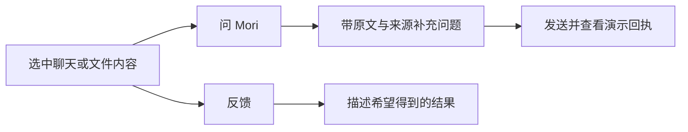
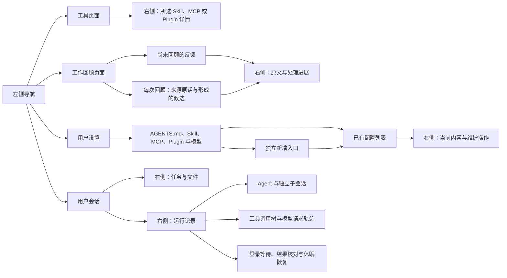

# Mori 界面 Demo

参照固定 DSH 版本的视觉风格与界面结构，使用浏览器原生模块制作会话侧栏、聊天输入和工作区。
按 proposal 演示模型池、会话引用与分屏、任务与文件，以及 Agent、工具和模型请求的运行记录。
本目录没有导入 DSH 组件；组件复用、必要修改与演示覆盖见
[界面与运行记录 Proposal](../docs/proposals/interface.md)。

## 运行

需要 Python 3。在 Mori 项目目录的 PowerShell 中运行：

```powershell
./demo/start.ps1
```

打开 <http://127.0.0.1:4173>。服务只监听本机，按 `Ctrl+C` 停止。
页面不请求外部资源，不需要安装前端依赖。

## 可以体验什么

- 拖动左侧会话栏的右边框、右侧工作区的左边框，分别调整宽度。
- 点击左上角“新项目”，填写项目名称和可选工作目录，创建后进入项目页并加入侧栏。
  新项目同步出现在工具页和新会话的项目选择中；项目配置从空白开始，共用用户级能力。
- 点击项目旁的“＋”、项目页“新建会话”或按 `Ctrl+N`，选择所属项目和会话名称后创建。
  每次创建都是独立会话，并显示在对应项目下；可连续创建、切换、改名、引用与分屏，消息和草稿互不覆盖。
- 右键会话名称，选择改名；引用仍能追溯到原会话。
- 把会话名称拖入目标输入框，带上该会话的内容和来源，再补充问题发送。
- 把会话名称拖到聊天区域的左侧或右侧，按放置提示建立左右分屏；
  两个会话保留各自草稿、引用和消息，可以分别输入与发送。
- 选中聊天或文件中的文字，可以点“问 Mori”带入输入框，也可以点“反馈”，
  只写“希望得到什么结果？”，无需选择类别或作用范围。
- 在右侧“任务与文件”中查看目标整理、执行、独立验收及各阶段的关联文件。
  点击文件直接阅读正文，正文头部标明所属阶段；完整目标、约束与监督依据可在任务详情中展开。
- 左上角模型池可查看槽位、排队、所属会话与等待原因；输入框下方可以推进任务演示。
- 打开“运行记录”，查看平级 main agent 与直属 subagent，选择 Agent 阅读独立子会话详情。
  工具调用按执行者分组并按步骤展开，可查看操作结果；模型请求轨迹保留所属会话、职责与等待原因。
  这些角色名称是示例，不是必须采用的预装 Agent 名单。
- 在运行记录中选择登录等待、结果未知或休眠恢复场景。登录等待和结果未知使编码任务进入等待，阻止直接推进验收。
  登录场景模拟完成登录后恢复；结果未知必须先核对，确认未执行后才允许重新执行。
  休眠场景展示已核对的编码任务执行记录，继续待验收；错过的独立工作回顾保留待处理，
  明确选择恢复后才生成演示维护请求，跳过保留记录；不自动补跑，也不阻塞编码任务。
- 工具与工作回顾各有独立页面：中间展示主要内容，右侧显示所选条目的详情。
  工具页按 Skill、MCP、Plugin 分类。工作回顾整合反馈、回顾记录与候选，不再保留单独的反馈记录入口。
- 工具页顶部选择 mori、资料研究或新建的项目，列表、来源、权限范围和右侧详情一起切换。
  从会话打开工具时默认使用该会话的项目，也可在所选项目直接新建会话。
  mori 提供代码检查、工作回顾和项目文件工具；资料研究提供来源核对、方案对比及只读资料工具。
  各项目分别保存启停、详情选择和 MCP 连接更新进展，用户级能力供所有项目共用。
- 工作回顾上方显示尚未回顾的本次反馈；每次回顾下直接列出使用的原话与形成的候选。
  点击候选可追溯到来源反馈，点击反馈可查看它关联的回顾和候选；本次反馈仍可返回原消息或文件选区。
- Skill 展示用途、工作流程和来源，可以演示启停。MCP 下直接列出它提供的工具，并保留连接更新演示。
  Plugin 显示包含的 Skill 和 MCP，可以直接跳转查看；停用 Plugin 会同步停用包内能力，独立 Skill 不受影响。
- 左下角“设置”集中管理用户级 AGENTS.md、Skill、MCP、Plugin 和模型配置。
  默认展示已有条目、数量、状态与来源；选中后在右侧查看当前内容，再点“编辑配置”进入维护表单。
  AGENTS.md 直接查看和编辑现有文件；其他分类通过独立的“新增”入口添加配置。
  编辑已有条目不会重复添加；支持取消编辑、按条目保留草稿、启停、移除与撤销最近一次移除。
  模型配置包含服务地址、协议、认证引用、模型 ID 与共享并发上限；模型池内可直接进入“配置模型”。
  修改共享并发上限后，模型池的运行、排队与可用容量一起更新，多个模型共用同一份容量。
- 项目工具页区分“来自用户设置”和“来自项目配置”。用户级能力跳转到设置中编辑，保存后同步名称与状态。
  用户级资料助手 Plugin 包含整理笔记 Skill 和个人资料 MCP；能力详情可跳转到所属 Plugin。
  停用 Plugin 会影响包内能力，移除会一同移除包内能力，撤销时一并恢复；项目助手 Plugin 保持原来的状态。
  Plugin 提供的 Skill 正文在详情只读，通过所属 Plugin 维护，用户自定义 Skill 可直接编辑。
- 点击“返回会话”或左侧会话名称，恢复会话布局、草稿、引用和文件阅读位置。
  独立页面的右侧详情也可以拖动边框调整宽度；窄屏先展示列表，点选后再打开详情。
  新会话显示自己的任务与文件空状态，不展示其他会话的代码修改或终端记录。

选区操作在聊天与文件中保持一致：



文件引用发送后可以点击返回原文位置。示例中，`dispatch.ts` 和 `tool-version-check.md`
在执行阶段修改，`tool-version-check.txt` 是独立验收阶段使用的验证记录。
验证记录存在不代表验收完成；准备验收时显示“待核对”，验收通过后才显示“已通过”。
任务和文件共用一个入口，不保留独立任务页签或差异视图。
任务状态、阶段进展和验收记录分别回答“能否继续”“正在处理什么”和“证据是否核对”。
“待验收”“准备独立验收”“待核对”可以同时成立；执行阶段完成后，其模型请求不会继续显示正在输出。
“重新演示”和场景切换会重建当前任务示例进度；“重置演示”或刷新会重建整个页面示例。
这些操作不代表真实终态任务自动重开；真实任务终态与恢复规则见
[Agent 角色定义与生命周期 Proposal](../docs/proposals/agent-lifecycle.md#任务状态如何转换)。



所有交互仅保存在当前页面内存中；刷新或点击“重置演示”会清空。
切换场景也会重建演示任务的起始状态，不代表重开真实的已完成或已取消任务。
新项目只记录名称和工作目录，不创建或读取真实文件夹；取消创建不添加项目。
Demo 没有连接模型或真实工作区文件，也没有创建实际定时任务。
工具页中的项目助手 Plugin、代码检查 Skill、工作回顾 Skill 和项目文件 MCP 都是示例配置。
资料研究中的研究助手 Plugin、来源核对 Skill、方案对比 Skill 和研究资料 MCP 也都是示例。
用户设置中的规则、沟通规范 Skill、资料助手 Plugin、个人资料 MCP 和模型服务也都是示例。
保存仅写入当前页面内存，不修改用户目录，不读取或保存真实密钥，不安装能力或验证接口连接。
启停不安装、加载或修改真实能力；Plugin 重新启用后保留各 Skill 之前的独立启停选择。
记录反馈后显示“已记录 · 待模型判断”，不会假装完成分类，也不会立即修改目标版本。
正式流程由模型结合选区、产物与任务上下文判断内部归因和影响范围，可涉及多类；
只澄清必要歧义。当前任务纠正即时经程序验证与版本更新生效，不等待工作回顾。
长期反馈在工作回顾集中处理，结合普通沟通和后续结果形成候选，不自动全局化。
回顾记录与其中关联的原话、候选都是预置示例；本次新增反馈不会自动并入示例回顾或候选。
文件正文、测试输出、版本与模型容量均为示例，不代表已修改项目或已通过生产验收。
此目录是界面原型，不作为另一套 Agent 运行时或 DSH 适配层。

## 覆盖范围

| 内容 | 当前 Demo | 尚未连接的实际能力 |
| --- | --- | --- |
| 项目、会话、布局与文件 | 创建、切换、分屏、引用、选区操作与示例正文 | 真实目录、持久会话、文件读取和写入 |
| Agent 与任务 | 两层关系、独立子会话详情、待验收推进及等待场景 | Agent 实例、真实上下文、权限、程序状态转换和独立验收 |
| 工具与模型 | 调用树、请求轨迹、共享容量、排队原因与核对操作 | 工具执行、模型请求、远端核对、取消与未知占用释放 |
| 休眠与维护 | 中断核对、恢复和错过维护待处理 | Host 重启恢复、真实时钟、定时任务与补跑策略 |
| 配置、反馈与回顾 | 当前页面编辑与联动，预置原话和候选追溯 | 用户配置文件、认证、安装、模型处理和资产发布 |

Demo 用于核对产品表达与交互，不构成上述实际能力的运行验收。
正式补跑次数、频率、预算及预装 Agent 定义继续保留为待确定参数。

## 检查演示逻辑

检查需要 Node.js，使用其内置测试工具，不需要安装 npm 依赖。在 Mori 项目目录运行：

```powershell
node --test demo/tests/*.test.mjs
```

检查共享模型容量、任务推进和恢复场景的交互约束，不调用真实模型或工具。
启动与浏览 Demo 仍只需要 Python 3。

## 界面依据

- 产品行为：[Mori proposal](../docs/proposal.md)。
- 组件对应与改动范围：[界面与运行记录 Proposal](../docs/proposals/interface.md)。
- [DSH 官方界面演示](https://deepseek.com/harness/)。
- DSH `0.2.1-alpha.2`，提交 `d743267388641bc76f17c45ce8b4c231aed1d32c`。
  查阅 `ui-layout`、`ui-sidebar`、`ui-conversation`、`ui-sidebar-right` 与 `ui-theme` 的源码。
- 沿用白色主画布、浅灰侧栏、蓝色强调、系统正文字体和 Montserrat 品牌字体。
  字体许可证保存在 `assets/Montserrat-OFL.txt`。
- 分屏与拖放参照 [VS Code 工作区布局](https://code.visualstudio.com/docs/editing/getting-started/userinterface)，
  选区引用参照 [VS Code 聊天上下文](https://code.visualstudio.com/docs/chat/copilot-chat-context)。
- 按任务组织关联文件参照 [IntelliJ 更改列表](https://www.jetbrains.com/help/idea/managing-changelists.html)。
  这些是布局、上下文和文件组织的交互参考；会话拖入输入框或聊天区域是 Mori 的产品行为。
- 独立功能的主页面与所选详情参照
  [VS Code 扩展管理](https://code.visualstudio.com/docs/configure/extensions/extension-marketplace)
  和 [GitLab 页面布局](https://design.gitlab.com/product-foundations/layout/)。
- Skill、MCP、Plugin 的分类与来源关系参考
  [VS Code 自定义能力管理](https://code.visualstudio.com/docs/agent-customization/overview)
  和 [Agent Plugin](https://code.visualstudio.com/docs/agent-customization/agent-plugins)。
- 用户级与项目级的配置范围参考
  [VS Code 用户与工作区设置](https://code.visualstudio.com/docs/configure/settings)。
- 按项目新建会话的入口参考
  [VS Code Agents 窗口](https://code.visualstudio.com/docs/agents/run/agents-window)。
- 反馈与结果的来源关联参考
  [Productboard 的反馈依据](https://support.productboard.com/hc/en-us/articles/10071375851155-Support-your-feature-ideas-with-customer-insights)。

浏览器原生模块足以支持本次演示，因此没有新增前端框架、构建工具或第三方包。
