# Mori 产品与技术 Proposal

状态：方案草案。产品名称、个人机器部署范围和 DSH 基座选型已确定；本文中的实现方案用于评审。

更新日期：2026-10-13。

本文保留产品目标、用户流程和跨模块关系。各项能力使用独立 Proposal，分别评审、实施和验收；具体机制只在所属文档维护。

## 要解决的问题

Mori（莫里）是运行在个人机器上的桌面 Agent harness，通过 MCP 和 CLI 使用公司内网资源，
主要帮助用户完成编码、资料研究、系统操作和网页操作。

现有模型的速度、工具调用能力、长期注意力和指令遵从能力不一致。
长会话中的目标、约束和经验容易失效；依靠 AGENTS.md 和每日总结，不能保证执行时真正使用这些信息。
现有会话又不能让不同模型同时配合，工具配置改变后还需要重启会话。

Mori 保留一个稳定的对话入口，让不同模型分别处理范围明确的任务。
程序负责保存目标、准备每次调用的材料、检查执行条件和推进任务。
模型负责理解、提出方案、执行和判断语义质量，不能自行跳过程序要求的步骤。

## 产品范围与术语

| 名称 | 含义 |
| --- | --- |
| 用户会话 | 用户在侧栏中打开的一段对话；可以关联多个任务和多个角色会话 |
| Agent 定义 | 用户通过 `agent.md` 定义的职责、指令与能力要求，并指定其启动方式 |
| main agent | 随用户会话默认并行启动的 Agent 实例；可以决定启动 subagent |
| 默认 agent | 用户会话中承担用户对话入口的 main agent，与其他 main agent 平级 |
| subagent | 由 main agent 按需决定启动的 Agent 实例；不能再启动 subagent |
| 同族 | 同一个 main agent 及其直接启动的 subagent；不同 main agent 分属不同族 |
| 任务 | 程序维护的工作记录，包含目标、约束、当前进度、证据、产物和验收结果 |
| 角色会话 | 某个 Agent 实例使用的独立模型上下文，可选择不同模型；通常只覆盖一个任务片段 |
| 共享区 | 按权限提供的共享记录视图，供 Agent 追加简短结果、来源和关联原记录的更正 |
| 模型池 | 多个会话和后台任务共享的模型请求队列与并发槽位 |
| 工具版本 | 模型请求实际看到的工具名称、描述、参数定义及执行连接的版本记录 |
| 反馈 | 用户针对消息片段、图形、产物或任务步骤给出的纠正和期望 |
| 记忆资产 | 有来源、适用范围和版本的经验、词表、表达偏好及可优化的提示词 |

部署范围是个人机器。首要目标环境为 Windows，通过 OpenAI 兼容接口调用内网模型。
用户会话可以同时运行；关闭或切换一个界面标签，不应停止其后台任务。
本地服务退出、机器关机或休眠时，定时任务无法继续执行；恢复行为必须在界面中可见。

本期使用 DSH 原生模型和子会话路径，不接入另一套外部 Agent 运行时。
公司共享服务、多租户管理和云端执行不在当前范围。

## 基座选择

选择 DSH 官方桌面工程作为长期 fork，保留桌面壳、聊天、文件、终端、会话存储、
Agent loop、子会话、工具注册、MCP 和定时任务。新增业务以 DSH 插件和已有界面扩展点实现。

| 候选 | 可复用的基础 | 与本需求有关的改造成本 | 决策 |
| --- | --- | --- | --- |
| DSH 官方桌面工程 | 完整桌面界面、独立子会话、程序检查入口、工具动态注册、配置热重载、持久定时任务 | 增加职责编排和模型池；补工具版本及连接交接；扩展反馈和维护业务 | 采用 |
| Pi 社区桌面版 | 桌面编码界面、选区引用、多模型子会话、目标循环、定时任务 | 调整现成审查策略；替换自写 MCP 协议部分；统一动态工具检查；降低服务层与私有 SDK 字段耦合 | 保留比较结论，不引入运行时 |
| OpenHands | 完整编码界面、多模型工作流、工具检查、自动化 | 活会话 MCP 配置传播，以及 Canvas、AgentServer、automation 的离线和 Windows 执行衔接 | 保留比较结论，不引入运行时 |

源码基线如下。它们是能力判断的依据，不等同于已通过 Mori 的实际运行验收。

| 项目 | 固定版本与提交 | 重要边界 |
| --- | --- | --- |
| DSH | `0.2.1-alpha.2`，`d743267388641bc76f17c45ce8b4c231aed1d32c` | 预览版本；官网安装包与此提交的对应关系未确认，Mori 应自行构建固定源码 |
| Pi 社区桌面版 | `0.104.4`，`08c9a52b6e5dd3d0bb5c3d4cac2d5fb8301722d0` | 锁文件使用 Pi SDK 1.1.0；原 App 还允许运行时选择全局 SDK |
| OpenHands | Canvas 1.27.1、SDK 1.54.0、automation 1.19.3 | SDK 的工具动态更新不等同于设置页更新已传播至活会话 |

DSH 已使用 Pi 的模型连接器。Mori 不再叠加 LangGraph 或 Pi Agent 运行时，
也不重新开发 MCP 协议、聊天存储或通用工作流引擎。

## 用户看到的工作方式

用户创建 Agent，编写 `agent.md` 描述其职责、指令与能力要求，并选择启动方式。
选择随用户会话启动的 Agent 成为 main agent；选择按需启动的 Agent，只有 main agent 决定使用时才创建 subagent。
职责与启动方式分开：承担执行、监督或验收等职责，不会自动改变 Agent 的启动方式。
具体定义格式与配置入口由生命周期 Proposal 维护，下面的名称只说明关系，不确定预装 Agent 名单。

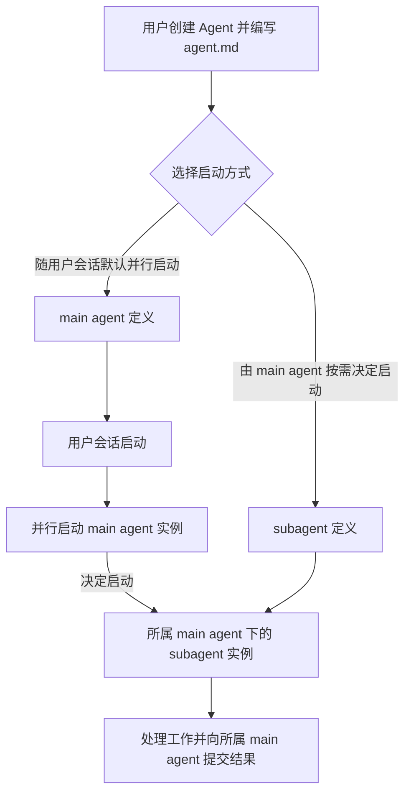

用户始终面对默认 agent。它按照用户的表达习惯解释进展、澄清目标、转述结果，
与其他 main agent 协作，也可以启动自己的 subagent。默认 agent 是平级成员中的用户入口，
不是其他 main agent 的父节点。所有 main agent 都可以启动 subagent，subagent 不能继续委派出下一层实例。

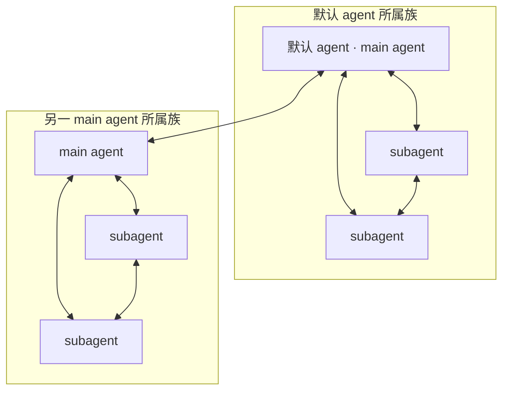

main agent 之间可以直接通信；subagent 只能与自己的 main agent 和同族 subagent 通信。
跨族协作由双方 main agent 交流所需证据，不能给 subagent 开放另一族的直接会话或上下文访问。
向程序提交任务结果属于程序接口调用，不构成与另一族 Agent 的直接通信。

用户可以在执行中插话。纠正一旦影响目标、约束或结果位置，程序更新任务版本；
尚未执行的旧计划和旧审查结果失效。正在执行的外部操作先记录真实结果，再决定下一步。
已经发生的文件写入或远端操作不能因为界面显示“已取消”就被视为撤销。

长任务持续存在的是任务记录，不是某个无限增长的执行者上下文。
执行者完成一个片段后，程序保存证据和交接信息；下一片段可以使用新的角色会话。
需要创建新的 subagent 实例时，仍由所属 main agent 决定启动。
切换模型不依赖用户手工切换整个用户会话。

## 独立功能 Proposal

| Proposal | 要回答的问题 | 独立范围 |
| --- | --- | --- |
| [Agent 通信与上下文共享 Proposal](proposals/agent-communication.md) | 共享记录如何保存和读取，Agent 如何提问并核对原始依据？ | 共享区追加与更正、定向消息、等待、权限、原始记录与请求材料 |
| [Agent 协作引导与上下文准备 Proposal](proposals/agent-collaboration.md) | Agent 何时发布结果、读取原文、追问或更正？ | 共同提示词、共享摘要进入后续请求、按需取证、必要任务依赖和行为评估 |
| [Agent 角色定义与生命周期 Proposal](proposals/agent-lifecycle.md) | 用户如何定义 Agent，哪些随会话启动，哪些由 main agent 按需启动？ | `agent.md`、启动方式、平级 main agent、单层 subagent、职责检查、任务推进与恢复 |
| [Chrome DevTools 内嵌工具 Proposal](proposals/chrome-devtools.md) | 每个 Agent 如何在内网搜索和操作网站？ | 内嵌工具、独立浏览器状态、登录、容量、网页操作、下载与离线分发 |
| [内网模型资源可靠性 Proposal](proposals/model-reliability.md) | 慢、不稳定、低并发的模型资源如何支持多个任务？ | 共享限额、排队、超时、单层重试、熔断、取消、未知占用与请求观测 |

每份 Proposal 分别维护已有能力、需要修改的边界、模块接口、最小闭环、完整验收和待定参数。
一个模块的评审通过不等于其他模块已获确认，也不等于已经完成实现。
反馈和工作回顾仍在本文描述产品行为，使用这些底座能力，不重复定义底层机制。

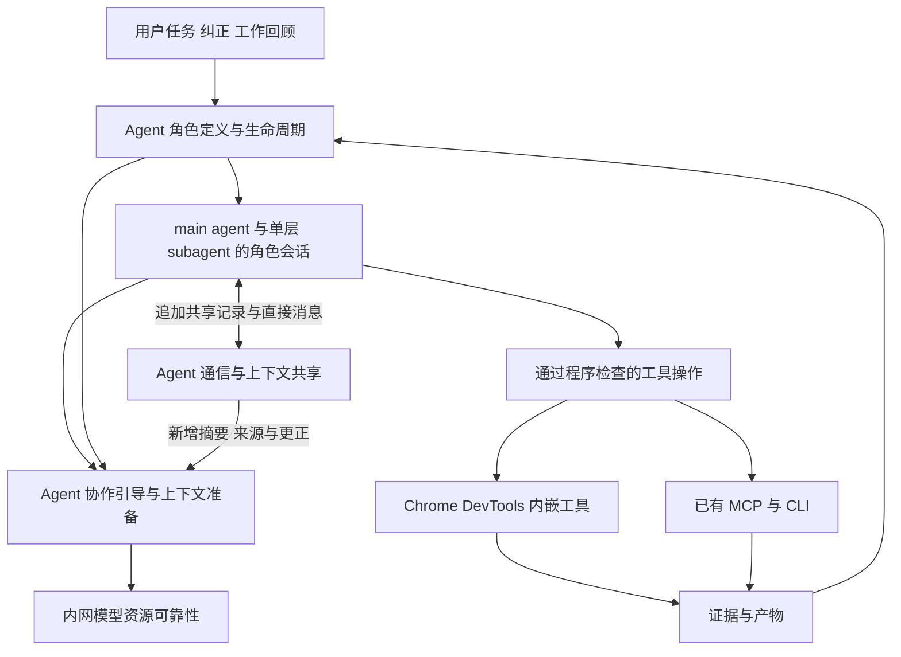

图表示模块间的工作流，不表示引入新的通用调度引擎或消息总线。
成员、任务和目标由生命周期模块管理；消息与上下文、浏览器、模型请求分别维护自己的事实，
通过稳定标识引用，不互相复制状态所有权。

Agent 在共享区追加有证据的结果、失败或明确标注的不确定信息；发现错误时追加更正并关联原记录。
后续请求提供授权范围内的新增摘要，由 system prompt 引导模型判断是否读原文、向作者追问或继续工作。
程序不把每条摘要绑定到工具操作，也不因共享区更新或更正作废执行计划；必要的任务依赖由原任务记录维护。
本方案接受信息滞后与后续修正，具体发布、读取、更正和行为验证由协作引导 Proposal 维护。

## 用户任务如何推进

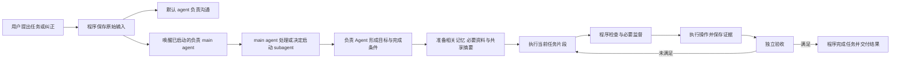

各 Agent 使用自己的 system prompt 和角色会话。目标整理、必要监督、独立验收与维护仍是必须完成的职责；
程序保存义务和状态，并按事件唤醒已随用户会话启动、负责该工作的 main agent。
如果承担职责的定义配置为 subagent，由负责的 main agent 决定是否启动；程序不能因职责必需而自行创建它。
未启动、证据缺失或结果未通过时，任务保持等待或失败，不能跳过检查继续操作或完成任务。
权限与预算检查约束每次启动和操作，不替 main agent 作出启动 subagent 的决定。

监督和验收必须由独立于被检查执行者的 Agent 实例完成。检查结果通过程序接口提交并验证；
跨族检查所需的证据由双方 main agent 传递，监督或验收职责本身不授予跨族直接上下文访问权。
具体职责、启动条件、通信范围和中断恢复见
[Agent 角色定义与生命周期 Proposal](proposals/agent-lifecycle.md)。

用户纠正即时作用于当前任务。执行者自述完成不构成完成证据；程序只有在当前目标的完成条件、
实际证据与独立验收均满足后才完成任务。结果未知的外部操作先核对，不能当作成功或自动重放。
模型负责语义判断，程序保证检查实际发生；证据缺失、结果无法解析或指定模型不可用时明确等待或失败。

## 简洁界面与反馈

保留 DSH 现有聊天、多会话、文件、终端、工具树、子会话和请求轨迹。
主界面围绕会话、任务阶段和文件正文组织信息，模型池保持紧凑，完整任务细节按需展开。
右侧工作区将任务和文件放在同一个入口中，不保留独立任务页签或差异视图。
执行和验收仍可比较代码并记录变更证据，这不要求用户查看差异界面。

### 独立功能页面

工具与工作回顾从左侧导航进入，用户设置从左下角进入，各自占据中间主区域。
工具页按 Skill、MCP、Plugin 展示。工作回顾将反馈、回顾记录和候选放在同一页，不保留独立反馈记录入口。
工具页提供明确的项目选择，列表、能力来源、操作范围和右侧详情随所选项目同步变化。
从会话进入工具页时默认选择该会话所属项目；切换项目不改变正在进行的会话。
每个项目分别保留工具启停、详情选择和连接更新进展，用户级能力按同一来源展示于各项目。
右侧随所选条目显示详情：Skill 的用途与流程、MCP 的连接与范围、Plugin 包含的能力，
以及回顾候选的来源与反证、反馈的原文与处理状态。
这些页面不占用会话的文件工作区，也不保留无关的聊天输入框。

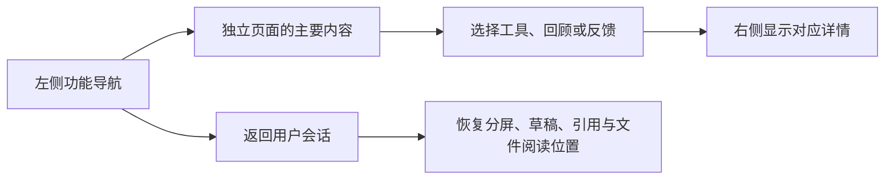

右侧详情可调整宽度并关闭，窄屏先展示主内容，选择条目后打开详情。
返回会话时保留原有分屏、各自草稿、引用和文件阅读位置。

工作回顾上方显示尚未回顾的反馈，每次回顾下面直接列出使用的反馈与沟通原话，以及形成的候选。
选择候选可以查看来源原话、范围与反证；选择反馈可以看到关联回顾及后续候选，也能返回原消息或文件。
尚未处理的反馈保留“待模型判断”，不能因为出现在这个页面就视为已经回顾、形成候选或发布长期偏好。
本次新增反馈与预置回顾示例分开，示例不能冒充真实模型处理结果。

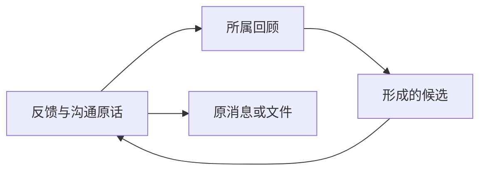

工具页始终使用 Skill、MCP、Plugin 三个名称。MCP 提供的具体工具列在其下，
Skill 和 MCP 标明独立维护或由哪个 Plugin 提供，可在能力与所属 Plugin 之间跳转。
停用 Plugin 时明确显示受影响的包内能力，独立维护的能力不受影响；
重新启用 Plugin 后仍保留包内 Skill 原有的独立启停选择。
界面 demo 的启停、连接与版本均为本页示例状态，不代表实际安装、加载或连接已经完成。

### 用户设置与配置来源

左下角“设置”集中管理用户级 AGENTS.md、Skill、MCP、Plugin 和模型配置，明确作用于所有项目。
进入分类先展示已有配置列表、数量、状态和来源，选中后在右侧查看具体内容，再通过编辑入口维护。
AGENTS.md 是现有文件的查看与编辑；其他分类将新增入口与已有列表分开。
条目有稳定身份，改名或修改配置更新原条目；启停、移除与撤销移除同步反映到项目工具页。
Plugin 详情列出其包含的能力；包内能力能返回所属 Plugin，移除 Plugin 时一并移除，撤销时一并恢复。
Plugin 提供的 Skill 正文由所属 Plugin 维护，用户自定义 Skill 可直接编辑。
项目工具页区分来自用户设置的能力和项目自身的配置；用户级能力通过来源入口回到设置编辑，
避免在用户设置和项目工具页中各维护一份。项目规则仍在项目内维护，不在这里定义新的配置加载优先级。

模型配置沿用 DSH 的模型设置，展示服务地址、协议、模型标识、认证引用和共享容量。
模型池负责展示请求、排队和运行状态，并提供“配置模型”入口；不把运行状态选择当成模型配置。
具体容量和配置生效约定以[内网模型资源可靠性 Proposal](proposals/model-reliability.md)为准。

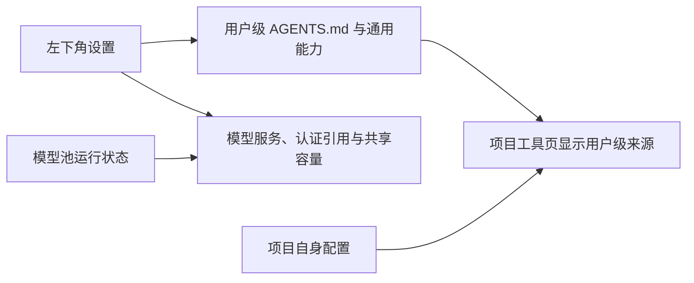

界面 demo 支持查看已有条目、逐条编辑、新增、取消编辑、启停与可撤销移除，切换分类和条目保留草稿。
保存后更新当前条目及项目工具页的名称、数量与状态，操作只保存在当前页面。
示例不读写真实用户配置，不保存真实密钥、不安装能力或调用接口；不将配置预览显示为连接验证通过。

### 会话布局与引用

左上角“新项目”提供项目创建入口，填写名称与可选工作目录后加入侧栏，并打开项目页。
新项目同步出现在工具页和新会话的项目选择中，项目配置从空白开始，仍可使用用户级能力。
项目旁的“＋”、项目页“新建会话”和快捷键均进入新建会话，明确选择所属项目和名称后创建。
工具页也可直接为所选项目新建会话。会话按项目显示，每次创建都有独立身份、消息、草稿和引用。
取消创建不产生会话；连续新建不会覆盖原有会话。新会话的任务、文件和终端不能混入其他会话的内容。
演示中项目名称和工作目录仅保存在当前页面，不创建或读取真实文件夹；取消创建不添加项目。

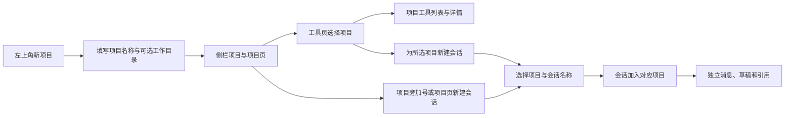

左右侧栏均可拖动边框调整宽度，让用户按当前工作分配会话、聊天和文件的阅读空间。
右键会话名称可以改名；名称变化不改变会话身份，已有引用仍能追溯到原会话。

拖动会话名称到输入框，引用该会话的内容和来源，用户补充问题后再发送。
输入框中的引用可以查看和移除，程序保留来源会话与内容依据，不只插入一个会话名称。
拖到聊天区域的左侧或右侧则建立左右分屏，放下前显示位置提示。
两个会话分别保留草稿、引用、消息和发送目标；关闭分屏不删除会话，也不停止后台任务。

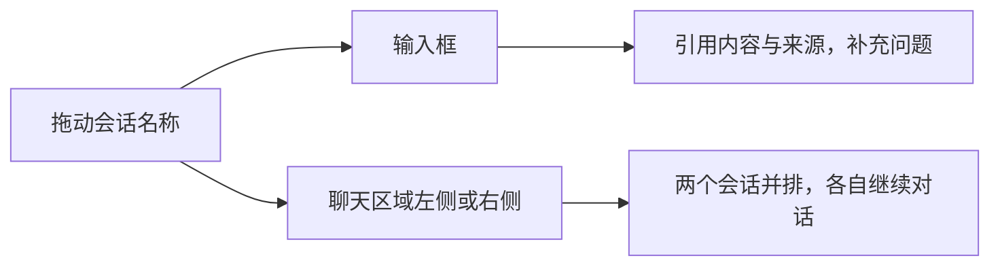

### 模型池状态

左上角按模型池显示紧凑圆点；展开后显示请求、队列、所属用户会话、角色与等待原因。
颜色必须配合文字，能追溯实际状态。颜色定义、优先级和请求指标统一维护在
[内网模型资源可靠性 Proposal](proposals/model-reliability.md)。

### 任务阶段与文件正文

右侧默认显示任务名称、阶段和各阶段关联的文件，下方直接展示选中文件的正文。
目标整理、执行和独立验收的状态始终可见，完整完成条件、约束和监督依据按需展开。
每份文件记录关联所属任务、发生改动的阶段和内容版本；正文头部再次标明阶段，
用户不必在任务页签和文件页签之间来回查找。切换聊天时不能把另一任务的文件归到当前任务。
独立验收使用的验证记录与验收状态分开显示，存在检查记录不等于已经通过独立验收。

### 聊天与文件的选区互动

聊天与文件中的文字都可以选中，并通过“问 Mori”把原文与来源带入当前输入框。
聊天选区保留来源会话、消息标识、内容版本和选区范围；文件选区保留文件路径、
所属项目、内容版本和选区范围。用户补充问题或修改要求后发送，引用随这次请求保存。
提问得到针对所选内容的解释；修改请求进入当前任务的执行与验收流程，结果回到文件正文。
文件已变化时保留原选区依据，并按当前内容核对修改位置，不能只凭旧行号写入。

### 选区反馈

聊天或文件中选中文字后，浮层同时提供“问 Mori”和“反馈”；图片、图表和其他产物在对象旁提供反馈入口。
选择反馈后保留原文或对象引用，以及“希望得到什么结果？”输入。
用户只需描述期望，不需要选择类别或作用范围。

“用词”“执行”“结果定位”“编排”用于模型内部归因，一条反馈可以涉及多项，不强行单选。
模型结合选区、产物和任务上下文判断类别及影响范围；不确定时只澄清影响后续处理的必要歧义。

| 内部归因 | 用户表达示例 | 程序需要关联的对象 |
| --- | --- | --- |
| 用词 | 这句话太绕，以后直接说结论 | 消息、文字范围、内容版本、期望表达 |
| 执行 | 这里应该先查已有实现 | 任务、片段、工具操作及对应证据 |
| 结果定位 | 文件应该放到项目文档目录 | 产物、当前路径、期望路径和任务归属 |
| 编排 | 不要让这个慢模型处理普通解释 | 角色调用、模型、排队或执行记录 |

反馈保存用户原话与来源。消息反馈保留消息标识、选区、原文和内容版本；
文件反馈保留文件路径、所属项目、内容版本与原选区；图形反馈保留对象或产物标识。
不能只保存一段脱离上下文的文本，也不能只靠字符位置定位已经被改写的消息。

反馈提交后立即显示“已记录 · 待模型判断”，不把记录成功显示成分类或任务修订已完成。
模型判断后，影响当前任务的纠正立即经程序验证与任务版本更新生效，不等待定时回顾。
长期反馈与沟通记录进入统一的工作回顾入口，可能形成的长期偏好仅作为候选资产处理。
当前任务指令不能自动扩大成全局偏好。用户可以查看实际建立的任务修订或记忆版本关联。

## 自动化维护的时序

“工作回顾”作为长期反馈、沟通整理和文件整理的统一入口，复用 DSH 的持久定时任务。
到期事件由程序恢复并唤醒用户会话中已存在、负责维护的 main agent，由它处理工作或决定启动 subagent。
程序不能在到期时绕过 main agent 创建学习、整理或反证实例。没有可恢复的负责 main agent 时明确等待或失败。
学习、文件整理和反证各自使用角色会话；学习与反证必须由不同 Agent 实例完成。
它们可以是平级 main agent，也可以是同一 main agent 决定启动的兄弟 subagent；学习 subagent 不能启动反证 subagent。
模型结果由程序接收和验证，缺少必要反证时不能发布候选。
这些调用参与模型池的全局调度，受前台任务并发和运行预算约束。
回顾频率与补跑规则仍待确定；本文定义职责与流程，不据此创建或启用定时任务。

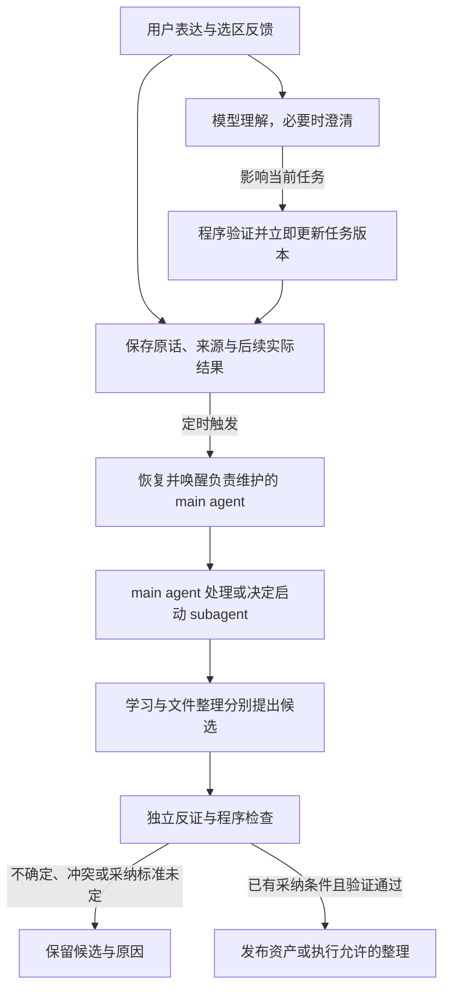

程序为每次回顾提供有来源的材料：明确纠正、普通对话中的否定与重述、撤回、未解决分歧，
以及后续实际结果、产物记录和活跃文件引用。用户原话与模型推断分开保存，
一次任务要求与稳定偏好分开判断；没有明确结论的分歧不能因后续沉默而视为已解决。
回顾提示词约束整理任务的职责，不能单靠提示词保证长期遵从。
程序必须实际准备相关材料，并在后续调用中记录采用的资产版本。

工作回顾提示词示例：

```text
回顾程序为本次任务提供的会话、反馈、产物与后续实际结果，重点整理纠正和沟通中的理解偏差。
查找明确纠正，以及普通对话中的否定、重述、撤回和未解决分歧；逐项保留原话、来源与上下文。
区分用户明确表达与模型推断、一次任务要求与稳定偏好，并核对后续实际结果是否支持当前判断。
提出有适用范围的表达偏好、执行经验候选或文件整理计划，供独立反证和程序检查。
不确定或互相冲突的结论保留为候选，说明缺失证据；不从沉默推断认可，不扩大用户指令的范围。
采纳标准未确定或检查未通过时不发布，不修改程序硬约束，不删除会话证据和反馈。
当前任务纠正由即时流程处理；本次回顾不得延迟、覆盖或撤销已经生效的任务修订。
```

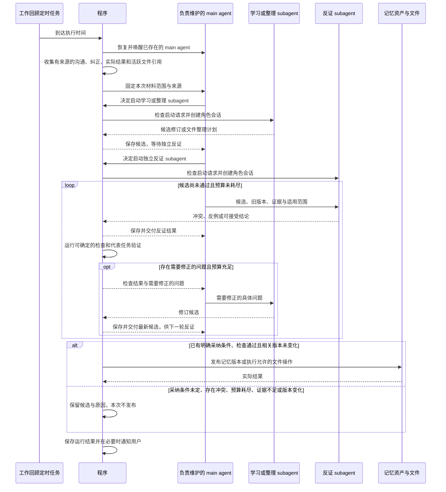

图中使用同一 main agent 下的兄弟 subagent 展示一种配置，学习和整理是不同任务，使用各自角色会话。
反证使用不同实例的独立上下文；它的启动决定来自 main agent。必要实例未启动或结果未返回时保持等待或失败。
采用平级 main agent 承担这些职责时，程序只唤醒已存在实例，main agent 之间按通信规则交换证据。
只有存在需要修正的问题时才进入下一轮，不在已通过后继续无意义调用。

| 维护任务 | 材料 | 发布条件 |
| --- | --- | --- |
| 学习 | 本次回顾范围内的会话、明确纠正、否定与重述、撤回、未解决分歧和后续实际结果 | 有可追溯证据，区分原话与推断、一次任务与稳定偏好，适用范围明确 |
| 词表与表达偏好 | 用户明确措辞、反复纠正、已采纳表达与后续沟通结果 | 区分场景，保留原词与期望用法，不从沉默推断偏好 |
| 记忆反证 | 既有资产、新证据、使用中的失败与反例 | 冲突被处理，过时条目停止参与检索，历史修订仍可追溯 |
| 提示词优化 | 已知失败案例、纠正记录、候选修改 | 代表任务验证通过；不能修改程序权限、硬约束或用户明确指令 |
| 文件整理 | 产物记录、目录规则、活跃引用 | 操作范围确定、文件不被活跃任务使用、冲突检查通过 |

纠正次数只是学习证据之一，还要记录涉及多少任务、什么场景和实际结果，
避免把高频使用场景误判成更差的行为。模型自评、复制的外部内容和用户明确反馈分开保存。

发布后的记忆、词表、表达偏好和提示词，在已有用户会话的下一次相关调用准备时生效，
每次调用记录实际采用的资产版本。已发出的请求保留原材料快照；
直接影响当前执行的用户纠正仍即时按任务版本更新，不能等待工作回顾才生效。
不确定、互相冲突或自动发布标准未确定时只保留候选，不允许模型自行决定采纳标准。
首个端到端验收使用明确固定的样本和采纳条件，不将测试条件扩大为全部资产的默认发布政策。

会话证据、反馈和记忆资产不是普通临时文件，清理任务不能自行删除。
默认只自动处理明确登记的临时文件和规则明确的文件位置；未知来源文件只形成建议。
资产更新保留修订历史用于追溯，不保留旧接口或旧代码的兼容层。

定时任务定义和运行结果持久化。同一任务不能因前次超时但仍在执行而再次启动。
机器恢复后的补跑次数、执行频率、时间和预算列为待确定参数；无论采用什么参数，
程序都要区分未开始、实际运行中、已停止和结果未知。

## 模块落点与桌面分发

模块按责任划分，角色不逐个拆成插件。各份功能 Proposal 扩展同一个 DSH 运行时，
不新增独立模型网关、第二套存储系统或预备更换基座的适配层。

| 模块 | 拟落点 | 详细设计 |
| --- | --- | --- |
| 通信与上下文 | 原 Team 日志上的共享区追加与读取、inbox、会话查询和请求记录 | [Agent 通信与上下文共享 Proposal](proposals/agent-communication.md) |
| 协作引导与上下文准备 | 原 Team 提示词、工具说明、共享摘要的动态上下文与任务记录 | [Agent 协作引导与上下文准备 Proposal](proposals/agent-collaboration.md) |
| 职责与任务编排 | 现有 agent-team、subagents、schedule 与 Mori 业务插件 | [Agent 角色定义与生命周期 Proposal](proposals/agent-lifecycle.md) |
| 工具版本与派发检查 | 现有 tools、agent-loop 与 mcp-client | [Agent 角色定义与生命周期 Proposal](proposals/agent-lifecycle.md) |
| 浏览器 | 现有 browser-use-runtime 与 Chrome DevTools MCP provider | [Chrome DevTools 内嵌工具 Proposal](proposals/chrome-devtools.md) |
| 模型池 | Host 级插件与现有模型 dispatch 的必要改动 | [内网模型资源可靠性 Proposal](proposals/model-reliability.md) |
| 记忆维护 | Mori 业务插件，复用 storageDomain 和 schedule | 本文的工作回顾、反证与资产发布流程 |
| 反馈与界面 | 现有 message-feedback 及 UI 扩展点 | 本文的文件正文、选区互动和反馈流程 |

Mori 实施时直接基于固定 DSH 提交建立 fork，保留上游目录和历史；不把整仓复制到 vendor 再外包应用。
本目录当前保存设计与界面 Demo，尚未导入 DSH 运行时代码或建立远端仓库。

桌面构建预置所需 Node、插件、工具依赖和浏览器资源，运行时不依赖临时从公网安装包。
发布前检查更新、遥测、登录和工具启动的实际网络去向。DSH 欢迎页可跳过，
强制更新是可选打包配置，不要求用户使用 DeepSeek 公网账号。
内网网页搜索与操作统一使用内嵌 Chrome DevTools MCP，不注册公网 web-search。

复用已有 OpenAI 兼容连接器。纯文本模型可承担适合的职责，执行模型必须实际验证工具调用能力。
模型和工具的可用能力由配置与验证结果提供，不能猜测，也不能静默切换资源绕过失败。
实验性实现必须经过实际运行验证，不能因源码目录存在就视为可交付。

## 实施与联合验收

各功能先完成自己文档中的最小端到端闭环，再验证模块之间的完整任务。
最小闭环使用最终模块边界，保留已可运行能力，不为未完成的复杂度增加临时运行时或拆除现成路径。


| 联合场景 | 必须出现的结果 |
| --- | --- |
| 用户创建 Agent 并开始会话 | `agent.md` 定义和启动方式生效；main agent 默认并行启动，subagent 仅在 main agent 决定后创建 |
| 用户提出需要内网资料的任务 | main agent 处理或启动检索 subagent，通过 Chrome 获取证据；执行者只能在授权通信范围内读取材料，跨族证据由 main agent 传递 |
| 研究中获得有共享价值的结果 | 模型向共享区追加摘要和来源，执行者后续看到后按需读取或追问；明确任务依赖仍按原任务交付推进 |
| 共享区出现更正 | 保留原记录与更正，模型核实后修正工作；不自动重开任务、作废排队请求或逐摘要阻断工具 |
| 多个会话与后台维护同时运行 | 共享模型限额与浏览器容量生效，等待有明确原因；各调用可追到所属会话 |
| 执行者申请操作并提交成果 | 必要监督先于操作，独立验收先于任务完成；必需职责配置为 subagent 却未启动时明确等待或失败，不能绕过 main agent 自动创建 |
| subagent 请求嵌套启动或跨族会话 | 程序拒绝请求；同族通信和 main agent 之间的通信正常，职责检查不扩大上下文权限 |
| 工具或任务约束在等待期间变化 | 旧参数、旧审查和旧目标不能继续放行；重新准备后的实际材料可追溯 |
| 取消、断网或 Host 中断 | 各模块恢复自己的持久事实，任务据此推进；未知写操作不盲目重放 |
| 用户反馈后执行一次工作回顾 | 当前任务即时纠正；长期候选经独立反证和明确条件验证后发布，后续调用采用新版本 |

各项底座能力的故障边界和完整验收只在其所属 Proposal 维护。产品交付还需满足以下用户行为：

| 验收主题 | 通过条件 |
| --- | --- |
| 长任务 | 更换执行者上下文后按任务记录继续，目标和约束不依赖旧聊天中的偶然记忆 |
| 会话布局 | 左右侧栏可拖边框调宽；会话可右键改名，既有引用不因改名失去来源 |
| 会话引用与分屏 | 拖入输入框引用内容与来源；拖入聊天区域按落点左右分屏，两个会话草稿、引用和消息互不串用 |
| 任务与文件 | 阶段下直接列关联文件，正文显示改动阶段；无独立任务页签或差异视图，验证记录不冒充验收通过 |
| 独立功能页面 | 工具、工作回顾与设置在中间展示主要内容，右侧显示所选详情；返回会话恢复原布局与输入状态 |
| 用户级配置 | 左下角设置管理 AGENTS.md、Skill、MCP、Plugin 与模型，项目工具标明来源；模型池可直达模型配置 |
| 反馈与回顾 | 同一入口展示尚未回顾的反馈及各次回顾下的原话与候选，可双向追溯；未处理反馈不冒充已形成候选 |
| 聊天与文件选区 | 两处均可选中后问 Mori 或反馈，保留原文、来源、版本和选区；发送目标明确，其他反馈同样可追溯 |
| 学习与反证 | 工作回顾覆盖明确纠正、对话分歧和后续结果，区分原话与推断；不确定、冲突或未通过验证的候选不发布 |
| 记忆实际生效 | 已发布词表或偏好进入原用户会话后续相关回答，能查到实际采用版本 |
| 困难咨询 | 停滞片段与失败证据进入独立咨询，产生可验证的下一步，并由程序决定是否采用 |
| 提示词优化 | 候选经过独立反证和代表任务验证，在明确范围内发布，并进入后续调用 |
| 文件整理 | 不触碰活跃任务文件与未登记的重要资产，结果可查询 |
| 定时恢复 | 未打开会话可恢复已存在的负责 main agent，由它处理或决定启动 subagent；休眠、退出、错过触发和前次未结束的行为明确 |
| 桌面分发 | 固定版本在目标 Windows 环境离线启动，必要工具无需公网临时下载 |

测试集中在对用户有影响的边界，不为简单界面文字或可逆布局调整增加重复实现的测试。

## 待确定的产品参数

功能参数分别保留在各份 Proposal 中，包含角色模型映射、容量、超时、监督范围、协作材料预算和浏览器配置。
下列产品参数仍待确认，不能用实现默认值冒充用户决定。

| 项目 | 需要的依据 |
| --- | --- |
| 工作回顾频率与补跑规则 | 日常使用时间、资源预算和错过任务的代价 |
| 资产自动发布标准 | 已知好坏案例、明确偏好、允许自动优化的提示词范围 |
| 文件整理目录与保留规则 | 实际项目布局、临时目录、产物和重要资产清单 |

## 工程约束

采用能满足当前需求的最简单实现，复用项目已有依赖和成熟库。
不增加兼容层、migration、fallback、推测性抽象或重复配置层。
过时实现直接删除，新增能力保持模块化和关注点分离。

生产代码遵守每行不超过 120 字符、每文件不超过 2000 行、每函数不超过 50 行且不超过 5 个入参。
接口声明使用 Doxygen 风格注释；typedef struct 的成员说明语义。
注释使用中文，代码、日志和错误输出使用英文，异常分支记录错误日志。
生产代码按上述规则验收，采用模块内职责拆分处理超限文件，不引入额外运行时或适配层。

## 产品选型与界面依据

底座执行机制的固定源码依据分别保留在各份功能 Proposal 中。以下为产品选型、界面与维护依据；
升级依赖后需要重新核查，源码存在不代表 Mori 已完成运行验收。

布局与拖放参照 [VS Code 工作区布局](https://code.visualstudio.com/docs/editing/getting-started/userinterface)，
选区引用参照 [VS Code 聊天上下文](https://code.visualstudio.com/docs/chat/copilot-chat-context)，
按任务组织关联文件参照 [IntelliJ 更改列表](https://www.jetbrains.com/help/idea/managing-changelists.html)。
这些资料用于交互参考；Mori 的会话拖入输入框与拖入聊天区域行为由本文定义。

| 结论 | 固定源码 |
| --- | --- |
| 定时任务恢复未加载会话 | [schedule runtime](https://github.com/deepseek-ai/deepseek-harness/blob/d743267388641bc76f17c45ce8b4c231aed1d32c/packages/schedule/schedule/src/runtime.ts#L85-L139) |
| 现成反馈与上下文界面 | [消息反馈入口](https://github.com/deepseek-ai/deepseek-harness/blob/d743267388641bc76f17c45ce8b4c231aed1d32c/packages/client/ui-message-feedback/src/client/index.ts#L98-L120)、[上下文计量](https://github.com/deepseek-ai/deepseek-harness/blob/d743267388641bc76f17c45ce8b4c231aed1d32c/packages/client/ui-conversation/src/client/skeleton/ContextMeter.tsx#L56-L96) |
| 桌面可跳过账号欢迎页 | [skip 进入工作区](https://github.com/deepseek-ai/deepseek-harness/blob/d743267388641bc76f17c45ce8b4c231aed1d32c/apps/desktop/src/main.ts#L1149-L1179) |
| Pi 社区版已有选区交互，但 MCP 通知链不完整 | [选区引用](https://github.com/xing-shuyin/pi-web-ui/blob/08c9a52b6e5dd3d0bb5c3d4cac2d5fb8301722d0/web/src/components/SelectionQuoteButton.tsx#L21-L107)、[MCP 通知处理](https://github.com/xing-shuyin/pi-web-ui/blob/08c9a52b6e5dd3d0bb5c3d4cac2d5fb8301722d0/server/mcp-bridge.ts#L382-L399) |
| OpenHands 已有工具定义同步，但设置保存没有完整活会话传播 | [工具同步](https://github.com/OpenHands/software-agent-sdk/blob/1d471742ea7be017d013eaaa3080f5d28d5490cb/openhands-sdk/openhands/sdk/mcp/utils.py#L254)、[设置保存](https://github.com/OpenHands/software-agent-sdk/blob/1d471742ea7be017d013eaaa3080f5d28d5490cb/openhands-agent-server/openhands/agent_server/settings_router.py#L293) |
