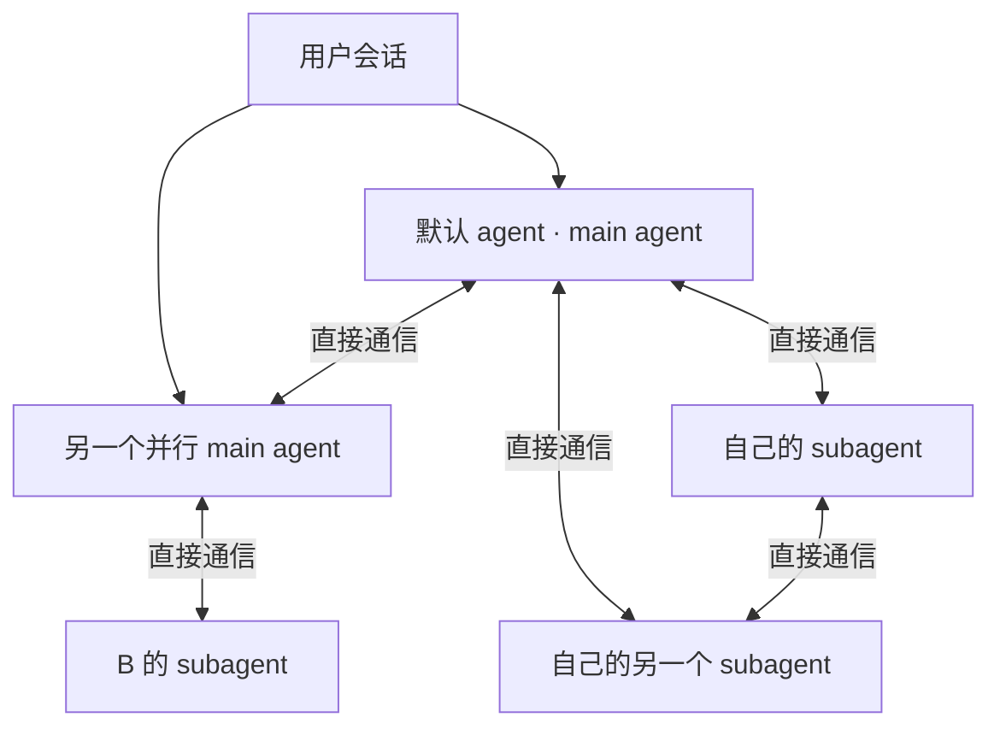
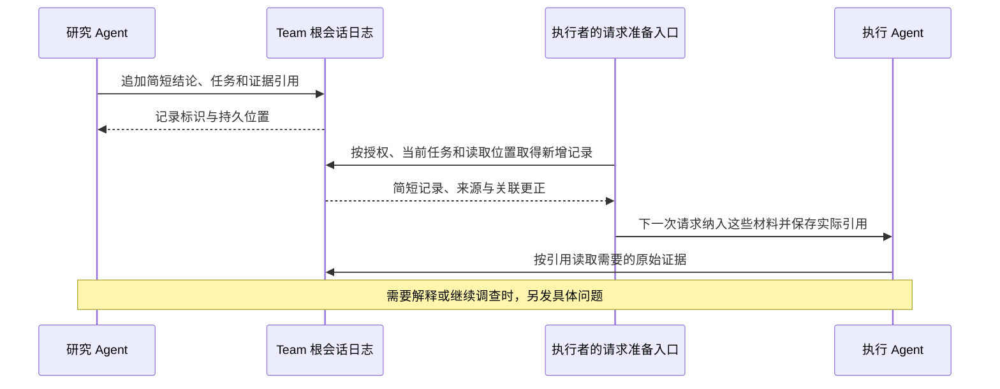
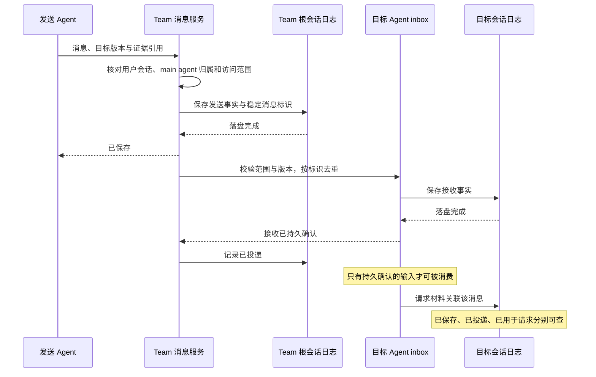
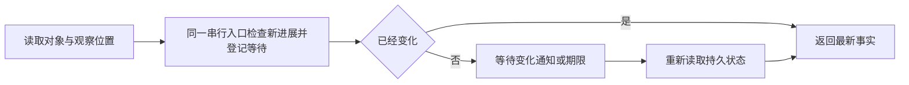

# Agent 通信与上下文共享 Proposal

状态：设计草案，供评审；尚未实施。

更新日期：2026-10-13。

本文细化 [Mori 产品与技术 Proposal](../proposal.md)，是 Agent 消息、等待和上下文共享的详细设计。
DSH 官方桌面工程是唯一运行时，固定基线为 `d743267388641bc76f17c45ce8b4c231aed1d32c`。

## 目的与范围

Agent 在共享区追加简短发现、结果和更正，其他 Agent 在下一次请求中看到授权范围内与当前任务
有关的新增记录，再按证据引用读取原文，或向作者发送具体问题。发布时不需要先指定所有接收者。
每个 Agent 仍有独立上下文；共享区提供共同的信息入口，不同步所有阅读历史，也不修改正在运行的请求。
程序记录共享内容是否保存、哪些材料实际进入请求，以及定向消息是否投递，不把这些状态当作模型已经理解。

用户创建 Agent 并编写 `agent.md`，选择随用户会话启动的 main agent，或按需启动的 subagent。
默认 agent 是用户对话入口，也属于 main agent；其他 main agent 与它平级。
每个 main agent 都可以启动 subagent，subagent 不能继续启动 subagent。
这些定义和启动规则由生命周期 Proposal 负责，本文将相同关系用于共享区、消息与上下文访问。

| 本文负责 | 归其他 Proposal 负责 |
| --- | --- |
| 共享记录追加与读取，消息身份、投递和去重 | [Agent 角色定义与生命周期 Proposal](agent-lifecycle.md)：Agent 定义、启动方式、main agent 归属与权限 |
| 等待通知、进展判断和消息恢复 | [Agent 角色定义与生命周期 Proposal](agent-lifecycle.md)：任务状态、依赖、容量与独立验收 |
| 提供共享记录、角色概况、消息关系和原始材料 | [Agent 协作引导与上下文准备 Proposal](agent-collaboration.md)：何时发布、读取或提问，每次请求的材料选择与行为评估 |
| 授权范围内的原始会话和请求上下文读取 | [内网模型资源可靠性 Proposal](model-reliability.md)：模型准入、网络尝试、取消、超时和重试 |
| 网页证据引用在 Agent 之间传递 | [Chrome DevTools 内嵌工具 Proposal](chrome-devtools.md)：浏览器隔离、搜索、操作和登录状态 |

复用 DSH Team、目标 Agent inbox、会话查询与附件存储，不新增通用消息总线、
第二套成员表、任务状态或聊天存储。通信能力本身不授予执行权限，也不负责决定任务是否完成。

## 已有能力与改造范围

| 已有能力 | 固定基线的边界 | Mori 的改动 |
| --- | --- | --- |
| `subagents.sendMessage` | 公开入口限直接父子关系，可恢复直接子会话 | 仅用于 main agent 与自己的 subagent，恢复时重新检查归属 |
| `experimental/agent-team` | 已有根会话日志和平级直投；消息成功只表示 inbox 接收 | 在根日志追加共享记录；补齐访问范围、消息持久投递和去重 |
| Agent inbox | 支持下一步骤与下一回合输入；仅拒绝当前待处理队列中的重复标识 | 增加消费前持久确认，去重覆盖消费、取消和丢弃后的消息 |
| Team 变化通知 | 等待登记之后的变化；通知本身是进程内状态 | 结合持久观察位置检查进展，避免登记等待时漏事件 |
| `experimental/tool-session-query` | 搜索、关系追踪和精确事件读取；按工作目录授权 | 按用户会话、main agent 归属和任务检查访问，读取共享记录、关联更正与实际请求材料 |
| 精确事件读取与大结果外置 | 可保留完整结果，超长内容由通用机制外置 | 复用预览和完整结果读取位置，不另造分页协议 |

Team 消息向目标 inbox 投递，向队友投递时复用 continuation 的 Host 路径并保留实际发送者，
无需把平级消息伪装为 main agent 指令。Team 根会话仅承担现有日志归属，不赋予默认 agent
访问所有 subagent 的权限。相关组件仍有实验性边界，以下能力需要按本文验收。
依据：[Team 消息语义](https://github.com/deepseek-ai/deepseek-harness/blob/d743267388641bc76f17c45ce8b4c231aed1d32c/packages/experimental/agent-team/README.md#messages-between-teammates)、
[消息执行路径](https://github.com/deepseek-ai/deepseek-harness/blob/d743267388641bc76f17c45ce8b4c231aed1d32c/packages/experimental/agent-team/src/index.ts#L223-L247)、
[现有 inbox 重复检查](https://github.com/deepseek-ai/deepseek-harness/blob/d743267388641bc76f17c45ce8b4c231aed1d32c/packages/core/agent-loop/src/inbox.ts#L218-L240)。

## 身份与访问范围

每个运行实例拥有独立角色会话；同一份 `agent.md` 可以对应不同实例，不能据此共享身份或权限。
共享记录作者和消息发送者由程序从真实调用实例取得，身份使用稳定角色会话标识，不依靠职责名称定位。
成员记录区分 main agent 与 subagent；subagent 记录唯一所属 main agent，不建立更深父链。

图中用户会话连接表示共同归属；有双向箭头的 Agent 才能直接协作。规则固定如下：

| 双方关系 | 共享记录、消息与上下文访问 |
| --- | --- |
| 同一用户会话中的两个 main agent | 允许，仍受任务与工具权限约束 |
| main agent 与自己的 subagent | 允许 |
| 同一个 main agent 下的 subagent | 允许 |
| main agent 与另一个 main agent 的 subagent | 禁止 |
| 分属不同 main agent 的 subagent | 禁止 |
| 分属不同用户会话的 Agent | 不直接通信，不通过共享目录或 Team 扩大范围 |

共享区发布与读取、消息、广播、成员发现、进展查询、等待通知、上下文搜索和附件访问遵守同一规则。
同一任务、工作目录、Agent 定义或 Team 不扩大允许范围。跨任务共享也只能发生在上述关系之内，
并满足对应任务的访问约束；不能通过配置一份额外名单开放跨族直连。
通信入口读取生命周期模块维护的成员与 main agent 归属，不维护另一份名单。

需要跨族协作时，subagent 将成果交给自己的 main agent，由 main agent 选择允许共享的成果，
向另一个 main agent 转述；对方再决定交给自己的哪个 subagent。
成果中的来源和引用保留，但转述不授予对方读取原始 subagent 会话、请求材料或附件的权限。
读取 main agent 的上下文也不能沿嵌入引用展开无权访问的 subagent 原始材料。
已经内联进 main agent 请求正文的 subagent 原始记录同样按来源检查，跨族部分标记不可见；
只有 main agent 明确选定转述的成果正文可以共享，不因复制原始记录而自动取得访问权。

共享记录和消息来源始终保留为 Agent。即使模型接口把它编码为 user 消息，也不等同于用户授权，
不能更改接收者职责、替代必需监督或放宽工具权限。
读取到的另一 Agent 的 system prompt 同样是参考材料，不会被注册成接收者自己的提示词。

## 共享区怎样追加和读取

共享区是现有 Team 根会话日志中共享记录的授权视图，不是一份由所有 Agent 反复覆盖的共同摘要。
在原 Team 写入入口增加追加共享记录的能力，原查询入口增加按任务和读取位置查询的能力。
不增加独立存储、消息总线、后台总结模型或语义订阅；发现什么值得发布、什么值得深入读取，
由 Agent 在正常工作步骤中结合自身职责判断，具体引导见 [协作引导 Proposal](agent-collaboration.md)。

| 记录内容 | 保存规则 |
| --- | --- |
| 身份与顺序 | 程序写入稳定记录标识、作者实例、所属用户会话与 main agent、记录时间和根日志位置 |
| 相关工作 | 关联原任务及其目标版本；没有业务任务的发布关联原会话，不虚构任务 |
| 简短正文 | Agent 提交结果或发现、适用条件和未确认事项；不复制完整阅读历史 |
| 证据 | 原始事件、工具结果或产物的精确引用与版本；作者标识不能代替具体证据位置 |
| 更正 | 新记录明确关联被更正的记录，保留原文；不通过覆盖旧摘要抹掉变化过程 |

共享发布没有接收者字段，也不向每个 Agent 的 inbox 复制一条消息。追加使用稳定调用标识去重，
同一发布的重试核对原记录；正文相似不代表同一发布。只有落盘后才返回成功并对读取者可见。
记录时间用于说明何时保存，日志位置确定持久追加顺序，不能据此推断外部操作的真实发生顺序。

读取先检查权限，再按当前任务及已有任务关系选择。只展示授权结果，不通过数量、通知或引用
泄露其他族的活动。更正不要求旧记录已被该读取者展示；返回更正时提供其关联与必要背景，
读取旧记录时也返回截至本次查询位置可见的关联更正，不把旧说法单独呈现为当前结论。
更正作者及正文保留来源，不自动裁定相互冲突的说法。

请求材料保存读取截止位置、实际纳入的记录标识和因预算未展示的范围。读取位置只表示查询范围，
不能代替实际纳入清单，更不表示模型已经理解。未展示内容保留查询入口，不能越过它们后宣称全部处理。
准备失败、取消或恢复时，依据持久请求记录重新准备；不能仅因曾读取或暂存过位置而遗漏未纳入的记录。
仅进入准备材料、但请求尚未发送便失败或取消的记录，不据此推进后续补读位置。
实际发送、结果未知和响应状态仍由模型模块记录，不另建每条共享记录的确认状态机。

普通共享变化在下一次请求准备时可见，不自动唤醒所有 Agent，不使已排队请求失效，也不修改已发送请求。
共享记录与更正不自动改变任务状态，不按每段摘要建立工具操作依赖或执行许可。
必要任务依赖以及实际用户目标、授权和工具变化的既有检查继续由生命周期模块执行。

## 消息如何协作

共享区用于发布可复用的发现；需要特定对象回答、解释或继续调查时，使用定向消息。
消息携带稳定消息标识、发送者、接收者、任务及其目标版本、正文、证据引用、是否需要回复和关联的原消息。
消息可以引用共享记录，不要求再复制其中的全部正文。问题和关联回复供原等待与任务记录生成协作视图；
收到回复不等于问题解决或依赖完成。原消息关联区分回复、纠正和一般引用。
消息正文的内容要求与回复处理见 [协作引导 Proposal](agent-collaboration.md)。

### 投递与确认

发送 Agent 取得“已保存”后可以继续工作，不同步等待对方回答。
不允许的接收者在保存待投递消息前被拒绝并记录错误；广播先按相同关系确定合法接收者，
不向其他成员泄露正文或投递通知。恢复和实际投递前再次校验归属、访问范围与目标状态。
“已投递”表示目标日志已保存接收事实；“已用于请求”表示指定请求材料确实包含该消息，
不表示模型已经理解、同意或完成其中工作。响应状态由模型请求记录另行说明。

同一逻辑消息的补投沿用原消息标识。去重覆盖已入队、已消费、已取消和已丢弃的完整记录，
不能只检查当前队列；取消过的消息不能在恢复时重新投递。
去重防止同一消息重复追加为新输入，正常后续请求继续携带它的历史记录不属于重复投递。

接收事实完成落盘后才能被执行循环消费，这需要修改现有 inbox 的持久准入边界。
仅在发送函数返回后追加一次 `flush` 不足以保证这一点，运行中的 Agent 可能已经读取该输入。
发送事实和接收事实分属原有根日志与目标日志，按稳定标识核对，不引入跨会话事务。

### 运行中、空闲和停止后的消息

| 接收者状态或消息条件 | 行为 |
| --- | --- |
| 正在执行 | 普通消息在后续步骤边界进入上下文，不修改已经发出的模型请求 |
| 已存在但空闲或尚未加载 | 在允许范围内持久保存，由任务编排判断是否恢复和启动回合；不能由投递函数无条件唤醒 |
| 尚未创建的 subagent | 消息不能创建实例；由 main agent 先决定是否启动，再取得接收者标识 |
| 任务已终止、成员已退役或消息目标版本过期 | 保存记录并标明未激活原因，不自动重新打开任务 |
| 消息在消费前被取消或丢弃 | 保存处置结果，恢复和重复发送不能使它再次生效 |
| 消息已经进入请求后任务取消 | 保留真实使用记录，不把已经使用过的消息改写成从未投递 |

DSH 的 `steer` 会请求唤醒，`inject` 只加入下一步骤输入而不唤醒。
Mori 必须让投递和唤醒都遵守生命周期 Proposal 的启动检查，不能直接照搬 Team 的自动 `steer` 行为。
消息不能把 subagent 提升为 main agent，也不能借恢复或唤醒替 subagent 创建下一层成员。
同一角色会话始终复用原 Agent loop，多条消息不能启动多个执行循环同时改写上下文。
依据：[原生投递与唤醒](https://github.com/deepseek-ai/deepseek-harness/blob/d743267388641bc76f17c45ce8b4c231aed1d32c/packages/core/agent-loop/src/agent.ts#L154-L172)。

用户纠正通过任务更新入口处理。影响目标或授权时先更新目标版本；即使模型请求尚未结束，
旧版本的工具操作也不能继续派发。Agent 间转述纠正不替代原始用户事件及其顺序。

## 等待如何结束

等待面向一个明确对象及观察位置，例如某条回复、某个子任务结果或任务状态的变化。
任务编排保存等待对象、原因和期限；通信模块复用 Team 变化通知提醒它重新读取持久事实。
通知只负责及时唤醒，不能作为消息已投递或任务已完成的唯一依据。
可等待的成员及返回的进展与成员发现使用相同范围，不通过全 Team 的变化通知暴露不可访问的成员或活动。
普通共享记录没有默认接收者，不因追加而唤醒全部成员，也不从 system prompt 推导后台语义监听条件。

消息到达、子任务完成、失败、取消或期限到达均能结束相应等待。
登记等待与检查观察位置必须在同一串行入口处理，避免读取之后、登记之前发生的变化被漏掉。
Host 恢复后根据保存的等待条件重新判断，不恢复旧 Promise、监听器或计时器对象。

等待本身不占模型请求槽位，也不消耗模型调用预算；有结果后实际发起模型请求才进入模型池。
消息量、等待期限和任务预算有界，超限返回明确原因，不默认触发无限自动回复。

循环等待和资源等待由同一个任务编排入口检查。除了相互等待回复，还要识别等待方占着子会话
或浏览器容量、被等待工作因而无法启动的情况。可释放时先释放；不可释放时拒绝本次启动或明确阻塞，
不无限等待永远不会空出的名额。容量与释放规则由生命周期、浏览器和模型可靠性 Proposal 定义。
现成通知只等待注册后的变化，观察位置与恢复检查属于 Mori 的补齐范围。
依据：[Team 变化等待](https://github.com/deepseek-ai/deepseek-harness/blob/d743267388641bc76f17c45ce8b4c231aed1d32c/packages/experimental/agent-team/src/activity.ts#L15-L76)。

## 如何读取对方上下文

何时查询、怎样把查询工具结果用于自己的后续请求，以及重复材料如何处理，见
[Agent 协作引导与上下文准备 Proposal](agent-collaboration.md)。本文维护读取与来源权限的真实语义。

每个 main agent 和 subagent 的运行实例使用独立上下文，初始材料按当前片段准备，
来源仍须通过上述访问检查。实例不会因为使用同一份 `agent.md` 而共享历史。
需要承接历史时显式选择片段和证据；DSH fork 只复制已结束回合的一次性前缀，
不提供持续共享，也不能代替消息投递和上下文读取。
依据：[fork 的上下文边界](https://github.com/deepseek-ai/deepseek-harness/blob/d743267388641bc76f17c45ce8b4c231aed1d32c/packages/subagent/subagent-fork-in-process/src/index.ts#L38-L79)。

| 读取内容 | 返回什么 | 用途 |
| --- | --- | --- |
| 共享记录 | 授权的简短正文、作者、任务、日志位置、精确证据与关联更正 | 发现与当前工作有关的信息，选择是否读原文或提问 |
| 角色概况 | 职责、启动方式、所属 main agent、当前片段、状态、等待原因和最近结果 | 在可访问成员中决定需要联系谁 |
| 会话记录 | 搜索相关事件，再按事件标识读取完整消息、工具调用、工具结果及证据 | 复核对方实际做过的工作 |
| 请求上下文 | 指定请求及尝试实际使用的消息、完整组装后的 system prompt、工具定义与版本、记忆版本和材料引用 | 核对对方判断时使用的输入 |

上述允许直接协作的 Agent 可以按需读取对方实际请求上下文，不能只提供摘要或让对方自行转述。
跨族 subagent 的原始会话不在此范围；来自各自 main agent 的成果转述不等于原始上下文读取。
读取未打开的会话不要求唤醒其模型。会话日志、请求材料和角色概况是不同视图，不能相互冒充。

### 固定一次请求的材料

请求上下文绑定请求标识、尝试标识、准备版本和日志截止位置。
实际材料清单保存共享记录、消息和原文的不可变引用，以及各自实际纳入形式；当时生成的提示词或压缩文本进入现有请求记录，
复用会话日志与附件存储，不再复制一套聊天历史。

准备完成的材料标为待发送。每次尝试通过最终版本检查后，发送意图绑定该尝试的材料快照。
界面区分准备材料、发送尝试及收到响应的记录，不能把排队草稿称为模型已经处理的上下文。
进程中断造成发送结果不明时保留这一状态，不凭发送意图推断模型已收到请求。

排队期间实际目标、授权、工具或提示词发生使请求失效的变化时，重新准备形成新的记录，不改写旧快照。
普通共享追加、更正与任务进度变化不触发这种失效；它们在下一次准备时纳入，网络重试沿用原冻结材料。
压缩结果保留来源；读取旧请求不能用当前摘要、当前提示词或当前工具定义冒充当时材料。
模型尝试状态和重试规则由模型可靠性 Proposal 负责，通信视图只关联并如实展示。

### 读取范围与大结果

复用已有 `session_search`、`session_event_search`、关系追踪和 `session_event_read` 路径，
在同一授权入口检查用户会话、main agent 归属与任务范围。成员名称、搜索结果、关系追踪、
精确读取和外置完整材料都执行同一范围检查；稳定会话标识或附件位置本身不是访问授权。
main agent 转述的成果正文可以由接收者使用，引用中的原始对象仍按其来源逐项检查访问范围。

超出内联预算时使用现有大结果外置机制，返回预览和完整结果读取位置；不另造分页协议，
也不把预览标成完整上下文。推理服务未返回的内部状态不属于可读取材料。
共享视图排除连接认证 headers、密钥和浏览器 Cookie；若原始材料含需遮蔽部分，明确标记不可见范围，
不能以“完整原文”名义悄悄改写。

读取只获得材料，不获得修改对方会话、接管浏览器或提高工具权限的能力。
网页内容、工具返回和其他 Agent 的记录保持来源，不能因来自内部协作而变成新的授权。
依据：[DSH 会话查询工具](https://github.com/deepseek-ai/deepseek-harness/blob/d743267388641bc76f17c45ce8b4c231aed1d32c/packages/experimental/tool-session-query/README.md#what-the-model-can-do)。

## 持久记录与故障恢复

| 事实 | 保存位置与含义 |
| --- | --- |
| 共享发布与更正 | Team 根会话日志追加作者、记录时间、稳定标识与位置、任务、简短正文、证据和更正关系 |
| 发送消息 | Team 根会话日志保存稳定标识、发送者、接收者、所属用户会话、main agent 归属、目标版本、正文及证据引用 |
| 接收与处置 | 目标会话日志保存接收、消费、取消或丢弃事实；发送端投递状态可据此核对 |
| 共享读取与请求材料 | 原请求记录保存读取位置、实际纳入记录及未展示范围；查询位置不等于理解或处理完成 |
| 请求使用消息 | 现有请求材料记录关联消息标识与实际尝试；共享记录不复制为收件消息，不把模型自述当成使用证明 |
| 等待 | 原有任务记录保存允许访问的对象、观察位置、原因和期限；变化通知不单独成为事实来源 |

`append` 后内容可能已经进入内存投影，`flush` 才是持久化边界。
关键刷新失败后，停止该根会话依赖这些记录的后续派发，直到持久化位置覆盖相关事件。
不能让下一次调度读取未落盘版本继续执行，也不能因为内存中存在接收记录就确认消息已持久投递。
复用现有单写入者和串行修改入口，不假定跨记录、跨会话事务。
依据：[会话持久化](https://github.com/deepseek-ai/deepseek-harness/blob/d743267388641bc76f17c45ce8b4c231aed1d32c/docs/subsystems/persistence.md)、
[Team 日志写入](https://github.com/deepseek-ai/deepseek-harness/blob/d743267388641bc76f17c45ce8b4c231aed1d32c/packages/experimental/agent-team/src/journal.ts#L42-L71)。

| 中断或故障 | 恢复行为 |
| --- | --- |
| 共享追加未确认或调用重试 | 按原稳定调用标识核对根日志，已持久化则返回原记录，未确认落盘不报告发布成功 |
| 共享查询后请求发送前失败或取消 | 核对持久请求材料与发送事实；仅进入未发送准备材料的记录仍可补读，不能按暂存位置跳过 |
| 共享区已有新增记录而读取者尚未创建或处于空闲 | 保留记录，合法启动或下一次请求准备时按任务查询，不因发布自行创建或唤醒成员 |
| 发送事实尚未落盘 | 不返回已保存；发送者获得失败，不能凭内存状态确认成功 |
| 已保存，目标尚未接收 | 校验原 main agent 归属、用户会话、当前任务及成员状态，仍有效时用原消息标识补投 |
| 目标已接收，发送端尚未记录已投递 | 核对目标持久记录，补齐投递状态，不重复追加输入 |
| 消息已消费、取消或丢弃后再次投递 | 返回已有事实，不把消息恢复为新输入 |
| 等待期间重启 | 先核对原归属和访问范围，再读取观察位置与当前事实；已经变化立即返回，否则按原期限重新等待 |
| subagent 的 main agent 归属缺失或不一致 | 停止投递、读取和唤醒并记录错误，不把 subagent 解释成新的 main agent |
| 目标任务终止、版本过期或成员退役 | 保留共享记录、消息和真实状态，不把旧目标下结论冒充当前结果，不恢复旧任务或唤醒退役成员 |
| 读取材料缺失或无权访问 | 返回具体缺失或拒绝结果，不用当前摘要或其他会话内容代替 |

投递允许重复尝试，接收端抑制重复受理；不宣称外部操作天然恰好执行一次。
消息已经用于请求后发生崩溃，任务可能需要再次准备模型输入；外部工具是否执行必须核对原操作事实，
不能仅凭消息去重决定重放或跳过业务操作。

## 与其他 Proposal 的接口

| 对接模块 | 本文读取 | 本文提供 |
| --- | --- | --- |
| [Agent 协作引导与上下文准备 Proposal](agent-collaboration.md) | 当前任务与材料范围、共享发布内容、消息回复要求及原消息关联 | 授权的共享新增记录与更正、角色概况、消息事实和原文；不判断模型是否理解 |
| [Agent 角色定义与生命周期 Proposal](agent-lifecycle.md) | 成员身份、main agent 归属、用户会话、任务目标版本、退役状态、启动与等待决定 | 共享发布、消息投递及处置事实和允许范围内的进展；不因摘要变化直接推进或阻塞任务 |
| [内网模型资源可靠性 Proposal](model-reliability.md) | 请求与尝试身份、发送状态、不可变材料快照和配置版本 | 实际纳入的共享记录与消息引用、读取范围及上下文查询；不自行重试或使排队请求失效 |
| [Chrome DevTools 内嵌工具 Proposal](chrome-devtools.md) | URL、快照、截图、下载产物及其访问范围 | 共享区和消息中的网页证据引用；不传递浏览器连接、页面控制权或登录凭证 |
| [Mori 产品与技术 Proposal](../proposal.md)中的反馈与记忆维护 | 已授权的会话范围、纠正来源和资产版本 | 可追溯的原始记录与请求材料；不决定长期资产是否发布 |

程序接收结果、核对证据和推进任务仍由生命周期 Proposal 定义，共享发布和普通消息不能替代验收或状态转换。
程序结果交付不能作为跨族聊天或读取原始会话的入口。独立监督与验收由已启动的 main agent 承担，
或由 main agent 决定委派给自己的 subagent；需要的结论缺失时阻塞对应操作或完成状态，
不由通信模块直接创建其他 Agent，也不借“程序消息”放宽访问范围。

## 最小端到端闭环

先使用同一个 main agent 启动的研究与执行 subagent，以摘要缺少必要细节、原文仍有待解释内容的受控场景验证通信：
研究者向共享区追加一项发现及精确证据引用，不指定执行者。执行者的下一次请求取得这条记录，
按引用读取原始工具结果，再向作者发送具体问题；摘要已足够的场景不要求读取或追问。
研究者回复并追加一条关联原记录的更正；执行者能读取更正及旧记录的关系。两个 subagent 都不能再创建成员。
另行指定一次请求读取当时的 system prompt、消息和工具材料，验证共享摘要与实际请求上下文没有混为一谈。

共享发布落盘后中断 Host，恢复后核对重复发布仍返回同一记录；在执行者请求准备失败或排队取消后恢复，
确认未纳入记录与仅进入未发送准备材料的记录仍可补读。共享区变化不重写已排队或已发送的请求。
再在定向消息发送事实落盘后、目标接收前中断；恢复后补投同一消息。确认只追加一次，
取消另一条待处理消息后再次恢复，确认它不会复活。
闭环直接使用最终 Team 日志、inbox 和会话查询路径，不引入临时消息队列。

随后加入另一个随用户会话启动的 main agent 和它的 subagent，确认两个 main agent 可以通信，
双方 subagent 不能互发消息、看到对方共享记录、发现对方成员或直接读取对方上下文；默认 agent 同样不能访问对方 subagent。
通过各自 main agent 转述一项允许共享的成果，确认正文可用，而原始会话和附件访问仍被拒绝。
重复广播、等待、冷恢复和持有已知会话标识的访问，验证这些路径执行相同边界。

## 完整验收

| 验收场景 | 必须成立 |
| --- | --- |
| 无接收者的共享发布 | 只向根日志追加一次，合法读取者下一次准备可见，不向所有 inbox 复制消息 |
| 共享记录身份与顺序 | 程序提供真实作者、稳定标识、时间和持久位置；重复调用核对原记录，未落盘不对外可见 |
| 更正与旧记录 | 更正可关联未展示的旧记录；读取旧记录返回可见的关联更正，不覆盖旧正文或自动裁定冲突 |
| 共享原文读取 | 精确引用定位原事件或产物，作者标识只用于联系；无需唤醒作者即可读取授权材料 |
| 共享读取恢复与预算 | 实际纳入清单和未展示范围可查；未发送请求中的记录与未纳入记录仍可补读，不把读取位置当成理解证明 |
| 共享变化的运行边界 | 不自动唤醒所有成员、改变任务状态或使已排队请求失效；实际目标、授权和工具变化仍走原检查 |
| main agent 之间通信 | 同一用户会话中的 main agent 可以直接收发；默认 agent 不成为其他 main agent 的父节点 |
| main agent 与自己的 subagent | 可以双向发送与读取允许材料，恢复后仍保持原归属 |
| 同族 subagent | 同一 main agent 下可直接协作，不能继续创建 subagent |
| 跨族访问拒绝 | main agent 不能访问其他 main agent 的 subagent；不同族的 subagent 不能直接通信或读取上下文 |
| 共享区、成员发现、广播与等待 | 只返回允许访问的记录、成员和进展，不通过摘要、数量或通知泄露其他族的活动 |
| 跨族成果转述 | 各自 main agent 选择共享正文，来源可追溯；原始会话、请求材料和附件权限不随引用转移 |
| main agent 请求内的原始材料 | 内联的外族 subagent 原始记录与嵌入引用都按来源检查，不可见部分明确标记 |
| 跨任务与同定义实例 | 相同任务、工作目录、Agent 定义或 Team 不扩大范围；搜索、精确读取和外置材料均遵守授权 |
| 运行中接收 | 输入只在后续步骤进入，不修改已发送请求，不生成并行执行循环 |
| 空闲、终止与退役 | 唤醒由任务编排决定；过期消息不重开任务或恢复退役成员 |
| 持久确认 | 接收记录落盘前不能被消费；刷新失败不能被内存投影掩盖 |
| 任一投递边界崩溃 | 已确认保存的消息可核对恢复，重复投递不重复追加 |
| 恢复时归属失效 | 拒绝补投、读取与唤醒，记录错误；不推断新 main agent，也不改变 subagent 启动方式 |
| 已消费、取消与丢弃去重 | 均能识别原消息；取消或丢弃后恢复不会再次生效 |
| 等待登记竞争 | 读取与登记之间发生变化不会被漏掉；重启仍依据持久事实判断 |
| 循环与资源等待 | 相互等回复和容量形成的等待均被处理；无法释放时明确阻塞 |
| 等待成本 | 等待不占模型请求槽位，不靠持续模型调用轮询；消息与期限有界 |
| 真实上下文读取 | 在允许关系内可读原始工具结果及指定尝试的完整请求材料，不只返回摘要；引用不越过来源权限 |
| 请求准备与发送 | 排队草稿、发送意图、结果未知和已收到响应分别标识 |
| 提示词、工具及压缩变化 | 旧请求仍可追溯当时材料，新版本不覆盖旧记录 |
| 大结果与不可见内容 | 预览可继续读取完整授权材料，截取或遮蔽均有说明 |
| 权限与来源 | Agent 消息和读取材料不能修改职责、接管浏览器或替代用户授权 |

验证覆盖共享追加与读取、消息及日志持久边界、活动 Agent 和冷会话、目标版本变化与恢复。
使用故障注入观察实际日志、输入追加次数和请求材料，不能只凭发布或发送成功、模型自述通过验收。

## 待确定参数

| 参数 | 确定依据 |
| --- | --- |
| 单条共享记录与每次请求的共享内容预算 | 简短结论的可读性、记录增长和模型容量；超额明确保留未展示范围与查询入口 |
| 单条消息、单任务待处理消息与总消息量上限 | 代表协作任务、存储成本和接收者上下文预算 |
| 不同等待对象的期限及超限处理 | 工作时长、交互要求和依赖失败的实际代价 |
| 请求材料的内联预算与外置结果保留范围 | 模型上下文容量、材料大小和历史复核需求 |
| 允许关系内跨任务共享的材料范围 | 在既定 main agent 与 subagent 关系内，结合任务约束、项目边界及反馈和维护用途确定 |
| 共享记录、通信证据与请求材料的保留规则 | 任务追溯要求、更正关系、活跃引用和产品资产管理规则 |

两层关系、subagent 不再创建成员以及通信范围已确定，不属于可调整的待定参数。
以上参数保留待定，不设置未经验证的生产默认值。共享记录、消息、上下文证据和请求材料属于可追溯资产，
不能由整理 Agent 当作普通临时文件删除。实施遵守总览中的工程约束，直接修改现有路径，
删除被替代机制，不增加兼容层、migration 或 fallback。
