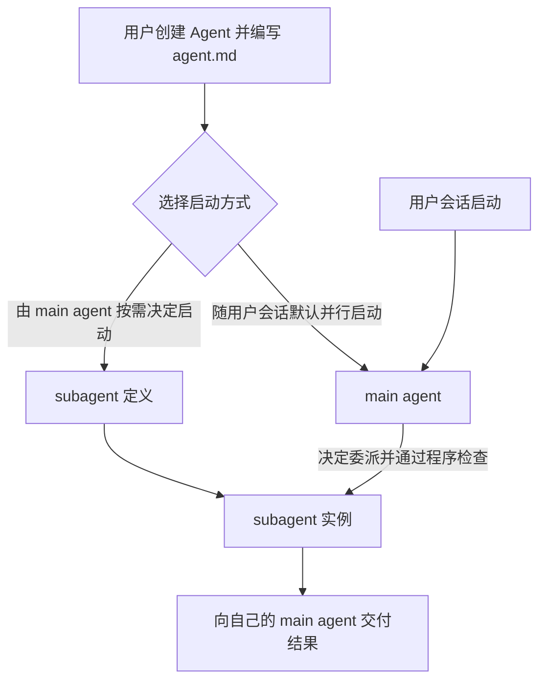
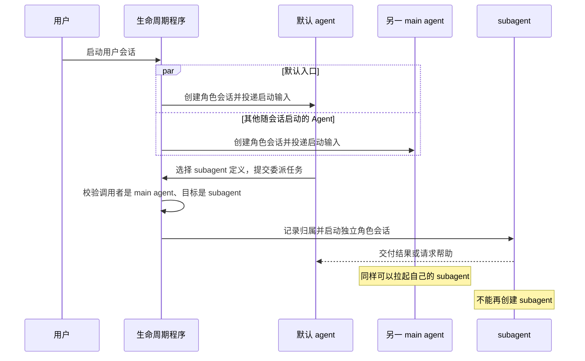
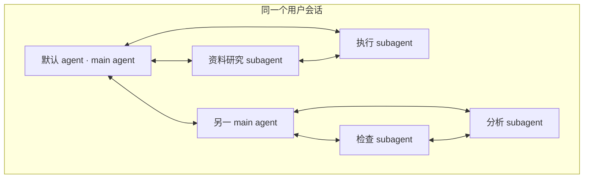
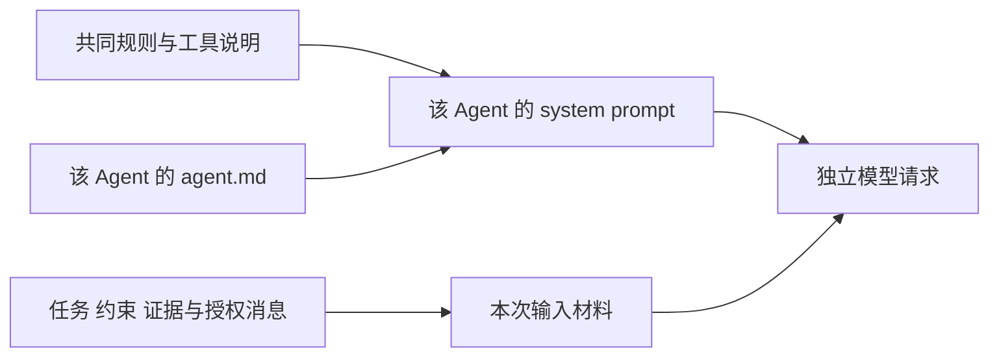
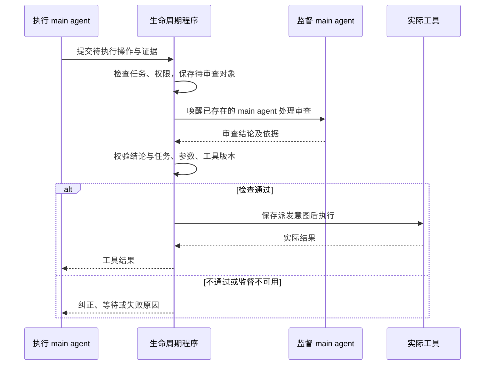
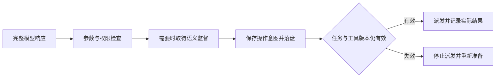
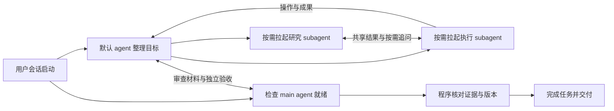

# Agent 角色定义与生命周期 Proposal

状态：方案草案，待评审。基于已选定的 DSH 桌面基座，不代表已经实现。

更新日期：2026-10-13。

产品范围见 [Mori 产品与技术 Proposal](../proposal.md)。本文定义用户如何创建 Agent、
编写 `agent.md`、选择启动方式，以及 main agent 和 subagent 的启动、通信、结束与恢复规则。

## 用户的心智模型

用户先定义“这个 Agent 负责什么”，再选择“它什么时候启动”。
每个 Agent 都有自己的 `agent.md` 和独立上下文；职责名称不决定它的层级或启动方式。



| 名称 | 含义 |
| --- | --- |
| Agent 定义 | 用户创建的可复用定义，包括 `agent.md`、启动方式以及模型和工具配置 |
| main agent | 随用户会话默认并行启动的 Agent；可以与其他 main agent 协作并拉起 subagent |
| 默认 agent | main agent 中承担默认用户对话入口的一个；与其他 main agent 平级 |
| subagent | 由某个 main agent 按需启动的 Agent；只能属于该 main agent，不能再拉起 subagent |
| 同族 subagent | 由同一个 main agent 实例启动的 subagent；不是同任务、同名称或同一份定义 |
| 角色会话 | 某个 Agent 实例的独立上下文与持久记录；定义相同也不共用上下文 |

默认 agent 可以决定启动 subagent，其他随会话启动的 main agent 也具有相同的委派资格。
默认 agent 不是其他 main agent 的父节点，也不会因此取得其他族的会话访问权限。
整个结构固定为 main agent 和它直属的 subagent 两层，层级上限不再是待确定参数。

## 用户如何创建 Agent

用户创建一个 Agent，为它命名并编写 `agent.md`，说明目的、职责、行为边界和交付要求。
然后选择随会话启动或按需作为 subagent 启动，并指定已有模型资源和工具范围。
启动方式是可检查的配置，不能只在提示词正文里写“请自动启动”或“不要创建子代理”。

| 用户维护的内容 | 含义 |
| --- | --- |
| 名称与用途说明 | 供用户辨认，也供 main agent 判断何时使用这个 subagent |
| `agent.md` | 该 Agent 的专属提示词正文；不再要求用户修改业务插件中的提示词资源 |
| 启动方式 | 随用户会话默认并行启动，或者仅在 main agent 决定委派时启动 |
| 模型资源 | 引用已经配置并验证的模型资源，不因创建 subagent 自动更换资源 |
| 工具范围 | 使用现有工具配置；实际权限仍受程序检查和两层关系约束 |

例如用户创建“资料研究”Agent，其 `agent.md` 可以写成：

```markdown
# 资料研究

根据收到的问题查找已有实现和可核对资料。
先检查项目现有依赖与文档，再检索外部来源。
交付结论、来源、适用范围和仍未确认的问题，不把推测当作事实。
需要其他工作时向自己的 main agent 提出请求。
```

将它选择为 subagent 后，保存定义只使它成为可委派对象，不会立即启动实例。
将它选择为 main agent 后，它随用户会话启动，与默认 agent 平级运行。
上例只是用户定义的示意，不代表固定的预装 Agent 名单或正式提示词。
`agent.md` 的存放位置与启动方式字段的具体格式留在待确定参数，不在本文虚构现成 DSH 配置字段。

文件定义参考 [OpenCode 的 Agent 类型与 Markdown 定义](https://opencode.ai/docs/agents/)
和 [Claude Code 的自定义 subagent 文件](https://code.claude.com/docs/en/sub-agents)。
复用“可复用定义与独立实例”的做法；Mori 的随会话并行启动、固定两层和同族通信由本文明确约束。

## 会话启动与按需委派

用户会话启动时，程序读取有效的 Agent 定义，为所有选择随会话启动的 main agent 建立独立角色会话，
并投递会话启动输入。它们不需要等待默认 agent 的模型返回，也不由默认 agent 逐个创建。
模型请求按模型池容量排队；并行启动不保证请求同时发出，也不表示空闲时持续调用模型。

subagent 定义作为可用委派目录提供给 main agent，由它根据用途说明决定是否使用。
main agent 提交要使用的定义和具体任务，程序从真实调用者取得归属，校验后创建 subagent 实例。
同一份 subagent 定义可以被不同 main agent 使用，每次实例分别记录自己的 main agent 和上下文。
main agent 不能将另一个 main agent 当作自己的 subagent 启动，也不能接管别人的 subagent。



subagent 不暴露创建 Agent 的工具，启动服务也必须拒绝来自 subagent 的创建请求。
不能只靠提示词约束，也不能通过其他工具、恢复入口或向程序发送请求间接创建下一层。
subagent 可以向自己的 main agent 请求帮助；main agent 独立决定后创建的是同族 subagent，
新实例仍直属该 main agent，原 subagent 不获得委派或控制权。

## 关系与通信边界



图中连线表示允许的直接通信。subagent 的连线只到自己的 main agent 和同族 subagent。
跨族协作由各自 main agent 交换需要共享的成果，再把选定材料交给自己的 subagent。
转述保留来源，不把转述当成对另一族原始会话的访问授权。

| 双方关系 | 直接消息、进展与上下文读取 |
| --- | --- |
| 同一用户会话内的 main agent 之间 | 允许，仍检查当前任务与材料范围 |
| main agent 与自己的 subagent | 允许 |
| 同一个 main agent 下的 subagent 之间 | 允许 |
| main agent 与另一 main agent 的 subagent | 双向禁止 |
| 不同 main agent 下的 subagent 之间 | 禁止，即使任务或 Agent 定义相同 |
| 不同用户会话内的 Agent | 不属于本会话的通信对象；用户显式提供的材料引用不建立直接通信关系 |

成员发现、广播、等待进展、消息投递、上下文搜索、精确读取和附件读取遵守同一关系检查。
同任务、同目录、同模型、同 Team 或获知会话标识，都不能扩大通信范围。
程序处理任务状态和审查结果，不等于任意 Agent 可以读取这些记录引用的其他族会话。
监督者需要其他族的执行证据时，由执行者的 main agent 提供必要操作、约束与成果，
不能直接开放执行 subagent 的完整上下文。详细投递和读取机制见 [通信 Proposal](agent-communication.md)。

## 职责与 system prompt

共同协作提示词、共享区结果的使用和向作者追问，见
[Agent 协作引导与上下文准备 Proposal](agent-collaboration.md)。任务、成员和明确任务层依赖仍由本文维护，
不新增任务状态或改变 Agent 定义、创建权限和归属。

对话、目标整理、记忆查询、参考检索、执行、监督、咨询、验收、学习、反证和文件整理都是职责。
用户可以为这些职责创建 Agent；职责不再被当作程序必须临时创建的一组固定成员。
具体预装定义与任务职责对应关系仍待确定，不能据此强制启动所有示例 Agent。

每个实例从自己的 `agent.md` 准备专属 system prompt，基础 preset 只保留共同规则、工具说明和 hooks。
任务、网页证据、用户消息和其他 Agent 的消息作为带来源的输入材料，不成为对方的 system prompt。
main agent 可以委派任务和交付证据，不能改写 subagent 的定义、启动方式或程序权限。
共享区追加已观察或验证的结果、来源、重要不确定性，以及关联旧记录的更正。
system prompt 引导 Agent 根据当前工作使用这些材料，必要时读取原文或向作者追问；
共享记录不登记为具体工具操作的依赖。



职责拆分服从任务本身的独立性要求。监督与验收实例都不能是被检查操作或产物的执行实例，
学习者与反证者也使用独立实例；它们可以是平级 main agent，也可以是同一 main agent 下的 subagent。
“独立验收”不要求创建第三层，也不能因所有实例共享基础 preset 而合并上下文。

每次请求记录实际使用的提示词文本、定义版本和模型资源。已发布的正文修订在下一次请求准备时生效，
已发送请求保留原快照；修改启动方式不把正在运行的 subagent 原地提升为 main agent。
现有角色会话保留创建时的类型和归属，新的启动选择作用于新用户会话中的 main agent 和新的委派实例。
修改职责目的时使用新角色会话；删除定义后停止新的创建，现有实例按显式取消或正常结束处理。
缺少 `agent.md`、模型资源或必要工具配置时明确失败，不采用父会话或全局默认职责。

`agent.md` 是用户维护的定义文件；程序生成的提示词修订仍须经过产品 Proposal 的资产发布流程，
不能因模型建议优化而直接覆盖用户定义。创建、请求准备和恢复使用同一个定义加载与权限检查入口。

## 程序负责什么

程序负责兑现用户选择的启动方式、维护任务状态、验证权限和结果、管理容量及恢复。
main agent 负责决定是否把工作委派给 subagent。任务需要某项职责，不代表程序可以绕过这个决定创建 subagent。

| 事件 | 程序行为 | Agent 行为 |
| --- | --- | --- |
| 用户会话启动 | 创建本会话选择的全部 main agent，记录各自定义 | 各自读取启动输入，按职责工作或等待 |
| 用户消息或目标纠正 | 保存原始输入，投递给默认 agent 及承担相关职责的已启动 main agent | 沟通、整理目标；需要委派时由 main agent 决定 |
| main agent 申请委派 | 校验真实调用者、目标定义、任务、工具权限、预算和容量 | 指定 subagent 的任务和必要材料 |
| 工具操作需要监督 | 阻止派发，将审查工作交给负责的 main agent | 由独立于执行者的实例监督；必要时决定启动监督 subagent |
| 执行者提交成果 | 进入待验收，将验收工作交给负责的 main agent | 安排独立验收实例，提供证据 |
| 重复失败或停滞 | 保存原因，将咨询需求交给所属 main agent | 决定如何继续，必要时拉起咨询 subagent |
| 工作回顾到期 | 恢复已有 main agent，向其投递回顾工作 | 自己承担适合的职责或决定启动学习、整理与反证 subagent |
| Agent 消息或已委派任务完成 | 校验范围并唤醒已有实例，记录任务结果 | 在自己的职责和通信范围内继续 |
| 共享区追加结果或更正 | 在下一次正常请求准备时提供授权材料，不自动启动或重开任务 | 看到后判断影响，按需读原文、追问或修正后续工作 |

目标整理、必要监督和独立验收仍是任务的程序约束，main agent 不能声明不需要就跳过。
将职责配置成 subagent 时，程序等待 main agent 的合法委派和必要结果；
负责的 main agent 没有委派、不可用或缺少必需定义时，任务显示等待或失败原因，不自动创建替代 Agent。
若这些职责由已随会话启动的 main agent 承担，关闭 subagent 委派工具不影响它们执行自己的工作。

用户纠正影响当前目标或约束时，先暂停相关未派发写操作，按来源顺序更新目标版本后重新检查。
旧输入的迟到结果不能覆盖新要求。普通对话不自动创建一条执行链。
任务依赖只表达明确登记的任务层工作顺序和完成条件，不建立共享记录与具体工具操作的依赖关系。
共享区新增记录或更正不增加目标版本，不作废排队或已发送的模型请求，也不阻止工具派发。
未登记的语义变化由 Agent 看到后判断是否需要修复；程序不保证每次操作都已采用最新共享结果。
事件路由复用任务记录、hooks 和 schedule；不另建工作流配置语言或常驻调度模型。

## 监督如何执行

以下示例由一个随会话启动的监督 main agent 承担审查。
执行者为 subagent 时，经所属 main agent 提交需要共享的审查材料，程序检查不提供跨族会话访问。



若用户将监督 Agent 配置为 subagent，则由负责监督的 main agent 决定创建并接收结果。
监督 subagent 不能再委派反证或咨询，只能请求自己的 main agent 处理。
程序保留最终放行权；没有审查结果或审查版本失效都不能执行受约束操作。

## 已有基础与实现边界

复用 DSH 的 agent-team 成员表、任务记录、subagents、persona 与 schedule。
固定源码基线为 `d743267388641bc76f17c45ce8b4c231aed1d32c`；当前目录尚未导入该运行时，
本文的用户 Agent 定义和关系规则属于 Mori 需要实现的行为，不能视为底座现成功能。

| 已有能力或限制 | Mori 需要做的改变 |
| --- | --- |
| Team 当前由根 Agent 创建直接成员 | 一个用户会话共用一个 Team；分别记录存储归属与 main agent、subagent 的产品关系 |
| Team 已通过 `subagents.startActivation` 创建成员 | 复用执行路径，main agent 启动来自会话初始化，subagent 启动来自真实 main agent 的委派 |
| Team 成员按累计创建计数，历史名称不能复用 | 按活动与可恢复实例控制容量；稳定会话标识留历史，不把显示名称当身份 |
| 子会话继承基础 preset，可应用独立 persona 和工具限制 | 从用户定义加载各自提示词、模型与工具范围；共同 preset 不夹带单个职责 |
| 创建或恢复实例与模型回合是分开动作 | 恢复归属先于继续运行；空闲 main agent 不必为了恢复 subagent 额外调用模型 |
| 现有任务所有者可直接标记完成 | 执行者只能提交成果，由程序结合独立验收推进 |
| schedule 持久保存任务，并向恢复会话发送后续消息 | 到期投递给负责维护的已有 main agent；subagent 仍由它决定启动 |

Team 根会话是现有存储与运行时入口，不代表默认 agent 是所有成员的产品层父节点。
记录中 main agent 没有所属 main agent；subagent 必须引用本用户会话内一个真实 main agent。
DSH 运行时需要的宿主关系与这一归属分别保存，不能从底层宿主链推导通信、委派或取消权限。
不为每个 main agent 再创建一个 Team，不支持递归父链或嵌套 Team。

普通 subagent 成果交付给自己的 main agent；程序按任务规则保存结构化结果和推进状态。
恢复保留原交付目标，不能把成果通知改投其他 main agent，也不能把程序处理结果当作跨族聊天入口。
main agent 等待 subagent 的任务结束后再完成相应父任务；这不要求停止其他平级 main agent。

依据：[Team 成员管理](https://github.com/deepseek-ai/deepseek-harness/blob/d743267388641bc76f17c45ce8b4c231aed1d32c/packages/experimental/agent-team/src/roster.ts)、
[Team 任务板](https://github.com/deepseek-ai/deepseek-harness/blob/d743267388641bc76f17c45ce8b4c231aed1d32c/packages/experimental/agent-team/src/task-board.ts)、
[子会话组成](https://github.com/deepseek-ai/deepseek-harness/blob/d743267388641bc76f17c45ce8b4c231aed1d32c/packages/subagent/subagent/src/child-agent.ts)、
[系统提示词作用域](https://github.com/deepseek-ai/deepseek-harness/blob/d743267388641bc76f17c45ce8b4c231aed1d32c/packages/core/system-prompt/README.md)、
[定时派发](https://github.com/deepseek-ai/deepseek-harness/blob/d743267388641bc76f17c45ce8b4c231aed1d32c/packages/schedule/schedule/src/runtime.ts)。

## 创建、唤醒与结果去重

会话初始化、main agent 委派、消息与定时事件先保存到现有持久记录，再创建或唤醒对应实例。
main agent 的启动记录绑定用户会话和定义；subagent 的启动记录绑定 main agent 和稳定委派标识。
创建前校验类型和归属，Host 恢复时先核对已有实例；恢复只能兑现原合法启动意图，不能新造委派决定。

同一角色会话一次只有一个活动执行回合，消息进入同一收件队列。
同一工作对象已有有效调用或结果时继续等待或采用结果，不能因重复通知创建第二个执行者。
任务调用关联来源事件、具体操作或产物、目标版本、定义版本、提示词及结果；
监督还关联操作参数与工具版本，不能把一次监督结论作为整个任务的通行许可。

迟到结果保存到原调用，只有目标与工作对象仍有效时才推进当前任务。
重试沿用原工作身份并记录尝试；返工绑定新的产物版本，不被旧结果阻止。
结束且不再接收工作的 subagent 明确退役，普通消息不能重新唤醒它；
main agent 需要继续委派时创建新实例并引用旧证据。

## 等待与并行执行

角色会话等待消息、子任务、监督或资源时，不持续调用模型。
每个角色会话只能有一个活动执行回合，多条唤醒请求进入同一收件队列。
等待模型、浏览器、角色容量和任务依赖分别记录，不能全部显示成“正在思考”。

进入等待前同时检查依赖关系与已经占用的资源。需要监督时，执行者已结束的模型请求应释放槽位；
持有浏览器或角色容量的等待者也可能使其依赖者无法运行，需要释放可释放的资源或明确报告阻塞。
不能只检查任务依赖没有环，就认为一定能够继续。具体模型占用和浏览器占用由对应模块负责。

同一可写目录只交给一个执行者修改，研究和检查角色可以并行读取。
同目录的多个写任务通过依赖串行交接；Team 的路径冲突提示本身不构成文件锁，
也不能约束终端或外部程序。共享目录不扩大任务或上下文访问权限。

## 任务状态与持久记录

沿用 Team 的任务记录和版本校验，补齐产品所需字段。
任务状态、目标版本和完成证据只在一处保存；成员表和任务记录仍归现有 Team 日志管理。
消息和模型请求分别由对应功能维护，本模块只关联其稳定标识与结果。

| 记录 | 必须保存的内容 |
| --- | --- |
| 任务 | 目标、约束、目标版本、记录修订、明确任务层依赖、成果用途、合法交付关系、完成条件、片段、预算、状态和等待原因 |
| 等待与取消 | 等待对象、观察位置、原因、原定期限，以及取消请求与实际处理结果 |
| 角色成员 | 用户会话、实例标识、定义及版本、main agent 或 subagent 类型、所属 main agent、运行时宿主、任务归属和生命周期 |
| 职责调用 | 来源事件、工作对象、定义与程序规则版本、提示词引用、模型资源、工具范围、交付目标、启动意图和结果 |
| 工具操作 | 操作标识、原始参数、任务版本、工具定义与连接版本、审查结论和实际结果 |
| 验收 | 完成条件、对应证据、独立验收结果、程序检查和采用的任务版本 |

目标版本在目标或约束改变时更新；普通进度修改更新记录修订。
二者分开，避免进度提示使所有操作失效，同时禁止用旧目标的验收完成新任务。
任务状态使用待执行、执行中、等待、待验收、已完成、失败和已取消。
等待原因单独保存；结果未知属于请求或工具操作的事实，需要核对时任务进入等待。
用户取消可以先结束任务，但不能把未核对的外部操作标成已经撤销。

现有会话 `append` 只保证接收顺序，`flush` 才是持久化边界；
`storageDomain` 的单次写是原子的，但不能据此假定存在跨记录或跨会话事务。
关键事件必须等待落盘成功，失败就停止相应派发。使用现有单写入者与串行修改入口，
通过稳定标识核对两处记录间的中断，不引入分布式事务。
依据：[DSH 会话持久化](https://github.com/deepseek-ai/deepseek-harness/blob/d743267388641bc76f17c45ce8b4c231aed1d32c/docs/subsystems/persistence.md)、
[业务存储契约](https://github.com/deepseek-ai/deepseek-harness/blob/d743267388641bc76f17c45ce8b4c231aed1d32c/docs/subsystems/storage.md)。

Team 记录在落盘前可能已经进入内存投影。关键落盘失败后，该根会话停止后续状态驱动派发，
直到确认持久化位置覆盖所依赖的事件；不能让下一次调度读取未落盘的版本继续执行。
每次工具操作先记录发送意图并落盘。存在发送意图而没有终态时，
即使缺少“已经发送”记录，也按可能已发送核对，覆盖发出请求后立即崩溃的情况。

## 工具派发与监督



检查覆盖模型发送前、网络重试准备时与实际工具派发前。
排队期间工具改变时丢弃旧的准备结果，由调用方重新准备，不修改冻结请求。
审查结论绑定具体参数、任务版本、工具定义版本和连接版本；相关变化使结论失效。
共享结果及其更正作为 Agent 判断的材料，不增加逐条摘要检查或研究结果撤回后的操作版本失效机制。

允许新旧连接同时存在的一般 MCP，更新时先完成新连接初始化，再切换新的调用；
旧调用保留原连接直到结束或明确超时。
更新期间暂停该工具的新派发；新连接失败就保持阻塞，不继续使用已经声明过期的旧认证。
撤销认证立即停止新派发，并请求终止旧调用。
更新失败、旧调用超时或浏览器进程退出时，按真实状态记录失败或结果未知。
旧调用晚到结果仍归原操作和原连接版本。

同一持久 profile 的 Chrome 连接采用停止后重建，具体过程由 [Chrome DevTools 内嵌工具 Proposal](chrome-devtools.md) 定义。

## 工具热更新

DSH 已能处理 MCP 的 `tools/list_changed`，并在下一步模型请求使用新定义。
修改 profile 中的地址、headers 或环境变量，也可通过热重载重建连接，不必重启用户会话。

需要补齐的是版本一致性和连接交接。当前源码会在执行时按名称查最新工具，
旧请求生成的参数可能进入同名的新工具；连接重载还可能关闭正在执行的旧请求。

| 更新类型 | Mori 的生效边界 | 对现有调用的处理 |
| --- | --- | --- |
| 工具名称、描述、参数定义 | 接到通知或用户明确刷新后登记新版本；下一次模型请求使用新定义 | 旧请求产生但尚未执行的受影响调用停止，要求按新定义重新决定 |
| 新增或移除工具 | 更新当前项目允许使用的工具集合 | 已移除工具不能继续派发；新增工具同样经过统一检查 |
| 地址、headers、环境变量、认证 | 一般 MCP 在新连接初始化后发布新版本；同一 Chrome 目录先停止旧进程再重建 | 更新期间暂停该工具的新调用；旧连接在调用结束后释放，超时则明确记录结果未知或失败 |
| 撤销认证 | 立即停止新的派发并请求终止旧调用 | 不能保证撤销服务端已经发生的副作用，需记录并核对 |
| 外部凭证存储变化 | 必须有实际变化通知或显式刷新入口 | 不把“凭证已保存”显示成“所有活连接已更新” |
| 没有发送变更通知的 MCP 服务 | 提供主动刷新入口；自动检查频率待确定 | 不假定客户端能自行知道远端 schema 已变化 |

工具定义版本与连接版本随请求和执行记录保存。只有相关工具发生变化时才使调用失效，
不因无关工具更新而重启所有任务。项目配置有作用域，不能把某个项目的工具广播成所有项目均可用。

检查覆盖发送前、网络重试准备时和工具派发前。DSH 当前同一步重试会复用旧工具快照，
因此工具改变后必须结束这组旧请求并重新准备，不能继续携带旧定义重试。
排队期间失效也走重新准备；重新准备时才读取最新模型配置、工具和相关材料。

认证更新有明确的准备、切换、完成和失败状态。新连接失败时，不继续用已声明过期的旧认证悄悄执行。
等待旧调用结束的时限必须有限，具体值由工具特征确定。旧调用的结果即使晚到，也记录到原任务和原版本。

## 中断与恢复

恢复先重建模型模块的容量、请求和未知占用记录，再按职责调用与模型请求标识核对，
之后才开放已有 Agent 的任务推进。已有排队请求或未核对尝试时，角色会话恢复不能创建新的逻辑请求
绕过原调用的状态；模型模块报告已经完成的结果则交回原职责处理。

| 中断位置 | 恢复行为 |
| --- | --- |
| 会话启动事件或委派已经保存，尚未保存启动意图 | 核对原启动选择或 main agent 的真实委派；补齐合法创建，不自动猜测委派决定 |
| 启动意图已经保存，角色会话状态未确认 | 按稳定标识核对成员与已有会话，确认后继续或明确失败 |
| 所属 main agent 未恢复 | 先恢复 main agent 实例，再恢复它的 subagent；不重做委派决定或额外调用 main agent 模型 |
| subagent 已结束，结果尚未保存 | 按原会话标识读取持久终态与输出，补齐结果并交付原 main agent；不重新执行 |
| 职责结果已经保存，任务尚未推进 | 检查当前目标与工作对象版本，采纳有效结果且只推进一次 |
| 等待期间中断 | 比较当前持久事实与观察位置，已变化立即继续，否则按原期限重新登记等待 |
| 工具操作已有派发意图但没有终态 | 按可能已发送处理，查询结果或比对产物，不直接重放写操作 |
| 关键任务记录落盘失败 | 停止该根会话后续状态驱动派发，确认持久化位置后才能继续 |
| 机器休眠或 Host 退出 | 展示暂停与恢复，分别调用模型和浏览器模块核对失去的请求或操作 |

任务仅在当前目标版本的全部完成条件满足后完成。
执行 Agent 提交结果，独立验收 Agent 给出判断，程序验证证据后推进。
程序收到角色结果后先持久保存，再推进任务；结果交付失败不使子会话的已完成事实失效。
若子会话输出尚无可核对的持久证据，明确等待核对或失败，不能猜测结果或重新执行产生副作用。
监督模型不可用或审查格式错误时，受约束操作等待或失败，不能放行。
恢复不重建旧的流对象、连接实例或取消信号；各模块按自身记录恢复。

main agent 停止或被移除时，停止向它及其 subagent 派发新工作，并分别核对正在进行的操作。
subagent 不能被重新挂到另一个 main agent 下，不能因所属 main agent 缺失而升级为 main agent。
取消一个 subagent 不影响同族其他实例；停止一个 main agent 不等于停止其他平级 main agent。
用户取消整个用户会话的工作时，程序覆盖其中全部 main agent 和 subagent，并保留各自真实终态。

## 与其他 Proposal 的接口

| 对接方案 | 本方案提供 | 本方案使用 |
| --- | --- | --- |
| [Agent 协作引导与上下文准备 Proposal](agent-collaboration.md) | 当前任务、明确任务层依赖、成员与等待事实 | 共享结果使用与追问的提示要求；共享区追加不改变任务状态或操作资格 |
| [Agent 通信与上下文共享 Proposal](agent-communication.md) | 稳定角色会话标识、类型、所属 main agent、任务归属、访问范围、退役状态与唤醒入口 | 已持久化消息、材料引用和实际请求上下文；消息状态不直接等于任务完成 |
| [Chrome DevTools 内嵌工具 Proposal](chrome-devtools.md) | Agent 实例、工具范围、操作标识、任务版本和派发许可 | 浏览器容量、实际工具结果、产物引用、连接版本和结果未知状态 |
| [内网模型资源可靠性 Proposal](model-reliability.md) | 角色选定的资源、请求上下文、任务与用户会话、预算、期限和版本检查 | 排队、响应、限流、失败、取消及远端状态；不会通过换模型绕过失败 |
| [Mori 产品与技术 Proposal](../proposal.md) | 当前任务状态、职责关系、成果、失败与等待原因 | 原始用户消息、纠正、工作回顾到期、候选资产和发布结果 |

职责调用、模型请求、消息与工具操作使用各自稳定标识相互引用。
任务状态只有一个所有者；通信、浏览器和模型模块报告事实，由任务编排决定是否推进。

## 最小端到端闭环

用户创建默认 agent 和检查 Agent，均选择随会话启动；再创建资料研究和执行 Agent，选择作为 subagent。
为每个定义编写 `agent.md` 并指定同一个可用模型资源，用确定性工具验证以下闭环。
这些选择是验收样例，不代表正式预装配置。



验证启动 main agent 不依赖默认 agent 委派；subagent 只因合法委派出现。
验证执行 subagent 再次创建、直接联系检查 main agent、读取另一族上下文时都被拒绝。
研究者向共享区追加带来源和不确定性的结果，执行者在下一次正常请求中使用授权材料并按需追问。
再追加关联旧记录的更正，验证任务目标版本、已有请求及工具派发资格不因此改变。
中断 Host 后恢复同一批实例和归属；已经结束的委派不重跑。
随后在相同机制上补齐其余职责、恢复边界和工具热更新，不拆除已经通过验收的路径。

## 完整验收范围

| 验收场景 | 通过条件 |
| --- | --- |
| 用户创建 Agent | 用户可编写 `agent.md`、选择启动方式并绑定已有模型与工具；实际请求使用该定义 |
| 随会话并行启动 | 所有选择随会话启动的 main agent 都独立启动；默认 agent 无需逐个委派，容量不足显示排队 |
| 按需 subagent | 仅保存定义不启动；默认 agent 和其他 main agent 均可合法委派，每个实例记录唯一所属 main agent |
| 不同职责同时运行 | 实际请求分别携带专属 system prompt；共同规则不夹带某个角色的职责 |
| 提示词发布后继续或恢复 | 下一次准备使用新版本，已发送请求仍可追溯旧文本；不原地改变角色目的 |
| 禁止嵌套委派 | subagent 没有创建工具；伪造类型、调用启动服务或经恢复入口创建下一层均被拒绝 |
| main agent 不可用 | 不替它决定新委派；已持久委派可按原身份恢复，必要职责缺位显示等待或失败 |
| 启动方式修改 | 现有实例类型和归属不变，新会话和新委派按有效定义检查，不原地提升 subagent |
| subagent 完成后冷恢复 | 结果只交付原 main agent，程序保存与任务推进不改变通信范围 |
| 子会话完成与程序保存结果之间崩溃 | 核对原子会话终态并补齐结果，不重复运行已完成职责，也不依赖已丢失的回调 |
| 角色恢复时已有模型请求 | 先核对原请求；排队或远端未知状态不会因自动启动变成新的重复请求 |
| main agent 协作与同族通信 | main agent 之间、main agent 与自己的 subagent、同族 subagent 之间可以协作 |
| 共享区追加结果或更正 | 下一次正常请求提供授权材料；不重开任务、不增加目标版本、不作废已有请求或阻止工具派发 |
| 明确任务层依赖与共享材料 | 任务按已登记依赖推进；不建立摘要到工具操作的依赖，Agent 读取更正后自行判断后续修复 |
| 跨族访问 | 外族 main agent 与 subagent、外族 subagent 之间均不能直接通信或读取上下文，持有标识也无效 |
| 同一定义被不同 main agent 使用 | 实例与上下文独立，不因定义相同被当成同族 |
| 取消与成员缺失 | 取消按真实归属处理；subagent 不被提升或改挂，其他平级 main agent 不受无关取消影响 |
| 重复事件与规则变更 | 同一工作对象不会产生多个有效执行者，返工的新版本不被旧记录阻止 |
| 事件或启动过程中崩溃 | 重启后补齐已确认的会话启动或委派，不重复创建已有实例，不生成未作出的委派 |
| 执行者自报完成或自我审查 | 不能自监督或自验收；成果先进入待验收，独立实例的判断与证据满足当前目标后由程序完成 |
| 用户在执行期间纠正 | 未派发的相关写操作先暂停，目标更新后重新检查；旧结论不能覆盖新要求 |
| 工具定义、连接或认证变化 | 发送、重试和派发前均检查相关版本，旧结论不会放行新参数或已撤销权限 |
| 任务关键记录无法落盘 | 根会话停止后续状态驱动派发，不读取未持久化投影继续运行 |
| 等待监督时资源紧张 | 区分任务依赖与实际容量；释放可释放资源或显示真实阻塞，不持续调用模型 |
| 必要职责使用 subagent | 没有合法委派或结果时任务等待或失败，不由程序补建隐含 Agent，不跳过监督或验收 |
| 工作回顾到期 | 恢复负责维护的已有 main agent；需要学习、整理或反证 subagent 时由它决定启动，彼此保持独立 |

## 待确定参数

| 参数 | 确定依据 |
| --- | --- |
| `agent.md` 存放位置与启动方式字段的具体格式 | 用户创建和编辑方式，以及 DSH 已有配置入口；只保留一处定义来源 |
| 预装 Agent 定义、默认对话入口及任务职责对应关系 | 用真实任务验证目标整理、监督与验收等责任如何由用户配置承担 |
| 各职责的正式提示词、输入输出格式和固定模型资源 | 用真实任务验证职责边界和结果可检查性；共享结果使用与追问的提示要求由协作引导 Proposal 提出 |
| 活动成员容量与职责预算 | 本地资源和实际任务规模；层级已固定为 main agent 与直属 subagent，不开放额外层级 |
| 需要语义监督的操作范围 | 内部工具能力、任务约束和可验证风险 |
| 停滞与咨询触发阈值 | 错误与证据进展记录，不按臆测阈值视为已决策 |
| 工具连接交接时限和无通知服务的刷新频率 | 各工具执行特征与服务能力 |
| 工作回顾的频率、触发时间和错过时间后的处理 | 用户使用方式和维护成本，产品流程中的未决项继续保留 |

本 Proposal 不创建定时任务，也不把上述待定参数作为已确认的实施配置。

## 工具执行源码依据

| 结论 | 固定源码 |
| --- | --- |
| 工具执行前检查及按名称解析 | [tools 执行入口](https://github.com/deepseek-ai/deepseek-harness/blob/d743267388641bc76f17c45ce8b4c231aed1d32c/packages/core/tools/src/index.ts#L1510-L1597) |
| MCP 定义同步与连接释放 | [工具注册换代](https://github.com/deepseek-ai/deepseek-harness/blob/d743267388641bc76f17c45ce8b4c231aed1d32c/packages/mcp/mcp-client/src/tools.ts#L113-L161)、[连接生命周期](https://github.com/deepseek-ai/deepseek-harness/blob/d743267388641bc76f17c45ce8b4c231aed1d32c/packages/mcp/mcp-client/src/connection.ts#L257-L407) |
| 模型请求保留本步工具快照 | [请求与重试](https://github.com/deepseek-ai/deepseek-harness/blob/d743267388641bc76f17c45ce8b4c231aed1d32c/packages/core/agent-loop/src/agent.ts#L410-L442) |
