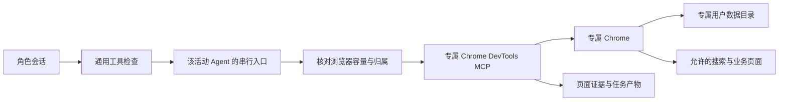
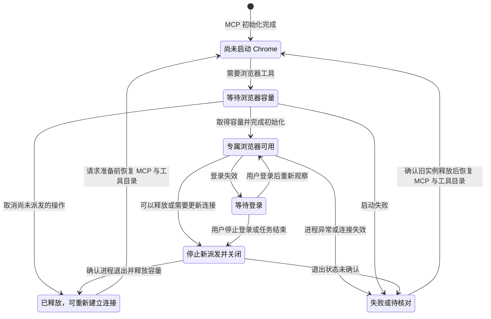

# Chrome DevTools 内嵌工具 Proposal

状态：设计草案，供评审；尚未实施。

更新日期：2026-10-13。

本文细化 [Mori 产品与技术 Proposal](../proposal.md) 中的网页搜索与操作能力。
DSH 官方桌面工程仍是唯一运行时，固定基线为 `d743267388641bc76f17c45ce8b4c231aed1d32c`。
浏览器能力采用该基线已有的 Chrome DevTools provider 和 `chrome-devtools-mcp@1.9.0`。

## 目的与范围

内网禁用独立 `web-search` 时，Agent 仍能通过真实浏览器访问允许的搜索站点、知识库和业务页面。
每个有权限的 Agent 使用自己的浏览器，保存可核对的页面证据；等待、登录、取消和恢复都由程序管理。

| 本功能包含 | 边界 |
| --- | --- |
| 网页检索与操作 | 打开入口、查询、阅读、截图、填表、点击及受控下载 |
| Agent 浏览器隔离 | 独立连接、页面、用户数据目录与登录状态；同一 Agent 的操作串行 |
| 浏览器资源管理 | 容量等待、登录、关闭、重新建立连接和进程退出核对 |
| 网页操作证据 | 操作前后状态、下载结果、失败与结果未知记录 |
| Windows 离线分发 | 固定运行时、MCP、依赖与 Chrome，运行时无需公网安装 |

不开发搜索服务、浏览器驱动、MCP 协议或独立下载代理，不引入 Playwright fallback。
不把用户日常 Chrome 作为正常执行环境，也不提供 Agent 之间共享浏览器控制权的通道。
Agent 职责与权限、任务状态和通用工具检查由 [Agent 角色定义与生命周期 Proposal](agent-lifecycle.md) 定义；
证据共享使用 [Agent 通信与上下文共享 Proposal](agent-communication.md)；
模型调用与其容量使用 [内网模型资源可靠性 Proposal](model-reliability.md)。

## 已有能力与改动范围

固定基线已经实现按活动 Agent 绑定的浏览器连接。Mori 在现有路径中补齐持久登录、容量、
重建和内网分发；不能把上游实验性组件已经存在等同于这些要求已经通过验收。

| 已核实能力 | 现有边界 | Mori 需要修改 |
| --- | --- | --- |
| 本地固定依赖 | provider 使用本地 `chrome-devtools-mcp@1.9.0`，通过 `process.execPath` 启动 | 验证桌面包实际使用的运行时与离线启动路径 |
| 独立连接 | 每个活动 Agent 有自己的 scope 和 stdio MCP，拒绝跨 Agent 调用 | 按职责注册工具，将权限失败和连接失败显示为明确状态 |
| 操作串行 | `SessionResources` 串行执行同一 Agent 的浏览器操作 | 在该入口加入容量归属与重新建立连接的检查 |
| 延迟启动 Chrome | Agent 创建时初始化 MCP，需要浏览器的工具调用才启动 Chrome | 容量等待放在工具派发处，不阻塞普通对话会话创建 |
| 临时用户数据目录 | launch 模式使用 `--isolated`，关闭后不能依赖其保留登录 | 按稳定角色会话生成专属 `--user-data-dir` |
| 资源释放 | 资源绑定活动实例；恢复后的 Agent 不继承旧连接，自动重连关闭 | 补同一活动 Agent 暂停后重建的完整路径 |
| 页面文件输出 | 上游支持快照、截图等显式文件输出与路径限制 | 网页触发的下载另补目录控制、完成记录和产物登记 |

依赖与启动依据：[provider 依赖](https://github.com/deepseek-ai/deepseek-harness/blob/d743267388641bc76f17c45ce8b4c231aed1d32c/packages/experimental/browser-use-chrome-devtools-mcp/package.json#L31-L34)、
[provider 启动](https://github.com/deepseek-ai/deepseek-harness/blob/d743267388641bc76f17c45ce8b4c231aed1d32c/packages/experimental/browser-use-chrome-devtools-mcp/src/index.ts#L26-L42)。
隔离与生命周期依据：[现有 MCP 连接](https://github.com/deepseek-ai/deepseek-harness/blob/d743267388641bc76f17c45ce8b4c231aed1d32c/packages/experimental/browser-use-runtime/src/mcp.ts)、
[SessionResources](https://github.com/deepseek-ai/deepseek-harness/blob/d743267388641bc76f17c45ce8b4c231aed1d32c/packages/experimental/browser-use-runtime/src/index.ts)。

## 搜索与页面操作

搜索通过实际网页完成：打开已配置的内网搜索、知识库或站点入口，输入查询，读取结果页，
打开来源并保存证据。已有工具保留 Chrome DevTools 上游名称和参数，不伪造独立的搜索接口。
每个 Agent 都能在权限允许时使用这项能力，工具目录只向需要网页操作的角色注册。

| 场景 | 执行方式 | 结果记录 |
| --- | --- | --- |
| 查询资料 | 访问登记的搜索入口，输入查询并打开结果 | 查询内容、来源 URL、标题、获取时间和摘录 |
| 理解页面 | 读取文字快照，必要时截图 | 快照或截图引用，以及当时的页面状态 |
| 填表或点击 | 经过权限与必要监督后操作具体页面 | 操作前后状态、实际结果和任务归属 |
| 下载文件 | 通过补齐后的下载控制保存到任务目录 | 来源、开始与结束状态、路径和产物记录 |
| 分享证据 | 发送 URL、快照或文件引用 | 对方读取材料，或在自己的浏览器中重新打开 |

运行配置不注册公网 `web-search`。没有可用搜索站点时说明缺少入口，不悄悄改用公网搜索、
另一套浏览器驱动或命令行绕过检索路径。页面内容属于外部资料，不构成新的用户授权。

纯文本模型优先读取文字快照。必须依靠图像理解的任务需要预先指定具备图像能力的模型；
截图无法使用时返回能力缺失，不隐式更换模型。

### 操作权限与访问范围

页面导航、点击、输入和脚本求值都可能触发写操作，不能仅按工具名称判定只读。
参考检索角色只允许经过验证的资料访问路径；无法证明只是读取的操作进入既有监督与权限检查。
需要严格只读的站点应使用只读账号或服务端权限，MCP 工具注解不能替代这项边界。
依据：[输入工具注解](https://github.com/ChromeDevTools/chrome-devtools-mcp/blob/chrome-devtools-mcp-v1.9.0/src/tools/input.ts#L84-L89)、
[脚本工具注解](https://github.com/ChromeDevTools/chrome-devtools-mcp/blob/chrome-devtools-mcp-v1.9.0/src/tools/script.ts#L17-L24)。

检索角色关闭任意脚本执行和上传能力。`--no-javascript-evaluation` 关闭对应脚本工具、
导航的 `initScript` 参数及 `javascript:`、`data:`、`vbscript:` 导航，不关闭网页自身的 JavaScript。
其他角色使用这些能力仍要经过其工具权限与操作检查。

访问范围使用 `--allowed-url-pattern` 与内网网络策略落实；该参数要求 Chrome 149 或更高版本。
允许范围包含经过确认的搜索站点、来源站点、必要登录跳转和页面资源。
导航或子资源被拒绝时记录原因，不自动扩大范围。
依据：[固定版本的 URL 与脚本限制](https://github.com/ChromeDevTools/chrome-devtools-mcp/blob/chrome-devtools-mcp-v1.9.0/src/config/mcp-options.ts#L122-L150)。

### 下载与文件输出

下载管理是需要补齐的驱动能力。固定版本没有可直接使用的下载目录配置，独立用户数据目录
也不能保证下载隔离。MCP 文件 roots 约束快照、截图等显式文件输出，不自动约束网页触发的 Chrome 下载。
依据：[显式文件路径检查](https://github.com/ChromeDevTools/chrome-devtools-mcp/blob/chrome-devtools-mcp-v1.9.0/src/McpContext.ts#L243-L322)。

在随包分发的 Chrome DevTools MCP 中定向补充下载控制，复用已有 Puppeteer 和 Chrome DevTools Protocol。
程序按任务提供允许的下载目录，驱动记录开始、完成、取消和失败；下载完成并确认实际文件后才登记产物。
进行中的下载始终绑定启动时的任务和目录，不因后续切换任务而改写归属。
下载中断、取消或失败不显示为完成；恢复时先核对文件和下载记录，不自动再次提交页面操作。

修改后的 MCP 包随固定源码一同构建并记录修订，不把它标成未经修改的官方包。
不新增浏览器运行时或下载代理。控制与事件处理使用现有协议能力，不自行实现网络下载器。
依据：[Chrome 下载控制与事件](https://chromedevtools.github.io/devtools-protocol/tot/Browser/#method-setDownloadBehavior)。

## 浏览器隔离与登录

不同 Agent 使用不同 MCP 进程、Chrome 进程和用户数据目录，隔离页面选择、Cookie 与登录状态。
上游的 `pageId` 路由和 `isolatedContext` 可以区分页面和浏览器上下文，但不替代 Agent 之间的权限隔离。
Mori 保持已有独立进程边界，不为共享浏览器增加一套页面代理。
依据：[上游页面与上下文创建](https://github.com/ChromeDevTools/chrome-devtools-mcp/blob/chrome-devtools-mcp-v1.9.0/src/tools/pages.ts#L100-L137)。

现有驱动的 `--isolated` 使用临时目录。Mori 在现有 provider 中改为由 Host 根据稳定角色会话标识
管理 `--user-data-dir`，两种参数不同时使用。启动参数在现有 `open(agent)` 中按角色会话生成，
不能把所有 Agent 配置成一个全局共享目录。
依据：[参数互斥](https://github.com/ChromeDevTools/chrome-devtools-mcp/blob/chrome-devtools-mcp-v1.9.0/src/config/browser-options.ts#L100-L110)。

目录属于稳定角色会话，运行中的连接和目录独占权属于当前活动 Agent 实例。
恢复后的实例可以重新打开自己的目录，但必须先确认旧实例与旧浏览器已经释放；
同一目录不能同时启动两个 Chrome。共用网站账号能否维持多个登录会话，需要按内网站点验证。

采用可见 Chrome 支持内网登录。登录失效时暂停受影响操作并显示等待登录，用户在对应浏览器中
完成登录后，Agent 重新观察页面再继续。凭证不通过 Agent 消息或共享上下文复制。
页面截图、快照和操作证据也遵守已有敏感信息记录范围。

默认由 harness 启动浏览器，不自动附着用户日常 Chrome。外接调试端口不作为正常运行依赖；
本地调试端口可被其他本机应用控制，浏览器专属目录也不等于对操作系统其他程序的安全隔离。
依据：[Chrome 官方调试安全说明](https://developer.chrome.com/blog/remote-debugging-port)。

## 容量、关闭与重新建立连接

浏览器容量与模型容量独立管理。MCP 初始化不消耗 Chrome 槽位，首次需要 Chrome 的工具派发
取得槽位，确认进程退出后才释放。每次浏览器工具派发都核对有效容量归属，防止 Chrome 意外退出后
上游自行启动新进程却绕过容量检查。上游会在连接失效后重新启动浏览器，不能只检查 Agent 的第一次调用。
依据：[上游浏览器启动与重新启动](https://github.com/ChromeDevTools/chrome-devtools-mcp/blob/chrome-devtools-mcp-v1.9.0/src/browser.ts#L266-L276)。

图中表示资源状态，具体工具操作的成功、失败和结果未知单独记录。
核对时允许执行经过检查的观察操作，但不得把原写操作作为恢复动作重放。

现有 runtime 关闭了自动重连，也没有完整的同一活动 Agent 暂停后重建路径。
Mori 扩展现有 `SessionResources`：停止新派发，等待进行中的操作收敛或记录未知结果，
关闭专属 MCP 与 Chrome，确认进程退出后释放容量。
仍有浏览器权限的角色在下一次模型请求准备前恢复 MCP 与工具目录，发布新的连接与工具版本；
此时不启动 Chrome，也不占 Chrome 槽位。实际浏览器工具派发再取得容量并启动 Chrome，
由 Agent 根据新观察决定操作，避免工具目录被撤销后无法再提出浏览器调用。

等待浏览器不占模型请求槽位。父 Agent 等待子 Agent 或长时间等待模型时，只有在没有进行中的操作、
没有需要保留的未提交页面状态且没有未知结果时，才自动释放浏览器并保留目录和证据。
存在不能释放的状态且子任务也在等待浏览器时，向任务编排报告资源阻塞，不能让双方无限等待。
容量等待可取消，队列受任务期限和运行预算约束；具体限额由实际机器资源确定。

使用同一持久目录的连接更新采用停止后重建：暂停派发、处理旧操作、确认旧进程退出，
再打开同一目录并发布新版本。不能直接套用先建新连接再关闭旧连接的交接方式。
重建期间排队的旧工具操作按通用版本规则重新准备，不把同名工具视为原连接仍然有效。

## 取消、故障与恢复证据

浏览器工具操作沿用通用执行记录，在派发前保存操作意图并落盘，结束后记录实际结果。
存在已保存的派发意图但缺少终态时，按可能已执行核对，覆盖操作送出后立即崩溃的情况。
通用持久化、任务版本和审查规则见 [Agent 角色定义与生命周期 Proposal](agent-lifecycle.md)。

| 情况 | 浏览器侧处理 |
| --- | --- |
| 等待容量时取消 | 移除待执行操作，不启动 Chrome，不声称已有操作被撤销 |
| 点击或提交后取消 | 停止后续派发；已送达页面的操作保留实际或未知结果 |
| 表单提交后连接断开 | 查询页面记录或业务事实，不能自动再次点击提交 |
| 浏览器意外退出 | 核对旧进程、容量与操作记录，重建后重新观察页面 |
| MCP 连接重新建立 | 发布新版本，旧页面标识、元素标识和快照不能继续用于操作 |
| 任务结束但操作结果未知 | 保留核对记录，任务结束不等于外部操作已经撤销 |
| Host 重启或机器休眠 | 先核对残留进程和目录归属，再恢复连接；页面内存与未提交表单不保证保留 |

用户数据目录、页面证据和下载产物都登记归属，不由整理 Agent 当作临时文件随意删除。
不知道业务操作是否成功时，界面显示结果未知与需要核对的对象，不把连接恢复等同于操作成功。

## 离线分发与内网网络行为

安装包携带固定版本 Node、Chrome DevTools MCP、完整依赖和经过验收的 Chrome。
运行时按本地路径启动，不使用联网 `npx` 安装，不依赖用户机器已有 npm 缓存。
MCP 采用标准输入输出通信，Chrome 使用上游已有的 pipe 启动方式，不开放公共调试端口。
依据：[上游 Chrome 启动](https://github.com/ChromeDevTools/chrome-devtools-mcp/blob/chrome-devtools-mcp-v1.9.0/src/browser.ts#L219-L239)。

`1.9.0` 的 Node engine 为 `^20.19.0 || ^22.12.0 || >=23`，实际分发固定一个经验证的受支持版本。
DSH provider 目前使用 `process.execPath`，必须用真实桌面安装包验证该路径启动的就是可运行 MCP 的运行时；
开发机能启动不构成离线桌面交付证据。
依据：[固定版本 Node 要求](https://github.com/ChromeDevTools/chrome-devtools-mcp/blob/chrome-devtools-mcp-v1.9.0/package.json#L101-L103)。

| 固定配置 | 用途 |
| --- | --- |
| `--executable-path` | 指向随包分发且经过验收的 Chrome |
| `--headless=false` | 显示浏览器，支持用户完成内网登录 |
| `--user-data-dir` | 按稳定角色会话生成的专属持久目录 |
| `--no-usage-statistics` | 关闭 MCP 使用统计；现有 provider 已包含 |
| `--no-performance-crux` | 关闭向 Google CrUX 查询性能数据 |
| `CHROME_DEVTOOLS_MCP_NO_UPDATE_CHECKS=1` | 关闭 npm 版本检查 |
| `--allowed-url-pattern` | 限制导航和子资源，要求 Chrome 149 或更高版本 |
| `--no-javascript-evaluation` | 检索角色关闭任意脚本执行及对应导航能力 |

这些参数均按固定 `1.9.0` 核实，不混入其他版本的新选项。
依据：[配置源码](https://github.com/ChromeDevTools/chrome-devtools-mcp/blob/chrome-devtools-mcp-v1.9.0/src/config/mcp-options.ts)、
[更新检查开关](https://github.com/ChromeDevTools/chrome-devtools-mcp/blob/chrome-devtools-mcp-v1.9.0/src/utils/check-for-updates.ts#L28)。
开关仅控制对应功能，发布验收仍需观测 Chrome、MCP、桌面更新和其他工具的实际网络去向。
内网代理、证书和访问策略按真实部署配置，不通过忽略证书错误来掩盖连接配置问题。

## 与其他功能的依赖接口

| 依赖方 | 本功能接收 | 本功能提供 |
| --- | --- | --- |
| [Agent 角色定义与生命周期 Proposal](agent-lifecycle.md) | 稳定角色会话、活动实例、职责工具范围、任务及版本、操作意图、取消与释放事件 | 浏览器可用性、等待原因、实际工具结果、连接版本和恢复核对状态 |
| [Agent 通信与上下文共享 Proposal](agent-communication.md) | 经允许的证据读取与分享范围 | URL、文字快照、截图、下载产物及不可变证据引用；不转移浏览器控制权 |
| [内网模型资源可靠性 Proposal](model-reliability.md) | 已完成的模型响应与模型能力信息 | 浏览器等待不占用模型槽位；需要图像但能力不足时明确失败 |
| 现有产物与文件管理 | 任务允许目录、文件归属和保留规则 | 已确认完成的文件、下载失败记录、活跃引用和持久目录归属 |

本功能不自行启动监督模型，也不判定整个任务完成；它把待检查操作、真实结果和资源阻塞交给既有任务编排。
通用权限与版本检查只有一条执行路径，浏览器参数或连接重新建立不能绕开该路径。

## 最小端到端闭环

在目标 Windows 上，由同一个 main agent 拉起有浏览器权限的研究与执行 subagent。
研究 subagent 以随包组件访问允许的内网测试搜索站点，提交查询、打开来源并保存文字快照，
执行 subagent 在同族通信范围内读取证据。浏览器容量限制为一个已配置槽位，
执行 subagent 需要网页操作时明确等待；研究 subagent 安全释放后，执行 subagent 通过自己的目录和连接继续。

闭环同时覆盖用户登录、停止后重新建立连接、页面重新观察以及一次提交后断线。
测试站点提供可查询的提交次数，证明恢复不会重复提交。整个链路使用最终的 SessionResources、
通用工具检查和证据存储，不先建立另一套临时浏览器路径。

随后补齐受控下载、全部角色权限、连接与配置更新、实际内网站点登录和完整离线验收。
这些仍属于本文范围，最小闭环不能代替最终验收。

## 完整验收

| 场景 | 必须成立 |
| --- | --- |
| 内网搜索 | 通过允许的真实页面完成查询并保留来源证据，不调用隐藏搜索服务 |
| 多 Agent 并行 | 页面选择、用户数据目录和登录状态互不串用；跨 Agent 调用被程序拒绝 |
| 同一 Agent 多操作 | 浏览器操作串行，排队期间更新权限或版本后旧操作不能派发 |
| 无浏览器权限 | 不注册可调用目录，直接调用也被拒绝；不静默改用其他工具 |
| 初次启动与意外重启 | 每次启动前都有有效容量归属，普通对话创建不因 Chrome 容量满而阻塞 |
| 父子等待 | 浏览器可释放时完成交接，不可释放时显示资源阻塞，不形成无限等待 |
| 登录与恢复 | 可见浏览器可完成登录；冷恢复使用同一会话目录但重新观察页面 |
| 目录独占 | 旧 Chrome 未确认退出时，新实例不能抢用同一目录 |
| 关闭后再使用 | 请求准备前恢复 MCP 与工具目录但不启动 Chrome；实际调用取得容量，旧连接工具与页面标识失效 |
| 连接更新 | 同一目录按停止后重建处理；失败时不继续用已过期连接 |
| 受限检索 | 任意脚本和上传不可用；普通点击仍经过操作检查，不依赖只读注解 |
| URL 范围 | 导航、登录跳转和子资源按固定范围处理，被拒绝后不自动放宽 |
| 下载 | 不同任务使用各自目录，开始与终态可查，未完成文件不登记为完成产物 |
| 提交后断线或取消 | 先核对业务事实，没有重复提交，也没有把取消显示成撤销 |
| 意图落盘后立即崩溃 | 缺少结果时按可能已执行核对，不根据缺少发送记录直接重放 |
| 模型能力不足 | 文字材料可用；必须使用图像而模型不支持时明确失败，不自动换模型 |
| Windows 离线启动 | 清洁目标环境可启动实际桌面包；无运行时公网安装和未登记网络请求 |
| 退出与资产保留 | 确认受管进程退出后才释放容量，登录目录和证据保持正确归属 |

使用可观察提交与下载状态的测试站点验证故障边界，使用目标 Windows 安装包验证进程、目录、
认证和网络行为。保留实际运行证据，不能以工具列表存在或单元测试通过代替完整闭环。

## 待确定参数

| 需要的实际资料 | 决定什么 |
| --- | --- |
| 内网搜索和知识库入口 | 查询路径、允许站点与来源证据形式 |
| 登录跳转、统一登录和账号策略 | 允许的认证域、并行登录限制和用户介入方式 |
| 目标 Windows 与 Chrome 部署约束 | Chrome 固定版本、Node 版本、安装位置和签名分发方式 |
| 内网代理、证书及出站要求 | 浏览器网络配置与发布验收范围 |
| 实际机器资源和代表任务 | Chrome 容量、等待期限、释放时机和最大排队数量 |
| 文件规模与业务下载方式 | 下载限制、取消行为、产物目录和完成核对方式 |
| 业务网站的结果查询能力 | 写操作超时或断线后如何核对结果 |
| 登录目录与任务资产保留要求 | 目录清理、归属记录和退出后的保留规则 |

这些参数尚未确认，不填写看似精确的默认值。本文的机制与改造范围用于评审，实际容量、
登录可用性、下载行为及网络边界必须通过目标环境验证。
