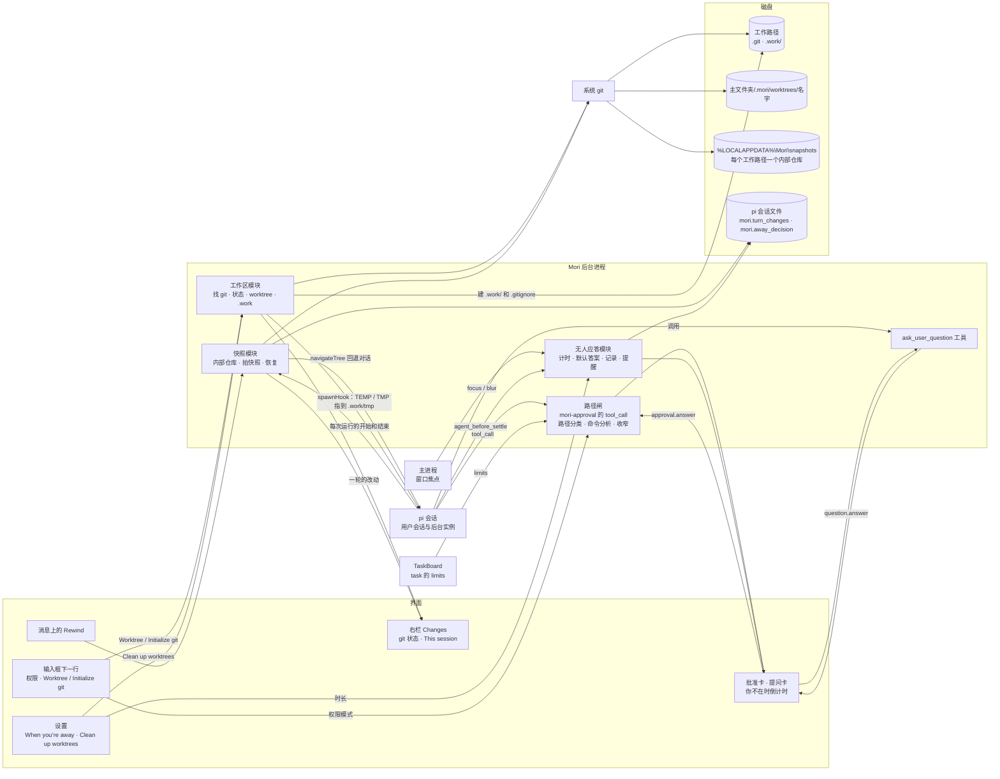
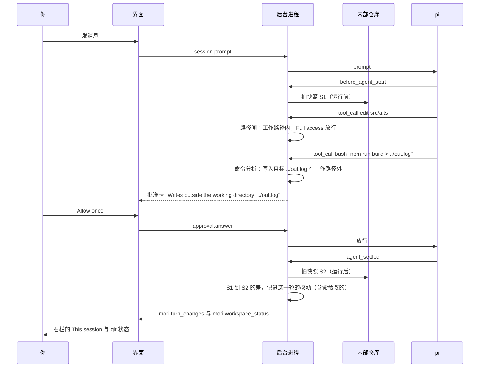
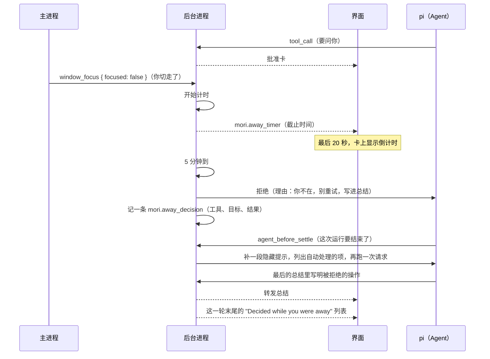
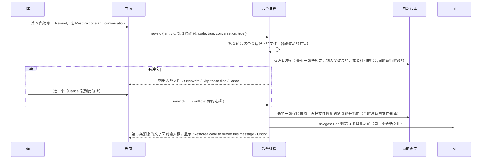
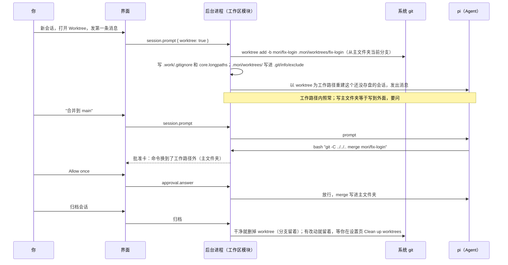

# 文件系统 Proposal：git 状态、快照回退、.work、worktree 与按路径的权限

状态：第一版已定（2026-10-26）：心智模型与 §13 的 20 条默认做法都按默认，构建规格见 [docs/specs/file-system.md](../specs/file-system.md)。
更新日期：2026-10-26。

本文只讲系统怎么运作：Mori 怎样看工作路径，什么时候拍快照，怎样回退，agent 的草稿放在哪里，并行会话怎样隔离，
权限怎样按路径判断，你不在时卡片怎样收尾。参数、状态表、命令载荷和验收条目写进构建规格 `docs/specs/file-system.md`（待写）。

- 你两轮回答定的写在 §12；正文里其余的选择集中列在 §13，2026-10-26 按括号里的默认做法全部定下。
- 交互细节照 Claude 桌面版（Code 标签页）和 Claude Code；Claude 没有对应的地方单独注明。
- 主 Agent、对话 Agent、立项 Agent、结案 Agent、subagent 的叫法同[提示词分层与记忆 Proposal](prompt-and-memory.md) §4。
- 在方案第 6 节“后台进程只做八件事”之外新增第 9 件：“工作区”（§10）。

## 1. 一句话

Mori 以每个会话的**工作路径**为边界。工作路径里的改动，每次运行前后各拍一张快照，随时可以 Rewind；
写到外面先问你；你不在时，卡片到时按默认处理，事后告诉你。

1. **git 状态**：右栏显示分支、领先和落后、未提交的文件。只在有事发生时读一次，不监视，也不轮询。
2. **快照与回退**：这个会话的 Agent 每次运行前后，Mori 用一个**内部仓库**（放在工作路径外的 git 仓库）各拍一张快照。
   是不是 git 仓库都一样，不碰你的分支、暂存区和提交。在你的消息上可以 **Rewind**：开始一次运行的消息可以恢复代码、恢复对话，
   或者两者都恢复；生成中排队或插话的消息只能恢复对话（§4）。
3. **.work**：Agent 的过程脚本、草稿和临时文件都放在 `<工作路径>/.work/`，不进 git，也不进快照，写它从来不问你。
4. **按路径的权限**：只有两种模式，**Ask each time**（新会话默认，同现在）和 **Full access**。
   碰文件的工具（读取、写入、编辑、命令、MCP）对所有 Agent 都一样，不再随角色或模式开关。
   Full access 下，工作路径里什么都不问，读取不限，命令只在分析出写到外面时才问；写到工作路径外、写受保护路径（`.git`、`.mori`、`.pi` 等）时问你。
   派 subagent 的 Agent 可以收窄它：关掉写、命令或 MCP，或者把可写范围缩到几个子目录。
5. **worktree**：git 仓库里的新会话可以打开输入框下一行的 **Worktree** 开关（默认关）。打开后，会话在自己的 worktree 和分支里改，
   不会和别的会话互相覆盖。
6. **你不在时**：卡片挂着，Mori 窗口又不在前台，就开始计时；切回 Mori 清零。5 分钟没人应答，批准卡按拒绝处理，提问卡按推荐项处理。
   Agent 在最后的总结里说明这些，Mori 自己也在这一轮末尾列出来。

## 2. 为什么

1. **改坏了退不回**：v0 的回退靠 git（方案第 4 节“v0 只看 diff，回退用 git”）。不是 git 仓库的文件夹改坏了，没法退；
   是 git 仓库，也分不出哪些改动是 Agent 这一轮做的，哪些是你原来没提交的。
2. **看不全改了什么**：右栏只列 edit、write 两个工具的改动。命令改的文件、后台 Agent 改的文件，都不在里面。
3. **权限是开关，不是范围**：
   - “Ask each time”下每次编辑都要问；“Allow all”什么都不问，写到 `C:\Windows` 也不问。
   - 协作模式靠工具白名单限制只读 task、立项、结案和临时提问。可是命令一给出去，就什么都能写，白名单拦不住。
4. **并行会话互相踩**：两个会话开在同一个文件夹里，同时改同一份文件，谁后写谁赢。
5. **人一走就停**：卡片会一直等。你去开会，Agent 就一直卡在第一张卡上。

## 3. 架构

- **pi 负责什么**：照常执行工具，照常存会话文件。Mori 只用 pi 已有的入口：
  - `tool_call`：拦截或放行；
  - `before_agent_start` / `agent_settled`：拍快照；
  - `agent_before_settle`：补提醒；
  - bash / PowerShell 工具的 `spawnHook`：改临时目录；
  - `navigateTree`：回退对话。
  pi 本身没有沙箱、快照、回退和 git 集成。pi 的 `docs/security.md` 写明，工作路径拦不住命令访问别处。
- **git 是系统的 git**：Mori 不自带 git。没装 git 时，git 状态、快照、Rewind、worktree 都不可用，界面明说“Git is required”。
  提示语和“要求系统装 git、不自带”照 Claude 桌面版。不过 Claude 只有 worktree 会话需要 git，它的 Rewind 不靠 git；
  Mori 的快照建在 git 上，所以 Rewind 也跟着不可用，这一点 Claude 没有对应。
- **内部仓库放在工作路径外**：每个工作路径一个内部仓库，放在 `%LOCALAPPDATA%\Mori\snapshots\` 下。这个目录不进漫游配置，也不在 OneDrive 里。
  工作路径里不会出现新的 `.git`，你的仓库里也不会多出 ref。Mori 调 git 时显式传 `--git-dir` / `--work-tree`，从不改进程的环境变量，
  否则 Agent 跑的命令会继承这些变量。

| 组件 | 做什么 |
| --- | --- |
| 工作区模块 | 新模块。找 git；认出工作路径属于哪个仓库、是不是 worktree；读 git 状态；建、删 worktree；建 `.work/` 和它的 `.gitignore`，并用 bash / PowerShell 工具的 `spawnHook` 把命令的 TEMP / TMP 指到 `.work/tmp`；不是 git 仓库的文件夹可以 Initialize git |
| 快照模块 | 新模块。每个工作路径一个内部仓库。用户会话和后台实例每次运行前后各拍一张，同一个工作路径同一时刻只拍一张；算出改了哪些文件，记进用户会话的会话文件；Rewind 时只恢复这个会话记下的文件，再用 pi 的 `navigateTree` 回退对话 |
| 路径闸 | 扩展现有的批准扩展 `mori-approval`。每个工具调用先分类：读取、工作路径内、`.work` 内、受保护路径、工作路径外。命令先分析出写入目标再分类。权限模式和收窄只看这个分类 |
| 无人应答模块 | 主进程把窗口焦点告诉后台进程。卡片挂着、窗口不在前台时开始计时，到时按默认答案收尾，写一条记录，这一轮结束前提醒 Agent |
| ask_user_question | 新工具，照 Claude 的 AskUserQuestion。Agent 带着选项和推荐项问你，出提问卡 |

## 4. 核心概念

| 概念 | 含义 |
| --- | --- |
| 工作路径 | 会话的 cwd：打开的文件夹，或者这个会话的 worktree。“里”“外”、`.work`、快照都以它为准。界面上叫 working directory（批准卡现在就用这个词） |
| 主文件夹 | 你打开的那个文件夹。worktree 会话的侧栏分组、记忆、增强、反馈、模型的项目访问都按它算 |
| 没装 git / 不是 git 仓库 | 没装 git：这台机器没有 git 程序，相关功能都不可用。不是 git 仓库：文件夹里没有 `.git`，快照、This session、Rewind 照常能用，只是没有分支和 worktree |
| 受保护路径 | 工作路径里仍然要问的一份固定名单，照 Claude：`.git`、`.mori`、`.pi`、`.vscode`、`.idea`、`.husky`、`.npmrc`、`.mcp.json` 等，删掉工作路径本身也算。Agent 在自己的仓库里跑 git 命令（commit、checkout、merge 进当前分支）不算写 `.git`；worktree 会话的 git 写共用的 `.git`，也不算写到外面。完整名单写进规格 |
| `.work` | `<工作路径>/.work/`：过程脚本、草稿、临时文件，命令的 TEMP / TMP 指到 `.work/tmp`。Mori 建它时写一个内容为 `*` 的 `.work/.gitignore`，所以它不进 git 状态、提交和快照。在任何模式下写它都不问。这照 Claude 的 scratchpad：Claude 的放在系统临时目录，Mori 的按你的要求放在工作路径里 |
| 一轮 | 你的一条消息，加上它之后、下一条消息之前的全部回复（方案 5.11 的定义），包括这期间后台 Agent 的运行。生成中排队（Queue）或插话（Steer）的消息也各算一轮，但它们和前一条消息在同一次运行里，没有自己的快照 |
| 快照 | 用户会话和后台实例的每次运行（pi 的 `before_agent_start` 到 `agent_settled`），开始前、结束后各拍一张。只用内部仓库，不碰你的 git。排除的文件和 git status 相同（`.gitignore`、`.git/info/exclude`、全局排除），另外总是排除 `.work/` 和 `.mori/worktrees/`。不是 git 仓库的文件夹用默认排除（`node_modules` 等）。有大小和文件数的上限 |
| 一轮的改动 | 同一个工作路径上，用户会话和后台实例每次运行的开始、结束各拍一张，排成一条时间线。相邻两张之间，只要这个会话有运行在进行，这一段的差就只记一次，记进当时那一轮（你最近的一条消息），并标出这段时间在跑的 Agent。合起来就是这一轮的改动：哪些文件改了、加了、删了，包括命令改的、后台 Agent 改的。记在用户会话的 pi 会话文件里（`mori.turn_changes`） |
| Rewind | 在你的一条消息上回到“这条消息之前”。菜单取 Claude 的四项：Restore code and conversation、Restore conversation、Restore code、Never mind（不做 Summarize）。这条消息之后没有文件改动时，不显示两个恢复代码的选项。生成中排队（Queue）或插话（Steer）的消息没有自己的快照，只能恢复对话，菜单上标 No code restore。这两条都照 Claude |
| 权限模式 | **Ask each time**：沿用现在的规则，读取不问，编辑、写入、命令、MCP 要问；写 `.work` 不问。**Full access**：工作路径里全部不问；读取不限；命令只在分析出写到外面时才问。两种模式下，写到工作路径外和写受保护路径都要问。原来的 “Allow all” 去掉。Full access 这个名字是你定的，Claude 没有对应：它的 Accept edits 只自动接受工作路径内的编辑和少数文件命令，Bypass permissions 什么都不问；Codex 的 Full access 是不设沙箱、从不询问，意思也不同 |
| 收窄 | 派 subagent 的 Agent 关掉它的写（关掉写也就关掉了命令，因为命令也会写文件）、命令、MCP，或者把可写范围缩到工作路径下的几个子目录。task 的 `limits` 收窄的是用户会话的权限（立项 Agent 自己被程序收窄的 `{ write: false }` 不传下去）；临时提问只能比发起方更窄。工具列表不变，越界的调用被拒绝并说明原因 |
| worktree 会话 | 打开 Worktree 开关后发第一条消息，Mori 建 `<主文件夹>/.mori/worktrees/<名字>`，分支是 `mori/<名字>`，会话的工作路径就是它。默认关，照 Claude |
| 你不在 | 卡片挂着时，Mori 窗口不在前台（失去焦点或最小化）。只按整个窗口算，不按分屏的哪一栏算。对应的组件叫无人应答模块 |

## 5. 主要流程

### 5.1 一轮对话：快照、Full access 下写入、写到外面先问

- 后台实例的每次运行也前后各拍一张；相邻两张快照之间的差只记一次，记进当时那一轮，标出是哪个 Agent（§4）。
- 读取（read、grep、find、ls）在任何模式下都不问，工作路径外也不问。
- 编辑和写入按路径判断。命令先分析出它会写到哪里：
  - 认得出的写法：`>`、`>>`、`tee`、`cp` / `mv` / `rm` / `mkdir`、`sed -i`，以及 `Copy-Item` / `Move-Item` / `Remove-Item` / `Set-Content` / `Out-File`。
  - 认出了写入，但目标看不出来（变量、`~`、通配符）：按写到外面处理。
  - 认不出写入的命令（例如 `npm run build`）：在 Full access 下照常跑，不问。
  - 命令把工作目录换到工作路径外（`cd`、`Set-Location`、`pushd`、`git -C`、`--git-dir` / `--work-tree`）：后面的部分按写到外面问；
    只读的命令（`ls`、`cat`、`git status`、`git log` 之类）除外。这一条照 Claude 对 worktree 会话的检查：命令的工作目录到了主文件夹，就拦下来。
- **这不是沙箱**：脚本和程序自己打开文件写到别处（`python build.py`、`npm i -g`、各种缓存目录），Mori 看不到。
  Claude Code 在 Windows 上也没有沙箱，它的文档对 Python、Node 脚本写明了同样的限制。切到 Full access 的确认框（§6）和规格都会写明这一点。
- MCP 和扩展注册的工具：Ask each time 下照旧要问；Full access 下不问，因为它们写什么，Mori 看不出来（§13 第 2 条）。

### 5.2 你不在：超时、按默认处理、事后告诉你

- 拒绝理由的英文原文在规格里定稿，大意是“The user was away and didn't answer within 5 minutes, so this was denied. Don't retry it. Mention it in your final summary.”。
- 只在窗口不在前台时计时。卡片出现时窗口已经在后台，就立刻开始计时；你切回 Mori，计时清零，卡片接着等。
  窗口在前台时，卡片一直等，和现在一样。
- **批准卡**按拒绝处理。**提问卡**（`ask_user_question`）按推荐项回答。**扩展弹出的确认和选择**没有推荐项（pi 没有这个字段），
  按取消处理，和现在扩展自己超时一样（§13 第 6 条）。
- 后台 Agent 的批准卡同样计时。被拒绝的结果回给那个 Agent，提醒它在交接里写明；界面上的列表在用户会话上列出全部。
- 时长在设置里改：60 秒、5 分钟（默认）、10 分钟、不自动处理（Never）。Claude 的提问超时也是这三档，但它的权限卡从不自动处理，
  所以“批准卡也超时”没有 Claude 的对应。
- 提醒只补一次：一次运行里有自动处理的项时，`agent_before_settle` 只在第一次补提示，避免循环。为此会多发一次模型请求。

### 5.3 Rewind：回到某条消息之前

- 恢复只动这个会话记下的文件，不用 `git clean`。两种文件进冲突列表，由你决定：
  - 这个会话最近一张快照之后，你或别的会话又改过的；
  - 这个会话和同一工作路径上别的用户会话同时运行时改的（这个会话自己的后台实例不算）。快照模块对同一工作路径排队拍快照，所以知道哪些运行重叠了。
- 恢复前先拍一张保险快照，所以 Rewind 本身也可以 Undo。
- 会话里有 Agent 在运行（包括后台 Agent）时，不能 Rewind。
- 恢复对话用 pi 的 `navigateTree`，留在同一个会话文件里。后面的轮次变成一个分支，界面按当前分支显示（同现在）。
  TaskBoard 不跟着回退（§13 第 18 条）。
- Claude 的 checkpoint 只跟踪它的编辑工具改过的文件：只被命令改过的文件不记，subagent 的编辑大多也不恢复。
  Mori 用快照，命令改的、后台 Agent 改的都能退。

### 5.4 worktree 会话：开关、工作、合并回去、归档

- 现在新会话的标签一打开，pi 会话就建好了，之后不能改 cwd。所以 Worktree 开关只在第一条消息之前出现：
  发第一条消息时，后台进程先建 worktree，再用同一个 id 在 worktree 里重建这个还没存盘的会话，然后发出消息。开关关着时同现在。
- 照 Claude：开关默认关，只在已有提交的 git 仓库里出现。worktree 放在 `<主文件夹>/.mori/worktrees/`，靠 `.git/info/exclude` 排除；
  Claude 放在 `<仓库>/.claude/worktrees/`，用的也是这个办法。
- 侧栏里 worktree 会话归在主文件夹下面，标出分支名。记忆、增强、反馈、模型的项目访问都按主文件夹算，不当成新项目（§13 第 11 条）。
- 合并照 Claude：没有本地合并按钮。Claude 的合并走 GitHub PR（Create PR、Merge when ready），Mori 离线，不做 PR 流程，
  所以合并、提交都是你跟 Agent 说一句，或者用你自己的 git 工具。合并要写主文件夹，对 worktree 会话来说是工作路径外，所以会问你一次。
- 归档时，worktree 干净（没有未提交、未跟踪的文件）就删掉，分支留着；有改动就留着，等你在设置页清理。归档不弹确认，同方案 5.3。
  恢复归档时 worktree 已经不在了，就从分支重新检出（照 Claude）。
- 新 worktree 里只有已提交的文件，`node_modules`、`.env` 这类要 Agent 重新装或复制。

**不是 git 仓库的文件夹**：几个会话共用这个文件夹，每个会话的快照和 Rewind 照常能用（照 Claude，不做隔离）。
Worktree 开关的位置换成 **Initialize git**：确认框写明会做的事，确认后 `git init`，并把现有文件（按 `.gitignore`）做第一次提交。
之后新会话才能开 Worktree，因为 worktree 只检出已提交的文件。Claude 没有这一项，Codex 会提示你建仓库（§13 第 13 条）。

### 5.5 派活时收窄 subagent

| 谁派 | 怎么写 | 效果 |
| --- | --- | --- |
| 立项 Agent 建 task | `task_create` 的 `read_only` 换成 `limits`：`{ write?: false, commands?: false, mcp?: false, write_paths?: ["src/"] }` | 这个 task 的所有实例都按它判断 |
| 任何有 `agent_message` 的 Agent（主 Agent、对话 Agent、立项、结案、task、订阅实例）临时问别的角色 | `agent_message` 加同样的 `limits` | 这个临时提问的实例按它判断 |
| 程序：立项、结案、订阅实例，以及所有临时提问 | 程序给 `{ write: false }` | 保住“同一时间只有一个 task 写工作区”（§13 第 3 条） |
| 程序：协作模式下的对话 Agent | 程序给 `{ write: false, mcp: false }` | 越界时理由写明对话 Agent 只转达（§13 第 4 条） |

- task：`limits` 不写的项不限，只按权限模式和路径判断；程序给立项 Agent 自己的 `{ write: false }` 不传给它建的 task。
- 临时提问：`write` 总是 false（程序给，写不写 `limits` 都一样）；其余不写的项继承发起方当时的限制，只能比发起方更窄。
- 越界的调用直接拒绝，理由写明限制（例如 “Not allowed for this task: writes are limited to src/.”），不出卡。
  限制是派它的 Agent 或程序定的，不是你定的。
- `write: false` 时写入和命令都拒绝，`.work` 也不能写；`write_paths` 外的写入拒绝，但 `.work` 总是可写（过程脚本和草稿放在那里，§4）；
  限制以内照常按权限模式和路径判断。
- 角色文件里的 `tools:`、“只读 task 只留读取工具”、临时提问写死的只读，这些按工具开关的做法都去掉，换成上面的收窄。
- 按职责给的工具照旧按席位给：TaskBoard 工具、memory、`ask_user_question`（平行 Agent 规格 §6.3、记忆规格 §7.6）。

## 6. 你看到什么

| 位置 | 内容 |
| --- | --- |
| 输入框下一行 | 左端是权限：“Ask each time ▾” / “Full access ▾”（Full access 用警示色）。新会话还没发消息时，旁边是 “Worktree” 开关（已有提交的 git 仓库）或 “Initialize git”（不是 git 仓库的文件夹）；还没有提交的 git 仓库两样都不显示 |
| 切到 Full access | 确认一次：“Switch to “Full access”?” / “Edits, writes, and commands inside the working directory will run without asking. Mori still asks before writes it can detect outside it or to protected files. This isn’t a sandbox: scripts and MCP tools can still write anywhere.” 这就是 §5.1 “这不是沙箱”在界面上的说明 |
| 顶栏 | “Toggle changes” 旁边显示这个会话改动的行数 `+12 −1`（照 Claude 的改动指示），点了打开右栏 |
| 右栏 Changes | git 仓库：上面是 git 状态（分支、领先和落后、未提交的文件，分暂存、未暂存、未跟踪），下面是 This session，按轮列出这个会话改过的文件（含命令和后台 Agent 改的），点开看 diff。不是 git 仓库：上面是 “Not a git repository” 和 Initialize git，下面的 This session 照常。没装 git：只显示 “Git is required to track changes and rewind.”（§13 第 19 条） |
| 你的消息 | 悬停或键盘聚焦时多一个 “Rewind”，菜单见 §4 |
| 批准卡 | 写到外面时标 “Writes outside the working directory: <路径>”；写受保护路径时标 “Protected path: <路径>”；你不在时最后 20 秒显示倒计时 |
| 提问卡 | 问题、选项、标 “(Recommended)” 的推荐项、可以自己填的 “Other”；你不在时最后 20 秒显示倒计时 |
| 一轮末尾 | 有自动处理的项时出现一块 “Decided while you were away”，列出工具、目标、结果。由程序按记录生成，不靠模型 |
| 设置 | “When you’re away”：60 seconds / 5 minutes / 10 minutes / Never。“Clean up worktrees”：删掉归档会话留下的 worktree，确认后才删（照 Claude 的 Clean up） |

## 7. 接口

**给 Agent 的工具**

| 工具 | 参数 | 说明 |
| --- | --- | --- |
| `ask_user_question`（新） | `questions`：1–4 个，每个 `{ question, header, options: 2–4 × { label, description }, multiSelect, recommended }` | 格式照 Claude 的 AskUserQuestion（1–4 个问题、2–4 个选项、multiSelect、Other）。Claude 没有推荐字段，只约定把推荐项放第一个、label 末尾加 “(Recommended)”；Mori 加一个必填的 `recommended`，界面照 Claude 的写法显示。答案是每个问题选中的 label，或者你填的文字。只给跟你对话的 Agent（协作模式关闭时的主 Agent，打开时的对话 Agent）；subagent 不给，照 Claude。名字不用 `ask_user`，因为平行 Agent 规格里 `ask_user` 已经是一种投递的名字 |
| `task_create` | `read_only` 换成 `limits` | §5.5 |
| `agent_message` | 加 `limits` | §5.5 |

**后台进程命令与事件**（给界面）

| 名字 | 说明 |
| --- | --- |
| `session.prompt { …, worktree: true }` | 只在第一条消息上有效：先建 worktree，再在里面重建这个还没存盘的会话（§5.4）。`session.create` 不变 |
| `workspace.status { sessionId }` → `mori.workspace_status` | git 状态：有没有装 git、是不是 git 仓库、仓库根、是不是 worktree、分支、上游、领先和落后、文件列表（有上限） |
| `workspace.initGit { cwd }` | Initialize git |
| `worktrees.cleanUp` | 设置页的 Clean up worktrees |
| `rewind { sessionId, entryId, code, conversation, conflicts? }` | §5.3。第一次调用返回冲突列表，带上你的选择再调一次 |
| `approval.setMode { mode: 'ask' \| 'full' }` | 去掉 `'all'` |
| `question.answer { sessionId, requestId, answers }` | 提问卡的答复 |
| `mori.turn_changes`、`mori.away_decision` | 相邻两张快照之间的改动，一条自动处理记录。也写进会话文件，重新载入后还在 |
| `mori.away_timer { requestId, deadline }` | 无人应答模块开始计时时发截止时间，你切回 Mori、计时清零时发 null；界面据此在最后 20 秒显示倒计时，自己不计时 |
| 批准请求加 `scope` 和 `targets` | `inside` / `outside` / `protected` 和分析出的写入目标，由后台进程判定，界面不再自己猜 |
| 主进程 → 后台进程 `window_focus { focused }` | 新消息，只在焦点变化时发 |

## 8. 信息往哪写，谁什么时候读

| 信息 | 谁写 | 存在哪 | 谁读 |
| --- | --- | --- | --- |
| 快照 | 快照模块，每次运行前后 | `%LOCALAPPDATA%\Mori\snapshots\<工作路径编码>\`（内部仓库，ref 按会话、按运行） | Rewind、一轮的改动 |
| 一轮的改动 | 快照模块，每拍一张快照时 | 用户会话的 pi 会话文件，自定义条目 `mori.turn_changes`（不进模型上下文） | 右栏 This session、Rewind |
| git 状态 | 工作区模块，事件触发 | 只在内存里，交给界面 | 右栏 |
| worktree | 工作区模块 | `<主文件夹>/.mori/worktrees/<名字>`、分支 `mori/<名字>`；会话文件里记一条 `mori.worktree` | 侧栏分组、归档、恢复 |
| 草稿和脚本 | Agent | `<工作路径>/.work/` | Agent |
| 权限模式、“Allow for this session” | 你 | 后台进程的内存（同现在） | 路径闸 |
| 收窄 | 派它的 Agent 或程序 | TaskBoard 的 task / 临时提问实例 | 路径闸（按实例） |
| 自动处理记录 | 无人应答模块 | 会话文件的自定义条目 `mori.away_decision` | 界面列表、`agent_before_settle` 提醒 |
| 无人应答时长 | 你 | Mori 的设置 | 无人应答模块 |

**git 状态什么时候读**：
- 打开会话或切到会话；
- 改文件的工具（edit、write、命令、MCP）执行完；
- 一轮结束；
- 窗口回到前台；
- 打开右栏，或者点 Refresh。

同一时刻只读一个，有超时，也有文件数上限。用 `git --no-optional-locks status`，不和你自己的 git 抢锁。
pi 自带的分支显示靠文件监视，Mori 不用它。

## 9. 关键规则

1. **碰文件的权限只看路径和收窄**：读取、写入、编辑、命令、MCP 这些工具对所有 Agent 都一样，不开关；判断在调用时按路径做，越界就拒绝并说明原因。
   按职责给的工具（TaskBoard 工具、memory、`ask_user_question`）照旧按席位给。
2. **写到外面默认要问**：edit、write 和命令分析出的写入目标，落在工作路径外或受保护路径时，两种模式下都要问。
   按工具名的 “Allow for this session” 不放行它们。写到外面的批准卡上可以选 “Allow writes to <目录> for this session”，只放行那一个目录（§13 第 1 条）；
   受保护路径每次都问。MCP 和扩展工具看不出写到哪，Full access 下不问（§13 第 2 条）。读取永远不问。
   这一条只管 Agent 的写入；pi 和 Mori 自己写的文件（会话文件、截断输出、快照）不算。
3. **命令靠分析，不是沙箱**：认出了写入、但目标看不出来时，按写到外面问；认不出写入的命令照常跑；程序自己打开文件写到别处，Mori 看不到，界面明说。
4. **快照不碰你的 git**：内部仓库在工作路径外；恢复只动这个会话记下的文件，动之前先问清冲突，并留一张保险快照。
5. **不监视、不轮询**：git 状态只在事件发生时读，快照只在运行前后拍，同一个工作路径同一时刻只拍一张；
   没有后台清理，worktree 和快照的清理都在你操作时做。
6. **只在你不在时自动处理**：窗口在前台时卡片一直等；自动处理的每一项都留记录，Agent 在总结里说，界面也列出来。
7. **没装 git 就不假装**：git 状态、快照、Rewind、worktree 都不可用，界面明说；不另做一套不用 git 的快照。

## 10. 与现有方案的关系

- **方案第 4 节**：
  - “撤销与文件快照：v0 只看 diff，回退用 git”由本文替代，快照改由内部仓库做。
  - “按命令前缀放行、复合命令识别等批准规则”：命令分析要拆开复合命令（`cd … && …`）找写入目标，换目录那条规则还按命令名放过只读命令（§5.1）。
    这两样改了第 4 节；仍不做你自己配置的按命令前缀放行。
  - “批准 | Mori 最小扩展”一行改为路径闸。
- **方案第 5.3 节**：worktree 会话归在主文件夹下；归档和删除会话时 worktree 的处理按 §5.4 和 §13 第 12 条。
  [sessions.md](../v0/screens/sessions.md) 第 155 行（“Mori 没有 worktree”）改写。
- **方案第 5.7 节**：
  - 权限模式由 “Ask each time / Allow all” 改为 “Ask each time / Full access”。
  - “放行名单是一个常量，没有其他规则”改为路径分类。
  - 按工具名的 “Allow for this session” 只管工作路径内；写到外面另有按目录的放行（§13 第 1 条）。
- **方案第 5.9 节**：右栏的改动列表改由快照算出，命令和后台 Agent 改的都在。顶部那句 “Files changed by commands aren’t included.” 去掉。
- **方案第 6 节**：
  - 后台进程新增第 9 件事“工作区”：工作区模块、快照模块、路径闸、无人应答模块、`ask_user_question`。AGENTS.md 第 4 条跟着改。
  - “最小批准扩展”一段（“Allow for this session 只是按工具名记录的集合，不做其他规则”）改为路径闸。
  - “会话与数据”加上 `%LOCALAPPDATA%\Mori\snapshots`。
- **方案第 11 节**：2026-10-19 的“不做规则引擎”“Mori 只做界面、安装包、进程桥和最小批准扩展”，由路径闸（路径分类、命令分析、收窄）取代。
- **平行 Agent 规格与 proposal**：
  - §0：“多个实例同时写工作区”仍不在范围。worktree 是按会话的，不是按实例的。
  - 写入锁：改成 `limits.write` 不是 false 的 task 取锁（代替 `read_only: false`）。按 §13 第 3 条的默认，“同一时间只有一个 task 写工作区”（proposal 规则 8、规格 §9.2）照旧成立。
  - §4.1 角色的 `tools:`、§5.5 / §8.1 的工具白名单、§6.3 的 `task_create.read_only`、§9.5 的订阅只读、§10.1 的临时提问只读，都按 §5.5 改。
  - §11.1 / §11.3 的 “Allow all”、§11 的批准卡加计时。
  - §13.12 和 TB-57：右栏 This session 列出后台实例改的文件，去掉 “Changes made by team tasks aren’t listed here.”。
  - §5.6 的 `ask_user` 投递名字不变；对话 Agent 收到它之后怎样问你，按 §13 第 5 条。
- **记忆规格**：
  - 身份段里 “Tool calls other than reading and searching may wait for the user’s approval” 按模式改写，并加一句 `.work` 的用法。
    这改了模型看到的文字，所以按 AGENTS.md 要重录 fixture、用真实模型走一遍。
  - 增强会话原来以 “Allow all” 开始，改为 Full access。write、edit 在增强会话和它的实例里一律拒绝（不论路径，记忆规格 §9.6），这条不变。
    命令和 MCP 在工作路径里照旧自动执行；命令分析出写到工作路径外或受保护路径时直接拒绝，因为没人能批（§13 第 20 条）。MEM-20 跟着改。
  - worktree 会话按主文件夹算项目：§3 的项目目录、§9.5 读哪些会话，从按 cwd 精确匹配改为按主文件夹（§13 第 11 条）。
- **界面文字**：Full access、Worktree、Initialize git、Rewind、Decided while you were away 等词进 [ui-strings.md](../v0/ui-strings.md)；
  第 47 行“不用 Bypass permissions”的说明跟着改写。

## 11. 分步落地

1. 心智模型定下后写规格，内容包括：
   - 状态表：右栏、批准卡、提问卡、Rewind 菜单、输入框下一行；
   - 受保护路径名单，命令分析覆盖的写法；
   - 快照的排除和上限；
   - 命令载荷和验收条目。
   临时默认值登记在 `docs/v1/defaults.md`。
2. 用真实模型录 fixture：改过的身份段、`ask_user_question`、自动拒绝的工具结果、提醒。
3. 在单独的会话里用 workflow 实现，分三步，每一步都能在 App 里走查：
   1. 权限：路径闸、两种模式、受保护路径、命令分析、`.work` 和临时目录、`ask_user_question`、无人应答模块。不依赖 git。
   2. git：git 状态、快照、一轮的改动、右栏、Rewind。
   3. 并行：worktree 开关、Initialize git、侧栏分组、归档和清理；TaskBoard 的 `limits`。

## 12. 已定的（2026-10-26 你的决定）

1. git 仓库也用 Mori 自己的快照回退：按轮拍（每次运行前后各一张），存在工作路径外，和不是 git 仓库的文件夹用同一套内部仓库；不碰你的分支、暂存区和提交。
2. 命令写到工作路径外：执行前分析命令，同时把 TEMP / TMP 指到 `.work/tmp`；明说这不是沙箱，这一轮不做 Windows 沙箱。
3. 权限模式只留 Ask each time 和 Full access，去掉 Allow all。新会话从 Ask each time 开始（同方案 5.7 节、平行 Agent 规格 §11.1）；
   Claude 桌面版按文件夹记住上次选的模式，Mori 不记。
4. 收窄 subagent：按类关掉写（连带命令）、命令、MCP，再加上缩小可写路径；只能收窄。角色文件的 `tools:` 和只读 task 的工具裁剪去掉。
5. Worktree 照 Claude：输入框下一行的开关，默认关。
6. 不是 git 仓库的文件夹：几个会话共用文件夹，各自的快照回退照常；开关换成 Initialize git。
7. 受保护路径照 Claude：Full access 下写 `.git`、`.mori`、`.pi`、`.vscode` 等也要问。
8. 加提问工具，照 Claude 的 AskUserQuestion，推荐项必填；只给跟你对话的 Agent。（你选的名字是 ask_user。它和平行 Agent 规格 §5.6 的投递种类重名，本文暂叫 `ask_user_question`，改不改见 §13 第 7 条。）
9. 你不在时 5 分钟后按默认处理；只在窗口不在前台时计时，切回清零；最后 20 秒倒计时；后台 Agent 的卡也一样；设置里可以改成 60 秒、10 分钟或不自动。
10. 告知方式：工具结果里写明；`agent_before_settle` 钩子提醒一次，多一次请求；再加上程序生成的 “Decided while you were away” 列表。
11. 合并回主分支照 Claude：不放合并按钮，让 Agent 做；归档时干净的 worktree 删掉，有改动的留着。
12. git：要求系统装 git，不自带 MinGit；没装时相关功能不可用，并且明说。提示语照 Claude。

## 13. 按默认定下的（2026-10-26，括号里是定下的做法）

下面 20 条原是待你定的问题，2026-10-26 你同意全部按括号里的默认做法；“另一种做法”只留作记录。

**权限**

1. **写到外面的“本会话允许”**：写到外面的批准卡上要不要有 “Allow writes to <目录> for this session”？
   （要。目录取目标文件所在的目录：写 `D:\out\a\b.log` 时放行 `D:\out\a`。这是 Mori 自己的做法；Claude 的文件修改可以选“本会话不再问”。）
2. **MCP 在 Full access 下**：（不问，也不分析参数。）这和原始需求“工具写到外面也要确认”不同：MCP 工具写什么，Mori 看不出来。
   另一种做法是参数里有工作路径外的绝对路径时问你，但这是按参数名猜，容易误报。
3. **程序开的实例和临时提问**：立项、结案、订阅实例和临时提问，以前只有读取类工具。
   （现在工具和大家一样，但程序给它们收窄 `{ write: false }`，所以“同一时间只有一个 task 写工作区”照旧成立。）
   另一种做法是它们也能写：代价是写入锁只管 task，它们写文件时不排队，可能和正在写的 task 同时改同一个文件，评审也可能看到改了一半的代码。
4. **协作模式下的对话 Agent**：以前只拿读取类工具加转达工具（“只转达、不做决定”，平行 Agent 第四轮的决定）。
   （工具列表不变，改成程序给它收窄 `{ write: false, mcp: false }`，越界调用被拒绝，理由写明对话 Agent 只转达。）
5. **协作模式分开时的提问卡**：你对提问卡的答复，对话 Agent 当成工具结果拿到；立项 Agent 看不到，它只读你的消息。
   （程序同时把“问题 + 你的答复”当成你的一条消息放进立项的待判断队列，立项照常处理。task 等你拿主意时（`ask_user` 投递），
   对话 Agent 也用提问卡问你，推荐项取自提出问题的 Agent 的交接。）另一种做法是：协作模式分开时不给对话 Agent 这个工具，仍在对话里问，不超时
   （这和 §12 第 8 条“只给跟你对话的 Agent”不同）。
6. **你不在时扩展的确认和选择**：（按取消处理。）这和原始需求“提问按推荐项”不同，原因是 pi 的确认和选择没有推荐项字段。
7. **`ask_user_question` 的名字和批准**：（叫 `ask_user_question`，因为 `ask_user` 已经是平行 Agent 规格 §5.6 的投递种类；不要批准，同 TaskBoard 工具和 memory。）
   另一种做法是保留你定的 `ask_user`，把投递种类改名，例如 `user_decision`。

**worktree**

8. **位置**：（`<主文件夹>/.mori/worktrees/<名字>`，照 Claude 放在仓库里；不能改，Claude 的 Worktree location 设置这一轮不做。）仓库在 OneDrive 里时，worktree 和它的 `node_modules` 也会被同步。
   每个 worktree 写 `core.longpaths=true`（Claude 也这样做），这只让 git 自己的检出和状态不受 260 个字符的限制；
   `node_modules` 这类 git 不管的目录由 npm 等工具写，仍受 Windows 的 LongPathsEnabled 限制（本机为 0）。
   本机嵌套 worktree 里 `node_modules` 的路径已到 244 个字符，这是把 worktree 放在仓库里的代价。
9. **从哪个提交切出**：（主文件夹当前分支的 HEAD，不联网。）Claude Code 命令行默认以远端默认分支为准。
10. **worktree 里的项目配置**：Mori 自己读的 `.mori/agents`、`.mori/models.json` 从主文件夹读；pi 读的 `.pi/` 和 AGENTS.md 按 pi 的规则从 worktree 读，
   所以没提交的 `.pi/` 配置在 worktree 里没有。（接受这个差别。Claude 是从主文件夹读设置、从 worktree 读 CLAUDE.md。）
11. **按哪个文件夹算项目**：（worktree 会话的记忆、增强、反馈、模型的项目访问按主文件夹算。）这改了记忆规格按 cwd 精确匹配的规则。
12. **删除 worktree 会话**：（删除确认框写明 worktree 和里面没提交的改动一起删；分支留着。）
13. **Initialize git 要不要做第一次提交**：（要，按 `.gitignore` 提交现有文件，确认框写明。）另一种做法是只 `git init`，等仓库有了提交才出现 Worktree 开关。
    还没有提交的 git 仓库：（不显示 Worktree，等你自己提交一次。）

**快照与 Rewind**

14. **快照的上限**：（单个未跟踪文件超过 10 MB 不进快照；不是 git 仓库的文件夹默认排除 `node_modules`、`.venv`、`dist`、`build`、`target`；
    一次要加入超过 20000 个文件时，这个文件夹暂停快照，界面说明原因。）实测：Mori 仓库第一次快照约 3 秒，之后每次约 1 秒；
    不排除 `node_modules`（3 万个文件）时，第一次要 76 秒。
15. **快照存在哪**：（`%LOCALAPPDATA%\Mori\snapshots`，不放进 `%APPDATA%\Mori` 这个用户数据目录，因为快照大，不该进漫游配置。）
16. **保留多久**：（每个会话保留最近 100 轮，照 Claude；会话删除时一起删；内部仓库的整理只在删除会话时做。）
17. **同一文件夹里两个会话同时在跑**：一轮的改动会把另一个会话同时写的文件也算进来（Claude 的命令改动记录也有同样的说明）。
    （接受；Rewind 时这些文件一律进冲突列表，由你决定。要分清楚就开 worktree。）
    后台 Agent 的改动按时间记进当时那一轮。另一种做法是整次运行归到它开始时的那一轮，但它和对话的运行重叠时，同一份改动会在两轮里各记一次。
18. **协作模式下的 Rewind**：（会话里任何 Agent 在运行时不能 Rewind；后台 Agent 改的文件一起退；TaskBoard 的需求、task、交接不回退，
    所以有还没关闭的需求时，不能把对话恢复到它立项之前，界面说明原因。）
19. **没装 git 时的右栏**：（只显示 “Git is required to track changes and rewind.”，不再列编辑和写入。）
    另一种做法是保留现在（v0）那份只列编辑、写入的列表，连同那句 “Files changed by commands aren’t included.”；但那是第二套改动列表。

**增强任务**

20. **增强会话里写到外面或受保护路径的命令**：（直接拒绝，因为没人能批。）这改了 2026-10-22 定的“命令和 MCP 一律自动执行”（记忆规格 §0、方案第 11 节）。

## 14. 没验证的

- Claude 桌面版的 Rewind：官方桌面版文档没写，只有用户报告说桌面版可以双击 Esc 或点时间线上的 checkpoint；菜单项取自 Claude Code 的文档。
- 命令分析能覆盖多少真实命令：要拿真实会话里的命令统计一次，再定名单。
- 快照在公司仓库上的耗时：只在本机的 Mori 仓库上量过。后台实例多时快照次数也多，规格里要量一次。
- `agent_before_settle` 多跑一次请求时，TaskBoard 等 `agent_settled` 的投递会晚一轮，要测。
- pi 能不能让 worktree 会话从主文件夹读 `.pi/`：没核实，所以 §13 第 10 条先按 pi 现有的规则。
- 公司机器有没有 git：方案第 11 节待确认的第 2 条还开着；没装 git 时，本文的大部分功能不可用。
