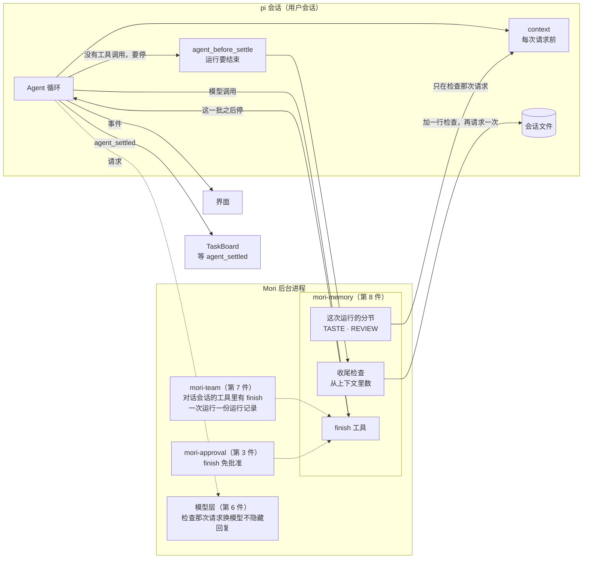
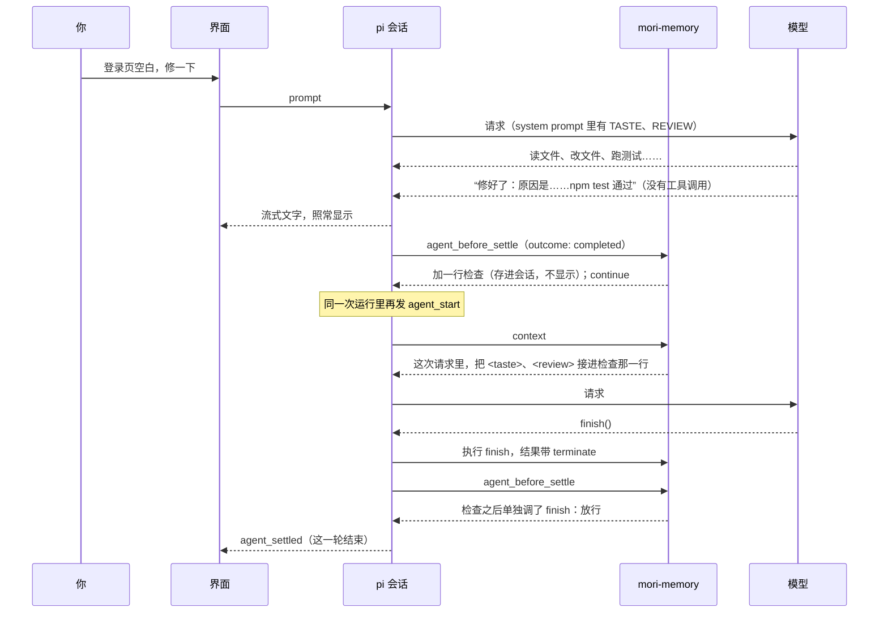
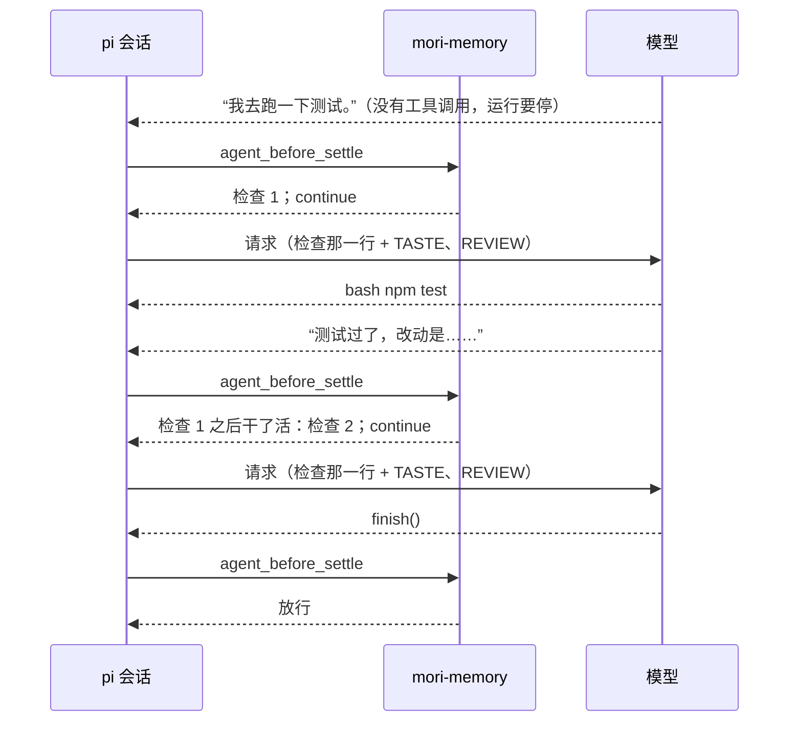

# 收尾检查 Proposal：运行结束前，按 TASTE 和 REVIEW 再看一眼

状态：第一版草案（2026-10-27），已按一轮 Fable 评审改过（五个维度各一位评审、每条发现一位反驳者核实）。
机制、上限和范围是负责人 2026-10-27 与发起会话谈定的（§12）；§13 是负责人不在时（无人模式）按推荐定下的，
同时登记在 [docs/v1/defaults.md](../v1/defaults.md) 的“收尾检查”一节，待负责人审。构建规格（§14 第 1 步）见 [docs/specs/finish-check.md](../specs/finish-check.md)（2026-10-27；第 1 步已实现、未提交，检查记录 [docs/v1/finish-check-checks.md](../v1/finish-check-checks.md)）。
更新日期：2026-10-27。

本文只讲系统怎么运作：一次运行快结束时 Mori 做什么、模型怎么回应、什么存进会话、什么只在一次请求里出现、界面上看到什么。
检查那一行和 `finish` 说明的英文原文、计数的边界情况、状态表和验收写进构建规格（§14 列出交给规格的事）。

- 这是[提示词分层与记忆 Proposal](prompt-and-memory.md) 的延伸：TASTE、REVIEW 除了在 system prompt 里，运行收尾时再出现一次。
  主体属于方案第 6 节“后台进程只做八件事”的第 8 件（记忆、拼装与增强），由已有的 inline extension `mori-memory` 做；
  第 7 件（`mori-team`）、第 3 件（`mori-approval`）和第 6 件（模型层）各有一处配合改动（§3、§10）。
- 主 Agent、对话 Agent、立项 Agent、结案 Agent、subagent 的叫法同 prompt-and-memory §4。
  **一次运行**是 pi 的一次运行：从一条消息交给 pi，到 `agent_settled`。
- 交互细节照 Claude 桌面版；Claude 没有对应的地方单独注明。

## 1. 一句话

模型写完回复、正要停下时，Mori 在会话末尾加一行看不见的**收尾检查**，在那次请求里把这个会话的 TASTE、REVIEW 临时接在后面，让模型再请求一次。
模型三选一：调用不带参数的 `finish`，确认刚才那段就是最终回复；接着用工具干活；或者重写回复。回复照常写成文字，流式和 Markdown 都不变。

## 2. 为什么

1. **长上下文里 TASTE、REVIEW 离得太远**：它们在 system prompt 里（prompt-and-memory §5.2）。会话长了，中间隔着几万 token 的工具输出，
   模型写最后那段回复时，“先给结论”“说完成前要跑过测试”这类约束最弱，而这正是它们该起作用的时候。
2. **运行骤停**：pi 的循环在一条助手消息没有工具调用、插话和排队都为空时结束（`pi-agent-core/dist/agent-loop.js` 141–207 行），然后发
   `agent_end`、`agent_settled`。模型说“我去跑一下测试”却没调工具，或者把工具调用写成了纯文本、服务端没解析出来，运行就停了，
   你回来看到的是一句空话。Mori 现在不自己判断哪段是最终回复，也就发现不了。

## 3. 架构



- **pi 负责什么**：照常跑循环。运行要结束时发 `agent_before_settle`（相当于 Claude Code 的 Stop hook），处理器可以往会话里加条目、
  要求在同一次运行里再请求一次；每次请求前发 `context`，处理器可以改这次请求的消息；照常执行工具、存会话文件。pi 不改。
- **同一次运行里会多出一组 `agent_start`、`agent_end`**：pi 每次接着跑（`agent.continue()`：检查之后、重试、压缩后接着跑）都再发一个
  `agent_start`，但不再发 `before_agent_start`；`agent_settled` 只在最后发一次（`agent-session.js` 1418–1440 行，`agent-loop.js` 59–70 行）。
  Mori 里凡是按 `agent_start` 认“一次运行”的地方都要按这一点处理（§5.4、§10）。
- **Mori 负责什么**：

| 扩展 | 多做什么 |
| --- | --- |
| `mori-memory`（第 8 件） | 注册 `finish`；`agent_before_settle` 的处理器按 §5.4 决定检查或放行，检查时往会话里加一条不显示的 `custom_message`（`mori.finish_check`），返回 `continue: true`；`context` 的处理器在检查那次请求里把检查块接进检查那一行 |
| `mori-team`（第 7 件） | 协作模式下对话会话每次运行设的工具里一直有 `finish`，`tool_call` 的限制也放过它；一次 pi 运行只记一份运行记录，同一次运行里再来的 `agent_start` 不另起（§10） |
| `mori-approval`（第 3 件） | `finish` 免批准 |
| 模型层（第 6 件） | 检查那次请求换模型时不隐藏刚写完的回复（§10） |

## 4. 核心概念

| 概念 | 含义 |
| --- | --- |
| 收尾检查 | 一次运行要结束时 Mori 追加的一次请求：一行检查，加上 TASTE、REVIEW。代码名 finish check |
| 检查那一行 | 存进会话文件的一行英文提示（`custom_message`，`mori.finish_check`，不显示）：说明这是 Mori 的检查；说过要做的做了没有，对照 TASTE、REVIEW 看回复，然后三选一。每次检查一行，约 140 token（构建规格 §7.1 量过） |
| 检查块 | 只在检查那次请求里出现的 `<taste>…</taste><review>…</review>`。`context` 处理器在这次请求的副本里把它接进检查那一行，两者是同一条消息；内容就是这次运行 system prompt 里那两段（会话打开时的快照，按这次运行开始时的身份取）。不存，下一次请求就没有了 |
| `finish` | 模型用来确认的工具，没有参数。只有检查之后**单独**调用、执行成功（这一批只有它，循环就此停下）才算确认 |
| 最终回复 | 这次运行最后一段非空文字。模型常在调 `finish` 的同一条消息里先写一句话（录制的 GLM、DeepSeek 会话里，工具调用前写话很常见），那句话就是最终回复；只调 `finish`、不写字时，就是检查之前那段；模型重写了，就是新的那段。和 TaskBoard 的 `run.lastText` 是同一个定义 |
| 干活 | `finish` 以外的工具调用，不论成功、失败还是被拒绝（包括被 `mori-team` 或批准拦下、工具不存在、参数校验失败的） |

## 5. 一次运行怎么收尾

### 5.1 回复就是最终回复（a，最常见）



回复在模型写完时就显示了。之后阶段行照常按事件走：回复写完到检查请求发出之间不显示，然后“Waiting for the model… Ns”，
开了思考时“Thinking…”，模型写 `finish` 调用的那一下短暂显示“Responding…”（和写任何工具调用一样）。`finish` 的工具卡不显示（§11）。

### 5.2 说了要做却停了（b）



工具调用被写成纯文本、服务端没解析出来时走同一条路：检查给模型再一次机会，把调用正经发出来。

### 5.3 重写回复（c）

模型对照 TASTE 发现没先给结论，重写了一段（后面调不调 `finish` 都行）。新的那段就是最终回复；检查之后没干活，不再追问，运行结束。
前一段留在对话流里，不删。重写是同一轮里的第二条助手消息，所以回复下的 Copy 和“Attach message as context”（取整轮的正文）带着两段，
而最终回复与 TaskBoard 的 `run.lastText` 是新的那段（§11、§13 第 17 条）；增强任务读会话片段时两段都在。

### 5.4 什么时候检查

运行要结束、`outcome` 为 `completed` 时，按顺序取第一条成立的：

| 顺序 | 情况 | 做什么 |
| --- | --- | --- |
| 1 | 这次运行还没检查过 | 检查 |
| 2 | 最近一次检查之后，模型单独调用了 `finish` 并执行成功 | 放行（a） |
| 3 | 最近一次检查之后没干活 | 放行（c：重写了、什么都没写，或者 `finish` 调用失败后写了字） |
| 4 | 已经检查了 3 次 | 放行 |
| 5 | 其余：检查之后又干了活（b），或 `finish` 和别的调用在同一批 | 再检查一次 |

- **怎么数**：不另存状态。`agent_before_settle` 带着这次运行的上下文（pi 的 `event.context`），Mori 从最近一条用户消息往后数：
  有几行检查，最近一行检查之后模型调了哪些工具、`finish` 有没有单独成功。所以运行中你排队或插话的消息一进上下文，后面就是对新消息的回复，
  计数自然从头算；上一次运行留下的检查行（例如检查时你按了停止，§8）在新消息之前，不算。
- **不按 pi 的 `agent_start` 认运行开始**：检查之后的接着跑在同一次运行里会再发一个 `agent_start`（§3），在那里清零会让第 1 条每次都成立、
  检查没有上限；文件系统规格 §9.8 的提醒清单为同样的原因不在 `agent_start` 清。
- 你按了停止（`aborted`）或出错（`error`）：不检查。停止时 pi 根本不发这个边界；出错时处理器直接放行。
- 检查之前就调了 `finish`（模型自己提前确认）不算：照样检查一次。
- 每次运行都检查，不看调没调过工具、上下文多长（§12 第 4 条）：最常见的骤停恰恰是一次工具都没调。
  Mori 自己开始的用户会话运行也算：协作模式下程序投递到用户会话的唤醒（平行 Agent 规格 §5.6）、扩展命令开始的运行。

### 5.5 检查那次请求长什么样

主 Agent，协作模式关闭：

```text
system      你是 Mori…… <taste>…</taste> <review>…</review> ……    会话打开时定下，不变
user        登录页空白，修一下
assistant   [read] [edit] [bash]
tool        ……
assistant   修好了：原因是……npm test 通过                          已经显示给你
user        [Mori] This is Mori's end-of-turn check. …                检查那一行：存进会话，不显示
            <taste>…</taste> <review>…</review>                       检查块：只在这次请求，接在同一条消息里
```

- **一条消息**：检查块接进检查那一行，不另起一条。pi 不合并连着的 user 消息，有的 OpenAI 兼容服务端（聊天模板要求 user、assistant 严格交替）
  遇到连着两条 user 会回 400（§8）。
- **后面还有什么**：“你不在时”的提醒（文件系统规格 §9.8）由排在 `mori-memory` 之后的 `mori-approval` 加，所以在检查那一行之后；
  协作模式的工作卡由 `mori-team` 的 `context` 处理器先加，仍在最后。顺序是 [检查那一行（含检查块），提醒，工作卡]（§13 第 14 条）。
  所以 `context` 处理器找的是最后一条助手消息之后的检查那一行，不要求它在末尾。
- **缓存**：下一次请求（`finish` 之后，或者你的下一条消息）里检查那一行只剩一行，和这次相同的前缀到最终回复为止。自动前缀缓存的服务
  （DeepSeek、OpenAI 一类）命中到那里；按断点缓存的服务（Anthropic，OpenRouter 上的 Claude）命中到上一次请求的断点，回复重算一次；
  检查那次请求写下的缓存（含检查块）之后用不上。
- **检查那一行的大意**（英文原文在规格里定稿）：开头说明这是 Mori 的收尾检查、不是用户的话（协作模式关闭时，没有别处解释 `[Mori]`）；
  这一轮要结束了，说过要做的事还没做、或者工具调用没有发出去，现在就用工具去做；对照检查块看最后那段回复（在等用户回答的问题也算回复）；
  现在写的字都会作为回复显示给用户，它就是最终回复，就只调用 `finish`；要改，写出新的回复，再调用 `finish`。
  只点名检查块里有的分节，同 system prompt：哪种两层都没有条目就不贴也不提。主 Agent 通常是 TASTE 和 REVIEW，对话 Agent 只有 TASTE；
  都没有时没有检查块，只问说过要做的做了没有。

## 6. 接口

### 6.1 给模型的工具

| 名字 | 参数 | 效果 |
| --- | --- | --- |
| `finish` | 没有：`{ type: 'object', properties: {}, additionalProperties: false }`，多余字段校验失败；也不在 `prepareArguments` 里丢掉多余字段（memory、TaskBoard 工具会丢） | 确认上一段文字是最终回复。结果带 `terminate`，单独调用时这一批之后循环就停（pi 只在一批的结果全带 `terminate` 时停，平行 Agent 规格 §14.6 T-T5）。说明的第一行是人看得懂的一句（Customize 页显示它，§11）；后面写明只在 Mori 收尾检查时调用、回复要先写成正文 |

- **注册在哪**：用户会话，增强任务的看不见的会话除外（它也走用户会话的路径，`isHeadless`；同文件系统规格对 `ask_user_question` 的处理）。
- **一直启用**，不随检查开关：启用的工具一变，pi 就记一条 system 补丁、工具定义也跟着变，前缀缓存失效（prompt-and-memory §5.1 最后一条）。
  协作模式下 `mori-team` 每次运行前重设对话会话的工具，`finish` 要和 `agent_message`、`memory` 一样留着（文件系统规格 §8.6 把这一步换成
  `applyDutyTools` 之后，它是职责工具之一），`tool_call` 的限制也要放过它；不然 pi 回 `Tool finish not found`，对话 Agent 没法确认。
  因为一直启用，模型在检查之前也看得到它，提前调用按 §5.4 不算确认。
- **免批准**：`mori-approval` 的免批准名单加上它（同 memory 规格 §7.5 的 `memory`）。

### 6.2 用到的 pi 入口

| 入口 | 用法 |
| --- | --- |
| `before_agent_start` | `mori-memory` 已有的处理器：这次运行取哪几种分节，检查块和检查那一行用同一份；运行中切换协作模式不影响这次运行 |
| `agent_before_settle` | 按 §5.4 从 `event.context` 数；检查时返回 `{ entries: [...event.entries, 检查那一行], continue: true }`，放行时不返回；pi 提交条目后在同一次运行里再请求一次（平行 Agent 规格 §14.6 T-F3 已实测） |
| `context` | 最后一条助手消息之后有检查那一行时，在这次请求的副本里把检查块接进那一行；会话里的条目不变 |
| `registerTool` | `finish`（§6.1） |

不加后台进程命令，也不加事件：检查那一行是 `custom_message`，界面本来就不画；`finish` 的卡由界面按工具名不画。

### 6.3 信息往哪写，谁什么时候读

| 信息 | 谁写 | 写到哪 | 谁读 | 什么时候读 |
| --- | --- | --- | --- | --- |
| 检查了几次、最近一次检查之后调了什么 | — | 不存 | 收尾检查 | 每次运行要结束时，从这次运行的上下文里数（§5.4） |
| 检查那一行 | 收尾检查 | pi 会话文件（`custom_message`，`mori.finish_check`） | 模型（之后每次请求都带着）；增强任务读会话时看得到 | 每次请求 |
| 检查块 | `context` 钩子 | 只在那一次请求里，接在检查那一行里 | 模型 | 检查那次请求 |
| `finish` 的调用与结果 | pi | 会话文件（普通的工具调用） | 模型；界面认出它、不画 | 每次请求；打开会话时 |
| 最终回复 | 模型 | 会话文件（普通的助手消息） | 你；TaskBoard（`run.lastText`，例如协作模式下等这个会话回复的 `agent_message`）；增强任务（读整段会话片段） | 实时；运行结束时 |

## 7. 为什么不把回复放进工具参数

负责人最初的想法是：模型调 `agent_end(最终回复)`，Mori 注入 TASTE、REVIEW，模型再调 `agent_settle` 才显示。
讨论后改成回复照常写成文字、只加一个不带参数的确认工具，因为把回复放进参数：

1. **流式和 Markdown 受影响**：参数是 JSON，界面要边收边解析半截 JSON 才能流式显示；部分 OpenAI 兼容服务端把参数攒到最后一次发出，回复写完之前什么都看不到。
2. **弱模型写坏 JSON**：长文要转义引号、换行和反斜杠，弱模型容易出错；被 `max_tokens` 截断时，pi 把这一批调用全判失败
   （`agent-loop.js` 的 `failToolCallsFromTruncatedMessage`），整段回复都没了。
3. **输出翻倍**：模型常先写一遍正文，再原样抄进参数。
4. **每条回复都多等一轮才显示**：要等确认回来才能给你看。

不带参数的 `finish` 只有几个 token，弱模型也写得对；回复的流式、Markdown、复制都不变。

也比较过的做法：

- **每次请求都在末尾贴 TASTE、REVIEW**（像工作卡）：能解决问题 1，但每次请求多约 1000 个不进缓存的 token，中间的工具步骤用不上；解决不了问题 2。
- **用文字标记代替工具**（回复末尾写 `<done/>` 之类）：标记会随正文流到界面上，要么显示出来，要么从流式文字里删掉，和“不藏模型写的字”冲突；
  模型也常把标记写到正文中间。工具调用和正文天然分开。
- **按回复文字猜**（“我去……”“接下来……”）：要按语言写规则，猜错了就白问或漏问。让模型自己判断，Mori 只给它一次机会。

## 8. 代价与失败模式

| 代价 | 多大 | 说明 |
| --- | --- | --- |
| 每次运行多一次请求 | 通常 1 次，最多 3 次。输入是整个上下文（前缀多半命中缓存，§5.5）加检查块，检查块 ≤ 1000 token；输出是一个 `finish` 调用，开了思考时还有思考，多少待真实模型走查量出 | 负责人定每次运行都检查（§12）。Mori 自己开始的用户会话运行也算（§5.4），所以协作模式下检查次数会多于你发的消息数。内网端点没开前缀缓存时，长上下文要整段重算一遍，收尾多等几秒到几十秒 |
| 这一轮晚一次请求才结束 | 一次请求的时间 | 回复写完就显示了；晚的是：停止按钮（回复已经完整时仍可以按，Claude 桌面版没有对应）、回复下的 Copy 等操作行（`agent_settled` 之后才出现，§11）、侧栏的 Running 和 Unread、等 `agent_settled` 的 TaskBoard 投递（同文件系统 Proposal 的提醒，FS-79） |
| 会话文件每次运行多一行检查和一次 `finish` | 约 160 token（检查那一行约 140，加 `finish` 调用与结果；构建规格 §7.1），一次运行最多 3 次 | 只追加；会话长了随压缩进摘要 |
| 检查块在下一次请求里消失 | — | 同工作卡：较新的 Claude 模型的 preserved thinking 可能把消失的内容当作改了历史（负责人接受，§12 第 5 条） |

| 失败模式 | 结果 | 怎么兜 |
| --- | --- | --- |
| 模型回应检查时写了话（“已检查，回复无误”），单独写或和 `finish` 写在同一条消息里 | 常见，不少 OpenAI 兼容模型调工具前先写一句。这句话照常显示，成了最终回复；协作模式下等这个会话回复的 `agent_message` 拿到的也是它 | 检查那一行写明现在写的字会显示给用户、确认就只调 `finish`；不藏模型写的字（§13 第 6 条）；走查按服务分开统计“写话 + `finish`”和“只写话” |
| 模型把回复写进 `finish` 的参数 | 参数校验失败，pi 把错误作为工具结果回给模型，模型再写成正文 | `finish` 的 schema 带 `additionalProperties: false`（§6.1） |
| 模型把调用写成文字，或服务端处理不了没有字段的工具 | 每次检查都走 c：它回应检查的话成了最终回复 | 选择器只让工具调用已验证的模型进会话（模型层规格 §5.3 第 3 步），不另加过滤（§13 第 11 条）；走查在每个服务上调一次 `finish` |
| 检查那次请求出错（模型层重试、换模型之后仍失败） | 回复完整显示，后面跟一张错误卡，侧栏这个会话显示 Error；协作模式下等这个会话回复的 `agent_message` 拿到的是错误。候选耗尽时是“No model available”卡 | 错误卡照常显示原文，但不带“Put your last message back in the message box”（§13 第 7 条）；Team 要不要把它当作已完成的运行，规格里定（建议当作已完成：回复已经在了） |
| 检查那次请求换了模型 | 按模型层现在的规则，换到的模型看不到刚写完的回复（换模型时隐藏这一段已有的过程、加重做说明），要么从头再做一遍，要么盲确认 | 跟在没有工具调用的助手消息之后的请求换模型时不隐藏、不加重做说明（§10、§13 第 18 条） |
| 聊天模板要求 user、assistant 严格交替的服务端 | 连着的两条 user 消息回 400 | 检查块接进检查那一行（§5.5），协作模式关闭时没有连着的 user；协作模式下工作卡、有提醒时提醒仍跟在后面，同工作卡现在的情况；检查时停止或出错之后，留下的检查那一行与你的下一条消息是连着的两条 user 消息（停止、出错的那条助手消息发请求时被去掉），同今天在你的消息之后停止或出错的情形，接受（构建规格 §7.1） |
| 你在检查时按了停止、检查出错、后台进程退出 | 回复完整，后面是“Stopped · Changes made so far stay as they are”（或错误卡、重启提示）；检查那一行留在会话里，下一次运行时它在你的新消息之前 | 计数从最近一条用户消息往后数，旧的那行不算（§5.4）；检查那一行的英文要让过期的那行无害（规格） |
| 模型每次检查后都去干活 | 最多检查 3 次，之后放行 | 上限（§12 第 3 条） |

## 9. 范围：谁过检查，不做什么

| 会话 | 过不过 | 检查块 |
| --- | --- | --- |
| 主 Agent（协作模式关闭的用户会话） | 过 | TASTE、REVIEW |
| 对话 Agent（协作模式打开，分开时的用户会话） | 过 | TASTE |
| 对话兼立项（合并会话） | 过 | TASTE |
| 分开时的立项会话、结案会话、task 实例、临时提问、订阅 | 不过 | — |
| 增强任务的看不见的会话 | 不注册 `finish`，也不检查（§13 第 10 条） | — |

- 用户会话的每次运行都算，不论是你发的消息、排队的消息，还是 Mori 投递的唤醒、扩展命令开始的。
- 检查块按 prompt-and-memory §5.1 的席位取 TASTE、REVIEW 两列：REVIEW 给主 Agent 和结案，TASTE 给主 Agent、对话、立项。
  这一轮只做用户会话，结案会话不在内，所以协作模式下用户会话的检查块只有 TASTE。
- 种类在这次运行开始时定下，同这次运行的分节；运行中你切换协作模式，这次运行的检查块不变，下一次运行跟着变。
- task 实例已经有显式的结束：`task_handoff` 带 `terminate`，没交接时程序强制填写（平行 Agent 规格 §7.4、§7.5），不再加。

**不做**：

- 不把回复放进工具参数；不改流式和 Markdown 渲染。
- 不在实例会话（task、结案、分开时的立项、临时提问、订阅）和增强任务里检查。
- 不按调没调过工具、上下文长度、模型能力过滤；不加开关。
- 不按回复文字猜模型是不是还没做完。
- 不把 TASTE、REVIEW 全文存进会话；不在每次请求末尾都贴。
- 收尾检查本身（§14 第 1 步）不加界面文字、后台进程命令和事件；第 2 步折叠头的文字另按 ui-strings 登记。
- 不改 pi。

## 10. 与现有方案的关系

- **v0 方案**：第 4 节的表加一行“收尾检查”（Mori）；第 6 节第 8 件加上收尾检查，并注明第 3、6、7 件的配合改动；第 11 节记下这次的决定（已改）。
- **提示词分层与记忆**：检查块就是这次运行 system prompt 里的 `taste`、`review` 两段，取自同一份快照，不另读文件，会话进行中不变（prompt-and-memory 规则 5）；
  不算进 2500 的预算，和工作卡一样属于“不算在里面的”（prompt-and-memory §5.2）。
  增强任务读会话时会看到检查那一行和 `finish`：那是 Mori 的话和模型的确认，不是你的话，不算 TASTE 的依据（同 prompt-and-memory §10.3“网页、文件、MCP 返回里写的话不算你的意思”）。
- **平行 Agent 与 TaskBoard**：
  - **一次运行一份运行记录**：检查之后 pi 在同一次运行里再发一个 `agent_start`（§3）。`mori-team` 现在每个 `agent_start` 都新起一份运行记录（LaneRun），
    检查之后就丢了这次运行的判断（合并会话不写 `mori.progress`、不提醒没有 task 的需求）、最后一段文字（等它回复的 `agent_message` 拿到
    `It ended without a reply.`）和这一回合的工具限制。所以 `mori-team` 要改成一次 pi 运行只起一份运行记录：运行记录还开着时再来的 `agent_start` 不另起。
    这是共用的前提：pi 溢出后压缩再接着跑、文件系统规格 §9.8 的提醒，今天就会这样。
  - 改完之后：`run.lastText` 仍是最后一段非空文字（§4；可能是调 `finish` 时写的那句）；对话会话的工具里一直有 `finish`（§6.1）；
    用户会话的 `agent_settled` 晚一次请求，等它的投递跟着晚；工作卡仍在最后；分开时立项看到的对话（平行 Agent 规格 §8.4）取对话 Agent 的正文，
    重写时两段都在；检查那次请求出错时运行记录以错误结束，规格定要不要当作已完成（§8）。
  - 只改用户会话；实例会话的结束（§9.4 的表）不变。
- **模型层**：检查那次请求是这一段回复里的普通请求：同一个模型、同一个调度类别（`conversation`）、同样的重试。
  例外是换模型：模型层规格 §6.1 换模型时隐藏这一段已有的过程、加重做说明；可检查那次请求之前的回复已经完整，没有中断的过程，
  所以跟在没有工具调用的助手消息之后的请求（检查、你不在时的提醒）换模型时不隐藏、不加重做说明，换到的模型看得到回复和检查那一行（§13 第 18 条，改模型层规格 §6.1）。
  换模型重发时检查块随检查那一行保留。接手判断和窗口估算在 `context` 钩子之前做，看不到检查块；规格里照工作卡的做法把它的长度加进去。
  思考强度用会话的（§13 第 12 条）；pi 每次请求都可以单独定强度，量出来代价大时再降。
- **文件系统**：你不在时的提醒（文件系统规格 §9.8）也用 `agent_before_settle`，处理器在 `mori-approval` 里，排在 `mori-memory` 之后。
  两者在同一个边界上都要加时合成一次请求，顺序是 [检查那一行（含检查块），提醒，工作卡]；有工作卡时提醒仍是倒数第二条 user 消息；用户会话里提醒因此跟在检查那一行之后、不另多一次请求，文件系统规格 §9.8 与 FS-78 已加注（构建规格 §11）。
  提醒每次运行只补一次，检查按 §5.4 计数，互不影响；两者在停止或出错后都会留在会话里。快照按运行前后拍，检查之后多干的活落在同一轮里。

## 11. 界面

| 东西 | 怎么显示 | 依据 |
| --- | --- | --- |
| 检查那一行 | 不显示：实时没有它的 `message_start`，打开会话时 `custom_message` 不画 | 现有行为（文件系统规格 §9.8“界面”一行） |
| `finish` 的工具卡 | 不显示：实时（工具调用的增量、开始执行、批准闸的事件）、打开会话、会话引用的 `[Tool]` 行、阶段行的工具名都不出现；只有 `finish` 的那条助手消息不留空位 | Claude 没有对应；Stop hook 通过时看不到，只是类比（§13 第 3 条） |
| Customize 页的 Built-in tools | 列出：`finish` · Mori · Enabled · 说明的第一行，同 `memory` | 工具页列出会话注册的全部工具（§13 第 15 条） |
| 阶段行 | 照常按事件走：回复写完到检查请求发出之间不显示 → “Waiting for the model… Ns” → 开了思考时“Thinking…” → 写 `finish` 调用时短暂“Responding…” → 不显示 | 不加新文字（方案原则 4“界面不谈自己”；§13 第 5 条） |
| 回复下的操作（Copy 等） | 规则不变：这一轮结束（`agent_settled`）才出现，所以在检查之后才出现；Copy 复制这一轮的全部正文，重写（c）时两段都在 | 现有行为（方案 5.4）；§13 第 16、17 条 |
| 检查后又干活（b） | 前一段回复留在原处，成了过程里的一段文字，后面接工具卡和新的回复 | — |
| 检查那次请求出错 | 错误卡显示原文，不带“Put your last message back in the message box”；侧栏显示 Error | §13 第 7 条 |
| 你在检查时按了停止 | 回复完整，下面是“Stopped · Changes made so far stay as they are” | 现有行为 |
| 过程的折叠 | 照 Claude 桌面版（Code 标签页）：一轮里最后一次干活之前的文字和工具卡收进可以展开的过程，之后的文字完整显示；`finish` 不算干活。另作一步（§14 第 2 步） | §13 第 4 条 |

## 12. 已定的（2026-10-27 负责人与发起会话谈定）

1. 回复照常写成文字；只加一个不带参数的确认工具，不把回复放进参数（§7）。工具名不用 pi 的事件名 `agent_end`、`agent_settled`。
2. 用 pi 的 `agent_before_settle`，只在 `outcome` 为 `completed` 时检查：追加一条不显示的 `custom_message`，返回 `continue: true`；模型三选一（§5）。
3. 上限：两次检查之间没调过工具就不再追问；一次运行最多 3 次；停止或出错不检查。
4. 每次运行都检查，不按调没调过工具或上下文长度过滤：最常见的骤停是零工具调用。
5. 会话里只存一行检查；完整的 TASTE、REVIEW 只在检查那次请求经 `context` 钩子临时接到末尾（同工作卡的做法，代价也同工作卡）。
6. 先只做用户会话；座位按 prompt-and-memory：REVIEW 给主 Agent 和结案，TASTE 给主 Agent、对话、立项，所以协作模式下对话 Agent 的检查只有 TASTE。
   task 实例已有显式结束，不加。TaskBoard 的 `run.lastText`（最后一段非空文字）仍是回复（要 `mori-team` 一次运行只记一份运行记录才成立，§10）。
7. 过检查后继续干活时，前一段回复变成过程文字；要不要折叠、`finish` 的卡显不显示，按“照 Claude 桌面版”的约定推荐并登记（§13 第 3、4 条）。

## 13. 待你审的（2026-10-27 无人模式下按推荐定）

同样登记在 [docs/v1/defaults.md](../v1/defaults.md) 的“收尾检查”一节。

| # | 问题 | 定下的 | 理由 |
| --- | --- | --- | --- |
| 1 | 正式名字 | 收尾检查（代码名 finish check）；工具 `finish`；会话条目 `mori.finish_check` | “检查点”在 Claude 里指 Rewind 的 checkpoint，文件系统 Proposal 也这样用，换个词免得混；`finish` 短，没有参数，也不像要填内容 |
| 2 | 写进 prompt-and-memory 还是单独成文 | 单独成文，prompt-and-memory 的开头、§5.2、§13 挂链接 | 现有 proposal 一个机制一份；它还要解决骤停，不只是记忆；prompt-and-memory 的 §15、§16 是那一版的决定，接在后面会混 |
| 3 | `finish` 的工具卡显不显示 | 不显示（实时、打开会话、会话引用、阶段行） | Claude 没有这种工具，算 Mori 自己的决定；最像的 Stop hook 通过时看不到；显示的话每一轮末尾都多一张没有内容的卡 |
| 4 | 过程要不要折叠 | 照 Claude 桌面版（Code 标签页）折叠：最后一次干活之前的文字和工具卡收进过程，之后的文字完整显示；另作一步（§14 第 2 步）。折叠头的文字、悬停和读屏名在第 2 步的规格里对照 Claude 桌面版定，登记进 ui-strings；Code 标签页若其实不折叠，改记为 Mori 自己的决定 | Claude 有对应时完全照它；它影响所有多工具的轮次，单独一步、单独走查；收尾检查不依赖它 |
| 5 | 检查时的阶段行 | 照常按事件走，不加新文字；模型写 `finish` 调用时短暂显示“Responding…”，接受 | 界面不谈自己；界面已要认出 `finish` 来藏卡和阶段行的工具名，不为“Responding…”再加一处 |
| 6 | 检查之后模型写的话 | 照常显示，不藏；它就是最终回复 | 状态有来源，Mori 不藏模型写出的字；检查那一行要求只调 `finish`；比例在走查里量 |
| 7 | 检查那次请求出错 | 错误卡照常显示原文，但不带“Put your last message back in the message box”；侧栏显示 Error | 错误都显示原文（方案 5.8）；你的消息已经答完，放回输入框只会让你重发一遍；界面从对话流就认得出这种情况（错误紧跟在一段没有工具调用的完整回复之后、中间没有你的消息），不加事件 |
| 8 | 检查之前调的 `finish` | 不算确认，照样检查一次；`finish` 在用户会话里一直启用（协作模式下 `mori-team` 也留着它） | 检查是为了收尾时再看一眼 TASTE、REVIEW；只在检查时启用会让前缀缓存失效（§6.1） |
| 9 | 运行中进来新的消息 | 排队或插话的消息进了上下文，计数从头算 | 那是对新消息的新回复，同样该检查；从上下文里数（第 19 条）自然就是这样 |
| 10 | 增强任务的看不见的会话 | 不注册 `finish`，也不检查 | TASTE 管的是怎么和你说话，它用不上；要加，就得把修订记录的 Notes 改成“最后一段非空文字”（记忆规格 §9.8 现在取最后一条助手消息，加了检查后会是没有文字的 `finish`）。代价：它说“我去改条目”却没调 `memory` 就停了，会记成一次正常的“没有改动”，不会重跑 |
| 11 | 按模型能力过滤 | 不在选择器之外另加过滤 | 选择器已经只让工具调用验证过的模型进会话（模型层规格 §5.3 第 3 步）；负责人定每次运行都检查 |
| 12 | 检查那次请求的思考强度 | 用会话的，不另降 | 对照 REVIEW 判断做没做完需要思考；不另加一条按请求改强度的规则；对按 `budget_tokens` 或顶层 effort 发强度的 Claude 模型，另降会让检查那次请求的消息缓存失效。代价是检查照会话强度思考，多少 token 待走查量出 |
| 13 | 开关 | 不加 | 负责人定每次运行都检查；能满足需求的最简单做法 |
| 14 | 检查块的形状与位置 | 接进检查那一行（同一条消息）；顺序是 [检查那一行，你不在时的提醒，工作卡] | 一条消息，协作模式关闭时没有连着的 user 消息；扩展顺序（`mori-memory` 在 `mori-approval` 之前）本来就把检查那一行排在提醒之前，块和行贴在一起规则最简单；工作卡照平行 Agent 规格总在最后 |
| 15 | Customize 页列不列 `finish` | 列出，同 `memory`：来源 Mori，说明的第一行写成人看得懂的一句 | 状态有来源，模型确实有这个工具；pi 的 `hidden` 会让工具不能调用，按名字藏又多一个特例 |
| 16 | 回复下的操作行什么时候出现 | 照现在的规则，这一轮结束（检查之后）才出现 | 回复要过了检查才算最终回复；不另加“回复看起来写完了就先显示”的规则 |
| 17 | 重写（c）之后 | 两段都显示，Copy 和“Attach message as context”仍取整轮的正文 | 同 Stop hook 让模型接着写时的情形；改 Copy 的范围会影响所有多工具的轮次，不在本文；想只复制最终回复，可以在第 2 步折叠时一起定 |
| 18 | 检查那次请求换模型 | 跟在没有工具调用的助手消息之后的请求（检查、你不在时的提醒）换模型时，不隐藏、不加重做说明 | 回复已经完整，没有中断的过程可重做；隐藏了换到的模型就看不到要检查的回复，只能重做一遍或盲确认 |
| 19 | 检查计数怎么得到 | 不另存状态：每次运行要结束时，从这次运行的上下文里数（最近一条用户消息之后有几行检查、最近一行检查之后调了什么） | 不会被同一次运行里重复的 `agent_start` 清掉；排队、插话和旧的检查行都自然处理；最简单 |

## 14. 分步落地

| 步 | 做什么 | 在 App 里看得到 |
| --- | --- | --- |
| 1 | 收尾检查：`mori-memory` 的 `finish`、`agent_before_settle` 与 `context` 处理器；`mori-team` 一次运行一份运行记录、对话会话的工具里留 `finish`；`mori-approval` 免批准；模型层换模型不隐藏的规则；界面不画 `finish`、错误卡不带放回链接 | 对一个说了“我去跑测试”却不调工具的回复（合成端点），运行没停，接着跑了命令；正常的回复后面多一次“Waiting for the model…”，对话流不变 |
| 2 | 过程的折叠（照 Claude 桌面版，§13 第 4 条） | 多工具的一轮：过程收起、最终回复完整显示 |

- 模型看到的变了，所以要录 fixture、用真实模型走一遍（AGENTS.md 工作约定第 2 条）；第 2 步只改界面，可以跳过。
  真实模型走查看：a、b、c 各占多少；“写话 + `finish`”和“只写话”按服务分开统计；每个服务（DeepSeek、GLM、Qwen、一个内网模型）上
  `finish` 这种没有字段的工具调不调得通；检查那次请求的思考和输出 token 单独记；检查那次和下一次请求的 cache_read、cache_creation；
  你开始的运行和 Mori 开始的运行各检查几次。
- 测试：用户会话的每次运行多一次请求，工具里多了 `finish`。合成端点统一认出检查那一行：不算一次投递（同工作卡，常量与内核共用），
  请求末尾的消息里有它时回一个 `finish`（脚本模式和关键词模式都一样），所以场景脚本不用逐个改；但断言用户会话每次运行的请求数或工具列表的套件要改
  （至少 `tb-app-models.mjs` 的 `requests.length === 1`、`mem-app-prompt.mjs` 的 tools 集合、`tb-app-flow.mjs` TB-10 的“恰好 3 个请求”，实现时再查一遍）。
- 构建规格定：
  - 检查那一行和 `finish` 说明的英文原文：自报来自 Mori；只点名检查块里有的分节；写明现在写的字会作为回复显示、确认就只调 `finish`；过期的检查行不影响新消息。
  - §5.4 的边界：`finish` 和别的调用同一批、`finish` 参数校验失败、排队和插话的消息、回复被 `max_tokens` 截断、压缩后数不到更早的检查行。
  - `context` 处理器怎样在提醒和工作卡之间找到检查那一行。
  - 要改的文件：`mori-memory`；`mori-team`（对话会话设工具的三个分支，含回到关闭模式时恢复的那一份；`tool_call` 的放行；一次运行一份运行记录）；
    `mori-approval` 的免批准名单；模型层的不隐藏规则和窗口估算里加上检查块；界面不画 `finish` 的各处（工具调用的增量、开始执行、批准闸的事件、
    打开会话、会话引用、阶段行、只有 `finish` 的助手消息不留空位）、错误卡的放回链接；平行 Agent 规格 §5.5 与 §9.4、记忆规格 §7.5 与 §7.6、
    文件系统规格 §8.6、模型层规格 §6.1 各加一行；AGENTS.md 第 8 件的规格链接。
  - 检查那次请求出错时，Team 要不要把这次运行当作已完成（建议当作已完成）。
  - 界面的状态表（含 c 的那一行）、验收；第 2 步折叠头的文字、悬停和读屏名进 ui-strings。
