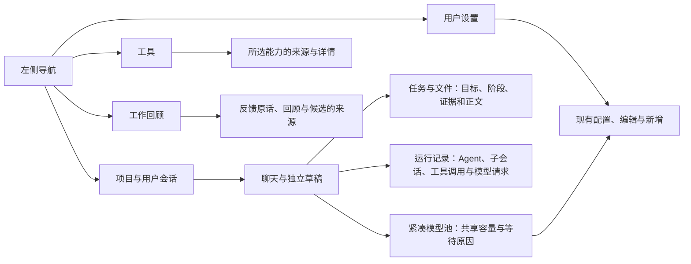
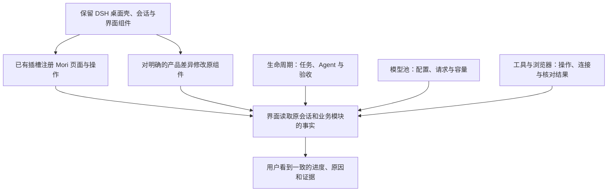
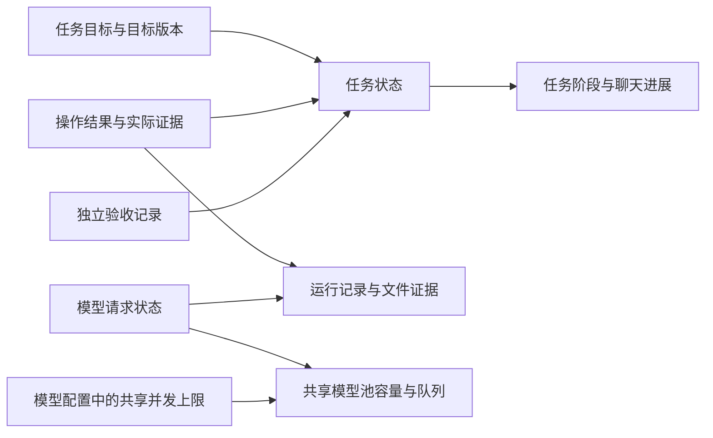

# 界面与运行记录 Proposal

状态：方案草案，供独立评审。界面 Demo 已提供交互示例，DSH 运行时尚未接入。

更新日期：2026-10-14。

本文细化 [Mori 产品与技术 Proposal](../proposal.md) 的界面落点、状态展示和 Demo 覆盖范围。
任务推进由 [Agent 角色定义与生命周期 Proposal](agent-lifecycle.md) 定义；界面读取和解释这些事实，
不创建另一套任务状态、角色会话或模型请求记录。

## 用户如何找到工作与证据

用户按项目打开会话，在聊天中沟通，在“任务与文件”中查看阶段和成果。
需要了解谁在工作、工具实际做了什么或请求为何等待时，再打开“运行记录”。
工具、工作回顾和设置各有独立页面，返回会话时恢复原来的草稿、分屏、引用和阅读位置。

“新项目”创建项目；项目旁的“＋”和项目页的“新建会话”创建该项目下的会话。
Agent 关系不复用项目或会话树来表达。多个 main agent 相互平级，默认 agent 只是用户入口；
subagent 只显示在所属 main agent 下，详情标明自己的独立角色会话。
职责名称来自用户定义，示例中的执行、监督、验收等名称不构成固定或预装 Agent 名单。

## 固定源码与接入方式

依据为 DSH `0.2.1-alpha.2`，提交 `d743267388641bc76f17c45ce8b4c231aed1d32c`。
以下是固定源码核对结果和拟采用的改动，不是已经完成的桌面接入验收。
Demo 使用浏览器原生模块参照视觉风格和交互结构，没有导入或运行 DSH 组件。

DSH 已提供 `ctx.slots.register`，全局页面使用根作用域 `main` 插槽，
`ctx.layout.selectPanel(id)` 选择已注册页面。侧栏 `sidebar.panellist` 的入口与主页面使用相同标识。
因此工具和工作回顾页面可以按已有页面机制接入；是否需要修改具体组件取决于下面的产品差异。
依据：[页面插槽契约][layout]、[插槽声明与注册][layout-code]、[侧栏页面入口][sidebar]。

| 用户看到的界面 | DSH 已有组件或扩展点 | Mori 需要增加或修改的部分 | Demo 页面与文件 |
| --- | --- | --- | --- |
| 品牌、侧栏和宽度调整 | [ui-layout][layout]、[ui-sidebar][sidebar]；品牌插槽与原有布局控制 | 使用 Mori 品牌；紧凑模型池入口需要在侧栏组件组合中安排位置，不能假设任意位置都有插槽 | 侧栏、拖动边框；[app.js](../../demo/app.js)、[resize.js](../../demo/resize.js) |
| 项目、会话列表和创建入口 | [ui-workspace][workspace] 的 Workspace/Session 浏览器与已有操作 | 明确分开项目创建和会话创建；项目名称及可选工作目录与现有 Workspace 目录关系需要业务接入；不把 DSH 的目录注册并开启会话直接当作 Mori 的新项目流程 | 项目页与创建表单；[projects.js](../../demo/projects.js)、[project-create.js](../../demo/project-create.js)、[session-create.js](../../demo/session-create.js) |
| 聊天、分屏和会话引用 | [ui-conversation][conversation] 的会话绑定、输入状态与内容组件 | 增加两个不同用户会话的布局组合、拖放来源和引用；同一 Session 不能同时挂两个可编辑输入根，不能从现有右栏分屏推断聊天分屏已满足 | 聊天区域；[chat-pane.js](../../demo/chat-pane.js)、[session-actions.js](../../demo/session-actions.js) |
| 任务与文件 | [ui-sidebar-right][rightbar] 的标签注册、[ui-sidebar-files][files] 的文件入口与原有文件预览 | 增加阶段、目标和证据的业务视图，将关联文件组织到同一入口；保留正文查看，不增加独立任务页签或差异视图 | 任务与文件；[panels.js](../../demo/panels.js)、[files.js](../../demo/files.js) |
| 终端 | [ui-sidebar-terminal][terminal] 的终端类型与 Host 终端控制 | 复用真实进程与连接；根据 Mori 工作区布局调整入口和组合，不能以 Demo 的静态输出代替终端连接 | 工作区终端记录；[panels.js](../../demo/panels.js) |
| 两层 Agent 关系与独立子会话 | [ui-subagent][subagent] 的子会话目录、会话导航与右栏资源 | 增加平级 main agent、直属 subagent 与同族关系展示；DSH 可展开更深子树，Mori 的两层限制与访问检查需在运行时实现 | 运行记录中的 Agent 与子会话详情；[runtime-panel.js](../../demo/runtime-panel.js) |
| 工具调用树 | [ui-tool][tool] 的工具树和 `tool.call.toolview` | 沿用工具调用与结果配对；增加任务、目标版本、监督和结果未知的业务关联，不在界面重建调用事实 | 运行记录按执行者分组，展开本次平级工具步骤；[runtime-panel.js](../../demo/runtime-panel.js) |
| 模型请求轨迹 | [ui-trajectory][trajectory] 的事件轨迹与请求检查 | 增加模型池逻辑请求、尝试、共享限额、排队原因与任务引用；已有轨迹不等于共享模型池已实现 | 运行记录中的模型请求；[runtime-panel.js](../../demo/runtime-panel.js)、[pool.js](../../demo/pool.js) |
| 模型池与模型设置 | [ui-settings-models][models] 的服务、模型目录和认证引用；[ui-settings][settings] 的配置表单 | 在同一模型配置来源增加共享限额，并连接 Host 级模型池观测；展示一次共享容量，不能按模型重复累计同一服务槽位 | 模型池与设置中的模型配置；[model-pool.js](../../demo/model-pool.js)、[pool.js](../../demo/pool.js)、[settings-forms.js](../../demo/settings-forms.js)、[user-settings.js](../../demo/user-settings.js) |
| 工具与工作回顾独立页 | `sidebar.panellist` 与 `main`；原有 Plugin 与配置能力 | 增加 Skill、MCP、Plugin 的项目来源与关系、反馈原话及候选追溯；各页面自行组合右侧详情，不能直接占用只随会话显示的右栏子树 | 工具、工作回顾；[feature-pages.js](../../demo/feature-pages.js)、[tools-page.js](../../demo/tools-page.js)、[review-page.js](../../demo/review-page.js) |
| 用户设置 | [ui-settings][settings] 的 `settings.section` 与现有设置领域 | 保留既有配置读取、校验和写入链路；按 Mori 的主页面与详情布局修改呈现，补用户级能力来源；不另存项目工具配置副本 | 设置；[settings-page.js](../../demo/settings-page.js)、[settings-detail.js](../../demo/settings-detail.js)、[user-capabilities.js](../../demo/user-capabilities.js) |
| 选区反馈和来源引用 | [ui-message-feedback][feedback] 的 `conversation.chat.assistant-actions` 与 `conversation.input.overlay` 注册 | 增加聊天与文件选区、版本、原文、期望结果及回顾关联；原有赞踩和反馈表单不能直接代表完整反馈流程 | 聊天、文件和工作回顾；[feedback.js](../../demo/feedback.js)、[review-feedback.js](../../demo/review-feedback.js) |
| 登录等待、结果核对与休眠恢复 | 原会话、工具、浏览器、模型和 schedule 的记录，见各功能 Proposal | 增加清晰原因与可执行操作；恢复先核对持久事实，错过维护按明确决定处理，界面不能自行推断成功或补跑 | 运行记录的演示场景；[task-state.js](../../demo/task-state.js)、[runtime-panel.js](../../demo/runtime-panel.js) |

保留组件不意味着禁止修改组件。先使用上游已声明的插槽；涉及现有组件拥有的布局或行为时，
直接在长期 fork 的对应组件中修改，不创建第二套聊天存储、兼容层或临时适配层。
桌面标题栏、快捷键、原生目录选择与真实终端属于 DSH 桌面集成的后续运行验收，浏览器 Demo 不证明它们已接入。

## 状态如何保持一致

| 展示内容 | 用户应当理解的含义 | 一致性要求 |
| --- | --- | --- |
| 目标版本 | 当前目标和约束的版本 | 与操作、监督及验收引用一致；普通进度更新使用记录修订 |
| 任务状态 | 待执行、执行中、等待、待验收、已完成、失败或已取消 | 状态转换只按生命周期 Proposal 发生，阶段文案不增加第八种任务状态 |
| 阶段进展 | 当前正在准备、执行或核对什么 | “待验收”可以同时显示“准备独立验收”；执行阶段已完成时不能仍展示该执行请求正在输出 |
| 验收记录 | 证据是否已由独立实例核对 | “待核对”“核对中”“已通过”描述记录，不替代任务状态 |
| 工具操作 | 每次调用的派发、结果、失败或结果未知 | 已取消任务仍可保留结果未知的操作；取消不等于副作用回滚 |
| 模型请求 | 各逻辑请求与尝试的排队、运行、结束或远端未知 | 请求归属可追到会话和职责；已结束执行请求不能占用当前槽位 |
| 模型池容量 | 同一共享限额下的正在运行与未知占用 | 可用容量按共享上限扣除占用，排队不计占用；模型之间不重复显示同一份剩余容量 |

共享并发上限从模型配置读取。用户调整上限后，Demo 的共享容量与队列一起更新；
真实运行时的已有请求处理和配置生效边界由 [模型可靠性 Proposal](model-reliability.md) 规定。
Demo 的场景选择只决定展示哪些示例请求，不提供第二套容量配置。

## Demo 覆盖与实际运行边界

演示入口与启动方式见 [Demo README](../../demo/README.md)。所有记录和操作都只在当前页面内存中存在。
刷新或重置重建页面示例；切换场景只重置当前任务的演示进度和恢复结果，保留草稿与配置。
这些动作不是恢复真实持久任务，也不是重开真实终态任务。

| 可体验的内容 | Demo 中的交互 | 仍需 DSH 运行时验证的内容 |
| --- | --- | --- |
| 项目与会话 | 创建、取消、改名、切换、引用与两个会话分屏；新会话保留独立草稿与空状态 | 真实目录、会话持久化、原生文件选择与跨窗口状态 |
| 任务与成果 | 从待验收进入核对，再明确完成；展开目标、约束和关联文件 | 当前目标证据检查、独立验收实例和持久状态转换 |
| Agent 与运行记录 | 查看平级 main agent、直属 subagent、独立子会话、按执行者分组的平级工具步骤与请求轨迹 | 实例创建、两层限制、同族访问、真实嵌套工具调用及请求日志 |
| 登录等待 | 展示等待原因，模拟完成登录后恢复任务推进 | 用户操作浏览器、登录状态隔离、实际结果确认与权限检查 |
| 结果未知 | 先核对原操作；本次示例核对为未执行，之后才允许明确重新执行 | 远端状态查询、幂等身份、真实副作用与原操作证据；已执行结果的采纳分支 |
| 休眠恢复 | 展示恢复时核对到的执行记录，编码任务继续待验收；独立的错过维护保留待处理，由用户选择恢复或跳过 | Host 重启、持久请求与容量恢复、真实时钟与定时派发；补跑参数仍待确认 |
| 模型容量 | 修改共享并发上限，查看运行、排队、限流与停止及相应原因 | Host 全局调度、并发约束、取消、超时与远端未知占用的保留和释放 |
| 工具、配置与反馈 | 启停、编辑、来源联动、撤销移除及原话追溯 | 文件写入、工具连接、认证、安装、模型归因、回顾和资产发布 |

登录等待和结果未知使编码任务进入等待，并阻止直接推进验收。
结果未知时没有可用的重新执行动作；明确核对为未执行后才出现该动作。
休眠场景中，编码任务的执行结果已核对，可以继续待验收；错过的工作回顾是独立工作，不阻塞编码任务。
错过维护不会自动补跑；显式选择“恢复”才生成演示维护请求，“跳过”只保留记录。
这些动作仅展示用户选择的后果，不确定正式补跑次数、频率或预算。

## 接入顺序与验收

先在固定 DSH 源码上接入一个已有会话、一个任务与关联文件，再由同一请求记录展示模型池和运行记录。
这条最小路径必须使用最终的会话、任务和请求来源，不能先制作一套临时数据服务再替换。
随后扩展独立页面、双会话布局、反馈和恢复场景；保留已能运行的路径。

| 验收场景 | 必须观察到的结果 |
| --- | --- |
| 页面切换与布局 | 工具、回顾、设置有独立主区域与详情，返回会话保留草稿、引用和阅读位置；窄屏仍能操作 |
| 项目和会话创建 | “新项目”与项目旁“＋”含义不同；取消不创建，连续创建不覆盖已有会话 |
| Agent 与来源核对 | 默认 agent 与其他 main agent 平级；subagent 没有下一层，记录可追到真实独立角色会话 |
| 状态同步 | 任务、阶段、验收、工具和模型各显示自己的事实；已完成执行阶段不再显示对应模型输出中 |
| 容量同步 | 模型设置、共享剩余容量、运行请求和队列一致；不会给同一共享服务重复分配容量 |
| 等待与未知结果 | 登录或核对条件未满足时不能继续；未核对副作用不能重放，已核对结果不会重复执行 |
| 休眠与维护 | 恢复过程与错过维护可见；未确认补跑规则不会变成自动补跑实现 |
| 真实运行边界 | DSH 运行记录来自 Host 事实；Demo 一直标明演示数据，不以点击成功代替模型、文件和桌面运行验收 |

[layout]: https://github.com/deepseek-ai/deepseek-harness/blob/d743267388641bc76f17c45ce8b4c231aed1d32c/packages/client/ui-layout/README.md
[layout-code]: https://github.com/deepseek-ai/deepseek-harness/blob/d743267388641bc76f17c45ce8b4c231aed1d32c/packages/client/ui-layout/src/client/index.ts#L73-L190
[sidebar]: https://github.com/deepseek-ai/deepseek-harness/blob/d743267388641bc76f17c45ce8b4c231aed1d32c/packages/client/ui-sidebar/README.md
[workspace]: https://github.com/deepseek-ai/deepseek-harness/blob/d743267388641bc76f17c45ce8b4c231aed1d32c/packages/client/ui-workspace/README.md
[conversation]: https://github.com/deepseek-ai/deepseek-harness/blob/d743267388641bc76f17c45ce8b4c231aed1d32c/packages/client/ui-conversation/README.md
[rightbar]: https://github.com/deepseek-ai/deepseek-harness/blob/d743267388641bc76f17c45ce8b4c231aed1d32c/packages/client/ui-sidebar-right/README.md
[files]: https://github.com/deepseek-ai/deepseek-harness/blob/d743267388641bc76f17c45ce8b4c231aed1d32c/packages/client/ui-sidebar-files/README.md
[terminal]: https://github.com/deepseek-ai/deepseek-harness/blob/d743267388641bc76f17c45ce8b4c231aed1d32c/packages/client/ui-sidebar-terminal/README.md
[subagent]: https://github.com/deepseek-ai/deepseek-harness/blob/d743267388641bc76f17c45ce8b4c231aed1d32c/packages/client/ui-subagent/README.md
[tool]: https://github.com/deepseek-ai/deepseek-harness/blob/d743267388641bc76f17c45ce8b4c231aed1d32c/packages/client/ui-tool/README.md
[trajectory]: https://github.com/deepseek-ai/deepseek-harness/blob/d743267388641bc76f17c45ce8b4c231aed1d32c/packages/client/ui-trajectory/README.md
[settings]: https://github.com/deepseek-ai/deepseek-harness/blob/d743267388641bc76f17c45ce8b4c231aed1d32c/packages/client/ui-settings/README.md
[models]: https://github.com/deepseek-ai/deepseek-harness/blob/d743267388641bc76f17c45ce8b4c231aed1d32c/packages/client/ui-settings-models/README.md
[feedback]: https://github.com/deepseek-ai/deepseek-harness/blob/d743267388641bc76f17c45ce8b4c231aed1d32c/packages/client/ui-message-feedback/src/client/index.ts#L98-L120
