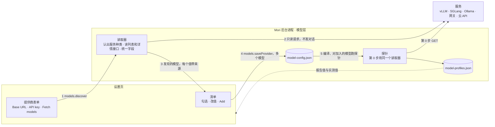
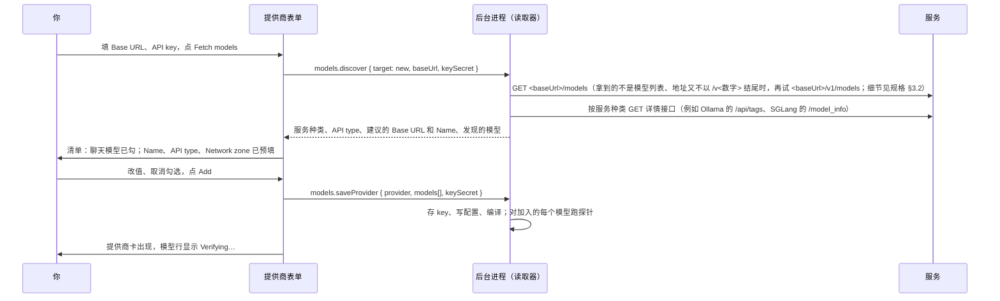

# 一键拉取模型 Proposal

状态：第一版已定（2026-10-23）：心智模型与 §12 第 4–8 条（原 §13 的五条）按默认，构建规格见 [docs/specs/model-discovery.md](../specs/model-discovery.md)。更新日期：2026-10-26（§12 第 2 条按负责人走查回答 1 改为按服务地址取 pi 自带的模型表）。

本文扩展 [统一模型提供商 Proposal](model-providers.md) §10“一个模型从添加到可用”：模型怎么进到配置里。
选择器、模型池、探针判定和切换都不变。细节见 [一键拉取模型构建规格](../specs/model-discovery.md)（它改到的统一模型提供商规格条目在那边注明）
和设置页的两张状态表（[models-settings.md](../v1/screens/models-settings.md)、
[first-run.md](../v1/screens/first-run.md)）。在方案第 6 节“后台进程只做八件事”里属于第 6 件（模型层）。

## 1. 一句话

添加提供商时只填 **Base URL** 和 **API key**，点 **Fetch models**。Mori 只向这个服务发读取信息的请求（不发对话请求），读出它的模型列表，
以及它自己报告的窗口、输出上限、思考和图片输入，列成一张清单，聊天模型预先勾好；你可以改值、取消勾选，点一次 **Add** 全部加入。
服务没报告的值用默认值，并且明确标成“Not reported”。工具调用、交接等级、有效窗口这些能力照旧由探针实测。

## 2. 为什么

1. **手抄容易错，错了代价大**：每个模型都要手填 id、窗口、输出上限、思考、图片。id 建好后不能改，抄错只能删了重加。
   窗口填大了更隐蔽：例如在 32K 的 vLLM 上用默认的 128000，pi 按声明的窗口决定什么时候压缩，上下文会被撑爆。
2. **服务其实知道**：vLLM、SGLang 的 `/models` 有 `max_model_len`，DeepSeek 有 `context_window` 和 `max_output_tokens`，
   Kimi 有 `context_length` 和 `supports_reasoning`，Ollama 有 `capabilities`。探针第 0 步已经在读其中一点，
   但只在保存之后读，只读窗口；界面上只间接体现在档案摘要的 Context（有效窗口），不说明这是服务报告的，也不提示配置的窗口偏大。
3. **一个一个加不现实**：公司网关、OpenRouter 一次能列出几十到几百个模型。

## 3. 架构

| 组件 | 做什么 |
| --- | --- |
| 读取器 | 新模块。按地址和响应认出服务种类，按种类读列表接口和需要的详情接口，把各家的字段名统一成 Mori 的模型字段；每个值注明是服务报告的还是默认值 |
| 清单 | 表单里列出发现的模型。它只在表单里，点 Add 之前不写任何文件 |
| 探针 | 判定不变。第 0 步改用同一个读取器，所以保存后模型行上的“服务报告的值”和添加时看到的一致 |

## 4. 核心概念

| 概念 | 含义 |
| --- | --- |
| 发现 | 你点 Fetch models 时做一次：只发读取信息的请求（GET；Ollama 还要每个模型 POST 一次 `/api/show`，读 Modelfile 的 `num_ctx`，0.30.0 以前还读 `capabilities` 和训练窗口，最多 100 个模型），不发对话请求，不花额度，不写配置。不轮询。对同一个 origin 同时最多 4 个请求，多出来的排队 |
| 服务种类 | vLLM、SGLang、llama.cpp、Ollama、LM Studio、Xinference、GPUStack、LiteLLM、New API / One API、按域名认出的云厂商；都不是时按“通用 OpenAI 兼容”读。种类决定还要读哪些详情接口（§7） |
| 报告值、默认值 | 每个字段只有这两种来源：服务报告的，或 Mori 的默认值。没有第三种：不查 pi 自带的模型目录，不按模型名猜（§12 第 2 条）（2026-10-26 改，§12 第 2 条：窗口、最大输出、是否支持思考有第三种来源，服务没报告时按服务地址取 pi 自带的模型表里的条目；仍不按模型名猜） |
| 实测值 | 探针给出的：工具调用、交接写入等级、推理字段、能否关闭思考、有效窗口。实测与声明不一致时，模型行给出提示和一键采用（§10 第 4 条） |
| 清单 | 每行一个模型：勾选框、Model ID、Context window、Max output、Supports thinking、Image input；没报告的值旁边标“Not reported”（2026-10-26 改：WP-02 起改标“Default”，只在值仍是 Mori 的默认值时标；WP-15 起取自 pi 模型表的值标“From pi”，见规格 §6.2） |
| 聊天模型 | 只按服务报告的类型判断（Ollama 的 `capabilities`、LM Studio 的 `type`、LiteLLM 的 `mode`、New API 的 `supported_endpoint_types` 等）。服务不报告类型时怎么勾见 §12 第 4 条 |

## 5. 主要流程

### 5.1 添加提供商

- 地址填成 `http://10.0.0.5:8000`（少了 `/v1`）或带上了 `/chat/completions` 时，读取器试出能用的地址，表单的 Base URL 框换成它（例如补上 `/v1`），可以改。
  拿到了列表时框下面一行“Updated to <url> so the model list loads.”；拿不到列表时只换框，不写这一行。
- key 在 Add 之前只在表单和这次 `models.discover` 请求里：后台进程只在这次拉取中用它，不存盘、不进模型池，Add 时才加密保存。
  这是一条新路径：现在没有哪个请求会带着还没保存的 key 发出（首次启动表单点 Test connection 时也是先保存再测）。

### 5.2 已有提供商再拉一次

提供商卡上的 **Fetch models** 用已保存的 key 拉取（`models.discover { target: provider, providerId }`），key 不回到界面。
清单里已经加入的模型标“Added”、不能再勾；新出现的可以勾选加入；服务不再列出的已加入模型标“Not listed by the server”，不自动删除。

### 5.3 拉不到列表

有的服务不提供列表：智谱 GLM、火山方舟的文档里都没有列表接口（有没有待用真实 key 确认，§14）；Kong 网关通常没有；
Azure 列出的是基础模型而不是可调用的部署名。各家的 Anthropic 兼容地址也大多没有列表（Kimi、百炼、千帆的 `/anthropic` 下都是 404）：
这时先试同一主机的 OpenAI 形式列表（去掉地址里的 `/anthropic` 段），拿到了就用它的 id，API type 仍按你填的地址是 Anthropic Messages。
都拉不到时，清单显示原因（“This server doesn’t list its models.”或服务的原文），下面是一行 **Add a model ID**，就是现在的模型字段，手填后照样加入。
任何情况下这一行都在清单底部，用来补列表里没有的模型。

### 5.4 首次启动

首次启动表单走同一个流程。勾了一个模型时，新会话的默认范围是这个模型（同现在）；勾了多个时，默认范围是这个提供商，按清单顺序。
Test connection 用第一个勾选的模型。

## 6. 每个字段从哪来

| 字段 | 服务报告时（举例） | 没报告时 | 探针之后 |
| --- | --- | --- | --- |
| Model ID | 列表里的 id，原样 | 只能手填（§5.3） | — |
| API type | 不看服务报告，只看地址：路径里有一段是 `anthropic`，或主机是 `api.anthropic.com` → Anthropic Messages；其他 → OpenAI-compatible。列表是 Anthropic 的形状只改 Detected 一行的写法（Anthropic-compatible server）；New API 的 `supported_endpoint_types` 只用来判断是不是聊天模型 | OpenAI-compatible。OpenAI Responses 只能手选；你改过的，再拉取时不被覆盖 | — |
| Context window | vLLM、SGLang 的 `max_model_len`；llama.cpp 的 `meta.n_ctx`；DeepSeek 的 `context_window`；Kimi 的 `context_length`；LM Studio 已加载实例的 `context_length`；阿里云百炼、千帆、OpenRouter、Anthropic 各自的字段 | 128000，标 Not reported | 有效窗口 = 声明、报告、长输入实测中最小的（同现在） |
| Max output | DeepSeek 的 `max_output_tokens`；Anthropic 的 `max_tokens`；百炼的 `max_output_tokens`；OpenRouter 的 `top_provider.max_completion_tokens`。不小于窗口的不算报告（DeepInfra、LiteLLM 会把窗口填在这里） | 16384 与窗口一半中较小的（同现在） | — |
| Supports thinking | DeepSeek 有 `effort`；Kimi 的 `supports_reasoning`；Ollama 的 `thinking`；SGLang 配了 `reasoning_parser`；Anthropic 的 `thinking.supported` | 不勾 | 模型其实输出了思考内容时，行上提示打开（§10 第 4 条） |
| Image input | `input_modalities` 含 `image`；Kimi 的 `supports_image_in`；Ollama、LM Studio 的 `vision` | 不勾 | 不探测（同现在） |
| Family | Ollama 的 `details.family`；Xinference 的 `model_family` | 空 | — |
| 工具调用 | 不从列表采用：服务说支持不等于真的能用。Ollama 没列出 `tools`、SGLang 没配 `tool_call_parser` 时，清单行上提示 | — | 探针实测，同现在 |
| 兼容选项 | 不报告。DeepSeek、GLM、Kimi 等已知云地址，pi 按地址自动处理 | 不勾 | 见 §12 第 6 条 |
| Name | 地址的主机名，可以改 | — | — |
| Network zone | 按地址建议（现有规则），你确认 | — | — |

（2026-10-26 改，§12 第 2 条：Context window、Max output、Supports thinking 三行的“没报告时”先按服务地址取 pi 自带的模型表里
这个服务、这个 id 的条目（例如 `api.z.ai` 的 glm-5.3 取 pi 的 Z.AI 条目：1,000,000、131,072、支持思考），标“From pi”；
pi 不认得这个地址或没有这个 id 时才是表里的默认值。Image input、Family 不取。）

## 7. 服务种类与读法

| 种类 | 怎么认 | 额外读什么 |
| --- | --- | --- |
| vLLM | 列表 `owned_by: vllm`，`/version` 有版本 | 列表本身就有窗口 |
| SGLang | 列表 `owned_by: sglang` | `/model_info`：工具解析器、推理解析器、图片、是否生成模型 |
| llama.cpp | 列表 `owned_by: llamacpp`，`/props` 有 `build_info` | 列表的 `meta.n_ctx`、`architecture.input_modalities` |
| Ollama | `/api/version`，且列表条目有 `owned_by`（命名空间，默认 `library`）和 `created`。LocalAI 也回答 `/api/version`（固定 0.9.0）但条目里没有这两项，用公开的 `/.well-known/localai.json` 认出 | `/api/tags` 的 `capabilities` 和训练窗口（0.30.0 起才有）；`/api/ps` 的当前窗口（只有已加载的）；每个模型 POST 一次 `/api/show`，读 Modelfile 的 `num_ctx`（0.30.0 以前还读 `capabilities` 和训练窗口），最多 100 个模型，对每个 origin 同时 4 个 |
| LM Studio | `/api/v1/models` 回答 | 同一个接口给类型、窗口、工具、图片、思考 |
| Xinference、GPUStack、MindIE | 列表的 `owned_by`（`xinference`、`gpustack`、`MindIE Server`）；GPUStack 加 `with_meta=true`；MindIE 读业务端口的 `/v2/models/<model>/config`（不读管理端口的 `/info`：端口不同就是另一个 origin） | 窗口；Xinference 还有 `model_ability` |
| TGI | `owned_by` 就是模型 id，要看 `/info` 的 `router` 是不是 `text-generation-router` | `/info` 的 `max_total_tokens` |
| LiteLLM | 列表 `created` 固定为 1677610602 | 列表的 `mode`、`max_input_tokens`、`max_output_tokens`；`false` 和缺省都按没报告 |
| New API、One API | 响应头 `X-New-Api-Version`；`created` 固定为 1626777600 | 只有 id；New API 的 `supported_endpoint_types` 只用来判断是不是聊天模型，不改 API type（API type 只看地址，§6） |
| 云厂商 | 按域名：DeepSeek、Kimi、百炼（改读原生的 `/api/v1/models`）、千帆、OpenRouter、Anthropic | 各自列表里的字段 |
| 通用 OpenAI 兼容 | 都不是 | 按常见字段名读：`max_model_len`、`context_length`、`context_window`、`max_context_length`、`context_size`、`max_output_tokens`、`input_modalities`。Mistral 等没有按域名认出的云厂商也走这里：Mistral 的 `max_context_length` 与 `capabilities`（`completion_chat`、`function_calling`、`vision`）照样按这些通用规则读到 |

按 2026-10-23 的调研，能自动填好窗口的：vLLM、SGLang、llama.cpp、LM Studio、GPUStack、TGI、MindIE、
DeepSeek、Kimi、百炼、千帆、OpenRouter、Anthropic、Mistral、LiteLLM（新版本）；Ollama 给的是训练窗口（§12 第 8 条），
Xinference 给的是模型族登记的窗口（族里没写时为 2048），都不一定是实际在用的窗口。
只有 id 的：OpenAI、MiniMax、阶跃、硅基流动、魔搭、One API、New API、LMDeploy。
拉不到列表的：GLM、火山方舟（都待用真实 key 确认，§14）、Kong、Azure 部署名。
不少列表报告工具支持（OpenRouter、Mistral、百炼、千帆、Ollama、LM Studio、Xinference、SGLang 的 `tool_call_parser`），
但报告不等于真能用，所以只作清单提示，是否 `verified` 只看探针。

## 8. 接口

| 命令 | 参数 | 结果 |
| --- | --- | --- |
| `models.discover`（新） | `{ target: { kind: 'new', baseUrl, api, keySecret } \| { kind: 'provider', providerId } }`（已有提供商用已保存的 key） | `{ error, cancelled, server: { kind, version }, api, baseUrl, name, anthropicShape, listError, models: DiscoveredModel[], truncated, notListed }`；完整载荷见规格 §5.1、§5.2 |
| `models.discoverCancel`（新） | — | 取消正在进行的拉取（Ollama 要逐个读 `/api/show`，可能要一会儿）；不取消探针第 0 步和读版本 |
| `models.saveProvider` | `model` 改成 `models[]`（1 到 N 个） | 同现在 |
| `models.firstRun` | `model` 改成 `models[]` | 同现在；默认范围按 §5.4 |
| `models.addModels`（新） | `{ providerId, models[] }` | `{ error }` |
| `models.saveModel` | 去掉 `adding`，只改已有的模型（模型表单只剩 Edit，加模型只走上面三个命令） | 同现在 |

`DiscoveredModel` = `{ id, contextWindow, maxTokens, reasoning, image, family, chat, reported, hints, unusable, added }`：
`reported` 逐个字段说明是不是服务报告的；`chat` 是服务报告的类型（不报告时为 `null`）；`hints` 是给清单行的提示（例如服务没列出工具支持）。

## 9. 信息往哪写，谁什么时候读

| 信息 | 谁写 | 存在哪 | 谁读 |
| --- | --- | --- | --- |
| 发现的结果 | 读取器 | 只在表单里，不落盘 | 清单 |
| 勾选的模型和它们的值 | 你点 Add | `model-config.json`，字段不变 | 编译、选择器（同现在） |
| key | 你 | Add 时才加密保存 | 模型池 |
| 服务报告的值 | 探针第 0 步（同一个读取器） | `model-profiles.json` 的 `reported`，从只有窗口扩到窗口、输出上限、思考、图片 | 模型行（“Server reports …”）、有效窗口 |
| 实测能力 | 探针 | `model-profiles.json`（同现在） | 选择器、模型行 |

配置里不记来源。模型行上的“Not reported”由档案的 `reported` 推出：服务没报告这一项，行上就标出来，不论值是默认的还是你改过的。
（2026-10-26：标记改为只在值仍是默认值时写“(default)”（WP-02）；服务没报告、按地址取自 pi 模型表的值写“(from pi)”，由档案的
`reported` 加 pi 的模型表推出，pi 的模型表不用发请求，不写进档案（§12 第 2 条，WP-15）。）
Ollama 只读到训练窗口时，档案不把它记作服务报告的窗口（训练窗口不是 Ollama 实际用的窗口，§12 第 8 条）：模型行写 not reported，也不提示改回训练窗口。

## 10. 关键规则

1. 发现只发读取信息的请求，不发对话请求；不写配置；不按项目区域过滤（和 Test connection 一样，发往你填的地址）。
2. 只用服务报告的值；没报告的用默认值并标出。不查目录，不猜。
3. 能力以探针为准：列表说支持工具，不算 `verified`。
4. 报告值、实测值和配置不一致时（例如服务改了 `max_model_len`，或模型其实会思考），不自动改配置。模型行显示
   “Server reports a context window of 32,768.”或“This model returned thinking content.”，旁边“Use”；你点了才改，改了按指纹重新探测。
5. 不轮询：只在你点 Fetch models 时拉。后台进程启动和打开会话时照旧读服务版本：每个提供商读一次，只发列表请求和版本请求，不读详情接口；
   拿到了列表，且种类变了、或读到的版本与档案里的不同时，重新探测；版本读不到时只比种类（同现在：读失败不算变化）。

## 11. 对现有界面和代码的改动

- 提供商表单：开头只有 Base URL、API key、Fetch models；Name、API type、Network zone 在拉取后预填；Concurrency per key 和兼容选项收进“More settings”。
- 卡片上的“Add model”变成 Fetch models 清单加手填的一行。
- 首次启动表单按 §5.4。
- 探针第 0 步改用读取器，先看列表的 `owned_by` 再看 `/version`，顺带修掉现在把 LocalAI、TensorRT-LLM 认成 vLLM 的问题（它们也回答 `/version`）。
- 配置的 schema 不变；`saveProvider`、`firstRun` 接受多个模型，一次编译、一次写入。
- 模型表单只剩 Edit；`models.saveModel` 不再加模型。

## 12. 已定的（2026-10-23 你的决定）

1. 拉取后先列出清单，聊天模型默认勾上，可以改值、取消勾选，点一次 Add 加入；不是全部直接加入。
2. 服务没报告的字段只用默认值，再靠探针；不查 pi 自带的模型目录，也不按模型名猜。
   （2026-10-26 改，负责人走查回答 1，推翻上面这条：“模型列表只给名字时（z.ai），上下文窗口、最大输出和是否支持思考
   按服务地址从 pi 自带的模型表取（api.z.ai 取 z.ai 的条目），不按模型名猜；仍是猜的值标 "(default)"。”
   现在是：服务没报告的这三项，pi 按地址认得这个服务时取 pi 的模型表里这个服务、这个 id 的条目，同一个 id 在别的地址上
   （OpenRouter、Bedrock、Cloudflare）是别的条目、上限不同，所以只按地址加 id 对上，从不只按名字；图片输入、模型族不取；
   pi 不认得这个地址、或没有这个 id 时仍用默认值并标 "(default)"。取自 pi 的值在清单和模型行上另有标记。
   构建规格 [model-discovery.md](../specs/model-discovery.md) §4.4，WP-15。）
3. API type 自动识别，认不出才让你选；识别结果可以改。

下面五条原是 §13 待你定的问题，2026-10-23 按当时写的默认做法定下：

4. 服务不报告类型时（OpenAI、Kimi、One API 等），只有一个模型就勾上；多个时都不勾，提供“Select all”。
   OpenAI 的列表里混着 embedding、语音和图片模型，又不能按名字猜。（原 §13 第 1 条）
5. 一次加入很多模型时，探针全部自动跑，同现在；清单底部写明“Each model is verified with up to 13 short requests.”。
   每个模型 5 到 13 个短请求（不支持思考的通常 5 个），在公网云上会花一点额度。（原 §13 第 2 条）
6. 兼容选项这一轮不自动，仍然手勾；已知云地址由 pi 按地址处理。不做“保存后用一两个请求试出来（例如 `max_completion_tokens` 被拒就改用
   `max_tokens`），记在档案里，编译时使用”。（原 §13 第 3 条）
7. 窗口没报告的模型（OpenAI、MiniMax、硅基流动、公司 One API / New API 网关）这一轮不加“请求一个极大的 `max_tokens`、从服务的报错里读出上限”的探针：
   各家报错里是否写了上限、怎么写，本轮没有核实，要先录真实报错。这些模型用 128000 并标 Not reported；长输入测试照旧需要你同意。（原 §13 第 4 条）
8. Ollama 的窗口依次用 `/api/ps` 的当前窗口、Modelfile 的 `num_ctx`；都没有时用训练窗口，并在清单行上提醒加入后跑一次长输入测试。
   加入后档案不把训练窗口记作服务报告的窗口，模型行写 not reported（§9）。
   原因：Ollama 的列表给的是训练窗口，实际用的是 `num_ctx`（没设置时先看 `OLLAMA_CONTEXT_LENGTH`，再按显存默认 4K、32K 或 256K）；
   已加载的模型由 `/api/ps` 报告当前窗口，Modelfile 里设了 `num_ctx` 时 `/api/show` 能读到，两样都没有时服务不报告。（原 §13 第 5 条）

## 13. 待你定的

没有：原来的五条都已在 2026-10-23 定下，现为 §12 第 4–8 条（原第 n 条即 §12 第 n + 3 条）。

## 14. 没验证的

- 智谱 GLM、火山方舟有没有 `/models`：官方文档里都没有；不带 key 时真实路径和随便写的路径都返回 401，看不出来。需要用真实 key 试一次。
- 百炼：原生 `/api/v1/models` 在文档写明的地址（`{WorkspaceId}.cn-beijing.maas.aliyuncs.com`、`dashscope-intl` 等）上字段已确认；
  常用的 `dashscope.aliyuncs.com` 上这个路径存在（401 而不是 404），但没有文档，返回内容待确认；列表分页，默认每页 20 个。
  compatible-mode 的 `/models` 和 Gemini OpenAI 兼容列表的字段也没有文档。
- MindIE 业务端口的 `/v2/models/<model>/config` 的字段来自源码，没有在真实部署上录过；管理端口（默认 1026）的 `/info` 不读，因为不同端口是另一个 origin。
- 以上服务的字段都来自源码和官方文档，没有在真实内网部署上录过；实现前要按 AGENTS.md 的顺序先录 fixture。

## 15. 分步落地

1. 心智模型定下后：写规格（读取器的字段表、清单状态表、命令载荷、验收条目），改两张设置页状态表。
   试出能用的地址（补 `/v1`、去掉 `/anthropic` 试 OpenAI 形式列表）是本文要求的功能，同时在 AGENTS.md 工程约束里登记，
   和模型层的迁移、换 key 一样，不算 fallback。
2. 用真实端点录 fixture：内网的 vLLM、SGLang、Ollama，公网的 DeepSeek、GLM、OpenRouter。
3. 在单独的会话里用 workflow 实现：读取器（内核纯函数）、命令、表单与清单、第 0 步改用读取器；然后跑测试、真实模型走查。
