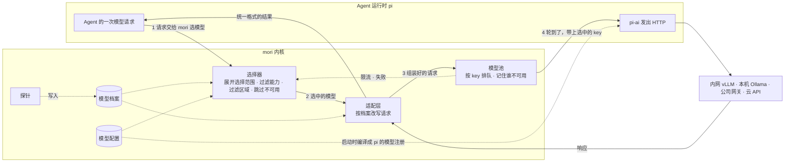
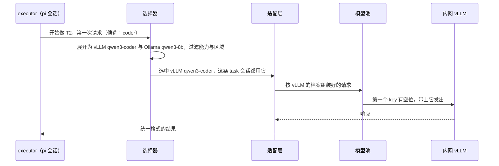
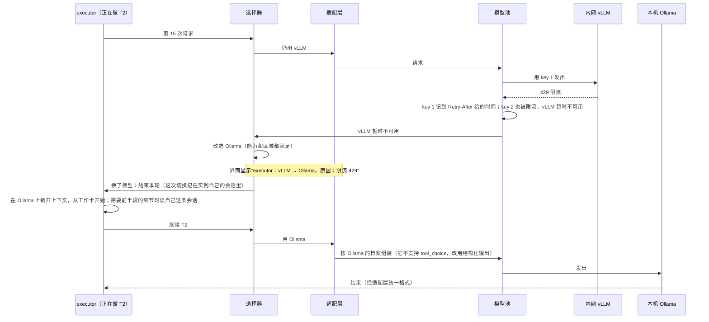
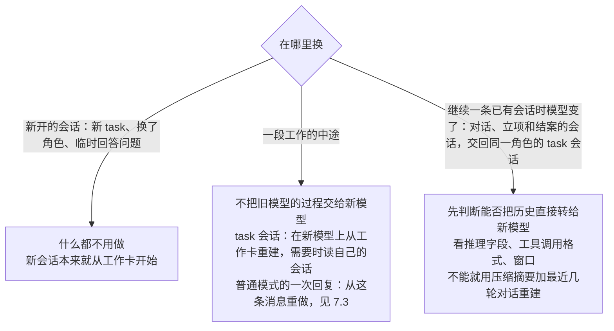

# 统一模型提供商 Proposal

状态：草案第四版，按 2026-10-21 的反馈修订（分组—提供商—模型三层、一个提供商多个 key、普通模式按范围选模型），待评审。更新日期：2026-10-21。

本文只讲模型这一层怎么运作：由哪几块组成、配置写在哪里、一次请求怎么选到模型、什么时候换模型、换了以后上下文怎么办。
配置 schema、切换协议、探针清单、模型池和验收细节放在 [构建规格](../specs/model-providers.md) 里，规格按本文第四版写成。
Agent 和 TaskBoard 见 [平行 Agent 与 TaskBoard Proposal](parallel-agents-taskboard.md)。

## 1. 一句话

模型按三层管理：**分组 — 提供商 — 模型**。一个分组包含若干提供商，也可以只挑某个提供商下的几个模型；一个提供商可以属于多个分组；一个提供商可以有多个 API key、提供多个模型。
Agent 不绑定提供商，只写一个**有序的候选列表**和**能力要求**；候选可以是分组、提供商或单个模型。
普通模式下，用户为主 Agent 选一个范围（分组、提供商或模型），其他 Agent 只能在这个范围里选；协作模式下用户不选，按做这个 task 的角色的候选和能力要求选（见平行 Agent 规格 §12）。
一段工作（一个实例从被唤醒到交接或回复为止）开始时，程序从候选里选出第一个能力满足、网络区域允许、当前可用的模型；之后一直用它，只有它出故障才按顺序换下一个，每次换都在界面上显示。

## 2. 为什么

1. **一个会话绑死一个端点**：端点一挂，整个会话停摆；不同职责也不能用不同的模型。
2. **同一个模型在不同部署上表现不同**：有的部署不支持强制工具调用，有的模板有问题，有的会静默截断上下文。只看模型名猜不出能力。
3. **数据边界**：代码不能被发到不允许的地方，换模型也不能越过内网和公网的边界。
4. **一个 key 的并发不够**：同一个提供商常常按 key 限并发、限流，多个 key 才能撑住几个会话同时跑。

## 3. 架构



- **pi 负责什么**：跑 Agent 循环、执行工具，并用 pi-ai 发出 HTTP 请求。
- **mori 负责什么**：每次请求前，pi 通过 mori 注册的钩子把请求交给 mori。mori 选定实际模型，按它的档案改写请求体，在模型池里排队并选定 key，轮到后交还 pi 发出；响应回来后，按档案统一格式。
- **编译**：mori 启动时把模型配置编译成 pi 能用的模型注册（地址、兼容选项），key 在每次请求时由模型池给出，pi 因此能直接连到选中的端点。

| 组件 | 做什么 |
| --- | --- |
| 模型配置 | 用户维护的分组、提供商（含一个或多个 API key）、模型和网络区域。Agent 定义里只写分组、提供商或模型的名字，不写地址和密钥 |
| 模型档案 | 每个部署一份，记录探针实测的能力：工具调用是否真的生效、强制调用是否被执行、推理字段叫什么、上下文会不会被静默截断 |
| 探针 | 添加或修改模型后在后台跑的一组短请求，结果写进档案 |
| 选择器 | 一段工作开始时挑模型；出故障时挑下一个 |
| 适配层 | 按档案改写请求，例如这个部署不支持 `tool_choice`，就改用结构化输出；把各家响应统一成同一种格式 |
| 模型池 | 控制每个 key 的并发，满了就排队；记住每个 key 最近的状态（限流到什么时候、认证失败），一个提供商的 key 全都不可用时，选择器跳过这个提供商 |

## 4. 核心概念

| 概念 | 含义 |
| --- | --- |
| 分组 | 一个有序列表，每一项是一个提供商（它的全部模型），或某个提供商下指定的一个模型。例如 `coder` = 内网 vLLM 的 qwen3-coder，然后是本机 Ollama。一个提供商可以属于多个分组。换部署只改分组 |
| 提供商 | 一个端点：地址、接入协议、一个或多个 API key、网络区域。一个提供商可以提供多个模型 |
| API key | 提供商下的一个密钥，有自己的并发上限。请求按顺序用第一个有空位的 key；某个 key 被限流或被拒绝时跳过它，直到它恢复；所有 key 都不可用时才算这个提供商不可用 |
| 模型 | 提供商下的一个模型：上下文窗口、输出上限、模型族（例如 qwen3） |
| 选择范围 | 一个分组、一个提供商或一个模型。展开成有序的模型列表：分组里的各项按分组中的顺序，是提供商的就按它列出的模型顺序展开，是模型的就是它自己 |
| 候选列表 | Agent 的 `models`，有序，每一项是一个选择范围，依次展开、去重，前面的优先 |
| 能力要求 | Agent 的 `requires`。可写的有：`tool_calling`（会调用工具）、`protocol_write`（能可靠地写交接单，见下）、`structured_output`、`vision`、`context>=N`（比较的是有效窗口：声明值与实测值中较小的一个）。不满足的候选直接跳过 |
| 模型档案 | 按“端点 + 服务版本 + 模型”建档。能力有三种状态：已验证、未验证、验证失败；关键能力必须验证过才算满足 |
| 交接写入等级 | 模型能多可靠地写出交接单这类结构化内容。A：服务端强制它调用指定工具；B：服务端强制它输出符合 schema 的 JSON；C：两者都不支持，让它写 `<outcome>…</outcome>` 这样的文本标签，再由程序解析。`protocol_write` 表示 A、B、C 中至少一级实测通过；要求更高可以写 `protocol_write>=B` |
| 网络区域 | 本机、内网、公网。每个项目有一个允许的区域集合，默认只有本机和内网；第一次选模型和出故障后换模型都按同一个集合过滤 |

下面会用到平行 Agent 的几个词：**task 会话**指某个角色的一个实例做一个 task 的那条会话，task 交回同一个角色时会被继续使用；**工作卡**是程序每次请求前钉在上下文末尾的大纲（需求与用户原话、上一棒的交接、已经排除的方案、留给这个 task 的消息），可以用来重建上下文；**对话 Agent** 是唯一和用户说话的 Agent；**结案 Agent** 负责处理交回来的 task；**协作模式**打开后，用户的消息先由立项 Agent 判断要不要交给平行 Agent 协作完成，默认关闭。
**普通模式**即协作模式关闭：对话 Agent 是**主 Agent**，自己读代码、改文件、跑命令，就是 v0 的那个 Agent；它临时去问的角色叫**子 Agent**。

## 5. 谁来选模型

| 模式 | 主 Agent（对话 Agent） | 其他 Agent |
| --- | --- | --- |
| 普通模式 | 用户在输入框下面一行选一个范围：分组、提供商或单个模型。新会话取设置里的默认范围；本会话一直用这个范围，直到再次切换 | 子 Agent 按自己的 `models` 和 `requires` 选，但只能选用户为主 Agent 选的范围里的模型；没有交集时这次提问失败，说明原因 |
| 协作模式 | 用户不选，范围按钮只显示正在用的模型；按对话 Agent 的候选选模型（见平行 Agent 规格 §12） | 按做这个 task 的角色的候选和能力要求选（见平行 Agent 规格 §12） |

主 Agent 要用工具，所以它总是要求 `tool_calling`；其余过滤（区域、可用性）与其他 Agent 相同。

## 6. 配置写在哪里

| 层 | 在哪 | 能写什么 |
| --- | --- | --- |
| 用户级 | 设置页编辑，保存在 `%APPDATA%/Mori` 下；密钥存在系统加密存储里 | 分组、提供商（含 key 和每个 key 的并发上限）、模型、默认允许的区域、普通模式的默认范围 |
| 本机按项目授权 | 设置页 | 给某个项目放宽区域，例如允许公网 |
| 仓库里的项目配置 | 项目的 `.mori/` 下 | 只能收紧：缩小允许区域、把分组缩小到其中的部分提供商或模型；不能新增提供商或密钥 |
| Agent 定义 | 项目的 `.mori/agents/*.md` | 只写候选（分组、提供商或模型的名字）和能力要求 |

同事 clone 仓库后，如果他的用户级配置里没有 Agent 或项目配置引用的分组、提供商或模型，会话启动时会拒绝，并说明缺哪一项、谁用到它。

```yaml
# 用户级模型配置
providers:
  intranet-vllm:
    api: openai-completions
    baseUrl: http://10.0.0.5:8000/v1
    keys: [{ secret_ref: intranet-vllm-1 }, { secret_ref: intranet-vllm-2 }]   # 两个 key 分担并发
    concurrency: 4                    # 每个 key 的并发上限
    zone: intranet
    models:
      - { id: qwen3-coder-30b, family: qwen3, contextWindow: 131072, maxTokens: 16384 }
  local-ollama:
    api: openai-completions
    baseUrl: http://127.0.0.1:11434/v1
    zone: local
    models:
      - { id: qwen3-8b, family: qwen3, contextWindow: 32768, maxTokens: 8192 }

groups:
  coder: [intranet-vllm/qwen3-coder-30b, local-ollama]   # 一项可以是提供商，也可以是提供商下的某个模型

normal_mode:
  default: coder                      # 普通模式新会话的默认范围：分组、提供商或 提供商/模型
```

```yaml
# .mori/agents/executor.md 的开头
models: [coder]
requires: [tool_calling, protocol_write, context>=32768]
```

## 7. 一次请求怎么走

### 7.1 正常情况



### 7.2 做 task 中途首选被限流



如果 vLLM 还有别的 key 有空位，换 key 重发同一个请求，不算换模型。
如果是 task 会话的第一个请求就被限流，还没有过程需要转交，直接把同一个请求按 Ollama 的档案重组后发出即可。

### 7.3 普通模式中途换模型

主 Agent 一次回复做到一半（例如已经调了 5 次工具）时首选不可用：

- 中断的部分留在对话里给用户看，但不交给新模型；
- 新模型拿到截至用户这条消息的对话、这条消息，以及一句“上一个模型中途中断，文件可能已经被改动”，重做这次回复；
- 界面显示“已换模型：A → B，原因：……”。

如果是这次回复的第一个请求就失败，同样把这条消息原样交给新模型。

## 8. 什么时候换，什么时候不换

| 情况 | 处理 |
| --- | --- |
| 某个 key 被限流、认证或额度失败 | 先换同一提供商下一个可用的 key，不算换模型；所有 key 都不可用时按候选顺序换下一个 |
| 连接失败、排队超时 | 按候选顺序换下一个 |
| 服务端错误（5xx） | v1 原地重试；v1.x 有了熔断后再参与切换 |
| 请求发出后超时，不知道对方是否还在算 | 先取消，确认旧请求停了再换，同一个请求不会在两个模型上同时跑 |
| 模型输出格式错误 | 不换，按格式错误重试 |
| 上下文太长 | 不换更大的模型，先压缩或重建上下文 |
| 内容策略拦截、用户取消、已经输出了一部分 | 不换 |
| 首选恢复了 | 同一段工作里不换回，下一段再用首选 |

全部候选都不可用时，先等一段时间；还是不行，执行中的 task 交给结案 Agent，对话中的请求在聊天流里说明原因。
本期只按可用性换模型，不做“输出质量差就换更强的模型”。

## 9. 换了模型，上下文怎么办



不把旧过程交给新模型有两个原因：各家的推理块和工具调用格式不兼容；接着别的模型的过程往下做，会继承它的偏差。
对话中重建用的摘要来自 pi 的上下文压缩（compaction），由该 Agent 当前可用的模型生成。
TaskBoard 把需求、分工和每一棒的结论放在模型外面，正好让中途换模型变得安全。

## 10. 一个模型从添加到可用


探针每个模型十几个短请求，结果决定它能担任哪些 Agent：

| 探什么 | 决定什么 |
| --- | --- |
| 工具调用能不能用、参数类型对不对、多轮往返是否正常 | `tool_calling` |
| 强制调用、结构化输出、文本标签是否可靠 | 交接写入等级 A / B / C |
| 推理字段叫什么、能不能关闭思考 | 适配层从哪个字段取推理内容、下一次请求要不要把它带回给模型 |
| 长输入是报错还是被静默截断（请求较长，先征得用户同意再跑） | 有效窗口；会截断时告警 |
| 断开连接后服务端是否真的停止（要故意断连，先征得用户同意再跑） | 超时后能不能立即换模型 |

添加时只填地址和 key、一键拉取模型列表并预填各个字段，见 [一键拉取模型 Proposal](model-discovery.md)（第一版已定，2026-10-23）。

探测完成前，要求 `tool_calling` 或 `protocol_write` 的 Agent 选不到这个模型。
所有候选都不满足时，会话启动被拒绝，界面列出每个候选被排除的原因，并提供“立即验证”。探针只证明能力存在，不代表真实任务的效果。

## 11. 与 TaskBoard、v0 的关系

- **平行 Agent**：Agent 之间通过 TaskBoard 上的大纲、交接和会话记录协作，不依赖彼此的推理格式，所以不同角色可以放心用不同提供商的模型。读别人的会话时，拿到的是整理过的文本（工具调用、输出、结论），不含对方的推理原文，也不会并进自己的消息历史。
  - **写入等级**：程序要求某个实例填交接单时，按它当前模型的写入等级决定方式；换了模型，下一次就按新模型的等级来。
  - **评审避开同族**：评审 Agent 可以声明 `differ_from: author`，选择器在运行时排除改过这个 task 代码的那个模型所属的模型族，避免模型给自己打分。
- **调度**：模型池按请求的来源排队。和用户的对话最优先，其次是立项、结案的决策，再次是执行 task，最后是订阅、定时和探针这类后台请求。v1 只做简单的优先级，按权重分配份额是 v1.x。
- **v0**：只有连接表单和“测试连接”，配置就是 pi 的 `models.json`，可以在会话里手动切换模型，没有探针、排队和自动切换。
  v1 改用 mori 自己的模型配置，首次启动时自动从 `models.json` 迁移，网络区域由用户确认。
  v0 的“切换模型”在 v1 变成选择范围（见第 5 节）：可以选分组、提供商或单个模型，本会话一直用这个范围，直到再次切换；协作模式下不再由用户选。

| 阶段 | 内容 |
| --- | --- |
| v0 | 连接表单、测试连接、错误原文、会话里手动切换模型；单 Agent |
| v1 | mori 模型配置与迁移、分组与多 key、选择范围与候选、能力要求、网络区域、选择器与按可用性切换、档案与探针、交接写入等级、按 key 的简单优先级排队 |
| v1.x | 完整模型池（额度组、权重、熔断）、服务端错误参与切换、运行时健康统计、成本统计 |

## 12. 需要确认的

| 问题 | 默认 |
| --- | --- |
| 只按可用性换模型，不按输出质量升级到更强的模型 | 是 |
| 公网提供商默认不允许，只能在本机按项目授权 | 是 |
| 工具调用、强制调用、结构化输出等关键能力必须实测通过才算满足 | 是 |
| 请求超时时严格等旧请求确认停止再换，不让新旧两个请求同时跑 | 是 |
| 评审是否必须用与执行者不同族的模型 | 可选，默认不开 |
| 分组取代第三版的别名 | 是（2026-10-21 定） |
| 范围内按列出的顺序选：分组里的提供商顺序，再按提供商里的模型顺序 | 是（2026-10-21 定） |
| 分组的一项可以是提供商下指定的模型，不必是整个提供商 | 是（2026-10-21 定） |
| 多个 key 按顺序填：用第一个有空位的 key，被限流或被拒绝的 key 跳过 | 是（2026-10-21 定） |
| 普通模式一次回复中途换模型时重做这次回复，中断的部分不交给新模型 | 是（2026-10-21 定） |

## 13. 细节在哪里

| 想看什么 | 规格章节 |
| --- | --- |
| 配置字段、编译到 pi、从 v0 迁移、会话启动校验 | §4 |
| 选择范围、选择器流程、切换协议、结果未知时的处理、候选耗尽 | §5 |
| 跨模型转写的条件、重做与重建 | §6 |
| 档案字段、适配规则、写入等级、探针清单 | §7 |
| 模型池与多 key | §8 |
| 界面 | §9 |
| 不在本规格里实现、由平行 Agent 与 TaskBoard 规格负责的部分 | §10 |
| 在 pi 上的实现落点 | §11 |
| 验收 | §14 |
