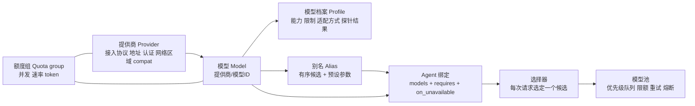
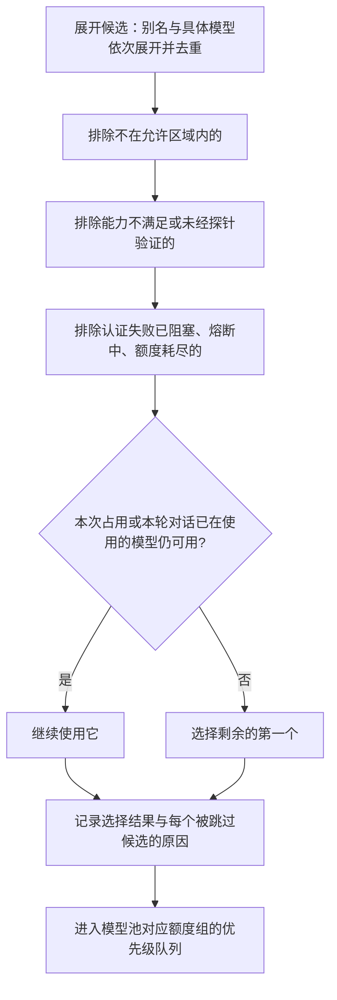

# 统一模型提供商 Proposal

状态：重设计草案，待评审。依据 2026-10-19 用户提出的心智模型与澄清回答编写，尚未实现。

更新日期：2026-10-19。

本文把所有模型提供商和模型放在同一个平面上管理：用户在 Agent 定义中按需引用任意提供商的任意模型，
会话不再绑定某一个提供商。确认后，它将替代 [Mori 产品与技术 Proposal](../proposal.md) 中“模型配置”的部分，
并修改 [内网模型资源可靠性 Proposal](model-reliability.md) 中“每个角色固定一个资源、不切换”的约定；
模型池的排队、限额、单层重试、熔断和远端未知占用等可靠性机制继续有效。
TaskBoard 与平行 Agent 见 [平行 Agent 与 TaskBoard Proposal](parallel-agents-taskboard.md)。

DSH 源码依据以固定提交 `d743267388641bc76f17c45ce8b4c231aed1d32c` 为准。核对结论：
DSH 的 `LlmRuntime` 已经允许多个提供商路由同时存在，每次请求按“提供商 + 模型”路由；
pi-ai 连接器的 `providers` 字典可以声明任意数量的端点。也就是说，“统一平面”的底座已经存在，
缺的是别名与候选、能力档案、排队与共享限额、熔断、显式切换和可见性。

## 1. 要解决的问题

1. **会话被绑定在单个提供商上**：常见 harness 启动时选定一个提供商，整个会话都只能用它的模型。
   mori 的平行 Agent 需要按角色选择模型：规划和评估用强模型，执行用代码模型，记忆和摘要用便宜的快模型。
2. **内网资源不稳定**：自部署端点限流、宕机、排队都很常见；旧方案只等待或失败，长任务因此停摆。
3. **模型之间差异大**：自部署和开源模型在工具调用、结构化输出、推理字段、上下文长度上各不相同，
   同一套 harness 请求发到不同模型，可靠性差别很大。这正是“harness 遵从度差”的重要来源之一。
   BFCL 排行榜上，常用开源模型的多轮工具调用准确率大多在 40%–68% 之间；
   同一个模型用原生函数调用还是提示词格式，成绩可能相差数十个百分点，而且哪种更好因模型而异。

## 2. 新旧方案评估

| 维度 | 旧方案 | 用户提出的新方案 | 本文采用 |
| --- | --- | --- | --- |
| 提供商范围 | 内网 OpenAI 兼容接口 | 所有提供商在一个平面上 | pi-ai 支持的全部接入协议，统一命名为 `提供商/模型` |
| Agent 与模型的关系 | 每个角色引用一个固定的模型资源 | 每个 Agent 按配置使用任意提供商的任意模型 | 有序候选列表 + 能力要求，可引用别名；别名同时捆绑推理档位、采样等参数 |
| 失败时 | 等待或失败，不自动切换 | 按配置的候选列表显式切换（用户已确认） | 只因可用性原因、只在请求边界切换；执行类 Agent 在占用中途切换时从工作卡重建上下文；切换处处可见 |
| 能力信息 | 配置 + 验证，不允许猜测 | — | 模型档案：目录与手写配置提供初值，探针验证后才算满足能力要求 |
| 弱模型适配 | 未涉及 | — | 档案驱动的请求适配：工具调用方式、强制调用策略、结构化输出、推理字段 |
| 可靠性 | 完整的模型池设计 | — | 全部保留；排队改为带优先级；额度组扩展到多提供商 |
| 数据边界 | 默认全在内网 | 未涉及 | 新增：每个提供商标注网络区域，切换不得越过允许的区域 |

**旧方案的优点**：可靠性语义完整（单层重试、远端未知占用、限额原子取得），并且坚持“能力不能猜”“不静默切换”。
**旧方案的不足**：把“不切换”作为硬规则，在资源不稳定时直接导致任务停摆；只考虑单一协议；没有处理模型之间的行为差异。

**新方案的优点**：按角色选模型，成本和质量可以分别优化；候选列表提高可用性；会话与提供商解耦。
**新方案的风险**：

| 风险 | 证据 | 对策 |
| --- | --- | --- |
| 切换后行为不一致，即使是“同一个模型” | Moonshot K2-Vendor-Verifier：同一 Kimi K2 模型在不同部署商上，工具调用触发一致率从约 51% 到约 76% 不等 | 每个候选都必须单独通过探针；切换记录在案；粘性选择减少切换（§5.5） |
| 中途换模型继承漂移 | Inherited Goal Drift：强模型接续弱模型的轨迹后也会漂移 | 执行类 Agent 在占用中途切换时，不回放旧轨迹，而是写检查点后从工作卡重建上下文（§5.3） |
| 切换导致代码离开内网 | — | 提供商标注网络区域；切换只在允许的区域内进行（§4.6） |
| 跨模型的上下文不兼容 | 推理块签名、工具调用标识格式、`reasoning_content` 回传要求各家不同 | 复用 pi-ai 的转写，补齐 mori 需要的规则（§6） |
| 切换掩盖真实故障 | 网关默认配置常在调用方不知情时换服务方（OpenRouter `allow_fallbacks` 默认开启） | 每次切换都记录原因并在界面显示；切换不重置期限和预算；不提供隐式重定向 |
| 上下文超长被当成换大模型 | LiteLLM 的 `context_window_fallbacks` 会掩盖 compaction 失效，让 Agent 在不同窗口的模型间来回跳 | 上下文超长不触发切换，交给 compaction 或从工作卡重建（§5.2） |
| 外部网关与 mori 重复重试 | — | 接入 LiteLLM、OneAPI 等网关时，网关和 mori 只能有一层重试（§8） |

## 3. 概念



| 概念 | 含义 |
| --- | --- |
| 提供商 | 一个可调用的端点：接入协议、地址、认证引用、网络区域、请求头、代理、compat 选项 |
| 模型 | 某个提供商下的一个模型（一个部署），统一命名为 `提供商/模型ID`；第一个 `/` 之前是提供商，其余整体是模型 ID |
| 模型档案 | 该模型的能力、限制、适配方式和探针结果；决定 harness 如何组装请求 |
| 额度组 | 实际共享的限额：并发、请求速率、token；可以跨模型、跨提供商（例如同一 GPU 集群上的两个模型） |
| 别名 | 一个有序候选列表，加上一组预设参数（推理档位、最大输出、采样参数） |
| Agent 绑定 | `agent.md` 中的 `models`（有序候选，可写别名或具体模型）、`requires`（能力要求）和 `on_unavailable` |
| 工具模型 | 摘要补写、compaction、标题等非 Agent 调用使用的模型，单独配置 |

## 4. 配置

### 4.1 存放与来源

- 提供商、模型、额度组、别名、工具模型：用户级设置，扩展 DSH 已有的 pi-ai 连接器配置（`providers` 字典及其 `models`、`compat` 字段），只有一处来源。
  mori 只在其上增加字段（网络区域、模型族、部署信息、额度组、探针结果、别名），不另起一套模型目录。
- 认证只保存引用，密钥放在系统凭据存储中（Windows 凭据管理器），不写进任何配置文件或 `agent.md`。
- `agent.md` 只引用别名或具体模型名，不包含地址和密钥，因此 Agent 定义可以安全地放进项目仓库共享。
- 项目可以收紧允许的网络区域、覆盖别名指向（例如本项目把 `coder` 指向另一组模型），不能新增提供商或密钥。
- 配置做严格校验，未知字段直接报错，不静默忽略（Claude Code 的 subagent frontmatter 静默忽略未知字段，曾让配置错误长期无人察觉）。

### 4.2 示例

```yaml
providers:
  intranet-vllm:
    api: openai-completions         # pi-ai 的接入协议名，见 §4.3
    baseUrl: http://10.0.0.5:8000/v1
    auth: { secret_ref: intranet-vllm }
    zone: intranet                  # 网络区域，mori 字段
    retry: mori                     # 由 mori 负责重试（默认），mori 字段
    compat: { supportsDeveloperRole: false, maxTokensField: max_tokens, thinkingFormat: qwen-chat-template }
    serving: { engine: vllm, tool_parser: qwen3_coder, reasoning_parser: qwen3, grammar_backend: xgrammar }
    models:
      - id: qwen3-coder-30b
        family: qwen3               # 模型族，mori 字段
        contextWindow: 131072
        maxTokens: 16384
        input: [text]
        quota_groups: [gpu-a]
      - id: qwen3-30b-a3b
        family: qwen3
        contextWindow: 32768
        quota_groups: [gpu-a]
  corp-gateway:                     # 公司已有的 LiteLLM / OneAPI 网关
    api: openai-completions
    baseUrl: http://llm-gw.corp/v1
    auth: { secret_ref: corp-gw }
    zone: intranet
    retry: upstream                 # 网关自己重试，mori 不再重试
    models:
      - { id: qwen3-coder-480b, family: qwen3, contextWindow: 262144 }
  deepseek:
    api: openai-completions
    baseUrl: https://api.deepseek.com
    auth: { secret_ref: deepseek }
    zone: public
    models:
      - { id: deepseek-reasoner, family: deepseek, reasoning: true,
          compat: { requiresReasoningContentOnAssistantMessages: true } }
  local-ollama:
    api: openai-completions
    baseUrl: http://127.0.0.1:11434/v1
    zone: local
    models:
      - { id: qwen3-8b, family: qwen3, contextWindow: 32768 }

quota_groups:
  gpu-a: { max_concurrency: 4, max_inflight_tokens: 400000 }

aliases:
  strong:
    candidates: [corp-gateway/qwen3-coder-480b, deepseek/deepseek-reasoner]
  coder:
    candidates: [intranet-vllm/qwen3-coder-30b, corp-gateway/qwen3-coder-480b]
    params: { thinking: off, maxTokens: 16384, samplingParams: { temperature: 0.55 } }
  fast:
    candidates: [intranet-vllm/qwen3-30b-a3b, local-ollama/qwen3-8b]

utility:
  summary: fast
  compaction: fast
  title: fast

policy:
  allowed_zones: [intranet, local]   # 用户级默认；项目可以收紧，不能放宽
```

`agent.md` 中的绑定：

```yaml
models: [coder, strong]          # 依次展开、去重；别名与具体模型可以混写
requires: [tool_calling, forced_tool_choice, context>=65536]
on_unavailable: failover         # failover（默认，按候选切换）| wait | release_task
thinking: medium                 # 可选，覆盖别名预设；经 pi-ai 的 thinkingLevelMap 映射
```

示例中的模型名称和数值只用于说明格式，实际值以配置和探针结果为准。
档案中的能力字段（§7.1）同样写在模型条目下，示例为简洁省略。

### 4.3 接入协议

接入协议直接使用 pi-ai 的实现，不另写协议层，也不新增独立的模型网关进程。pi-ai 1.0.2 提供的协议包括：
`openai-completions`（OpenAI Chat Completions 及其兼容实现：vLLM、SGLang、Ollama、LM Studio、llama.cpp server、各类网关、多数国产模型 API）、
`openai-responses`、`azure-openai-responses`、`anthropic-messages`、`google-generative-ai`、`google-vertex`、
`mistral-conversations`、`bedrock-converse-stream` 等。DSH 固定提交依赖 `@earendil-works/pi-ai ^1.0.2`，
上游当前为 1.3.x；升级时需要按固定版本重新核对协议与 compat 字段。

### 4.4 能力要求与能力来源

`requires` 中可以写：`tool_calling`、`forced_tool_choice`、`parallel_tools`、`structured_output`、`vision`、
`reasoning`、`context>=N`、`output>=N`。

每项能力标注来源和时间：

| 来源 | 含义 | 是否满足 `requires` |
| --- | --- | --- |
| `catalog` | 离线导入的公开目录（models.dev 或 LiteLLM 成本表的本地镜像） | 否，界面显示“未验证” |
| `declared` | 用户手写，覆盖目录 | 否，界面显示“未验证” |
| `probed` | mori 探针实测通过（§7.3） | 是 |

只有探针验证过的能力才算满足要求，这延续旧方案“能力不能猜”的原则。
公开目录描述的是模型本身，不反映你的部署所用的 tool parser 和 chat template；同一模型在不同部署上的行为可以差很多。

### 4.5 启动校验

会话启动时，程序为每个 Agent 展开候选并逐项过滤，至少剩下一个候选才允许启动；
否则拒绝启动，并说明每个候选被排除的原因（区域不允许、能力未验证、能力不满足、提供商已阻塞）。

### 4.6 网络区域

每个提供商必须标注 `zone`：`local`（本机）、`intranet`（公司内网）、`public`（公网）。

- 用户级 `policy.allowed_zones` 给出默认允许的区域；项目可以收紧，不能放宽。
- 候选列表中不在允许区域内的模型直接排除，并在启动校验结果中列出。
- 因此，内网模型失败时，不会因为候选列表里写了公网模型而把代码发到公网。
- 需要使用公网模型的项目必须显式允许 `public`。

## 5. 选择与切换

### 5.1 每次请求如何选模型



选择挂在 DSH 的 `agent/request` 钩子上：它在每一步生成请求时可以改写路由，改写结果记录在请求头事件中。

### 5.2 什么时候切换

按用户的决定，切换只因为**可用性**原因，并且只在**请求边界**发生：

| 情况 | 处理 |
| --- | --- |
| 连接失败，确认请求未送出 | 在单层重试预算内重试原模型；预算用完后切换到下一个候选 |
| 限流，`Retry-After` 超过本次请求允许的等待时间 | 原模型进入冷却，切换 |
| 服务错误达到重试预算，或熔断打开 | 切换 |
| 首个有效响应超时 | 原尝试按远端未知处理，保留其容量占用；切换 |
| 排队超过 `max_queue_wait` | 从原队列移出（确认未发送）后进入下一个候选的队列 |
| 认证失败、额度耗尽、模型不存在 | 阻塞该提供商或模型，立即切换，界面提示需要处理配置 |

以下情况**不切换**：

| 情况 | 处理 |
| --- | --- |
| 输出格式错误、工具参数不合格 | 交给 Agent 循环按模型步骤失败处理（档案中的格式重试），不当作可用性问题 |
| 已经向调用方发布了部分内容后失败 | 结束这次逻辑请求，保留部分输出（沿用旧方案）；Agent 循环下一次发起新请求时重新选择 |
| 上下文超长 | `continuous` 模式做 compaction；`per_task` 模式写检查点后从工作卡重建；不换更大窗口的模型 |
| 内容策略拦截 | 报告给用户，不换模型绕过 |
| 用户取消 | 停止，不切换 |
| `on_unavailable: wait` | 等待或失败，同旧方案 |
| `on_unavailable: release_task` | 占用者写一条系统步骤说明原因，task 交给主控，由主控决定改派或等待 |

“输出质量差时升级到更强的模型”属于语义路由，不在本期范围，见 §13 待澄清问题。

### 5.3 占用中途原模型不可用

执行类 Agent（`context: per_task`）在一次占用中途遇到原模型不可用且需要切换时，**不把旧轨迹回放给新模型**，而是：

1. 程序写一条 `system` 检查点步骤：已完成的工具调用与结果引用（`facts`）、最后一段模型输出；
2. 在下一个候选上为该 Agent 建立新上下文：system prompt + 工作卡 + 这条检查点；
3. 继续同一次占用（租约不变），交接要点中注明“因原模型不可用，从检查点继续”。

理由：旧轨迹里有原模型专有的推理块和工具调用格式，跨模型回放有兼容问题；
更重要的是，接续别的模型的轨迹会继承漂移，而从看板重建只继承结构化的结论。这正是 TaskBoard 给模型平面带来的能力。

`continuous` 模式的 Agent（对话、主控）需要保留对话历史，切换时用 pi-ai 的转写函数把历史转成目标模型可接受的形式（§6）。

### 5.4 不变的约束

- 切换不重置逻辑请求的总截止时间、任务预算和重试预算。
- 同一个逻辑请求在任一时刻只会发往一个模型；排队中的改投必须先确认在原队列中没有发出。
- 原模型上处于远端未知状态的尝试，继续保留它的容量占用，直到满足旧方案中的解除条件。
- 每次选择都写入请求记录：选中的模型、原因、每个被跳过的候选及原因。
- 不提供任何隐式重定向：不能像 LiteLLM key alias 或 Portkey `override_params` 那样，在调用方不知情时把请求改投到别的模型。

### 5.5 粘性与回切

- 一次 task 占用（或对话 Agent 的一轮对话）内，优先继续使用已经用过的模型，避免中途换风格、丢前缀缓存。
- 切换到后备模型之后，即使首选模型恢复，也要等下一次占用或下一轮对话开始时才回切，避免来回抖动。
- 每个步骤和批注都记录写入时实际使用的模型（别名、解析出的部署、服务端报告的模型、用量），
  TaskBoard 中可以看到“这一步是哪个模型写的”。部分服务不回报实际模型（例如 Bedrock、Vertex 不返回 model 字段），
  所以溯源以 harness 侧的解析结果为准。

## 6. 跨模型上下文

推荐的切换点是**占用边界**：TaskBoard 是与模型无关的纯文本共享状态，执行类 Agent 默认每次占用使用新上下文，
所以在两次占用之间换模型不需要任何转写。

必须转写时（`continuous` 模式的 Agent），复用 pi-ai 的 `transformMessages`，它已经处理：

| 内容 | pi-ai 的处理 |
| --- | --- |
| 推理内容 | 提供商、协议、模型三者都相同才保留；否则丢弃推理块，删除工具调用上的推理签名 |
| 工具调用标识 | 按目标协议的格式要求规范化，并同步改写对应工具结果的标识 |
| 没有结果的工具调用 | 补一条合成的错误结果 |
| 出错或中止的助手消息 | 整条跳过 |
| 图片 | 目标模型不支持图像时替换为占位文字 |
| 中途的 system 消息 | 目标不支持时折叠进开头的 system |

mori 在其上补充：

| 规则 | 原因 |
| --- | --- |
| Kimi 系模型的工具调用标识规范为 `functions.名称:序号` | pi-ai 源码中未见这条规范化；vLLM 排查 Kimi K2 精度问题时发现非标准标识会被 parser 丢弃 |
| 发给自部署模型的助手和工具消息，`content` 一律为字符串 | 空内容被转成数组后，chat template 可能把数组字面量打进 prompt |
| 校验模型调用的工具名是否在本次请求的工具列表中 | 不在就返回错误结果，不执行；模型有时会调用历史中出现过、但本次未声明的工具 |
| 看板推送与工作卡以追加消息注入，不改写开头的 system prompt 和工具列表 | 前缀改动会让前缀缓存失效，在 Anthropic 等提供商上还会使之前的推理块失效 |
| 一次占用内不改推理档位 | 改档位同样会让缓存失效 |
| 需要回传 `reasoning_content` 的模型（如 DeepSeek 推理模式带工具时）不接续别的模型生成的工具循环 | 缺失时 pi-ai 只能补空字符串绕过报错，补不回语义；这类模型的切换只在占用边界进行 |
| 图片：需要图像能力的请求，用 `requires: [vision]` 在选择阶段排除不支持的候选 | 不在转写时悄悄删图 |

## 7. 模型档案、适配与探针

### 7.1 档案字段

档案字段以 pi-ai 的模型定义和 compat 选项为基础，mori 增加验证和适配相关的字段：

| 字段 | 含义 | 来源 |
| --- | --- | --- |
| `contextWindow` / `maxTokens` / `input` | 上下文、输出上限、输入模态 | pi-ai 字段；可用 `/v1/models` 的 `max_model_len` 核对 |
| `reasoning` / `thinkingLevelMap` | 是否推理、推理档位映射 | pi-ai 字段 |
| `compat` | `thinkingFormat`、`maxTokensField`、`supportsDeveloperRole`、`requiresReasoningContentOnAssistantMessages`、`supportsMidConvoSystemMessages`、`vllmPriority` 等 | pi-ai 字段 |
| `family` / `weights` | 模型族、权重标识（判断两个部署是否同一份权重） | mori |
| `serving` | 推理引擎及版本、tool parser、reasoning parser、约束解码后端、chat template 摘要 | mori；配置 |
| `tool_call_mode` | `native`（原生函数调用）或 `prompt`（提示词定义格式，程序解析）；按实测选择 | mori；探针 |
| `tool_choice` | 支持的取值：`auto`、`required`、`named`（指定函数） | mori；探针 |
| `strict_schema` | 是否支持严格的参数 schema | mori；探针 |
| `parallel_tools` | 是否会并行发起多个工具调用 | mori；探针 |
| `structured_output` | `json_schema`、`json_object`、`none` | mori；探针 |
| `stream_usage` | 流式响应是否返回用量 | mori；探针 |
| `unsupported_params` | 需要从请求中去掉的参数 | mori；探针报错时记录 |
| `format_retry` | 输出格式错误时允许的修复重试次数 | mori；配置 |
| `price` | 每百万 token 的输入、输出、缓存价格；内网可填内部成本或 0 | pi-ai `cost` 字段 |
| `probe` | 每项能力的探针结果、遵从度得分、时间、服务版本 | mori；程序 |

### 7.2 档案驱动的请求适配

同一个 Agent 请求，程序按目标模型的档案组装。以“强制交接”这类必须调用某个工具的场景为例，按可靠性从高到低选第一个可用的策略：

| 策略 | 适用 | 说明 |
| --- | --- | --- |
| 指定函数（`tool_choice` 为 `named`） | vLLM、SGLang（xgrammar 后端）、多数云 API | 服务端用约束解码保证生成可解析的调用；只保证格式，不保证内容质量 |
| `required` 且只允许交接工具 | 支持 `required` 的后端 | 优先用 `allowed_tools` 一类的子集限制，保持完整工具列表不变以保住缓存；不支持时才临时只暴露这一个工具 |
| 结构化输出（`json_schema`） | 不支持 `tool_choice` 的后端，例如 Ollama | 用 `response_format` 约束输出，再由程序转成交接调用 |
| 提示词 + 解析与修复 | 以上都不支持 | 确定性修复（补全括号、去掉代码块包裹、键名归一、类型转换）后按 schema 校验 |

其他适配：

| 需要 | 做法 |
| --- | --- |
| 普通工具调用 | 按 `tool_call_mode` 选择原生函数调用或提示词格式；`auto` 模式下的调用参数可能畸形，一律防御性解析 |
| 推理内容 | 按 pi-ai 的 `thinkingFormat` 提取；按 compat 决定是否回传；不显示为正文 |
| 采样参数 | 使用别名或档案的推荐值，Agent 定义可以覆盖 |
| 不支持的参数 | 从请求中去掉，避免服务端报错 |
| 请求优先级 | 档案声明支持时，通过 pi-ai 的 `vllmPriority` 把队列优先级传给 vLLM（服务端需开启优先级调度） |

修复只做确定性的变换；修复后仍然无法通过 schema 校验，就按 `format_retry` 重试，把错误留在上下文里；
超过次数报告步骤失败，不做宽松猜测。对平行 Agent 协议而言，最后一道兜底是 TaskBoard 的自动回收（见 TaskBoard Proposal §7.5）。

### 7.3 探针与协议一致性测试

在设置中对每个模型执行“验证”，结果写入档案的 `probe`：

1. 基础请求：非流式与流式，检查用量是否返回；
2. 单个工具调用（`auto`），检查参数是否通过 schema；
3. 强制工具调用（`required`、`named`）；
4. 并行工具调用；
5. 工具结果回传后的下一轮回复（很多部署在这一步出错）；
6. `json_schema` 结构化输出；
7. 推理字段识别与回传要求；
8. `tool_call_mode` 对比：同一组用例分别用原生函数调用和提示词格式跑，选成绩更好的一种；
9. **协议一致性测试**：用固定的小型 TaskBoard 场景（领取后完成几次工具调用、记一步、按要求交接；遇到无效下一棒是否修正；缺信息时是否选 `blocked`），
   连跑 k 次，统计 pass^k（τ-bench 的指标）和工具调用触发一致率、参数 schema 准确率（参照 K2-Vendor-Verifier）。
   结果在 Agent 配置界面中提示“这个模型适合承担哪些角色”，例如一致性低的模型不建议担任主控。

探针只验证能力，不代表模型在真实任务中的效果。服务端版本、tool parser 或 chat template 变化后，档案标记为“需要重新验证”。
探针套件中包含主动触发的故障（限流、熔断），保证切换路径在生产之前被实际跑过。

## 8. 模型池

旧 [内网模型资源可靠性 Proposal](model-reliability.md) 的机制全部保留：统一入口、单层重试、退避与 `Retry-After`、
熔断、远端未知占用、排队公平、持久记录与恢复。DSH 核心层没有排队、并发限额和熔断，这些都由模型池在
`llm/stream` 钩子或连接器包装层实现。本文只做以下修改：

| 修改 | 说明 |
| --- | --- |
| 额度组跨提供商 | 额度组可以挂在提供商或模型上；一个请求同时取得它涉及的全部额度组 |
| 带优先级的等待队列 | 并发满时排队，不像 LiteLLM 那样立即返回 429：平行 Agent 会在同一时刻收到用户消息，请求会同时涌向同一个端点 |
| 优先级类别 | 交互（对话 Agent）> 决策与验证（主控、评估）> 执行 > 后台（记忆、纠错、工具模型）；类别内按用户会话轮转 |
| 候选感知的排队 | 请求按选定的候选进入对应队列；排队超时后按 §5.2 改投下一个候选 |
| 允许切换 | “不自动切换模型”改为“只按候选列表、在请求边界、因可用性原因切换，并且可见” |
| 熔断粒度 | 熔断作用于单个模型或单个提供商，不连带整个别名 |
| 故障判定 | 以 HTTP 状态、`Retry-After` 和连接错误为准；pi-ai 当前主要靠正则匹配错误文本来分类，自部署服务的报错格式可能被误判，只作参考 |
| 单层重试的边界 | 沿用 DSH `llm-retry` 的 normal 模式（有限次数，处理限流、服务错误、超时、传输错误）；删除会对鉴权和额度错误无限重试的 always 模式；`retry: upstream` 的提供商 mori 不再重试 |
| 成本统计 | 按提供商、模型、Agent、目标 task 汇总已知用量与价格；用量缺失保持未知，不按 0 计 |

## 9. 与 TaskBoard 的协同

- **看板让异构模型可以安全协作**：Agent 之间只通过看板上的纯文本交换信息，不依赖彼此的推理内容或工具调用格式，
  因此每个角色可以使用不同提供商的模型，换模型的最佳时机就是占用边界。
- **每一步记录写入模型**：评审时可以看到“这一步由哪个模型写成”，便于发现某个模型持续写出不可靠的摘要。
- **评审避开同族**：模型会偏好自己的输出。评估 Agent 可以声明 `differ_from: { agent: executor, by: family }`，
  选择器读取被评审步骤的写入模型，排除同族候选；没有满足条件的候选时，task 等待并显示原因，而不是降级为同族评审。
- **工具模型补位**：模型漏写摘要时由 `utility.summary` 补写；`utility.compaction` 用于 `continuous` 模式的 compaction。
- **按一致性分配角色**：协议一致性测试的结果用于建议角色分配；最强、最可靠的模型放在主控和评估这类决策与验证位置。
- **预算耗尽不降级**：task 或占用预算用完时，占用者交接并说明原因，由主控决定；不自动换成更便宜的模型继续。

## 10. DSH 落点

| 机制 | DSH 现有能力 | mori 的改动 |
| --- | --- | --- |
| 多提供商并存 | `LlmRuntime.registerAdapter` 把每个提供商路由映射到连接器；请求按“提供商 + 模型”路由 | 直接使用 |
| 端点声明 | pi-ai 连接器的 `providers` 字典，每个条目有 `api`、`baseURL`、`models`、`compat`、`retryPolicy` 等 | 作为配置底座，增加 mori 字段 |
| 每步选模型 | `agent/request` 钩子可改写路由，结果记录为请求头事件 | 挂选择器（§5.1） |
| 模型池 | `llm/stream` 钩子；核心层无排队、限额、熔断 | 在此实现 §8 |
| 重试 | `llm-retry` 的 normal 模式；always 模式会无限重试 | 保留 normal，删除 always |
| 错误事实 | pi-ai 按错误文本分类 | 通过请求钩子采集 HTTP 状态与响应头（旧方案已提出） |
| 跨模型转写 | pi-ai `transformMessages`；切换连接器时会剥离回放状态 | 直接使用，补 §6 的规则 |
| subagent 模型 | `startActivation` 的 `agentOptions` 可指定提供商、模型、推理档位；默认继承父 Agent | mori 要求 subagent 定义显式写模型或 `inherit` |

## 11. 界面

- 设置 → 模型：按提供商分组列出模型，显示网络区域、验证状态、能力标签及其来源、协议一致性得分；提供“验证”按钮。
- 别名编辑：拖动排序候选；显示每个候选当前是否可用。
- Agent 配置：选择候选和能力要求后，立即显示展开结果和被排除的原因，以及推荐角色提示。
- 模型池：在原有圆点与队列基础上，按提供商分组；切换事件显示为“executor：A → B，原因：限流 429”。
- TaskBoard 中每个步骤显示一个小的模型标签。

## 12. 最小闭环与验收

最小闭环：一个内网 vLLM 模型作为执行候选首位，一个本机 Ollama 模型作为第二候选，一个内网模型作为工具模型。

1. 对三个模型运行探针和协议一致性测试，档案得到验证结果。
2. 执行 Agent 正常运行；用测试服务对首选模型注入限流，验证切换到第二候选、记录原因，并在下一次占用时回切。
3. 在候选列表末尾加入一个 `public` 区域的模型，而项目只允许 `intranet` 和 `local`，验证它被排除。
4. 在占用中途注入首选模型宕机，验证写检查点后在第二候选上从工作卡继续，旧轨迹没有被回放。
5. 对不支持 `tool_choice` 的 Ollama 模型执行强制交接，验证走结构化输出的适配路径。

| 验收场景 | 通过条件 |
| --- | --- |
| 多提供商并存 | 同一会话中不同 Agent 同时使用不同提供商的模型，模型池分别计算额度 |
| 候选展开与过滤 | 别名展开顺序正确、去重；能力未验证或区域不允许的候选被排除并给出原因 |
| 启动校验 | 某个 Agent 没有可用候选时拒绝启动，原因明确；配置中的未知字段报错 |
| 可用性切换 | 限流、宕机、首响应超时、排队超时、认证失败各自按 §5.2 处理 |
| 不切换的情况 | 格式错误、部分输出后失败、上下文超长、内容策略拦截、用户取消都不切换 |
| 中途切换 | 执行类 Agent 写检查点后从工作卡重建，租约不变；`continuous` Agent 按 §6 转写 |
| 切换可见 | 请求记录、模型池界面、TaskBoard 步骤都能看到实际使用的模型和切换原因 |
| 期限与预算 | 切换不重置总截止时间、任务预算和重试预算 |
| 不重复发送 | 同一逻辑请求不会同时发往两个模型；排队改投先确认未发出 |
| 粘性与回切 | 占用内不来回切换；首选模型恢复后在下一次占用开始时回切 |
| 网络区域 | 任何切换都不会把请求发往不允许的区域 |
| 档案适配 | 强制交接在 `named`、`required`、结构化输出、提示词四种策略上都能完成，失败时报告具体原因 |
| 优先级排队 | 平行 Agent 同时发起请求时排队而不是互相挤成 429；交互请求先于后台请求 |
| 探针 | 每项能力的探针结果和来源可查；部署变化后标记需要重新验证；切换路径被故障注入实际跑过 |
| 单层重试 | `retry: upstream` 的提供商只有一次 mori 发送；always 模式已删除 |
| 评审避开同族 | 开启 `differ_from` 时，评审不会使用与被评审步骤同族的模型 |
| 成本统计 | 按提供商、模型、Agent、目标 task 汇总，未知用量单独显示 |

## 13. 待澄清问题与待定参数

需要用户决定的问题：

| 问题 | 本文暂定 |
| --- | --- |
| 是否需要“输出质量差时升级到更强模型”（语义路由）？ | 本期不做，只做可用性切换 |
| “每个任务同时使用所有模型”是否包括同一步并行调用多个模型（多选一、投票、交叉验证）？ | 不包括：不同 Agent 各用各的模型，同一步只调用一个模型 |
| 公网提供商是否在默认允许区域内？ | 默认不允许，项目需要显式开启 |
| 项目能否覆盖别名？ | 可以覆盖别名指向，不能新增提供商和密钥 |
| 协议一致性得分是否只作建议，还是可以阻止低分模型担任主控？ | 只作建议 |
| 评审是否必须使用与执行者不同族的模型？ | 可选，不默认开启 |
| 模型目录与探针结果是个人维护，还是团队共享？ | 个人维护；团队共享可在后续通过导入导出实现 |
| 是否需要每个目标 task 的费用上限，以及超出后的行为？ | 需要；超出时暂停并询问用户 |

待实测确定的参数：各模型的期限与重试预算、`max_queue_wait`、优先级权重、熔断条件、探针用例与一致性通过标准、
请求长度估算方法、价格与目录数据的离线来源（内网环境不能在运行时联网拉取 models.dev 等目录，需要本地镜像）。

## 14. 业界参考

| 来源 | 借鉴点 |
| --- | --- |
| [pi-ai](https://github.com/earendil-works/pi)（DSH 使用的连接器）与 [models.json 配置](https://github.com/earendil-works/pi/blob/main/packages/coding-agent/docs/models-configuration.md) | 多协议接入与统一消息格式；compat 选项；跨模型转写 `transformMessages` |
| [LiteLLM Router](https://docs.litellm.ai/docs/routing)、[Fallbacks](https://docs.litellm.ai/docs/proxy/reliability) | 一个名字对应多个部署；每个部署的限额与冷却；调用前的上下文检查；也是“满并发立即 429”和“改 alias 即静默换模型”的反例 |
| [OpenRouter provider routing](https://openrouter.ai/docs/features/provider-routing) | `order`、`only`、`allow_fallbacks`、`require_parameters`；默认开启回退是“静默切换”的反例 |
| [Portkey config](https://portkey.ai/docs/api-reference/inference-api/config-object) | 声明式 fallback 与按状态码触发；`override_params` 隐式改写是反例 |
| [Vercel AI SDK provider registry](https://ai-sdk.dev/docs/ai-sdk-core/provider-management) | `provider:model` 命名；别名捆绑预设参数 |
| [opencode](https://opencode.ai/docs/providers/) 与 [models.dev](https://github.com/sst/models.dev) | 多提供商配置；开放的能力目录字段；每个 agent 指定模型；隐式继承的问题 |
| [Roo Code 配置档](https://roocodeinc.github.io/Roo-Code/features/api-configuration-profiles)、[Continue 模型角色](https://docs.continue.dev/reference)、[Aider](https://aider.chat/docs/usage/modes.html) | 按模式或角色绑定模型；task 记住启动时的配置；能力可手动覆盖自动探测 |
| [K2-Vendor-Verifier](https://github.com/MoonshotAI/K2-Vendor-Verifier)、[vLLM：Kimi K2 精度排查](https://vllm.ai/blog/Kimi-K2-Accuracy) | 同一模型不同部署行为差异大；工具调用标识与 chat template 的坑 |
| [vLLM tool calling](https://docs.vllm.ai/en/latest/features/tool_calling.html)、[SGLang tool parser](https://docs.sglang.io/advanced_features/tool_parser.html)、[Ollama OpenAI 兼容](https://docs.ollama.com/api/openai-compatibility) | `tool_choice` 各取值的保证程度；parser 列表；Ollama 不支持 `tool_choice` |
| [BFCL](https://gorilla.cs.berkeley.edu/blogs/13_bfcl_v3_multi_turn.html) | 开源模型多轮工具调用准确率；原生函数调用与提示词格式的差异因模型而异 |
| [Inherited Goal Drift](https://arxiv.org/abs/2603.03258) | 接续他人轨迹会继承漂移，中途换模型应从结构化状态重建 |
| [LLM Evaluators Favor Their Own Generations](https://arxiv.org/abs/2404.13076) | 评审避开同族模型 |
