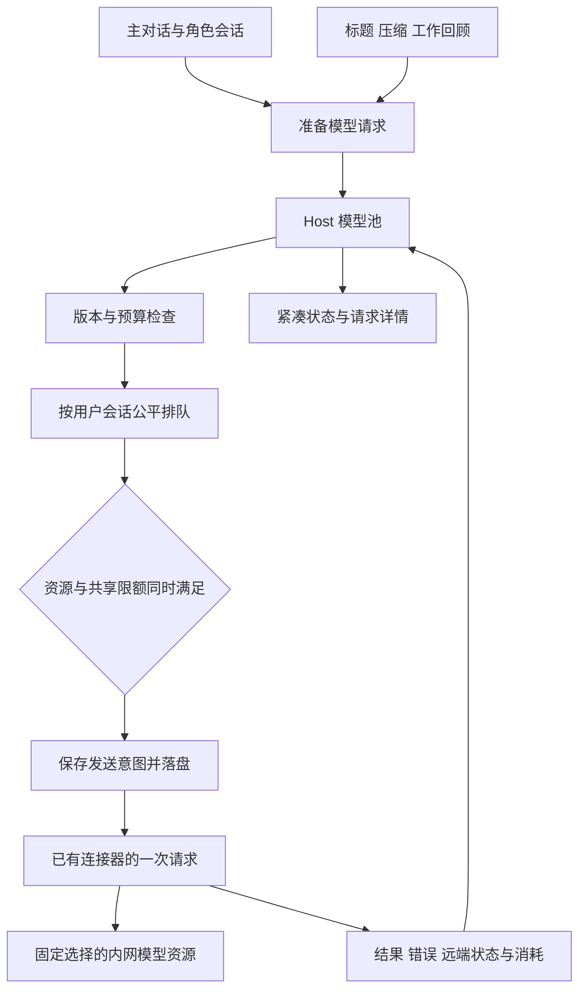
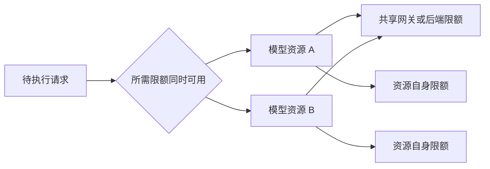
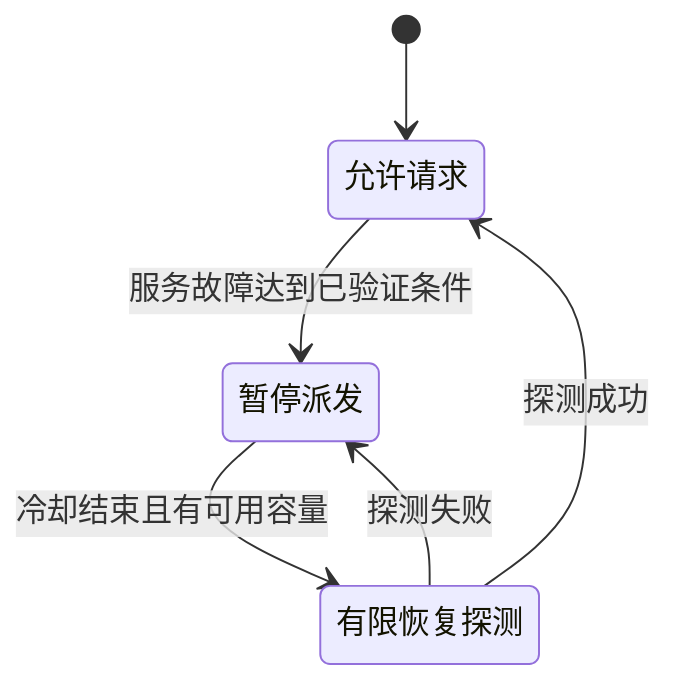
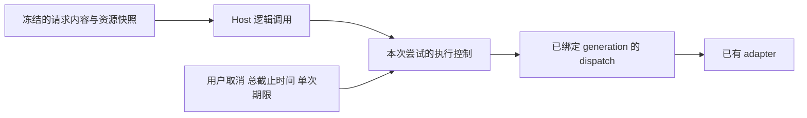
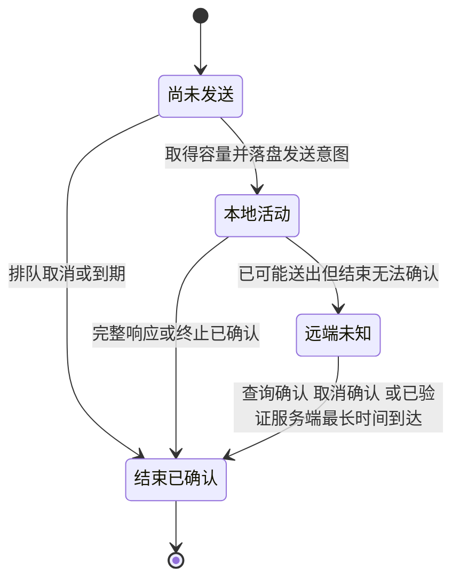
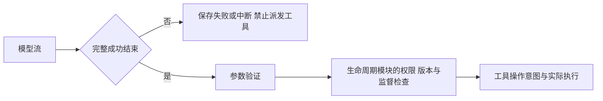
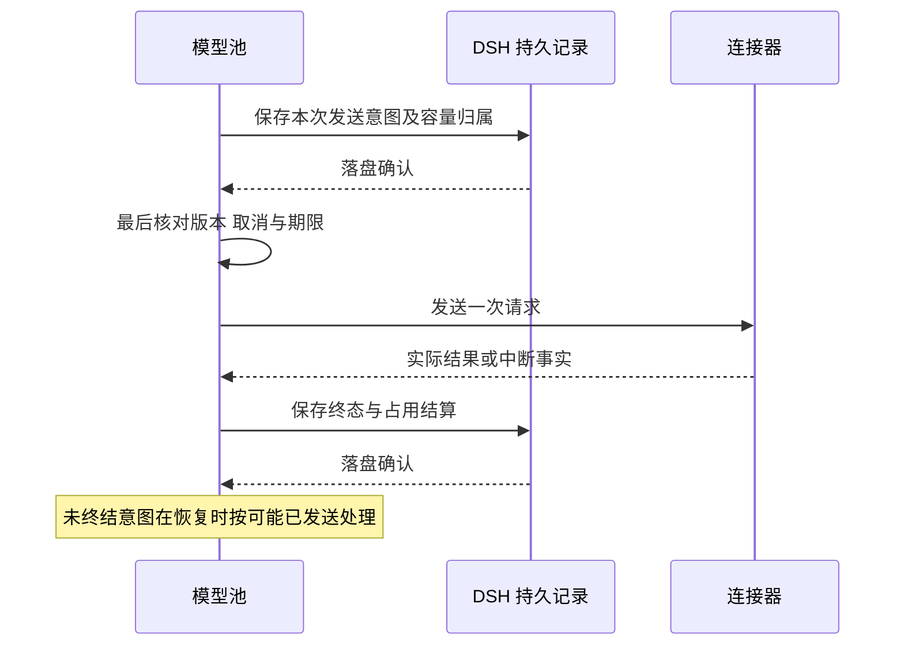

# 内网模型资源可靠性 Proposal

状态：方案草案，供独立评审；尚未实施。本文中的拟议改造与待定参数不代表已经批准或通过运行验收。

更新日期：2026-10-13。

本文细化 [Mori 产品与技术 Proposal](../proposal.md) 中的模型池与请求状态展示，
以 DSH `0.2.1-alpha.2`、提交 `d743267388641bc76f17c45ce8b4c231aed1d32c` 为源码基线。
DSH 是唯一 Agent 运行时；本文设计同一个本地 Host 内的模型资源管理，不新增独立模型网关。

## 要解决的问题

内网有多个模型 API，但不同资源的响应速度、网关稳定性和允许并发差异较大。
多个用户会话、角色会话和后台任务同时调用时，单个调用者自行重试会进一步挤占资源，
本地取消也不能证明远端已经停止计算。

模型池负责统一决定请求何时发送、何时等待、哪些失败可以重试，以及什么情况下必须停止。
用户应能看到任务为什么没有继续、实际等待在哪个阶段，以及取消后远端状态是否已经确认。
慢模型在约定期限内正常等待，不因为速度慢就被标成网络故障。

## 范围与责任边界

| 范围 | 本方案负责 |
| --- | --- |
| 请求覆盖 | 主对话、所有角色、标题生成、上下文压缩、维护及网络重试 |
| 资源控制 | 模型资源、共享限额、并发、请求速率、已知 token 限额和有界队列 |
| 失败处理 | 超时、单层重试、退避、限流冷却、熔断、取消和远端未知占用 |
| 持久恢复 | 请求意图、逐次尝试、期限与预算、占用恢复和晚到结果归属 |
| 可观测性 | 可实测的阶段耗时、错误事实、已知消耗、估算及未知状态 |
| 界面 | 模型池圆点、队列与槽位详情、用户会话归属和可继续条件 |

角色选择哪个模型、哪些步骤必须执行、如何准备独立 system prompt，由
[Agent 角色定义与生命周期 Proposal](agent-lifecycle.md) 管理。
消息和上下文共享由 [Agent 通信与上下文共享 Proposal](agent-communication.md) 管理；
每次 Agent 请求的共享区材料由原调用方按
[Agent 协作引导与上下文准备 Proposal](agent-collaboration.md) 准备；网络重试不重新选择材料。
共享区新增结果或更正在下一次正常请求准备时纳入授权材料，不触发额外模型请求。
浏览器进程、网页操作和浏览器容量由 [Chrome DevTools 内嵌工具 Proposal](chrome-devtools.md) 管理。

模型池不决定任务目标，不替代监督或验收，不执行工具，也不通过重新调用模型重放工具副作用。
不自动切换模型、端点或账号，不启用 fallback，不引入另一套 Agent 运行时、存储或工作流引擎。
本地 Host 只能约束经过自己的请求，不能保证公司其他调用者遵守同一限额。

## 现有能力与必要改造

| 基线能力 | 已核实的边界 | 拟议改造 |
| --- | --- | --- |
| `llm/stream` | 已准备请求与直接请求均进入统一模型流入口 | 在 Host 统一准入、排队、资源控制与记录 |
| `PreparedLlmCall` | 绑定准备时的 adapter generation；`stream()` 只能调用一次 | 保留绑定，在内部 dispatch 控制逐次尝试 |
| `llm-retry` | 监听 `agent/request-error`，没有覆盖所有直接模型调用；存在无限重试模式 | 将有用的分类、退避和记录逻辑收口到 Host，删除旧自动重试注册和无限模式 |
| Pi adapter | 已设置 `maxRetries: 0`，已有取消信号和流空闲超时 | 保持下层单次请求，接入 Host 执行控制和结构化 HTTP 观测 |
| `dsh-timeout` | 已有期限、信号合并和 `idleWatchdog` | 复用能力，明确每种期限的起止与责任 |
| Pi 错误转换 | 主要从错误文本识别类型 | 采集真实状态、允许记录的响应头及请求标识，缺失事实保持未知 |
| 会话日志与 `storageDomain` | 已有持久化；不能假定跨会话、跨记录事务 | 保存发送意图和结果，用稳定标识核对中断 |
| 断路器 | 基线没有直接提供完整熔断原语 | 拟增加 Cockatiel 窄依赖，仅使用断路器及状态事件 |

Pi 的 `maxRetries: 0` 是已有行为，不把它写成尚未修复的重复重试问题。
新增模型池后继续保持这个边界，确保 Host 是唯一网络重试责任方。
现有 Agent loop 仍承担会话步骤与工具执行，不再独立决定网络重试。

Cockatiel 不接管任务调度，不启用其 fallback，也不增加另一层重试或超时。
公平调度、共享限额归属和远端未知占用属于 Mori 的业务规则。
不部署 Envoy 服务；参考其容量隔离和有界重试方法，不照搬缺少完整流量控制与可信样本的自适应并发。

## 模型资源与共享限额

模型池表示 Host 管理的请求队列与容量控制。一个模型资源表示确定的调用配置，
包含接口地址、协议、模型标识、认证引用及已验证能力。
多个资源共用网关、后端或账号配额时，登记它们实际共享的限额。

| 配置内容 | 依据与用途 |
| --- | --- |
| 接口与模型 | 实际地址、协议行为、模型标识及认证引用 |
| 共享限额归属 | 确认共用的网关、后端或账号配额，不能按显示名称或相同 URL 猜测 |
| 请求容量 | 经验证的并发上限，以及服务实际存在的请求速率或 token 限额 |
| 请求期限 | 排队、首个有效响应、流中无有效进展及总时间的允许范围 |
| 失败处理 | 可重试错误、次数与流量预算、退避、限流等待和恢复条件 |
| 模型能力 | 上下文容量、工具调用、图像、结构化输出及取消能力的验证结果 |

配置直接扩展 DSH 已有模型设置，不维护另一份模型目录。
在同一个 Host 运行期间，排队请求保留准备时的配置快照；普通设置修改在下一次准备时生效。
认证撤销、任务约束或相关工具版本失效时，旧请求停止派发并重新准备，不能继续使用旧快照。
共享区新增结果或更正不属于上述失效变化，不作废排队或已发请求，也不使任务目标版本改变。

一次发送可能同时受资源自身、共享网关或账号的限制。
Host 在一次串行调度中检查并取得全部所需容量；任一条件不足就保持排队，
不能先占住一处再等待另一处。某个资源不可用不阻塞其他满足条件的请求。

最初采用经测量的固定并发上限。降低上限后，已发送请求按原配置收尾，停止新增超额请求；
不伪造取消，也不为提高吞吐自动扩容。模型推理与输出长度本身会改变耗时，
不能只用总响应时间推断后端过载。

### 速率、token 与调用预算

| 控制对象 | 约定 |
| --- | --- |
| 并发 | 计入本地活动尝试与远端未知占用，不能靠增加模型配置或子 Agent 绕过 |
| 请求速率 | 按服务真实窗口语义预留；每次实际尝试和恢复探测同样受限 |
| token 限额 | 使用已验证的输入计数及输出上限预留，取得可信 usage 后结算 |
| 逻辑调用 | 有统一总截止时间、尝试次数与重试预算，重新排队不重置 |
| 用户任务 | 沿用任务预算；重新准备上下文或创建新请求不能无限重置任务预算 |
| 池级重试流量 | 所有会话共享重试预算，避免各自重试叠加压垮网关 |

缺少可信 tokenizer 或 usage 时，采用明确标注的保守估算控制，不宣称精确还原服务端计费。
失败请求的消耗未知时，不能按零消耗返还预留额度。
尚未到期的限流窗口、额度记录与冷却时间持久保存，重启不能清空它们。
请求超过已知上限或总期限已经无法满足时明确失败，不能永久堵在队列中。

## 排队与公平性

前台交互和后台维护各自保留正权重份额，类别内按用户会话轮转，会话内保持请求顺序。
同一用户会话增加任务或 Agent，不增加调度份额。
直接阻塞用户任务的监督、咨询和验收继承该任务的调度类别。
权重与期限需根据实际端点验证，不在方案中填写未经测量的精确数值。

| 机制 | 约定 |
| --- | --- |
| 统一入口 | 主对话、子会话、标题、压缩、维护和重试全部进入 `llm/stream` |
| 队列上限 | 全局、用户会话及任务队列有界；超限返回明确原因 |
| 排队取消 | 立即移除待执行请求，保存取消事实，不向服务发送 |
| 重试排队 | 返回原调度类别及用户会话队列，不绕开限额或持续插队 |
| 退避 | 不占已经确定释放的模型请求槽位；远端未知占用另行保留 |
| 工具与子任务等待 | 已结束的模型请求释放槽位，不为等待监督、工具或子任务保留 |
| 队列更新 | 派发前检查任务、工具、认证和相关规则版本；失效则由调用方重新准备 |
| 可执行请求选择 | 某个请求暂不满足资源条件时，允许其他满足条件的请求执行 |

模型请求数量、Agent 存活数量、子会话准入和 Chrome 数量分别管理。
模型池报告等待原因，生命周期模块处理父子会话的准入，浏览器模块处理浏览器占用；
不能只释放模型槽位就宣称所有跨模块等待都已解决。

## 超时、重试与熔断

### 各类期限

| 期限 | 从何时计时 | 到期后的结果 |
| --- | --- | --- |
| 排队期限 | 请求进入队列 | 移出队列并报告排队超时；尚未发送 |
| 首个有效响应期限 | 实际 dispatch 开始 | 终止本地等待，按已知网络事实判定失败或远端未知 |
| 流中无有效进展期限 | 等待下一个有效内容进展 | 终止本次尝试，保存部分输出和远端状态 |
| 总截止时间 | 逻辑调用开始 | 结束调用；包含排队、退避和全部尝试，未知占用仍需核对 |

心跳和无内容事件不能无限延长有效进展期限，总截止时间不因重试或心跳重新开始。
复用 `dsh-timeout` 的期限、信号合并和 `idleWatchdog`；每个计时器只有一个明确责任方。
计时与关闭本地传输相连，不能只让界面返回超时却继续无记录地发送请求。

使用端点实测的延迟范围设置期限。连接器没有提供真实建连事件时，
只显示实际 dispatch 后的等待和响应耗时，不虚构 DNS、连接或 TLS 阶段。

### 唯一重试责任

连接器一次调用只执行一次模型请求，Host 决定是否再尝试。
网络重试只针对原资源、原模型和仍有效的准备结果，不自动更换端点、账号或模型。

| 情况 | 处理 |
| --- | --- |
| 确认请求未送出 | 在期限及重试预算内，对原资源进行有界退避 |
| 明确限流且未执行 | 尊重可验证的 `Retry-After`，暂停受影响共享限额的新派发 |
| 临时服务错误 | 依据端点已验证的错误语义判断；确定可重试后退避 |
| 鉴权、权限、模型不存在、额度耗尽或参数错误 | 直接失败或阻塞对应资源，不连续重试 |
| 已送出但断网、超时或网关错误导致结果不明 | 保留远端未知占用，核对结束条件后再决定是否重试 |
| 已经发布部分内容后失败 | 结束该逻辑调用，保存未完成内容，不透明重试或拼接 |
| 输出格式或工具参数不合格 | 交给任务编排作为模型步骤失败处理，不伪装成网络故障 |
| 用户取消 | 停止后续尝试，传递取消信号，分别记录本地结束与远端状态 |

退避采用已有指数退避与随机抖动逻辑，受单次调用和池级重试预算共同限制。
`Retry-After` 超过本次调用剩余期限时结束调用，仍保留资源冷却时间，
不能缩短服务要求的等待后重新发送。

每次重试准备和发送前重新检查任务、工具与认证版本。
相关条件已经变化时，结束旧请求并让调用方重新准备，不改写冻结对象。
新的准备结果仍受原任务预算限制。

### 熔断与恢复

熔断按故障实际范围执行：单个资源错误不封锁其他模型，
只有确认共享网关异常时才影响同组请求。鉴权失败属于配置阻塞，限流属于配额冷却，
正常但缓慢的输出不计为服务故障。

熔断期间队列仍有上限和期限。恢复探测受相同容量、速率与预算约束，
不同时释放全部排队请求，也不在结果未知的旧尝试仍占满容量时强行探测。
拟使用 Cockatiel 的断路器与状态事件，具体触发条件与冷却参数待实际测量。

## 冻结请求与 dispatch 改造

现有 `PreparedLlmCall.stream()` 只能调用一次，`llm/stream` 的继续回调不接受新参数。
因此不能只在插件外层包装流，就宣称已经实现逐次尝试的取消与总期限。

拟在现有模型 dispatch 中接入单独的尝试执行控制，管理尝试标识、取消信号及期限。
请求内容和模型配置保持冻结，每次尝试创建新的执行控制并合并上游取消。
重试发生在同一个逻辑调用内部，不反复调用已经使用过的 prepared stream。
排队期间不能修改其消息、工具定义或模型配置。
同一请求的重试仍使用原准备版本的共享区材料；新增结果或更正留待下一次正常请求准备时纳入。

断路器包围完整的流消费过程，仅取得 `AsyncIterable` 不算调用成功。
同时处理抛出的异常和流结束中的 `error`、`aborted` 状态，不能把 HTTP 成功或流对象创建当作模型成功。
本地执行槽位保留到该尝试的本地传输收尾，远端占用按独立事实管理。

Pi 现有错误转换主要依靠文本分类。拟通过已有请求钩子采集实际 HTTP 状态、
允许记录的响应头、`Retry-After`、服务端请求标识和响应时间，保留原 SDK 的协议解析。
错误日志不记录密钥和认证 headers；缺少结构化事实时保持未知，
不通过错误文字推断精确网络阶段、服务端已停止或共享限额归属。

## 远端状态未知与容量保留

关闭连接只证明客户端停止接收，不证明网关或模型已经停止计算。
逻辑调用的完成、失败或取消，与远端尝试是否已经终止分开记录。

图描述一次尝试的占用事实，不代替逻辑调用状态。
用户取消或总期限到达后可以先结束逻辑调用；其远端未知占用继续保留，直到满足解除条件。

同一共享限额下，新增请求必须满足“本地活动数量 + 远端未知数量”不超过允许并发。
同一尝试在两类状态间原子转移同一份容量保留，不重复计算，
也不出现先释放、后登记未知占用的派发空窗。
同一个逻辑请求仍有未核对的旧尝试时，不再并发发送另一份。

远端占用只在服务确认终止、结果查询确认完成，或经过已验证的服务端最长执行时间后清除。
缺少这些能力时暂停受影响容量并显示核对需求，不使用随意设置的本地等待时间作为结束证明。
即使逻辑调用已失败或取消，晚到结果仍归入原请求与原尝试，不激活工具或第二次任务操作。

Host 重启后先恢复未终结尝试的容量保留、限流窗口与冷却状态，再开放新请求派发。
不能把进程退出当作服务端全部停止，也不能靠重启获得新的重试预算。

## 流式响应与工具执行边界

流式文字可以展示。透明重试只允许发生在从未向调用方发布任何正文、推理块或工具参数时。
发布内容后失败就结束该逻辑调用，保留部分内容作为未完成证据；
继续任务需要准备新的、可追溯的模型请求，不把第二次生成拼到第一条流上。

部分工具调用、断流参数片段、缺少结束标识和不合格参数都不能派发。
完整模型响应也不自动获得权限，仍需通过任务编排的工具检查。
执行者上一轮已经完成的工具操作不随网络重试重放；工具结果未知时由工具执行模块核对。

不支持严格结构化输出的模型仍可承担对话或咨询等合适职责。
需要机器解析的决定必须通过明确校验，解析失败报告步骤失败，不用宽松猜测继续。

## 持久记录与恢复

### 记录归属

Host 级模型请求、尝试和资源状态使用现有 `storageDomain`。
请求正文、提示词与上下文引用对应会话日志或现有附件存储，不复制一套聊天历史。
任务目标、目标版本、职责规则和工具事实继续由各自模块保存。

| 记录 | 必须包含 |
| --- | --- |
| 逻辑调用 | 稳定请求标识、用户或维护会话、用途、可选任务及职责调用、上下文引用和总截止时间 |
| 准备结果 | 指定资源、配置版本、模型及能力、任务与相关工具版本、实际材料记录 |
| 逐次尝试 | 尝试标识、发送意图、关联限额、时间、允许记录的服务端请求标识和终态 |
| 容量事实 | 本地活动或远端未知、解除依据、关联资源和共享限额 |
| 限流与重试 | 未到期窗口、额度预留与结算、冷却、重试次数和已消耗预算 |
| 结果与观测 | 内容发布边界、阶段耗时、结构化错误、可信 usage、估算和未知项 |

标题和压缩等调用可以没有业务任务，但必须关联原用户会话及用途；
维护调用关联维护会话。不能因为没有 Agent 或业务任务标识就绕过模型池或丢失归属。

### 落盘边界

会话 `append` 只保证接收顺序，`flush` 才是持久化边界。
`storageDomain` 的单次写具有原子性，不能据此假定跨记录或跨会话事务。
使用现有单写入者与串行修改入口，依稳定标识核对中断，不引入分布式事务。

关键落盘失败后停止依赖这些记录的新派发，直到持久位置确认覆盖所依赖的事实。
不能让下一次调度使用已经进入内存、尚未落盘的版本或容量变更继续发送。
发送前最后检查发现失效时，记录确定未发送的终态；若此时崩溃导致证据不足，
恢复仍按可能已发送核对，而不是为了继续执行猜测请求未发生。

### 恢复规则

| 中断位置 | 恢复行为 |
| --- | --- |
| 排队且确定没有发送意图 | 通知原调用方基于持久记录重新准备原指定资源，保留绝对期限和预算后进入队列 |
| 有发送意图但没有终态 | 按可能已发送恢复远端未知占用，即使缺少“已发送”事件 |
| 完整终态已落盘 | 使用原结果，不重新发送相同尝试 |
| 处于退避或限流冷却 | 保留剩余等待、原预算及窗口，不从头计时 |
| 用户已取消但远端未知 | 不再启动尝试，继续保留并核对占用 |
| 机器休眠或 Host 退出 | 展示暂停与恢复；失去连接按未知事实处理，已过期限的调用不能续期 |

重启不恢复旧的 prepared stream、adapter 实例或取消信号。
模型池先恢复请求身份、容量和预算，再与原调用方核对。角色会话恢复不能为已有排队请求或未核对尝试
另建逻辑请求；生命周期模块须完成这项核对后才继续相应职责。
重新准备时读取原指定资源当前配置与认证，记录新版本；资源已失效则阻塞，不改选其他资源。
绝对截止时间及任务预算不变，旧尝试未核对前不能借重新准备发出重复请求。

## 状态展示与观测

左上角按模型池展示紧凑圆点，不为每个角色常驻独立面板。
默认显示全局状态，展开后查看共享限额、槽位与队列，可按当前用户会话筛选并跳转所属会话。

| 颜色或外观 | 程序依据 | 展开后显示 |
| --- | --- | --- |
| 绿色 | 有正常运行请求，未处于错误或暂不能派发状态 | 会话、职责或用途、任务和运行时间 |
| 黄色 | 已确认的网络异常、限流或超时影响请求 | 错误类别、发生时间、冷却及等待请求 |
| 红色 | 错误使请求或资源停止，尚未满足恢复条件 | 原因、受影响范围、核对需求与可继续条件 |
| 黑色 | 槽位全满或资源被禁用，当前不能立即派发 | 本地活动、远端未知、排队数量或禁用原因 |
| 空心 | 没有请求运行，仍可派发 | 可用容量与最近状态 |

聚合状态优先显示停止错误，其次网络异常，再其次暂不能派发，最后显示运行或空闲。
颜色配合文字，不代替每个请求的真实状态。槽位全满表示暂不能派发，
队列仍有容量时可以接收等待请求；队列已满则明确拒绝。

| 用户关心的问题 | 可显示的事实 |
| --- | --- |
| 谁占用了资源 | 用户会话、角色或调用用途、资源和当前尝试 |
| 为什么没有继续 | 排队、监督或工具等待、限流冷却、熔断、预算耗尽或资源核对 |
| 为什么这次慢 | 排队时间、dispatch 后等待、有效流式输出和退避耗时 |
| 请求是否真的停了 | 本地已终止、远端已确认终止或远端未知 |
| 消耗了多少 | 各次尝试的可信 usage、明确标注的估算和仍未知的部分 |
| 是否换了配置 | 实际使用的模型、资源与配置版本，以及重新准备原因 |

只有连接器提供真实网络事件时，才进一步展示建连与连接后的等待。
HTTP 响应正常不代表模型完成，流有心跳不代表有有效内容进展。
总消耗汇总全部尝试的已知值，并单独保留估算和未知部分；
缺失 usage 不按零成本处理，模型未提供上下文容量时不显示伪精确百分比。
错误与日志使用英文，面向用户的说明按产品语言展示。

## 与其他模块的接口

| 交互对象 | 模型池接收 | 模型池提供 |
| --- | --- | --- |
| 职责与生命周期 | 指定资源、会话归属、目标版本、调用预算、取消及准备好的输入 | 排队与运行状态、结果、失败原因、重新准备要求 |
| 通信与上下文 | 请求材料引用、消息及共享记录与上下文版本 | 请求标识、实际材料版本、尝试与结果引用；共享区追加不触发请求失效 |
| 工具执行 | 相关工具定义及连接版本、当前派发资格 | 完整模型响应或失败；不直接执行工具 |
| Chrome DevTools | 浏览器工具结果作为模型材料 | 与其他工具相同的请求调度；不占用或释放 Chrome 容量 |
| 既有模型设置 | 资源、认证引用、能力、共享限额及策略配置 | 配置生效边界、阻塞原因和请求使用版本 |
| 界面 | 当前会话筛选、取消与查询请求 | 池、资源、队列、尝试及恢复事实 |

这些交互扩展现有服务和 hooks，不新增通用消息总线或跨模块配置语言。
模型池返回“需要重新准备”时，由原调用方重建上下文；角色调用由生命周期模块协调，
标题、压缩等调用仍由其现有调用方处理。模型池保留原预算与期限并报告失效原因，
模型池不能自行删改消息、工具或 system prompt 来让旧请求继续运行。
模型池不按共享结果建立操作依赖或检查摘要新旧；Agent 在后续请求中判断新材料是否需要修复工作。
这不保证已发送请求或已执行操作采用了最新共享结果，任务目标、权限与工具契约的既有检查仍然生效。

## 最小端到端闭环

先通过一个允许并发较小的模型资源，让两个用户会话及一个后台调用同时进入 Host 模型池。
其中一个会话完成“执行 main agent 提出工具调用、释放槽位、程序唤醒已随会话启动的监督 main agent、
检查通过后执行工具”的完整过程，
并验证后台请求仍能获得执行机会。

同一个闭环注入一次明确限流、一次发布工具参数后的断流，以及一次发送意图落盘后的 Host 中断。
界面必须显示实际等待原因，断流不能执行工具，重启不能因丢失内存状态重复发送未知尝试。

闭环从开始就使用最终的统一入口、单层重试、持久记录和独立容量管理。
随后扩展多个资源、共享网关、所有调用用途和实际内网参数；
不以最小闭环替代完整验收，也不为了尚未完成的复杂度拆掉已经运行的基础。

## 完整验收

| 场景 | 通过条件 |
| --- | --- |
| 全部调用入口 | 对话、子会话、标题、压缩、工作回顾和重试均经过同一模型池 |
| 共享限额 | 同网关多个资源不能靠增加配置、任务或 Agent 扩大实际并发 |
| 公平性 | 同一会话增加成员不增加份额，持续前台负载下后台仍能获得机会 |
| 多资源等待 | 一个资源不可用不阻塞其他可执行资源；取得多处额度没有占住一处等待另一处 |
| 单并发监督 | 执行者响应结束后释放模型槽位，监督能继续，不因父任务等待形成死锁 |
| 队列与取消 | 队列有界，排队到期是失败，用户取消不发送请求 |
| 唯一重试 | 下层重试保持关闭，旧 Agent 自动重试移除，所有尝试可逐次核对 |
| 限流 | 真实 `Retry-After` 作用于确认的范围，不能截短；重试与探测都计入限额 |
| 期限 | 排队、有效响应、流进展和总截止时间各自生效，心跳与重试不续总期限 |
| 熔断 | 错误范围正确，有限探测遵守容量，慢而正常的请求不触发熔断 |
| 取消与未知占用 | 本地停止不冒充远端停止，占用原子转移，旧尝试未核对时没有重复请求 |
| 流式失败 | 异常和错误终态均被识别；发布内容后不透明重试，不拼接下一次生成 |
| 工具执行 | 部分参数、缺失终态或失败响应不执行工具；网络重试不重放已执行操作 |
| 版本更新 | 任务、相关工具或认证失效后停止旧请求；冻结对象没有被改写 |
| 共享区新增结果或更正 | 不作废排队或已发请求，不重置预算；同一请求重试保留冻结材料，下一次正常准备纳入授权新记录 |
| 崩溃恢复 | 未终结发送意图恢复为可能已发送；恢复占用和冷却后才派发新请求 |
| 落盘失败 | 内存投影不能驱动新的依赖派发，未落盘终态不被当成已确认释放 |
| 重启准备 | 不恢复旧 prepared stream，原资源新版本被记录，原期限与预算不重置 |
| 原调用方恢复 | 角色、标题和压缩各自由原调用方重新准备；已有排队请求或未知尝试不会变成重复逻辑请求 |
| 消耗与观测 | 全部尝试计入记录，usage 缺失保持未知，不伪造网络阶段或容量百分比 |
| 模型能力 | 纯文本或无严格结构化输出的模型可承担合适职责，缺失必要能力明确失败 |
| 状态界面 | 圆点与文字、共享限额、会话归属和请求详情一致，取消后未知状态仍可见 |

使用受控的 OpenAI 兼容测试服务注入限流、延迟、心跳、错误终态、半截流及断连，
并记录实际请求数量和并发，验证跨模块行为。
故障测试覆盖发送意图落盘前后、网络发送前后和终态落盘前后的中断位置。
真实内网验收用于确认容量、错误语义与取消能力，不用模拟服务结果冒充端点事实。

## 待确定参数与评审边界

| 待确定内容 | 所需依据 |
| --- | --- |
| 模型资源与共享限额归属 | 内网接口清单、账号配额、网关及后端关系 |
| 并发与队列容量 | 代表任务、服务允许上限、本机资源和排队延迟目标 |
| 前后台权重 | 交互需求、维护负载及公平性测试 |
| 各类期限与总预算 | 分端点的首响应、有效流进展、最长任务及错误分布 |
| 重试范围和流量预算 | 实际错误语义、过载表现与恢复效果 |
| 熔断条件与冷却时间 | 可验证的故障范围、恢复样本及探测成本 |
| 远端未知占用的解除依据 | 服务端取消、结果查询和最长执行时间的真实契约 |
| token 计数与结算 | 服务端窗口、tokenizer、usage 字段与失败请求的消耗语义 |
| Cockatiel 固定版本 | 与固定 DSH、Node、打包和离线分发的实际验证 |

本文提出上述模块边界和执行语义用于评审；这些参数尚未确认，不填写看似精确的默认值。
生产实现继续遵守总 Proposal 的工程约束，删除被替代代码，不增加兼容层、migration 或 fallback。

## 源码与成熟方案依据

以下 DSH 链接固定到审计提交。升级依赖后需要重新核查相关执行边界，
源码存在不等于 Mori 已完成运行验收。

| 结论 | 依据 |
| --- | --- |
| 全部模型流的统一入口 | [DSH llm/stream](https://github.com/deepseek-ai/deepseek-harness/blob/d743267388641bc76f17c45ce8b4c231aed1d32c/packages/llm/llm/src/index.ts#L1143-L1156) |
| PreparedLlmCall 单次派发与绑定配置 | [请求准备与派发](https://github.com/deepseek-ai/deepseek-harness/blob/d743267388641bc76f17c45ce8b4c231aed1d32c/packages/llm/llm/src/index.ts#L947-L988) |
| 现有重试仅挂 Agent 错误入口 | [llm-retry](https://github.com/deepseek-ai/deepseek-harness/blob/d743267388641bc76f17c45ce8b4c231aed1d32c/packages/llm/llm-retry/src/index.ts#L194-L252) |
| 基线存在无限重试模式 | [RetryPolicy](https://github.com/deepseek-ai/deepseek-harness/blob/d743267388641bc76f17c45ce8b4c231aed1d32c/packages/llm/llm/src/retry-policy.ts) |
| Pi 已关闭下层重试 | [adapter 的 maxRetries](https://github.com/deepseek-ai/deepseek-harness/blob/d743267388641bc76f17c45ce8b4c231aed1d32c/packages/llm/llm-pi-ai/src/adapter.ts#L125-L142) |
| Pi 取消与流消费边界 | [adapter 流实现](https://github.com/deepseek-ai/deepseek-harness/blob/d743267388641bc76f17c45ce8b4c231aed1d32c/packages/llm/llm-pi-ai/src/adapter.ts#L342-L441) |
| Pi 错误事实当前主要来自文本 | [错误转换](https://github.com/deepseek-ai/deepseek-harness/blob/d743267388641bc76f17c45ce8b4c231aed1d32c/packages/llm/llm-pi-ai/src/stream.ts#L34-L67) |
| 已有期限和 idleWatchdog | [dsh-timeout](https://github.com/deepseek-ai/deepseek-harness/blob/d743267388641bc76f17c45ce8b4c231aed1d32c/packages/util/timeout/src/index.ts) |
| 模型正常结束后才进入工具执行 | [Agent loop](https://github.com/deepseek-ai/deepseek-harness/blob/d743267388641bc76f17c45ce8b4c231aed1d32c/packages/core/agent-loop/src/agent.ts#L504-L555) |
| 会话落盘与业务存储边界 | [会话持久化](https://github.com/deepseek-ai/deepseek-harness/blob/d743267388641bc76f17c45ce8b4c231aed1d32c/docs/subsystems/persistence.md)、[storageDomain](https://github.com/deepseek-ai/deepseek-harness/blob/d743267388641bc76f17c45ce8b4c231aed1d32c/docs/subsystems/storage.md) |
| 固定连接器与 SDK 依赖 | [Pi package](https://github.com/deepseek-ai/deepseek-harness/blob/d743267388641bc76f17c45ce8b4c231aed1d32c/packages/llm/llm-pi-ai/package.json)、[锁文件](https://github.com/deepseek-ai/deepseek-harness/blob/d743267388641bc76f17c45ce8b4c231aed1d32c/pnpm-lock.yaml) |
| Pi 1.0.2 声明请求 fetch 钩子 | [SDK 类型声明](https://unpkg.com/@earendil-works/pi-ai@1.0.2/dist/types.d.ts) |
| 单层重试、抖动与本地重试预算 | [AWS 超时与重试设计](https://aws.amazon.com/builders-library/timeouts-retries-and-backoff-with-jitter/) |
| 有界请求、排队与重试容量 | [Envoy 容量隔离](https://www.envoyproxy.io/docs/envoy/latest/intro/arch_overview/upstream/circuit_breaking) |
| 自适应并发的样本和控制范围限制 | [Envoy 自适应并发](https://www.envoyproxy.io/docs/envoy/latest/configuration/http/http_filters/adaptive_concurrency_filter.html) |
| 拟采用的窄依赖断路器 | [Cockatiel 官方实现](https://github.com/connor4312/cockatiel) |
