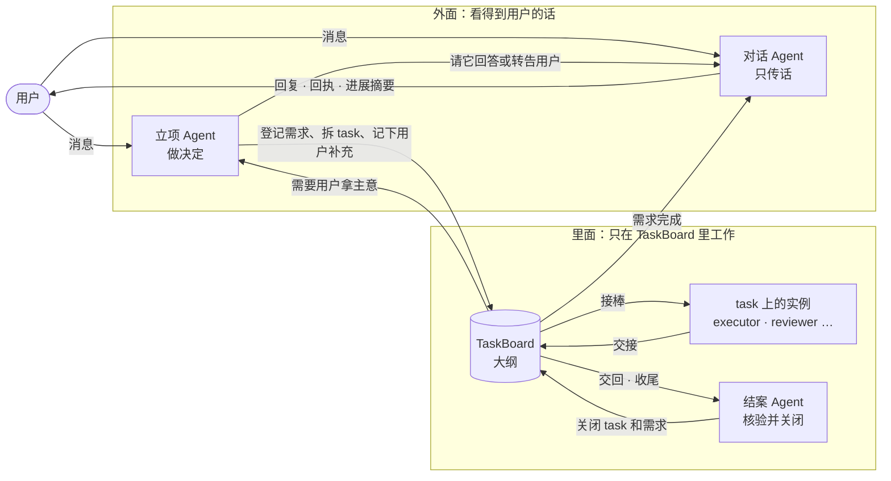
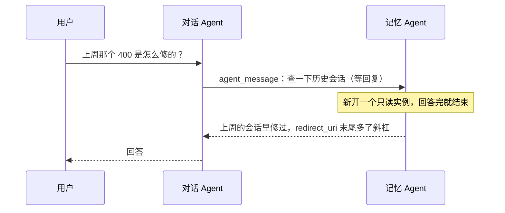
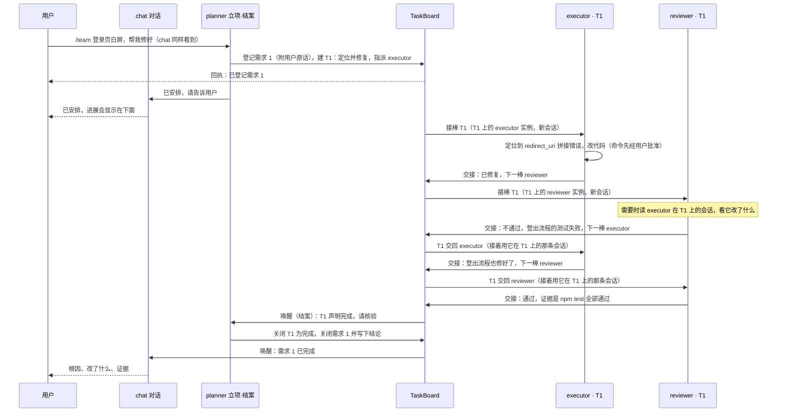
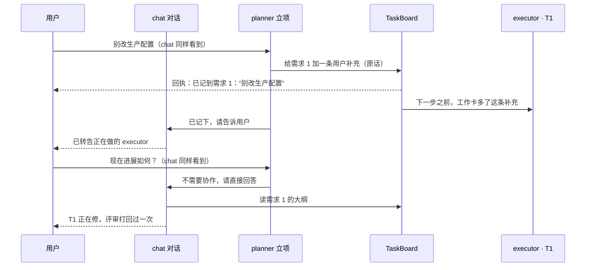
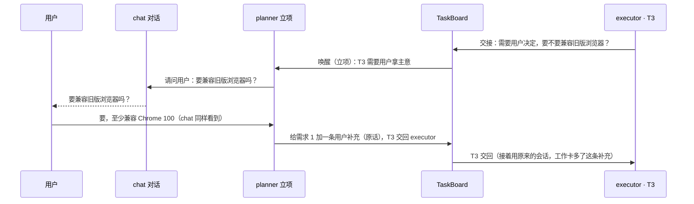
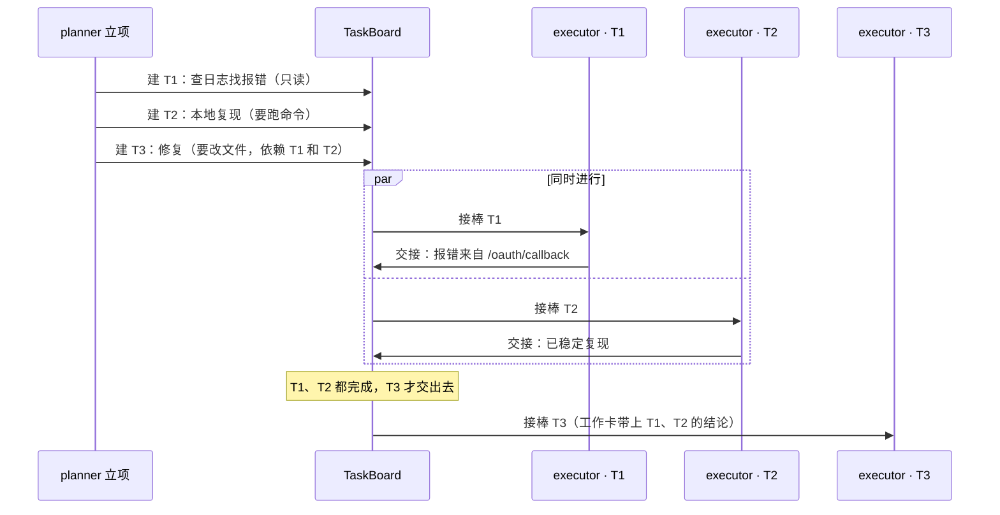
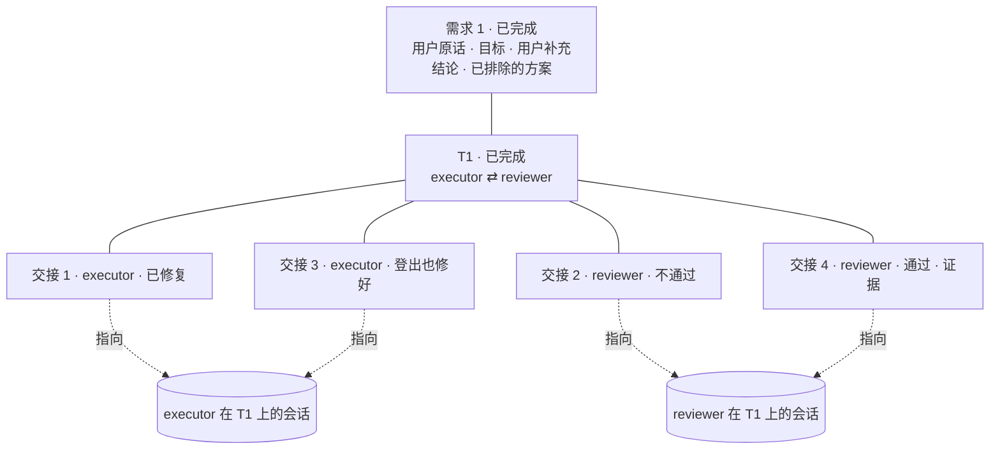

# 平行 Agent 与 TaskBoard Proposal

状态：草案第四版，按 2026-10-19 第三、四轮反馈修订，待评审。更新日期：2026-10-19。

本文只讲系统怎么运作：由哪几块组成、一次请求怎么走、用户看到什么、TaskBoard 里放什么、Agent 之间怎么交接和读取信息。
规则细节、参数和验收放在 [构建规格](../specs/parallel-agents-taskboard.md) 里，规格按本文第四版写成（2026-10-21）。
模型怎么选、怎么切换见 [统一模型提供商 Proposal](model-providers.md)。

## 1. 三个名字

| 名字 | 是什么 | 类比 Claude Code |
| --- | --- | --- |
| 平行 Agent | 基座：用户定义的角色、它们的运行实例，以及角色之间的 Agent 消息。协作模式关闭时也在 | 子 Agent |
| TaskBoard | 建在基座上的协作模块：记录需求、task 和交接，按交接唤醒下一棒 | workflow |
| 协作模式 | 功能开关：打开后，用户的消息先由立项 Agent 判断要不要交给其他角色协作完成。默认关闭 | ultracode |

协作模式关闭时，交互和 v0 一样，唯一多出来的是对话 Agent 可以临时问别的角色一个问题。

## 2. 为什么

自部署模型和开源模型在 mori 里有两个老问题：

1. **不守规矩**：忘记调用规定的工具、提前宣布完成、交接格式写错。
2. **长任务跑偏**：上下文一长或一次 compact，就丢掉目标、约束和已经排除的方案，在几个方案之间来回打转。

对策：

- **把大纲放在模型外面**：需求、约束、分工、每一棒的结论记在 TaskBoard 上，每次请求都钉在上下文里，compact 也丢不掉。
- **每个 Agent 只做一小段**：一个 task 一组实例，比一个 Agent 从头做到尾更不容易跑偏。
- **程序兜底**：交接漏写、写错，程序都交给结案 Agent，不会没人管。
- **按需协作**：简单问答、改一行配置不开协作模式，避免被多 Agent 流程拖慢。

## 3. 一张图：里面和外面



- **外面**只有两个角色能直接看到用户的话，不管是第一句还是中途插话：
  - **对话 Agent** 是唯一对用户说话的出口，只传话，不做决定。
  - **立项 Agent** 读用户的话并做决定：要不要协作、建什么需求、拆成哪些 task、插话补到哪、要不要取消。
- **里面**的角色（执行、评审、结案……）只在 TaskBoard 里工作：只看需求、task、交接和消息，不看用户的原始对话，也不和用户说话。
- **用户不进 TaskBoard 里看**：进展由程序在对话流里显示一行摘要（§7）。

## 4. 核心概念

| 概念 | 含义 |
| --- | --- |
| 角色 | 用户在 `.mori/agents/` 写的一个 `agent.md`：正文是职责说明，开头写工具、模型和认领的权限。系统不内置规划、执行、记忆这些角色，它们只是用户可以写的例子 |
| 实例 | 一个角色正在运行的一条会话（一个 pi 会话）。task 上的实例按 task 划分，见 §9 |
| 三项权限 | **对话**：唯一对用户说话，只传话。**立项**：读用户的话，决定要不要协作、登记需求、拆 task、处理插话。**结案**：核验交回的 task，关闭 task 和需求，接收所有兜底。每项恰好一个角色持有，一个角色可以兼任几项 |
| 基座 Agent | 系统唯一内置的角色，就是 v0 的单 Agent。没人认领的权限都由它接下：只写一个 `executor.md` 时，基座负责对话、立项和结案；一个角色都不写时，基座就是 v0 |
| 需求 · task | 立项 Agent 把用户的一个请求登记成一条**需求**，记录用户原话、目标和约束，再拆成若干 **task**；task 是被指派、执行、交接的单位 |
| 交接 | 一个实例做完一段，把 task 交出去：写几句结论、结果、下一棒，以及证据（自己会话里哪次工具调用证明了这个结论） |
| 会话 | 每个实例的完整过程：对话、推理、工具调用和输出，存在它自己的会话文件里，不进 TaskBoard |
| 工作卡 | 程序每次请求前钉在上下文末尾的一小段大纲：需求目标与用户原话、当前 task、最近的交接、已经排除的方案、留给这个 task 的消息 |

你之前说的“兜底的 main agent”，这里叫结案 Agent。它不是 Claude Code 里和你对话的主 Agent；
Claude Code 的主 Agent 一个人兼着对话和立项，mori 允许把这两份工作分给两个角色，也允许由同一个角色兼任。

```yaml
# .mori/agents/planner.md 的开头：认领立项和结案
---
name: planner
description: 读用户的需求，决定怎么拆、交给谁；核验交回的 task 并关闭
seats: [create, close]
tools: [read]
models: [strong]
---
```

## 5. 协作模式

| 状态 | 怎么进入 | 行为 |
| --- | --- | --- |
| 关闭（默认） | — | 对话 Agent 一个人工作，交互与 v0 相同；它能不能改文件，取决于它的工具配置。它可以临时问别的角色，对方只读、回答一次就结束 |
| 这一次打开 | 消息以 `/team` 开头 | 这条消息交给立项 Agent 判断；由它登记的需求关闭后自动关回 |
| 一直打开 | 对话顶栏的开关，或 `/team on` | 每条消息都先由立项 Agent 判断；简单问题它会交给对话 Agent 直接回答 |

只有用户能打开协作模式。对话 Agent 觉得任务适合协作时，可以在回复里建议，例如“这个问题要多处排查，可以用 /team 交给协作模式”。
协作模式下每条消息先经立项 Agent 判断，再由对话 Agent 回复，比 v0 多一次模型请求；简单的事适合在协作模式关闭时做。
（`/team` 和“协作模式”都是暂定名。）

## 6. 一次请求怎么走

### 6.1 协作模式关闭



除了这种临时提问，就是 v0：对话 Agent 一个人读代码、改文件、跑命令，写入和命令照常先经用户批准。

> 2026-10-22 注：图里的“记忆 Agent”不代表记忆。记忆是 Mori 的基础设施，见 [提示词分层与记忆 Proposal](prompt-and-memory.md)，
> 实现见 [构建规格](../specs/memory.md)；查历史会话仍可以是用户写的一个角色。

### 6.2 协作模式打开：修复一个缺陷，评审打回一次

配置：chat（对话）、planner（立项 + 结案）、executor（执行）、reviewer（评审）。



- executor 第二次接棒时，接着用它在 T1 上的那条会话：它记得自己改过什么，只需要看 reviewer 的交接。reviewer 也一样。
- reviewer 没有在 TaskBoard 上找细节，需要时直接读 executor 在这个 task 上的会话。TaskBoard 只告诉它“去哪看”。

### 6.3 执行中途用户插话



**这句话是给谁的，由立项 Agent 判断。** 每条用户消息，它必须做下面一件事：

- **新的请求**：登记需求，拆 task。
- **约束、补充**：记到对应需求上（用户原话照记），这个需求下所有实例的工作卡里都会出现，正在做的实例下一步就看到；需要的话再调整 task。
- **要取消**：撤销需求。
- **不需要协作**（问进展、简单问题）：交给对话 Agent 直接回答。

立项 Agent 什么都没做就结束时，程序按“交给对话 Agent 直接回答”处理。
回执由程序根据实际的登记操作显示，不是 Agent 自己说的；看不到回执，就说明没记上。

### 6.4 里面的实例需要用户拿主意



里面的实例从不直接和用户说话。需要用户拿主意时交给立项 Agent：它看得到用户之前说过的话，常常不必再问；确实要问，就请对话 Agent 去问。

### 6.5 几个 task 同时做



- 同一个角色可以同时在几个 task 上各有一个实例，所以不需要为了并行定义两个执行角色。
- 只读的 task 可以随便并行。要跑命令或改文件的 task，v1 里同一时间只有一个在写工作区，其他的排队；v1.x 再考虑每个实例用独立的 git worktree 并行写。
- task 是否只读由立项 Agent 建 task 时标明，程序据此不给它写入工具。
- 依赖的 task 没完成，后面的 task 就不交出去；依赖的 task 失败了，交给结案 Agent 决定。

### 6.6 Agent 没按规矩来时

交接缺失或出错，程序都交给结案 Agent：实例回合结束却没交接、下一棒没写或写错、说“做完了”。
声明完成必须有证据，证据要指向会话里真实发生的工具调用，程序核对它确实发生过、结果是什么；改过代码的实例不能给自己写“通过”。
结案 Agent 也处理不了、需要用户拿主意的，交给立项 Agent。

## 7. 用户看到什么

用户只在对话流里看到四样东西，不需要进 TaskBoard：

| 看到什么 | 谁产生 |
| --- | --- |
| 对话 Agent 的回复 | 对话 Agent |
| 回执，例如“已登记需求 1”“已记到需求 1：别改生产配置” | 程序，根据实际发生的登记操作 |
| 进展摘要，见下 | 程序 |
| 后台实例运行命令、改文件时的批准卡 | 程序；批准卡写明是谁、在做哪个 task，切到“全部允许”就不再出卡 |

（2026-10-26 负责人改：另有右栏的 Background tasks，按需求列出 task，打开一个 task 看完整的交接与留给它的消息，再只读地打开实例的会话；
在那里只看、不操作，见规格 §13.13。）

进展摘要挂在对话 Agent 的“已安排”回复下面，会随进展更新，可以展开：

```text
需求 1 · 登录页白屏 · 进行中 6 分钟
  T1 定位并修复 · reviewer · 运行 npm test
     executor：已修复 → reviewer：不通过，登出流程的测试失败 → executor：登出流程也修好了
```

**这些字是谁写的**：没有哪个模型专门去写进展，摘要由程序用三样现成的东西拼出来：

- **需求和 task 的标题**：立项 Agent 建需求、建 task 时写下的一句话。
- **当前在做什么**：程序把这个实例最近一次工具调用翻译成人话，规则和 v0 的工具卡一样（“读取 src/a.ts”“运行 npm test”）。
- **每一棒的结果**：交接里的那句结论。

Claude Code 也是这么做的：主 Agent 派出子 Agent 时，要填一个三五个词的 description；界面显示这句描述，加上子 Agent 实时的工具调用和计数。
TodoWrite 的每一项在创建时也要写一个“正在做什么”的进行时短语，执行时直接显示。workflow 的进展显示的是脚本里写好的标签、阶段名和 `log()` 行。
都是“模型在创建时写一句标题，程序实时显示工具调用”，没有额外请求模型来总结。

## 8. TaskBoard 里放什么

### 8.1 只放大纲



| 放在 TaskBoard | 不放在 TaskBoard |
| --- | --- |
| 需求：用户原话、目标、验收、用户补充（原话照记）、状态、结论、已排除的方案 | 用户的原始对话：只在对话 Agent 和立项 Agent 的会话里 |
| task：标题、要做什么、是否只读、指派给谁、谁在做、状态、依赖哪个 task | 过程细节、推理、完整的工具输出：都在各实例的会话里 |
| 每一棒的交接：几句结论、结果、下一棒、未结事项、证据、会话位置 | 中间进度：由程序从会话活动显示，不要求模型另写 |
| 留给某个 task 的消息 | |

“已排除的方案”不用专门维护：结案 Agent 把一个 task 关闭为失败时，它的关闭结论就记进这一栏。
只有经过结案 Agent 核验的结论才会进入需求级的大纲，单个实例写的“此路不通”先只挂在它那一棒上。

### 8.2 Agent 用的工具

| 谁能用 | 工具 | 做什么 |
| --- | --- | --- |
| 所有实例 | `board_read` | 读大纲：整块板，或者某个需求、某个 task 的详情和交接记录 |
| 所有实例 | `read_session` | 读某个 task 上某个实例的会话片段，看细节。返回整理过的文本（工具调用、输出、结论），不含对方的推理原文；太长时先给目录。读不到对话 Agent 和立项 Agent 的会话 |
| 所有实例 | `agent_message` | 发消息。发给某个角色：唤醒它（持有权限的角色进它的会话，其他角色新开一个只读实例，回答完就结束），可以等回复。发到某个 task：消息留在 task 上，当前或下一个做它的实例在工作卡里看到，不唤醒任何人 |
| 持有这个 task 的实例 | `task_handoff` | 交出这一棒，见下 |
| 立项 Agent | `request_submit`、`request_update`、`request_cancel` | 登记新需求；把用户的补充或约束记到需求上（原话照记）；撤销需求 |
| 立项 Agent | `task_create`、`task_edit` | 拆 task、调整 task |
| 立项 Agent | `reply_via_dialog` | 这条消息不需要协作，交给对话 Agent 直接回答 |
| 结案 Agent | `request_close` | 需求下的 task 都结束后，关闭需求并写下结论 |

对话 Agent 没有专门的 TaskBoard 工具：它读大纲回答进展，把立项 Agent、结案结果要说的话说给用户。

**交接怎么写**：写几句结论，选一个结果，可以写下一棒。

- 结果：继续、此路不通、受阻、需要用户拿主意、完成；评审写通过或不通过。
- 写了下一棒、结果是继续、此路不通或不通过：交给下一棒。
- 结果是需要用户拿主意：交给立项 Agent。
- 没写下一棒，或者结果是完成、通过、受阻：交给结案 Agent。
- 结案 Agent 交接时选“关闭为完成”或“关闭为失败”，就是结束这个 task。

### 8.3 程序做什么

TaskBoard 本身是一个只接受上面这些工具写入的服务。每次写入后，程序做三件事：

- **唤醒**：按 §11 唤醒该处理的角色。
- **更新工作卡**：相关实例下一次请求时看到最新的大纲。
- **更新对话流**：回执、进展摘要和后台实例的批准卡。

## 9. 角色、实例和上下文

**每个 task 维护自己的一组实例**：一个角色在一个 task 上最多一个实例。task 在角色之间来回时，回到同一个角色就继续它在这个 task 上的那条会话；
换到别的 task，一律是新实例。

| 情况 | 上下文 |
| --- | --- |
| task 交回这个 task 上已经有实例的角色（例如 executor → reviewer → executor） | 接着用这个角色在这个 task 上的会话，上下文继承；新来的交接作为新消息放进来 |
| task 第一次交给某个角色 | 新开会话，从工作卡开始；需要细节时用 `read_session` 读这个 task 上别的实例 |
| 新的 task | 新的一组实例，每个都从工作卡开始 |

持有权限的工作，各自一条会话：

| 工作 | 会话 |
| --- | --- |
| 对话 Agent | 一条连续的会话，就是 v0 的那个会话；太长时 pi 自动压缩 |
| 立项 Agent | 一条连续的会话：和对话 Agent 一样看着整个对话，加上 TaskBoard 大纲；太长时压缩，工作卡保证需求和分工不丢。同一个角色同时持有对话和立项时，就是同一条会话 |
| 结案 Agent | 每个需求一条会话：同一个需求内连续，不把上一个需求的记忆带进来 |
| 被临时问一个问题、订阅唤醒 | 新开一条只读的会话，回答完就结束 |

- **会话从不丢弃**：每条会话都存下来。“新开”是指模型上下文从头开始，旧会话随时可以读。
- **继承的会话太长时**，pi 照常压缩，工作卡保证需求、约束和已排除的方案不丢。
- **并行**：同一个角色可以同时在多个 task 上各有一个实例，有一个同时运行的上限。

## 10. 信息往哪写，Agent 怎么读

| 信息 | 写在哪 | 谁、怎么读到 |
| --- | --- | --- |
| 用户消息 | 对话 Agent 和立项 Agent 的会话 | 只有这两个角色收到。里面的角色只看到立项 Agent 登记到需求上的原话 |
| 需求、用户补充和约束 | TaskBoard 上的需求 | 这个需求下所有实例的工作卡，用户原话照搬 |
| task 和分工 | TaskBoard | 接棒时进工作卡；随时可以 `board_read` |
| 交接结论 | TaskBoard 上的交接记录 | 下一棒的工作卡；结案 Agent；进展摘要 |
| 过程细节 | 各实例自己的会话 | 同一实例继续时就在上下文里；这个 task 上别的实例用 `read_session` 读 |
| 留给 task 的消息 | TaskBoard 上的 task | 当前或下一个做这个 task 的实例，在工作卡里看到 |
| 角色之间的问答 | 双方的会话 | 收发双方 |

数据都按用户会话存在本机：TaskBoard 一份，每条会话一份。

**Agent 怎么读**：

- **推**：工作卡每次请求前由程序钉在上下文末尾，不依赖模型记得去查，compact 也不会丢。
- **拉**：大纲用 `board_read`，细节用 `read_session`，都是模型需要时自己调用。

## 11. 谁在什么时候被唤醒

| 触发 | 谁 |
| --- | --- |
| 用户发消息（协作模式打开时） | 立项 Agent 先判断；然后对话 Agent 回复 |
| 立项 Agent 请它回答或转告用户 | 对话 Agent |
| task 交给你 | 这个角色在这个 task 上的实例：已有就继续，没有就新开 |
| 依赖的 task 都完成了 | 后面那个 task 被指派的角色 |
| 交接结果是“需要用户拿主意” | 立项 Agent |
| task 交回、依赖的 task 失败、需求下的 task 都结束了 | 结案 Agent：关闭需求，或者请立项 Agent 再建 task |
| 需求关闭 | 对话 Agent，去向用户汇报 |
| 有角色给你发消息 | 收消息的角色 |
| 订阅的时刻 | 订阅者。例如记忆 Agent 在 `agent.md` 里写明只在“需求关闭且中途排除过方案”时被唤醒；它只能留消息，不能改文件（2026-10-22 注：这里的记忆 Agent 只是用户写的角色；记忆是基础设施，见 [构建规格](../specs/memory.md)） |

里面的角色不会被用户直接唤醒；用户的话只到对话 Agent 和立项 Agent。

## 12. 核心规则

1. 用户的话只有对话 Agent 和立项 Agent 看得到；其他角色只在 TaskBoard 里工作。
2. 只有对话 Agent 对用户说话，它只传话，不做决定。
3. 要不要协作、登记什么需求、怎么拆 task、插话补到哪，都由立项 Agent 决定；只有结案 Agent 关闭 task 和需求。
4. TaskBoard 只记大纲：结论、分工、交接、证据位置；细节留在会话里。
5. 每个 task 一组实例，回到同一个角色就继承它在这个 task 上的上下文；跨 task 一律新实例。
6. 声明完成要有证据，证据是会话里真实发生的工具调用；改过代码的实例不能给自己验证。
7. 交接出了问题交给结案 Agent，需要用户拿主意的交给立项 Agent。
8. 写入和命令照常要用户批准；v1 里同一时间只有一个实例写工作区。

## 13. 与 v0 的关系

- v0（app-v0）：单 Agent 编码台，pi 原样作为后端。本方案在 v0 稳定后实施。
- v1：在 mori 内核里新建 TaskBoard 服务和平行 Agent 的唤醒、交接、消息机制；协作模式关闭时交互与 v0 相同。
- 实施前要先确认 pi 能在一个后台进程里同时跑多个会话；这也是 app-v0 第一个里程碑 M0 要确认的事。

## 14. 需要确认的

| 问题 | 默认 |
| --- | --- |
| 功能叫“协作模式”，触发词 `/team`；平行 Agent 是基座，TaskBoard 是模块 | 是，名字可以再换 |
| 用户消息只有对话 Agent 和立项 Agent 看得到。这替换了之前“用户消息投递给所有 Agent”的决定 | 是 |
| 协作模式下，立项 Agent 每条消息都必须做一个决定；什么都没做时按“交给对话 Agent 直接回答”处理 | 是 |
| 同一个角色可以同时在多个 task 上各有一个实例。这替换了之前“每个角色一个实例”的决定 | 是 |
| 每个 task 一组实例，回到同一个角色继承上下文，跨 task 新实例 | 是 |
| v1 改文件的实例同一时间只有一个，v1.x 再做 worktree 并行 | 是 |
| 结案 Agent 的会话按需求划分；立项 Agent 的会话和对话一样连续 | 是 |
| 没人认领的权限总是由基座 Agent 接下 | 是 |
| 用户看到的进展只有对话流里的摘要，不提供 TaskBoard 页签；以后排查问题如果需要看实例的会话，再单独加一个开发者视图 | 是（2026-10-26 负责人改：右栏加 Background tasks，列出需求与 task、看完整的交接与消息、只读打开 task 与结案的会话；只看不操作，见规格 §13.13） |

## 附录 A：第四版相对第三版的变化

| 第三版的东西 | 现在 |
| --- | --- |
| 程序分诊：程序发一次小请求，把用户消息分成新任务、修改、约束、取消、回答、直接回答，并据此改看板 | 去掉，由立项 Agent 判断 |
| 回放：重新打开对话或重启后，从事件日志恢复对话流的显示 | 属于实现细节，不再出现在 proposal 里 |
| TaskBoard 页签，用户在上面操作、@ 非对话角色 | 去掉；用户只在对话流里看到回复、回执、进展摘要和批准卡 |
| 用户消息放进每个 Agent 的收件箱 | 去掉；只有对话 Agent 和立项 Agent 看得到用户消息 |
| 对话 Agent 判断要不要协作、登记需求 | 改由立项 Agent 判断和登记；对话 Agent 只传话 |
| `task_log`（记一步进度） | 去掉；进展由程序从会话活动和交接拼出，细节在会话里 |
| `task_note`（给 task 加批注） | 并入 `agent_message`：发到某个 task |
| `task_verify`（写验证结论） | 并入 `task_handoff`：评审的结果写通过或不通过 |
| `task_route`（结案 Agent 指派、关闭、问用户） | 并入 `task_handoff`；需要用户拿主意的交给立项 Agent |
| `task_update_brief`（改目标、验收、约束） | 用户的补充用 `request_update`，拆分调整用 `task_edit`，都归立项 Agent |
| `hypothesis_add` / `hypothesis_set`（假设台账） | 去掉；“已排除的方案”由失败 task 的关闭结论自动生成 |
| `suggest_board`（建议用户打开） | 去掉；对话 Agent 在回复里建议就行 |
| `history`、`trace`（读会话记录、读轨迹） | 并入 `read_session` |
| 程序记录的“事实”全文 | 证据改为指向会话里的那次工具调用，由程序核对 |
| 每次接棒都强制新开上下文 | 每个 task 一组实例，回到同一个角色时继承 |
| 每个角色一个实例 | 同一个角色可以同时在多个 task 上各有一个实例 |
| “看板开启 / 关闭” | 改叫协作模式；TaskBoard 只是模块名 |

## 附录 B：与旧方案的区别

旧方案指 `docs/proposals/` 下的 agent-lifecycle、agent-communication、agent-collaboration 三份文档。

| | 旧方案 | 本方案 |
| --- | --- | --- |
| Agent 从哪来 | 预设职责：对话、目标整理、监督、验收 | 只内置一个无角色的基座 Agent，其余由用户定义 |
| 谁能做什么 | 主 Agent 和子 Agent 两层，不同职责组之间互相隔离 | 三项权限，每项一个持有者 |
| 协作载体 | 一份共享记录，追加内容不会唤醒任何人 | TaskBoard 大纲 + 交接唤醒下一棒 |
| 下一步谁做 | 程序把事件路由给“负责的”主 Agent | 交接时显式写下一棒，结案 Agent 兜底 |
| 简单任务 | 也是多 Agent | 默认不开协作模式，就是 v0 |

借鉴的做法：Magentic-One 的任务账本（去掉后成绩下降 31%）；Anthropic 长任务 harness 的进度文件与“每次开工先读进度”；
Claude Code 的主 Agent 统一面对用户、子 Agent 在后台工作、进展用描述加工具调用显示；OpenAI Agents SDK 的 handoff；Beads 的领取与交接。
