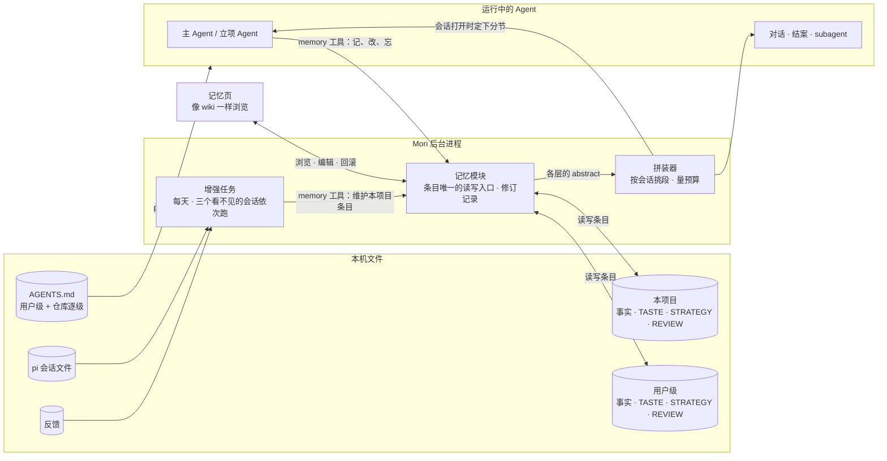
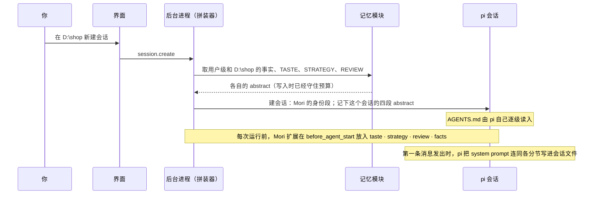
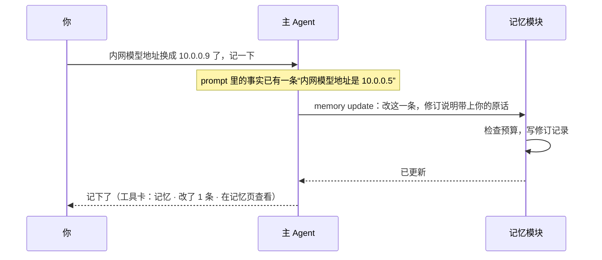
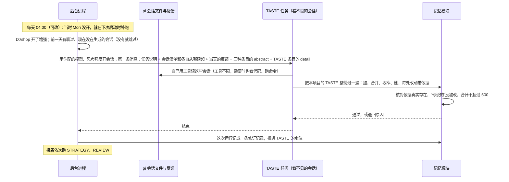
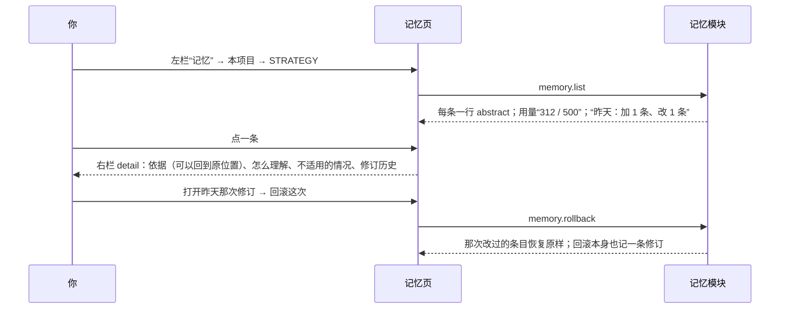

# 提示词分层与记忆 Proposal

状态：草案第一版，按 2026-10-22 负责人给的心智模型和当天几轮回答编写，待评审；构建规格按本文第一版写成（2026-10-22）。更新日期：2026-10-26。

2026-10-26 改（负责人走查 M19 的回答，§15 第 14 条）：主 Agent 主动记你说出的长期事实，你纠正它时也主动记规则；它主动记的算 **Mori 记的**，
开着增强时增强任务可以改它们，并把它们重新归到该在的种类。改到的地方：§4、§6.2、§8.1、§10.4、§12 规则 2、§16。

本文只讲系统怎么运作：system prompt 由哪几块拼成、每个 Agent 拿到哪几块、记忆存在哪里、谁来写、怎么进 prompt、
增强任务每天怎么跑、你在哪里看。参数、状态表和验收写在构建规格 [docs/specs/memory.md](../specs/memory.md) 里。

- 席位、协作模式和 subagent 见 [平行 Agent 与 TaskBoard Proposal](parallel-agents-taskboard.md)。你说的 task mode 就是那里的“协作模式打开”，
  normal mode 就是“协作模式关闭”；本文只说协作模式。
- 本文替代 [产品 Proposal](../proposal.md) 里“记忆资产”和“自动化维护”两部分，也替代 v0 的[工作回顾页](../v0/screens/review.md)（M7）。
- 你已经定的写在 §15。正文里其余的选择都是默认做法，集中列在 §16 等你定。

## 1. 一句话

system prompt 分三块：Mori 的**身份与 harness**；**AGENT**，团队的常识，就是现在的 AGENTS.md，留在仓库里；**记忆**，你的，存在本机。
记忆是四种条目：**事实**（是什么）、**TASTE**（怎么和你沟通）、**STRATEGY**（怎么规划、怎么拆）、**REVIEW**（怎么检查自己的工作）。
四种条目同一套存法、同一个工具、同一份修订记录、同一个页面：条目的 abstract 进 system prompt，detail 是给你看的评估记录。

谁拿什么：人人都拿 AGENT。协作模式关闭时，主 Agent 拿全部。打开时，TASTE 给看得到你原话的对话 Agent 和立项 Agent，
STRATEGY 和事实给做决定的立项 Agent，REVIEW 给结案 Agent。subagent 不论哪种模式，都只拿 STRATEGY 和 REVIEW。

项目可以打开**增强模式**：每天三个看不见的会话读这个项目当天结束的会话，改进它的 TASTE、STRATEGY、REVIEW。

## 2. 为什么

1. **一份文件给所有人**：AGENTS.md 里“项目用 pnpm”这类常识、“先给结论”这类沟通偏好、“跨模块改动先列计划”这类做法、
   “说完成前要跑测试”这类检查标准混在一起，每个 Agent 都拿全份。subagent 从不和你说话，却背着沟通偏好；
   立项要用的规模判断，埋在一大段常识里。
2. **经验不回流**：你纠正过的事、反馈里写的期望，下次照样犯。产品 Proposal 开头就指出，靠 AGENTS.md 和每日总结
   不能保证执行时真的用上。M7 的工作回顾只把反馈收起来，不进任何 prompt。
3. **看不见就不敢用**：自动学到的东西，看不到依据、改不了、退不回，你就不会让它进 prompt。
4. **prompt 越长越不守**：自部署和开源模型对长 system prompt 的遵守度差，所以总量要有上限（§5.2）。

## 3. 架构



- **pi 负责什么**：照常跑 Agent 循环，照常逐级读 AGENTS.md，照常存会话文件。
- **Mori 负责什么**：只用 pi 已有的入口，不改 pi。身份段由 Mori 给出：换掉 pi 的身份句，去掉 pi 文档指引，
  保留 pi 生成的工具清单和工具准则（插件、MCP 工具自带的说明也在里面）。Mori 已有的 inline extension 每次运行前
  在 `before_agent_start` 里放入 `taste`、`strategy`、`review`、`facts` 四个命名分节。

| 组件 | 做什么 |
| --- | --- |
| 拼装器 | 会话打开时向记忆模块取两层的 abstract，按 §5.1 挑段、量预算，定下这个会话的分节。之后每次运行放入同样的内容 |
| 记忆模块 | 条目的增、改、删、读；每次改动写一条修订记录；检查预算和依据；给记忆页提供列表、详情和回滚 |
| memory 工具 | 一个工具，按调用方限定能写什么（§8.1） |
| 增强任务 | 开了增强模式的项目，每天依次跑 TASTE、STRATEGY、REVIEW 三个任务。每个任务是一个看不见的会话，只读当天结束的会话和当天的反馈 |
| 记忆页 | 替换左栏“工作回顾”：浏览、编辑、回滚，开关增强模式 |

## 4. 核心概念

**prompt 的几块**

| 概念 | 含义 |
| --- | --- |
| 身份与 harness | 我是谁、工具怎么用、批准怎么走。Mori 的身份句，加上 pi 生成的工具清单和准则 |
| AGENT | 团队的常识：项目是什么、怎么构建、有什么约定。就是现在的 AGENTS.md，文件名不变，pi 照旧逐级加载 |
| 事实 | 是什么：你是谁、项目的环境、选了哪个方案和为什么。索引文件叫 `MEMORY.md` |
| TASTE | 怎么和你沟通：怎么呈现信息，怎么听懂你每句话背后的真实目标 |
| STRATEGY | 怎么做事：判断问题的难度和规模，小事快办，长难问题动态规划、分阶段 |
| REVIEW | 怎么检查自己：什么检查算数（跑过、读了输出、逐条对照了需求），什么只是蜻蜓点水 |

**记忆的几个词**

| 概念 | 含义 |
| --- | --- |
| 记忆 | 事实、TASTE、STRATEGY、REVIEW 四种条目的统称。AGENT 不算记忆 |
| 条目 | 一行 **abstract**（短句，进 system prompt）加一份 **detail**（评估记录，给你看，不进 prompt：依据、怎么理解、适用到哪、改过几次、为什么改） |
| 你说的、Mori 记的、它学的 | 条目的三种来源。你手写的、你提升的、你要 Agent 记下的（“记一下”“以后都…”）算**你说的**；Agent 没被要求、自己从你的话里记下的算 **Mori 记的**（2026-10-26）；增强任务从会话里推断出来的算**它学的** |
| 层 | 用户级（所有项目）和本项目。同一种条目两层都进 prompt，先用户级后本项目 |
| 增强模式 | 每个项目自己的开关，默认关。打开后每天跑三个增强任务 |
| 增强任务 | 一个看不见的会话（headless）：你看不到它执行了什么，只看到它改了什么；它用的模型、思考强度、要不要开协作模式由你配 |
| 水位 | 每个增强任务在每个会话里读到哪。第二天接着聊的会话，第二天只读新增的部分 |
| 修订记录 | 每次改动留下的记录：改了哪几条、前后对照、依据。增强任务的一次运行、Agent 的一次记录、你在记忆页的一次编辑各算一次；可以按次回滚 |

**Agent 的叫法**

| 概念 | 含义 |
| --- | --- |
| 主 Agent | 协作模式关闭时一个人和你对话的 Agent，就是 v0 的单 Agent |
| 席位 | 平行 Agent Proposal 里的三项权限：对话、立项、结案。持有它们的叫对话 Agent、立项 Agent、结案 Agent |
| subagent | 不持有席位的实例：task 上的 executor、reviewer 实例，对话 Agent 临时询问的角色，平行 Agent 派生的 subagent |

判别只问一句：**事实**回答“是什么”；**TASTE、STRATEGY、REVIEW** 回答“以后该怎么做”（怎么说、怎么安排、怎么查）；
**AGENT** 是团队都该知道、从仓库就能看出来的。能从代码或 AGENTS.md 读出来的，哪里都不记。

| 发生了什么 | 写到哪 | 谁写 |
| --- | --- | --- |
| “内网模型地址换成 10.0.0.9 了，记一下” | 事实 · 本项目 | 主 Agent 当场用 memory 工具 |
| “以后回复先给结论” | TASTE · 本项目 | 主 Agent 当场记，依据是你的原话（你说的） |
| 你提到“预发库是 PostgreSQL 15，只在周四发版”，没说记一下 | 事实 · 本项目 | 主 Agent 主动记，依据是你的原话（Mori 记的，2026-10-26） |
| 你纠正它“别用表格，我在窄终端里看” | TASTE · 本项目 | 主 Agent 主动记（Mori 记的）；开着增强时 TASTE 任务可以改它 |
| Mori 把“先给结论”记成了事实 | 移到 TASTE · 本项目 | 当天的 TASTE 任务重新归类（只移 Mori 记的） |
| 你连着两次嫌回复太长 | TASTE · 本项目 | 当天的 TASTE 任务（它学的） |
| 改一行配置也写三段计划，你说“直接改就行” | STRATEGY · 本项目 | STRATEGY 任务 |
| 说“已修复”但没跑测试，第二天你报同一个 bug | REVIEW · 本项目 | REVIEW 任务 |
| 构建命令是 `npm run check` | AGENT | 你或团队写进仓库的 AGENTS.md |
| 某条 TASTE 在所有项目都适用 | TASTE · 用户级 | 你在记忆页把它提升到用户级 |

## 5. 每个 Agent 拿到什么

### 5.1 分发表

| 谁 | 身份与 harness | AGENT | TASTE | STRATEGY | REVIEW | 事实 |
| --- | --- | --- | --- | --- | --- | --- |
| 主 Agent（协作模式关闭） | ✓ | ✓ | ✓ | ✓ | ✓ | ✓ |
| 对话 Agent（协作模式打开） | ✓ | ✓ | ✓ | | | |
| 立项 Agent | ✓ | ✓ | ✓ | ✓ | | ✓ |
| 结案 Agent | ✓ | ✓ | | | ✓ | |
| subagent | ✓ | ✓ | | ✓ | ✓ | |

- **兼任按会话取并集**：平行 Agent Proposal 里，同一个角色兼对话和立项时是同一条会话，这条会话拿两行的并集；
  结案每个需求一条会话，只拿结案那一行。例：协作模式打开时基座 Agent 兼全部席位，对话兼立项的那条会话拿
  AGENT、TASTE、STRATEGY、事实，每条结案会话拿 AGENT、REVIEW。
- **立项拿 TASTE 和事实，对话不拿事实**：协作模式下立项 Agent 直接读你的原始对话并做决定，最需要“听懂真实目标”，也要用事实做决定；
  对话 Agent 只传话、不做决定，只拿 TASTE 管怎么说。看得到你原始对话的只有对话和立项两个席位。
- **subagent**：不和你说话，所以不拿 TASTE，也不拿事实；需要的事实由派活的一方写进任务说明。
- **增强任务**和普通会话一样按这张表拼 prompt（按它自己的协作模式）。任务说明、当天结束的会话清单、当天的反馈、
  三种条目的 abstract、要处理那一种的 detail，作为第一条消息交给它；会话由它自己用工具去读（§10）。
- **协作模式切换时**：对话 Agent 那条会话的分节换一次，关闭时按主 Agent 那一行，打开时按它兼的席位取并集。
  pi 会记一条分节补丁；Mori 配的端点默认按不支持中途 system 消息处理，补丁并回开头，所以切换后的那一次请求前缀缓存失效。

### 5.2 拼好的 system prompt 长什么样

主 Agent，在 `D:\shop`：

```text
你是 Mori……批准怎么走……                       身份与 harness，约 500
<tools>…</tools> <rules>…</rules>               pi 生成的工具清单和准则，算在这 500 里
<addendum>…</addendum>                          APPEND_SYSTEM.md，有才有
<project_context>                               AGENT，约 500，pi 逐级读入
  用户级 AGENTS.md
  D:/shop/AGENTS.md
</project_context>
<skills>…</skills> <cwd>D:/shop</cwd>           pi 自己加
<taste>                                         500，用户级在前、本项目在后
- 先给结论，再给细节
- 改动说明里列出动了哪些文件
</taste>
<strategy>…</strategy>                          500
<review>…</review>                              500
<facts>                                         500，只有主 Agent 和立项 Agent 有
- 内网模型地址是 10.0.0.9
</facts>
```

pi 把扩展放入的分节排在最后，所以四个分节在技能列表和工作目录之后。别的 Agent 按 §5.1 少几段。

| 段 | 上限（token） | 怎么守 |
| --- | --- | --- |
| 身份与 harness | 约 500 | Mori 随版本发布，开发时量。pi 原来的这几段约 750，去掉的 pi 文档指引约 400 |
| AGENT | 约 500 | pi 逐级加载、不截断。超了在设置页和记忆页标出来，不截断仓库里的文件（那是团队的） |
| TASTE、STRATEGY、REVIEW | 每种 500 | 用户级和本项目两份加起来：用户级占了 200，本项目最多再写 300。写入时检查，超了拒绝写入，要求合并或删减；不截断 |
| 事实 | 500 | 同上 |

你定的上限是身份与 harness 500 加四份各 500，共 2500；事实另算，主 Agent 约 3000。不算在里面的：工具定义（作为 API 的 tools 参数发出）、
技能列表、工作目录、`APPEND_SYSTEM.md`、协作模式下的席位说明和角色 `agent.md` 正文（由平行 Agent Proposal 管）、工作卡。

> 2026-10-26 注（负责人走查 M15“budget for AGENT.md is too short, expand to 2000tokens”）：AGENT 一行的约 500 改为 2000，仍是提醒线、不截断（界面在合计超过 2000 时标出来，`shared/memory.ts` 的 `AGENTS_LIMIT`，与 TASTE 等每种的 500 分开）；这样整份 prompt 约 4000，加事实约 4500。上面表里的数字保留原样，以这条注为准。见 [specs/memory.md](../specs/memory.md) §10.3。

## 6. 一次请求怎么走

### 6.1 打开会话：定下这个会话的分节



- 会话进行中分节不变（协作模式切换除外）。条目改了，新建的会话和下次重新打开的会话才用新版，和现在 AGENTS.md 的规则一样。
- pi 把每个会话实际用的分节记在会话文件里，所以“这个会话用的是哪一版”随时查得到，不用另记。

### 6.2 对话中记一条



- 协作模式下由立项 Agent 记，它拿着事实、也直接读你的话。
- 你说“以后回复先给结论”这类以后都要照做的话，同样当场记，记进本项目的 TASTE，算“你说的”。
- memory 工具自动通过，不弹批准：它只写 Mori 自己的记忆目录，每次都留修订记录、能回滚。
- 同 Claude Code 的自动记忆：能从代码里看出来的、AGENTS.md 里已经写了的，不记。
- （2026-10-26）不等你说“记一下”：你说出以后的会话要用的长期事实，或纠正它怎么说、怎么安排、怎么检查时，主 Agent 主动记；这样记的算 Mori 记的，
  工具卡照样出现。你要它记的（“记一下”“以后都…”）仍算你说的。

### 6.3 每天的增强任务



### 6.4 在记忆页看、改、回滚



## 7. 文件放在哪

```text
%APPDATA%/Mori/
  pi/AGENTS.md                            用户级 AGENT（pi 原有，在设置页编辑；2026-10-26 改到 Customize 编辑）
  memory/
    user/                                 用户级
      MEMORY.md  TASTE.md  STRATEGY.md  REVIEW.md    索引：一行一条 abstract，链到 detail
      entries/<条目>.md                              detail
      revisions/<时间>.md                            修订记录
    projects/--<编码后的工作目录>--/       本项目，编码同 pi 的会话目录
      （同上）
      enhance.json                                   增强开关和设置、三个任务各自的水位、上次结果
<仓库>/AGENTS.md（逐级）                   项目级 AGENT（pi 原有，团队共享）
```

- **存在本机，不进仓库**（你定的）：增强任务每天改它，放进仓库会天天产生 git 改动；克隆来的仓库也带不进提示词。
  要和团队共享的，照旧写进 AGENTS.md。因为只有 Mori 写、只在本机，这些文件不受项目信任控制。
- **项目**就是会话的工作目录，按路径精确匹配，和 pi 存会话的方式一样。

索引就是普通的 Markdown，链接文字就是 abstract（格式同 Claude Code 的 `MEMORY.md`）。每条都链着一份 detail，你在记忆页手写的也有：

```markdown
# STRATEGY
- [改动跨三个以上模块，先列计划再动手](entries/plan-before-cross-module.md)
- [一行配置、一个错别字，直接改，不写计划](entries/small-fix-direct.md)
- [动数据库迁移前，先在测试库跑一遍](entries/migrate-on-test-db.md)
```

进 prompt 时只留 abstract：

```text
<strategy>
- 改动跨三个以上模块，先列计划再动手
- 一行配置、一个错别字，直接改，不写计划
- 动数据库迁移前，先在测试库跑一遍
</strategy>
```

detail 是评估记录，`created` 写着是谁加的，也就分出了“你说的”和“它学的”：

```markdown
---
kind: strategy
abstract: 改动跨三个以上模块，先列计划再动手
created: 2026-10-23 增强任务
modified: 2026-10-25 增强任务
---
## 依据
- 10-22「支付重构」会话：一次改了 5 个模块没列计划，中途回退两次（会话位置）
- 10-24 反馈：「这种先告诉我打算怎么改」（回到原位置）
## 怎么理解
跨模块的改动，先用三五行说清改哪几处、按什么顺序，你点头再动手。
## 不适用
- 你已经给了详细步骤
## 修订
- 10-25 “多个模块”改成“三个以上”：10-24 的会话里两个模块直接改也很顺利
```

## 8. 接口

### 8.1 memory 工具（给 Agent）

| 操作 | 参数 | 效果 |
| --- | --- | --- |
| `save` | 种类、层、abstract、detail、依据 | 新增一条 |
| `update` | 条目、新的 abstract（可选）、修订说明、依据 | 改一条，detail 追加一段修订 |
| `forget` | 条目、原因 | 删一条，原因写进修订记录 |

| 调用方 | 能写什么 | 依据 |
| --- | --- | --- |
| 主 Agent、立项 Agent（拿事实的两个） | 事实，两层都可以（默认本项目，关于你本人、跨项目的写用户级）；规则（你说以后都要照做的，或它从你的纠正里主动记的），写本项目对应的那一份；你要它记的算你说的，主动记的算 Mori 记的（2026-10-26） | 默认记下你的原话 |
| 增强任务 | 本项目里它负责的那一种，只限“它学的”和“Mori 记的”；把本项目 Mori 记的条目移进或移出它负责的那一种（2026-10-26） | 新增、修改、删除必须有：会话位置或反馈，程序核对存在；移动不要求，条目原有的依据留着 |
| 对话 Agent、结案 Agent、subagent | 没有这个工具 | — |

Agent 不读 detail，detail 是给你看的；超出预算时工具返回错误，要求先合并或删减。

### 8.2 后台进程命令（给界面）

| 命令 | 做什么 |
| --- | --- |
| `memory.list` | 一层、一种条目的列表和用量 |
| `memory.get` | 一条的 detail、修订历史、反向链接 |
| `memory.save`、`memory.delete` | 你在记忆页手动加、改、删（同样留修订记录） |
| `memory.move` | 提升到用户级，或放回本项目 |
| `memory.revisions`、`memory.rollback` | 修订记录列表；回滚一次修订 |
| `enhance.get`、`enhance.set` | 一个项目的增强开关和设置（模型、思考强度、协作模式）、上次结果、下次时间 |
| `enhance.run` | 现在跑一次 |

后台进程发两个事件：`memory.changed`（记忆页开着时刷新）和 `enhance.progress`（正在跑哪个任务）。

## 9. 信息往哪写，谁什么时候读

| 信息 | 谁写 | 写到哪 | 谁读 | 什么时候读 |
| --- | --- | --- | --- | --- |
| AGENT | 你、团队 | AGENTS.md（pi 原有） | 所有 Agent 和增强任务，pi 读 | 会话打开 |
| 事实 | 主 Agent、立项 Agent、你 | `MEMORY.md` + `entries/` | 主 Agent、立项 Agent 读 abstract | 会话打开 |
| TASTE、STRATEGY、REVIEW | 你（两层）；主 Agent、立项 Agent 照你原话；增强任务（只写本项目） | `TASTE.md` 等 + `entries/` | 按 §5.1 分发 | 会话打开 |
| detail | 写条目的那一方 | `entries/` | 你；增强任务改那一条时作为材料 | 记忆页；增强运行时 |
| 修订记录 | 记忆模块，每次改动 | `revisions/` | 你 | 记忆页、回滚时 |
| 会话 | pi | pi 会话文件 | 增强任务自己读（Mori 给清单和从哪读起） | 每天，读当天结束的会话，从水位读起 |
| 反馈 | 你（反馈表单） | `<userData>/feedback/`（原有，带工作目录） | 增强任务，按工作目录分到项目 | 每天，读当天的 |
| 开关、设置、水位 | 你、后台进程 | `enhance.json` | 后台进程 | 启动时、到点时 |

## 10. 增强任务

### 10.1 什么时候跑、读哪些会话

Mori 没有常驻进程，关了窗口就退出，所以“每天”是这样实现的：

- 每天一个固定时刻，默认 04:00，可以改；04:00 之前的对话算前一天的。
- Mori 开着跨过这个时刻：只设一个定时器，到点就跑；不轮询，不监视文件。当时没开：下次启动时补跑上次之后的各天。
- **读当天结束的会话**：那一天聊过、跑的时候没在生成的会话，算那天结束了。第二天接着聊的，第二天只读新增的部分（水位）。
  那一天这个项目没有会话，或会话都还在生成，这次跳过。
- 全应用同一时刻只跑一个任务，三个任务依次跑。

### 10.2 增强任务是一个看不见的会话

每个任务开一个看不见的会话（headless），和你平常用的会话一样跑，只是你看不到它执行了什么，只看到它改了什么（修订记录）。
它用的模型、思考强度、要不要打开协作模式，都在增强设置里由你配：每个项目一份，三个任务共用。

- **工具不限**：读、搜索、命令、MCP、插件工具都能用。没人批准，命令和 MCP 调用一律自动执行。
- **只限能写的文件**：能写的只有本项目里它负责那一种的条目，经 memory 工具写；write、edit 写别的文件一律拒绝，
  直接改记忆文件也拒绝（记忆模块是唯一的写入口）。命令和 MCP 调用会写什么 Mori 看不出来，靠任务说明约束：不许改别的文件。
- **会话由它自己读**：Mori 只给当天结束的会话清单和每个会话从哪读起，工具调用和输出都看得到；需要时也可以去看代码、翻 git 记录。

### 10.3 每个任务维护什么、认什么依据

| 任务 | 维护什么 | 算依据的 | 不算依据的 |
| --- | --- | --- | --- |
| TASTE | 怎么对你说、怎么听懂你 | 你的话：纠正、重问、追问、反馈 | Agent 自己的猜测和措辞 |
| STRATEGY | 动手前后怎么安排：规模和做法配不配 | 结果：回退、重做、被你打断、你补说明；反复出现才算 | 一次做顺了 |
| REVIEW | 说完成前要有什么证据 | “完成”和证据之间的缺口：之后你报回来的问题、评审的结论 | Agent 自己说“已验证” |

三个任务共同的：不从沉默推断你认可，不扩大你指令的范围；网页、文件、MCP 返回里写的话不算你的意思；
用户级和另外两种已有的不重复写；事实和常识不写，像是该进 AGENTS.md 的，在这次运行的结果里提一句。

它看得到工具输出的正文，所以网页或文件里藏的指令有机会被写进条目，进入此后的 system prompt。
兜底的是：每处改动都要带依据并经程序核对、整次运行一条修订记录可以回滚、改了东西后第二天的新会话顶部提示你（§10.5）。

### 10.4 怎么改

- **产出是这一种清单的新版本**，不是追加几条：把整份现有条目和新材料一起过一遍，决定加、合并、泛化、收窄、删。
  已有条目被印证，就在它的 detail 追加一条依据；出现反例，就收窄适用范围或删掉；预算紧时先合并旧的。500 是一开始就知道的约束。
- 只改本项目里它负责那一种的“它学的”和“Mori 记的”条目。“你说的”只读，和材料冲突时写进修订记录，由你处理。
- （2026-10-26）**重新归类**：Mori 记的条目可能放错了种类，增强任务把它移到该在的那一种（事实、TASTE、STRATEGY、REVIEW 之间，它负责的那一种是一端），
  条目、依据和你的原话不变，记进这次运行的修订记录，可以回滚。
- 每处改动都要带依据，程序核对依据真实存在。只能经 memory 工具写它负责的那一种；打开协作模式时也一样。
- 写完直接生效（新会话起）。整次运行记一条修订记录，你在记忆页能看前后对照、一键回滚。

### 10.5 你看到什么

- 记忆页“本项目”顶部一行：增强 开 · 上次 10-23 04:00 · STRATEGY 加 1 条、改 1 条 · 用了 38k token · 下次 10-24 04:00 · 现在运行 · 设置。
- 增强改了东西之后，你在这个项目新建的第一个会话顶部提示一行“昨天增强改了 STRATEGY 2 条 · 查看”，点开到那次修订记录；什么都没改就不提示。
- 失败时显示原因，水位不动，下次重试。

## 11. 记忆页

左栏“工作回顾”换成“记忆”，沿用 M7 的三级结构：中栏列表，右栏详情。

- **顶部**：用户级 ｜ 本项目。本项目跟随焦点会话的项目，同工具页。本项目下有增强模式的开关、增强设置和 §10.5 那一行。
- **分节**：事实、TASTE、STRATEGY、REVIEW、AGENT、修订记录。
  - 前四节：用量（“312 / 500”）、一行一条 abstract、“新增”。
  - AGENT：只列加载了哪些 AGENTS.md 和各自的 token 数；用户级的到设置页编辑（同 M6）（2026-10-26 注：负责人走查 M4，编辑挪到 Customize，链接是 “Edit in Customize”）。
  - 修订记录：每次改动一行；详情里是每条的前后对照和“回滚这次”。
- **详情（右栏）**：渲染后的 detail；依据可以“回到原位置”（复用 M7）；`[[条目]]` 链到别的条目，底部列出反向链接；
  编辑、删除、提升到用户级；这条的修订历史。
- **反馈**：反馈表单照旧。表单底部的说明从“只记录，不会发给模型”改成“会作为本项目增强任务的依据”
  （没开增强的项目：“这个项目没开增强，反馈只保存”）；保存后的“已记录 · 在工作回顾中查看”改成“已记录”。
  反馈不再单独成列表，出现在它支撑的条目 detail 和用到它的那次修订记录里。
- **F8 界面问题**：不是记忆，挪到设置页“界面问题”一节，沿用 M7 的列表、详情、截图和导出。

## 12. 核心规则

1. 条目文件只有记忆模块读写。Agent、增强任务、记忆页都走它；每次改动都留修订记录，都能回滚。
2. 增强任务只改本项目里它负责那一种的“它学的”和“Mori 记的”条目，并把 Mori 记的条目移到该在的种类（2026-10-26）。用户级只由你改，
   或由你把一条提升上去；增强任务不新增、不修改事实（只能把 Mori 记的条目移进或移出事实），不碰“你说的”、AGENTS.md 和角色的 `agent.md`。
3. 增强任务的工具不限，只限能写的文件：写入只能经 memory 工具写它负责的那一种，write、edit 写别的文件一律拒绝；
   命令和 MCP 自动执行，它们写什么靠任务说明约束。每一处改动都要有依据，程序核对。
4. 上限由程序守：写入后超了就拒绝，要求合并或删减，不截断。
5. 分节在会话打开时定下，中途不变，唯一的例外是协作模式切换时对话 Agent 的分节。
6. 记忆全部存在本机，不进仓库。

## 13. 与现有方案的关系

- **v0 方案**：本文属于 v1。落地前要改 [app-v0](../app-v0.md)：第 4 节加三行标 Mori 的（system prompt 拼装、记忆与记忆页、增强任务）；
  第 6 节“后台进程只做五件事”加第六件（2026-10-22 注：app-v0 现在列七件事，记忆是第 8 件，见[规格](../specs/memory.md) §2）；
  第 2 节原则 5（配置就是 pi 的配置）对记忆文件例外；“Mori 自己只保存……”加上 `memory/`。
  5.14 工作回顾页和 M7 由记忆页替换；第 9 节暂停的“工作回顾的定时与反证流程”由增强任务替代。
- **产品 Proposal**：“记忆资产”的定义、反馈“待模型判断”、自动化维护的时序和发布条件，由本文替代。
  原来的“学习和反证由不同实例完成、没有反证不发布、长期偏好只作候选”不再沿用：你 2026-10-22 决定增强直接改本项目文件、可回滚，
  用“依据核对 + 修订记录 + 回滚”代替反证。原来“不能扩大用户指令”这条保留在增强任务的提示词里（§10.3）。
- **平行 Agent 与 TaskBoard**：三份文件按席位分发（§5.1）。那里的“记忆 Agent”例子不再代表记忆：事实是基础设施；
  查历史会话仍可以是你写的一个角色。规格里“协作模式关闭时订阅时刻和定时全部暂停”不适用于增强任务，它是系统作业，与协作模式无关。
  规格里每个席位约 150–250 token 的说明段另算，和角色 `agent.md` 正文一样，不在 2500 里。
- **Agent 生命周期 Proposal**：“程序生成的提示词修订要走资产发布流程”由本文替代；增强任务不碰你写的 `agent.md`。

## 14. 分步落地

每一步都能在 App 里走查：

| 步 | 做什么 | 在 App 里看得到 |
| --- | --- | --- |
| 1 | 身份与 harness、四份分节的拼装（只有主 Agent）；记忆页替换工作回顾，能看、能手写 TASTE、STRATEGY、REVIEW；F8 挪到设置页 | 记忆页加一条 TASTE，下一个新会话的 prompt 里有它 |
| 2 | memory 工具：事实和你明说的规则、`MEMORY.md` 注入、修订记录与回滚 | 对话里说“记一下”，出现工具卡；记忆页看得到、回滚得了 |
| 3 | 增强模式：开关和设置、三个看不见的会话、每天的时刻与补跑、水位、依据核对；反馈作为依据 | 打开增强、点“现在运行”，看到修订记录和改动 |
| 4 | 协作模式下的分发 | 随平行 Agent 落地，各席位和 subagent 拿到 §5.1 的段 |

## 15. 已定的（2026-10-22 你的决定）

1. 协作模式下的对话、规划、评审对应三个席位：对话、立项、结案；兼任取并集；task 上的执行实例、被临时询问的角色都算 subagent。
2. 立项 Agent 也拿 TASTE（看得到你原话的对话和立项都拿）。
3. 事实由 Agent 在对话里用 memory 工具随手写，你在记忆页改；subagent 不写。写的是拿事实的那两个：主 Agent、立项 Agent。
4. 事实只给主 Agent 和立项 Agent；对话 Agent 不拿（第二轮改的）。
5. TASTE、STRATEGY、REVIEW 和事实一样是条目式：一行 abstract 链一份 detail。
6. 增强任务直接改本项目的三份文件，每次留修订记录，可看前后对照、一键回滚；用户级只由你改或从本项目提升。
7. 本项目的文件和记忆存在本机，按项目分，不进仓库。
8. 记忆页替换工作回顾；反馈作为增强任务的依据，可以回到原文；F8 界面问题挪到设置页。
9. 每种 500 是用户级和本项目两份加起来。
10. 增强任务是一个看不见的会话：你看不到它执行了什么，但能配它的模型、思考强度，也能打开协作模式。
11. 每次只读当天结束的会话（那一天聊过、跑的时候没在生成）；当天没有就跳过。
12. 每天固定时刻跑（默认 04:00，可改）；当时 Mori 没开，下次启动时补跑。
13. 增强任务的工具不限，只限能写的文件；命令和 MCP 一律照跑（没人批准），它们写什么只靠任务说明约束。
14. （2026-10-26，走查 M19 的回答：“1 + 2, if augment memory is on, the augment session re-distribute memory to correspond markdown
    (taste, strategy, review etc)”）主 Agent 主动记你说出的长期事实，你纠正它时也主动记规则；开着增强时，增强任务把记忆重新归到对应的种类。
    主动记的算 Mori 记的，增强可以改；你要它记的仍算你说的。

## 16. 待你定的（括号里是正文现在的默认做法）

| 问题 | 默认 |
| --- | --- |
| 身份与 harness 怎么来 | 换掉 pi 的身份句、去掉 pi 文档指引，保留 pi 生成的工具清单和准则。pi 原来的约 750，这样约 500 |
| AGENT 超过 500 怎么办 | 不截断仓库里的文件，在设置页和记忆页标出来（2026-10-26 注：提醒线改为 2000，标在 Customize 的 Instructions 一节和记忆页，见 §5.2 的注） |
| 事实的 500 算不算在 2500 里 | 另算，主 Agent 约 3000 |
| 你在对话里明说“以后都这样做” | 主 Agent、立项 Agent 当场写进本项目对应的那一份，算“你说的”；不记成事实（2026-10-26：没明说时也主动记，算 Mori 记的，§15 第 14 条） |
| 增强任务能不能改“你说的”条目 | 不能，只读；冲突写进修订记录，由你处理（Mori 记的可以改、可以重新归类，§15 第 14 条） |
| detail 给不给 Agent 读 | 不给；增强任务处理某一条时，程序把那条的 detail 作为材料交给它 |
| 增强设置每个项目一份还是全局一份 | 每个项目一份，三个任务共用；刚打开增强时取设置里的默认模型 |
| 开着很久的会话，条目改了要不要更新 | 不更新；重新打开时用新版 |
| 增强改了东西要不要提示 | 这个项目新建的第一个会话顶部提示一行 |
| M7 工作回顾还要不要走查 | 不走查，直接由记忆页替换 |

交给规格的参数，默认值随规格登记到 `docs/v0/defaults.md`：token 怎么估（暂按一个中日韩字符算 1、其他 4 个字符算 1）、
第一次打开增强从哪天读起（暂定当天）、回滚的范围、失败后怎么重试、
子文件夹算不算同一个项目（暂不算）。
（2026-10-22 注：实际登记在 [docs/v1/defaults.md](../v1/defaults.md) 的“提示词分层与记忆”一节，见[规格](../specs/memory.md) §12。）
