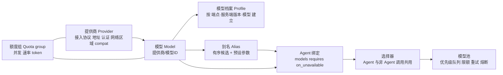
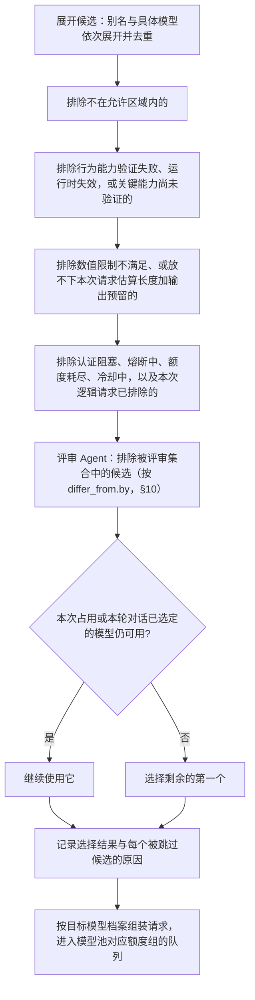

# 统一模型提供商构建规格

状态：构建规格草案，随 proposal 评审结论修订。

> 这是 [统一模型提供商 Proposal](../proposals/model-providers.md) 的构建规格：配置 schema、切换协议、探针、模型池与验收细节。
> 先读 proposal 了解心智模型；本文供实现与评审细节时查阅。两者冲突时，以 proposal 为准。
> **本文中涉及平行 Agent 的部分按第二版写成，以 [平行 Agent 与 TaskBoard Proposal](../proposals/parallel-agents-taskboard.md) 第四版为准。** 已被推翻的有：
> - 分诊小请求和 `triage_model`（§4.4、§4.5、§4.7、§5.7、§7.4、§8、§14）：第四版没有程序分诊。
> - 强制 `task_route`：已并入 `task_handoff`；“看板写入等级”改称交接写入等级，只管交接。
> - 换模型时写 TaskBoard 系统步骤、附程序事实（§5.5、§6.1、§12、§14）：切换记在实例自己的会话里，TaskBoard 不记。
> - “执行类每次占用都新建上下文，所以在占用边界换模型零成本”（§6.1）：第四版里 task 交回同一角色时继承原会话，继续一条会话时模型变了，要按 §6.2 处理。
> - 用语：占用、沟通者、结案者、TaskBoard 开启，分别读作 task 会话、对话 Agent、结案 Agent、协作模式打开。

更新日期：2026-10-19。

本文把所有模型提供商和模型放在同一个平面上管理：用户在 Agent 定义中按需引用任意提供商的任意模型，
会话不再绑定某一个提供商。本文是 [Mori App v0 方案](../app-v0.md) 之后的 v1+ 设计：
v0 只有连接表单、“测试连接”（首字耗时）和错误原文，模型配置就是 pi 的 `models.json`（app-v0 §4、§5.2）；探针、端点并发与排队、原始请求轨迹、多提供商候选、别名、模型档案、显式切换和模型池都是本文从 v1 起新建的（分期见 §13）。

确认后，本文将修改：
[Agent 角色定义与生命周期 Proposal](../proposals/agent-lifecycle.md) 中“角色引用固定的模型资源”，
[内网模型资源可靠性 Proposal](../proposals/model-reliability.md) 中“不自动切换模型、端点或账号”。
模型池的排队、限额、单层重试、熔断和远端未知占用等可靠性机制继续有效。
TaskBoard 与平行 Agent 见 [平行 Agent 与 TaskBoard 规格](parallel-agents-taskboard.md)。

本文的设计不依赖某一个 Agent 内核。选择器、模型池、模型档案和适配层都放在 mori 自己的内核进程中，
对内核只提出一组能力需求；v0 内核（pi-coding-agent SDK）与远期 DSH driver 的落点见 §11。

## 1. 要解决的问题

1. **会话被绑定在单个提供商上**：常见 harness 启动时选定一个提供商，整个会话都只能用它的模型。
   mori 的平行 Agent 需要按角色选择模型：规划和评估用强模型，执行用代码模型，记忆和摘要用便宜的快模型。
2. **内网资源不稳定**：自部署端点限流、宕机、排队都很常见；旧方案只等待或失败，长任务因此停摆。
3. **模型之间、部署之间差异大**：自部署和开源模型在工具调用、结构化输出、推理字段、上下文长度上各不相同，
   同一套 harness 请求发到不同模型，可靠性差别很大。这正是“harness 遵从度差”的重要来源之一：
   - BFCL 排行榜上，常用开源模型的多轮工具调用准确率大多在 40%–68% 之间；同一个模型用原生函数调用还是提示词格式，成绩可能相差数十个百分点；
   - 同一份权重在不同部署上行为也不同：Moonshot 的 K2-Vendor-Verifier 测得 Kimi K2 的工具调用 schema 准确率在 vLLM 上 76%、SGLang 上 73%，官方 API 100%；
   - 有些“不遵守规则”根本不是模型的问题：Ollama 的默认上下文按显存只有 4k–32k，超长时可能静默截掉 prompt 开头，而开头正是 system prompt 和工具定义；
     推理块里的工具调用可能被推理解析器吞掉，表现为 HTTP 200、没有工具调用、回合正常结束。

## 2. 新旧方案评估

| 维度 | 旧方案 | 用户提出的新方案 | 本文采用 |
| --- | --- | --- | --- |
| 提供商范围 | 内网 OpenAI 兼容接口 | 所有提供商在一个平面上 | pi-ai 支持的全部接入协议，统一命名为 `提供商/模型` |
| Agent 与模型的关系 | 每个角色引用一个固定的模型资源 | 每个 Agent 按配置使用任意提供商的任意模型 | 有序候选列表 + 能力要求；别名同时捆绑推理档位、采样等参数 |
| 失败时 | 等待或失败，不自动切换 | 按配置的候选列表显式切换（用户已确认） | 只因可用性原因、只在请求边界切换；旧尝试结果未知时先核对；切换处处可见 |
| 能力信息 | 配置 + 验证，不允许猜测 | 能力不满足的候选跳过（用户已确认） | 能力三态：已验证、未验证、验证失败；验证失败或运行时失效的候选跳过 |
| 弱模型适配 | 未涉及 | — | 按（端点，服务端版本，模型）建立档案，驱动请求、响应、历史、错误四侧的适配 |
| 可靠性 | 完整的模型池设计 | — | 全部保留；排队带优先级与权重；额度组扩展到多提供商 |
| 数据边界 | 默认全在内网 | 未涉及 | 每个提供商标注网络区域，任何调用都不得越过允许的区域 |

**旧方案的优点**：可靠性语义完整（单层重试、远端未知占用、限额原子取得），并且坚持“能力不能猜”“不静默切换”。
**旧方案的不足**：把“不切换”作为硬规则，在资源不稳定时直接导致任务停摆；只考虑单一协议；没有处理模型之间、部署之间的行为差异。

**新方案的优点**：按角色选模型，成本和质量可以分别优化；候选列表提高可用性；会话与提供商解耦。
**新方案的风险**：

| 风险 | 证据 | 对策 |
| --- | --- | --- |
| 切换后行为不一致，即使是“同一个模型” | K2-Vendor-Verifier：同一模型在不同部署上工具调用触发一致率约 51%–76% | 每个候选单独建档、单独探针；粘性选择减少切换；切换记录在案（§5） |
| 中途换模型继承漂移 | Inherited Goal Drift：强模型接续弱模型的轨迹后也会漂移 | 执行类 Agent 在占用中途切换时不回放旧轨迹，从工作卡重建（§6） |
| 切换导致代码离开内网 | — | 网络区域对所有调用生效，放宽只能在用户级设置中按项目授予（§4.6） |
| 跨模型的上下文不兼容 | 推理块签名、工具调用标识格式、`reasoning_content` 回传要求各家不同 | 复用 pi-ai 的转写；不可行时改走重建（§6） |
| 切换掩盖真实故障 | 网关默认配置常在调用方不知情时换服务方（OpenRouter `allow_fallbacks` 默认开启） | 每次切换记录原因并在界面显示；切换不重置总期限和总预算；网关必须关闭内部回退（§4.6、§5） |
| 同一请求在两个模型上同时执行 | 首响应超时时旧尝试可能仍在计算 | 旧尝试结果未知时不切换，除非取消可验证（§5.4） |
| 上下文超长被当成换大模型 | LiteLLM 的 `context_window_fallbacks` 会掩盖 compaction 失效 | 超长不触发换大模型；换到小窗口候选前先检查放不放得下（§5.1） |
| 外部网关与 mori 重复重试 | — | 网关和 mori 只能有一层重试；内核自带重试关闭（§5.5） |
| 探针污染生产状态 | 故障注入写入真实资源的冷却和熔断状态 | 故障注入只打模拟端点；探针经模型池、计入额度（§7.5） |

## 3. 概念



| 概念 | 含义 |
| --- | --- |
| 提供商 | 一个可调用的端点：接入协议、地址、认证引用、网络区域、请求头、代理、compat 选项 |
| 模型 | 某个提供商下的一个模型（一个部署），统一命名为 `提供商/模型ID`；第一个 `/` 之前是提供商，其余整体是模型 ID |
| 模型档案 | 该部署的能力、限制、适配方式、探针结果和运行时遥测；决定 harness 如何组装请求和解析响应 |
| 额度组 | 实际共享的限额：并发、请求速率、token；可以跨模型、跨提供商（例如同一 GPU 集群上的两个模型） |
| 别名 | 一个有序候选列表，加上一组预设参数（推理档位、最大输出、采样参数） |
| Agent 绑定 | `agent.md` 中的 `models`（有序候选，可写别名或具体模型）、`requires`、`on_unavailable`、`thinking`、`differ_from`、`compaction_model` |
| 工具模型 | 摘要补写、标题、相似判断等非 Agent 调用使用的模型，单独配置 |

## 4. 配置

### 4.1 来源与编译

- mori 的模型配置（提供商、模型、额度组、别名、工具模型、区域策略）是唯一的用户来源，schema 由 mori 定义并严格校验，未知字段直接报错。
- 启动时编译成内核的模型配置：对 pi 内核编译成内存模型注册（`ModelRuntime.create({ modelsPath: null })`，compat 按模型设置；接口在 v1 spike 中核实）。这是 v1 的新做法：app-v0 直接读写 pi 的 `models.json`（app-v0 §5.2、§6）；
  远期 DSH driver 编译成 `dsh-llm-pi-ai` 的 `Config`。网络区域、模型族、部署信息、额度组、价格、探针结果等 mori 字段只留在 mori 侧，供选择器和模型池使用。
- 认证只保存引用；密钥用 Electron `safeStorage` 加密保存（v1 新增；app-v0 把 key 明文写进 `models.json` 或写成 `$环境变量名`），在编译时注入内核，不写进任何配置文件或 `agent.md`。
- 认证有两种写法：`auth: { secret_ref }`（密钥在 `safeStorage` 中）和 `auth: { env: NAME }`（编译时从进程环境读取，DSH 映射到 `apiKeyEnv`）。
- **从 v0 迁移**：v1 首次启动时把 v0 的 `models.json` 导入 mori 配置，这一条取代 app-v0 原则 5“配置就是 pi 的配置”，属于 v1 的有意变更：
  - 明文 key 迁入 `safeStorage`，迁移成功后由程序删除 `models.json` 中已迁入的明文 key 并提示（不留明文备份）；`$环境变量名` 转为 `auth: { env: NAME }`。
  - `zone` 不静默猜测：按 baseUrl 给出建议值（回环地址为 `local`，私有网段为 `intranet`，其余为 `public`），第一次 v1 会话前要求用户确认；确认为 `public` 而未授权时，提示在用户级设置中按项目授予（§4.6）。
  - 缺失的 `maxTokens` 取临时默认值并登记；mori schema 不认识的 pi 字段列出后丢弃。
  - 迁移后不再读取 `models.json`（设置页注明）；v1 的首次启动表单、设置页“连接”和错误卡“去设置”都改写 mori 模型配置。
  - 迁移完成即在后台运行探针 P0–P9，期间启动校验显示“验证中”。
  - v0 的默认模型成为基座 Agent 的默认候选（§4.7）。
- `agent.md` 只引用别名或具体模型名，不包含地址和密钥，因此 Agent 定义可以安全地放进项目仓库共享。
- 项目配置只能收紧（缩小允许区域、在允许范围内覆盖别名指向），不能新增提供商或密钥；放宽见 §4.6。

字段映射：

| mori 字段 | pi-ai 模型定义 | DSH `dsh-llm-pi-ai` |
| --- | --- | --- |
| `api` | `api` | `api` |
| `baseUrl` | `baseUrl` | `baseURL` |
| `auth.secret_ref` | 编译时注入的 API key | `apiKeyEnv`（由 mori 设置进程环境） |
| `compat` | `compat`（原样透传） | `compat` |
| `models[].contextWindow` / `maxTokens` / `input` | 同名字段 | 同名字段 |
| `models[].reasoning` / `thinking` 档位 | `reasoning`、`thinkingLevelMap` | `reasoningEfforts`、`thinkingBudgets` |
| `retry` | 由 mori 关闭内核重试（§5.5） | `retryPolicy: { mode: normal, maxRetries: 0 }` |
| `zone`、`family`、`weights`、`serving`、`quota_groups`、`price`、`probe`、`aliases` | 不进入内核 | 不进入内核 |

### 4.2 示例

```yaml
providers:
  intranet-vllm:
    api: openai-completions          # pi-ai 的接入协议名，见 §4.3
    baseUrl: http://10.0.0.5:8000/v1
    auth: { secret_ref: intranet-vllm }
    zone: intranet
    compat: { supportsDeveloperRole: false, maxTokensField: max_tokens, thinkingFormat: qwen-chat-template }
    serving: { engine: vllm, version: "0.24", tool_parser: qwen3_coder, reasoning_parser: qwen3, grammar_backend: xgrammar }
    models:
      - id: qwen3-coder-30b
        family: qwen3
        contextWindow: 131072
        maxTokens: 16384             # 必须显式写出，且小于 contextWindow
        input: [text]
        quota_groups: [gpu-a]
      - id: qwen3-30b-a3b
        family: qwen3
        contextWindow: 32768
        maxTokens: 8192
        quota_groups: [gpu-a]
  corp-gateway:                      # 公司已有的 LiteLLM / OneAPI 网关
    api: openai-completions
    baseUrl: http://llm-gw.corp/v1
    auth: { secret_ref: corp-gw }
    zone: intranet
    gateway: { kind: litellm, fallbacks: disabled }   # 网关必须关闭内部回退
    models:
      - { id: qwen3-coder-480b, family: qwen3, contextWindow: 262144, maxTokens: 32768 }
  deepseek:
    api: openai-completions
    baseUrl: https://api.deepseek.com
    auth: { secret_ref: deepseek }
    zone: public
    models:
      - { id: deepseek-reasoner, family: deepseek, reasoning: true, contextWindow: 131072, maxTokens: 32768,
          compat: { requiresReasoningContentOnAssistantMessages: true } }
  local-ollama:
    api: openai-completions
    baseUrl: http://127.0.0.1:11434/v1
    zone: local
    models:
      - { id: qwen3-8b, family: qwen3, contextWindow: 32768, maxTokens: 8192 }

quota_groups:
  gpu-a: { max_concurrency: 4, max_inflight_tokens: 400000 }

aliases:
  strong:
    candidates: [corp-gateway/qwen3-coder-480b, deepseek/deepseek-reasoner]
  coder:
    candidates: [intranet-vllm/qwen3-coder-30b, corp-gateway/qwen3-coder-480b]
    params: { thinking: minimal, samplingParams: { temperature: 0.7, top_p: 0.8, top_k: 20 } }
  fast:
    candidates: [intranet-vllm/qwen3-30b-a3b, local-ollama/qwen3-8b]

utility:
  summary: { use: fast, requires: [structured_output] }
  title: { use: fast }
  similarity: { use: fast }

policy:
  allowed_zones: [intranet, local]   # 用户级默认
  project_trust:                     # 只能在用户级设置中按项目路径放宽
    "D:/work/open-source-tool": { allowed_zones: [intranet, local, public] }
```

`agent.md` 中的绑定：

```yaml
models: [coder, strong]          # 依次展开、去重；同一候选在多个别名中出现时，参数取它第一次出现的别名
requires: [tool_calling, protocol_write, context>=65536]
on_unavailable: failover         # failover（默认）| wait | release_task
thinking: medium                 # 可选，覆盖别名预设；只在同一模型内保持不变
compaction_model: inherit        # 默认使用该 Agent 当前解析出的模型
```

示例中的模型名称和数值只用于说明格式，实际值以配置和探针结果为准。档案中的能力字段（§7.2）由探针写入，不需要手写。

### 4.3 接入协议

接入协议直接使用 pi-ai 的实现，不另写协议层，也不新增独立的模型网关进程。pi-ai 提供的协议包括：
`openai-completions`（OpenAI Chat Completions 及其兼容实现：vLLM、SGLang、Ollama、LM Studio、llama.cpp server、各类网关、多数国产模型 API）、
`openai-responses`、`azure-openai-responses`、`anthropic-messages`、`google-generative-ai`、`google-vertex`、
`mistral-conversations`、`bedrock-converse-stream` 等。v0 锁定的 pi 版本决定实际可用的协议与 compat 字段，升级时重新核对。

### 4.4 能力

`requires` 中可以写行为能力（`tool_calling`、`forced_tool_choice`、`protocol_write`、`parallel_tools`、`structured_output`、`vision`、`reasoning`）
、看板写入等级下限（`protocol_write>=A`、`protocol_write>=B`；`protocol_write` 即不限等级）和数值限制（`context>=N`、`output>=N`）。其中：`forced_tool_choice` 指探针 P4 中 `named` 或 `required` 至少一项实测生效；
`protocol_write` 指该模型的看板写入等级已由探针判定（A、B、C 任一，§7.4），执行类 Agent 和立项、结案权限的持有者一般要求它而不是 `forced_tool_choice`，
这样不支持 `tool_choice` 的后端（如 Ollama）也能以 B 或 C 级担任执行者。
程序发起的协议写入（分诊小请求、提交轮、强制 `task_route`）隐含要求 `protocol_write`：选择器为这类请求过滤候选，不论该 Agent 的 `requires` 是否写出；没有判定等级的候选按能力不满足跳过，全部跳过时按候选耗尽处理。两类能力的判定方式不同：

| 类别 | 判定 |
| --- | --- |
| 行为能力 | 三态：**已验证**（探针通过）、**未验证**（只有目录或手写声明）、**验证失败**。验证失败、或运行时健康度把它降为失效（§7.6）的候选被跳过。`tool_calling`、`forced_tool_choice`、`protocol_write`、`structured_output` 未验证时视为不满足：添加模型后等待自动探针通过，启动校验显示“验证中”（延续 app-v0 §9 保留的“实测工具调用”）。其余行为能力未验证时默认可用，但在启动校验、Agent 配置界面和切换事件中标注“未验证”；`policy.require_probed: true` 时它们也必须验证 |
| 数值限制 | 取声明值与机器核对值中较小的一个：vLLM、SGLang 读 `/v1/models` 的 `max_model_len`；Ollama 读 `/api/ps` 的 `context_length`；llama.cpp 读单个 slot 的 `n_ctx`。无法核对时用探针 P10（§7.5） |

这对应用户的决定“能力不满足的候选跳过”，同时保留旧方案“能力不能猜”的精神：未验证的能力处处可见，不冒充已验证。
公开目录（models.dev 等）描述的是模型本身，不反映具体部署的 tool parser 和 chat template，只作初值。

### 4.5 启动校验

会话启动时，程序为每个 Agent（含基座 Agent，§4.7）和每个工具模型展开候选并逐项过滤：

- 至少剩下一个候选才允许启动；否则拒绝启动，说明每个候选被排除的原因；候选只因“未验证”或“验证中”被排除时，界面提供“立即验证这些模型”，显示预计请求数，验证完自动重试启动。
- 沟通者、立项者、结案者只有一个可用候选，或全部候选在同一提供商、同一额度组时，给出“没有可用性冗余”的警告。
- 立项者、结案者和分诊使用的 `triage_model` 没有任何满足 `protocol_write` 的候选时拒绝启动；其他平行 Agent 没有时警告“它被接棒后无法交接”（§4.4）。
- 评估 Agent 配置了 `differ_from`，而它的候选模型族都包含在所有带 `edit` 工具的平行 Agent 的候选模型族中时，给出警告（被评审者在运行时才确定，启动时按可能的作者估计）。
- 工具模型同样校验：`summary` 要求 `structured_output`；`compaction_model` 不为 `inherit` 时，它的窗口必须不小于所服务 Agent 的 compaction 触发阈值。

### 4.6 网络区域

每个提供商必须标注 `zone`：`local`（本机）、`intranet`（公司内网）、`public`（公网）。

- 区域过滤是选择器的统一前置步骤，作用于**所有**模型调用：平行 Agent、subagent、工具模型、compaction、记忆。
- 用户级 `policy.allowed_zones` 给出默认允许的区域。放宽只能在用户级设置中按项目路径授予（`project_trust`）；
  仓库里的项目配置只能收紧，否则克隆来的仓库就能把代码发往公网。项目请求了公网区域而用户未授予时，启动校验提示用户在本机授权。
- 网关类提供商必须声明 `gateway.fallbacks: disabled`，请求带上关闭回退的参数（如 LiteLLM 的 `disable_fallbacks`）；
  程序比对服务端报告的实际模型（`x-litellm-model-id`、响应中的 model 字段）与预期，不一致时记录、告警并把档案标为需要重新验证。
  否则网关内部的回退既可能越过区域，也违背“切换可见”。
- 项目覆盖别名时，启动校验和 Agent 配置界面显示“别名 coder 被本项目覆盖：A → B”。
- 内核自带的“模型在调用时自选路由”一类能力（例如 DSH subagent 工具的 `modelSelectionSettings`）一律关闭，subagent 的模型经选择器解析。
- 探针使用固定的合成用例，受用户级 `allowed_zones` 约束。

### 4.7 基座 Agent 的绑定

基座 Agent（TaskBoard 规格 §5.1）没有 `agent.md`，它的模型绑定写在 mori 模型配置中：

```yaml
base_agent:
  models: [default]                     # 默认候选；从 v0 迁移时取 v0 的默认模型
  requires: [tool_calling, protocol_write]
  on_unavailable: failover
```

- 启动校验（§4.5）同样展开和校验它；分诊的 `triage_model` 默认取沟通者的候选，沟通者是基座时即取这里。
- **顶栏切换模型**（v0 已有的交互）在 v1 定义为本会话对沟通者对话通道的覆盖：所选模型排在候选首位并标注“已覆盖”，从下一轮对话开始生效，不影响其他通道和其他 Agent；粘性规则（§5.8）以覆盖后的列表为准。

## 5. 选择与切换

### 5.1 选择器

选择器是一个函数，Agent 的每次模型请求和非 Agent 调用（工具模型、compaction、探针以外）都经过它：



“放不下本次请求”这一步防止因可用性切到窗口更小的候选时，第一个请求就溢出：
每次占用或每次唤醒新建的上下文这时从工作卡重建；连续上下文（沟通者的对话，以及配置了 `context: continuous` 的职责上下文）先主动做 compaction 再派发；都做不到就跳过该候选并记录“窗口不足”。
这一步只在**换到别的候选时**起作用；当前模型自己的上下文超长不触发换大模型（§5.3）。

### 5.2 切换协议

模型池不自行把请求改投到另一个提供商，因为已准备好的请求是按原目标模型档案组装的（工具调用方式、强制策略、去掉的参数都不同）。
模型池遇到 §5.3 的切换条件时，结束本次尝试并返回 `reprepare { exclude, reason, 剩余期限与预算 }`；
调用方重新执行选择器（`exclude` 中的候选本次逻辑请求内不再选），按新目标档案组装请求后重新进入模型池。
逻辑请求标识、总期限和总预算沿用。Agent 调用和非 Agent 调用都走这一协议，后者由 mori 的统一调用包装完成。

### 5.3 什么时候切换

按用户的决定，切换只因为**可用性**原因，并且只在**请求边界**发生：

| 情况 | 处理 |
| --- | --- |
| 连接失败，确认请求未送出 | 在该候选的重试子预算内重试；用完后切换 |
| 限流，`Retry-After` 超过本次请求允许的等待时间 | 原模型进入冷却，切换 |
| 服务错误（确认请求已被拒绝处理）达到子预算，或熔断打开 | 切换 |
| 首个有效响应超时、502/504、发送后流中断 | 结果未知，按 §5.4 处理 |
| 排队超过 `max_queue_wait` | 在模型池的同一串行调度步骤中确认未发出、移出队列，返回 `reprepare` |
| 认证失败、额度耗尽、模型不存在 | 阻塞该提供商或模型，立即切换，界面提示需要处理配置 |

以下情况**不切换**：

| 情况 | 处理 |
| --- | --- |
| 输出格式错误、工具参数不合格 | 交给 Agent 循环按模型步骤失败处理（档案中的格式重试）；持续失败由运行时健康度把能力降为失效（§7.6），在下一个请求边界自然跳过 |
| 已经输出部分内容后失败 | 按内核语义处理（丢弃部分输出后重试或结束回合）；对用户已显示的部分标为“已中断” |
| 当前模型上下文超长 | 连续上下文做 compaction；新建的上下文写检查点后从工作卡重建；不换更大窗口的模型 |
| 内容策略拦截 | 报告给用户，不换模型绕过 |
| 用户取消 | 停止，不切换 |

“输出质量差时升级到更强的模型”属于语义路由，不在本期范围，见 §15。

### 5.4 结果未知时

关闭连接只证明客户端停止接收，不证明远端已经停止计算（旧方案“远端未知占用”）。因此：

- 旧尝试处于远端未知状态时，默认**不切换**：先发取消，等待满足旧方案的解除条件（取消确认、结果查询确认或已验证的最长执行时间），
  界面显示“等待原尝试核对”；超出总期限则按 `on_unavailable` 处理。
- 若探针已经验证该部署“连接关闭即中止请求”（`cancel_verified`），取消后视为已终止，可以立即切换。
- 远端未知的旧尝试继续占用原额度组的容量；共享额度组中远端未知的占比超过阈值时，按熔断处理，防止一次负载高峰把整个额度组变成未知、流量全部涌向下一个候选。
- 同一个逻辑请求在任一时刻最多只有一个可能在执行的尝试。

### 5.5 重试与预算

- **单层重试**：重试只由 mori 的模型池决定。DSH 上不注册 `llm-retry`，其错误分类和退避参数并入模型池；
  pi 上由 mori 接管会话级重试：`retry.maxRetries` 设为总尝试上限、基础延迟设为 0，每次重试 pi 都会以 `reason: "retry"`（带 `failed`）调用虚拟模型的 `route()`，
  由模型池在 `route()` 中按 `Retry-After` 等待、决定同候选重试或返回新目标（即 `reprepare`）；provider 级重试保持为 0。具体做法列为 v1 开头的 spike。
  pi 只对它判为可重试的错误调用 `route(retry)`；认证失败、额度耗尽、模型不存在、模板 400 等会以 error 结束回合。对这类错误，mori 在 `agent_before_settle`（`outcome: "error"`）中按 `after_provider_response` 记录的状态判断是否属于 §5.3 的切换原因：属于就排除该候选并 `continue`，沿用逻辑请求的总期限与预算；这一判断在 TaskBoard 规格 §7.6 的出错回收之前执行；候选用完后先按 §5.7 的 `on_unavailable` 处理，处理结束仍无可用候选才进入回收。
  **占用中途换到另一个模型时不在原 pi 会话中继续**：同一模型的重试仍在原会话中进行；选出的新候选与当前模型不同时，`route()` 不返回新候选，而是结束本回合，程序写 `model_switch` 系统步骤，用 `createAgentSessionFromServices` 在新候选上新建会话（system prompt + 工作卡 + 该步骤），租约不变（§6.1）。对话通道与 `context: continuous` 的职责通道按 §6.2 先判断能否转写。这一做法列入 v1 spike。
  `retry: upstream`（网关自带重试）的提供商 mori 不再重试。
- **预算结构**：一个逻辑请求有跨候选不重置的总尝试上限和总期限；每个候选有自己的重试子预算，切到新候选时重新给，但受总上限约束。
- **期限**：每次切换时新候选的期限取“剩余总期限”与“该候选声明的期限”中较小的一个。总期限默认取“首选候选的期限（含其重试子预算）+ 后备候选中最大的单候选期限”，
  总尝试上限同理，保证首选用完重试后后备仍有一次完整尝试的时间；写入请求记录。
- 切换不重置任务预算；预算耗尽时不自动换成更便宜的模型继续（TaskBoard 规格 §7.6、§16）。

### 5.6 排队改投

- 改投在模型池的同一个串行调度入口完成：从原队列移除、确认没有发送意图、返回 `reprepare`，作为一个原子步骤。
- 改投后的请求保留原入队时间作为排序依据，不排到队尾；排队时间计入总期限。
- 一次逻辑请求中每个候选最多被选中一次，选中期间按 §5.5 的子预算重试；全部候选都失败或超时，逻辑请求失败，交给 `on_unavailable`。
- 熔断引起的批量改投按优先级分批放行，并受目标候选的队列上限约束，超出部分直接按排队超时处理。

### 5.7 候选耗尽

| `on_unavailable` | 全部候选都不可用时 |
| --- | --- |
| `failover`（默认） | 先按 `wait` 等待到总期限，期满按 `release_task` 处理 |
| `wait` | 等待或失败，同旧方案 |
| `release_task` | 由程序（不是模型）写一条系统步骤，以 `model_unavailable` 交给结案者（TaskBoard 规格 §7.7） |

上表适用于工作通道中的占用者，包括三项权限的持有者（基座执行、被选为下一棒、结案者亲自执行）：`wait` 期满仍不可用时同样按 `release_task` 处理；等待期间租约与写锁保留（心跳把排队视为活跃），所以总期限同时限定了写锁被占的时间。其他回合：

| 回合 | 候选耗尽时 |
| --- | --- |
| 沟通者的对话回合；立项者、结案者的职责回合 | 不交接（没有可交接的 task）：配置的 `wait`、`release_task` 都按 `failover` 等待；期满后程序在聊天流写一条系统消息，显示受影响的 Agent 名、各候选被排除的原因和可以继续的条件，不依赖任何模型；恢复后程序重投未完成的职责（TaskBoard 规格 §7.7）和未完成的 `request_settled` |
| Agent 消息的回复回合 | 立即以“对方模型暂时不可用”返回发送方，不做 `failover` 等待 |
| 订阅、定时回合 | 按 `PASS` 结束并记入遥测 |
| 工具模型调用（含分诊小请求） | 没有 `on_unavailable`，候选耗尽时直接失败；分诊因此失败时走 TaskBoard 规格 §6.3 的分诊超时路径（写入保持暂停、显示“需要你处理”），不走原话建目标的兜底 |

授予 task 租约前，程序先为接收者做一次候选可用性预检；没有可用候选就不授予，task 保持“已指派、等待可用模型”，不计入租约期限。

### 5.8 粘性与回切

- 一次 task 占用（或沟通者的一轮对话）内，优先继续使用已经选定的模型，避免中途换风格、丢前缀缓存。
- 切换到后备模型之后，即使首选模型恢复，也要等下一次占用或下一轮对话开始时才回切，避免来回抖动。
- 选定结果（占用或对话轮 → 模型、切换原因、回切条件）随租约记录落盘；Host 恢复时沿用落盘的选定模型，它不可用时按候选列表重选并记录原因。
  这修改了旧方案的恢复规则“资源已失效则阻塞，不改选其他资源”。
- 每个步骤记录本次占用中出现过的全部模型（别名、解析出的部署、服务端报告的模型、模型族、用量）。
  部分服务不回报实际模型（例如 Bedrock、Vertex 不返回 model 字段），溯源以 harness 侧的解析结果为准。

## 6. 跨模型上下文

### 6.1 执行类 Agent：从工作卡重建

推荐的切换点是**占用边界**：TaskBoard 是与模型无关的纯文本共享状态，执行类 Agent 默认每次占用使用新上下文，
所以在两次占用之间换模型不需要任何转写。

占用中途原模型不可用而需要切换时，**不把旧轨迹回放给新模型**：

1. 程序写一条 `system` 步骤（原因 `model_switch`）：已完成的工具调用与结果引用（程序事实）、最后一段模型输出、切换前后的模型；
2. 在下一个候选上为该 Agent 新建上下文：system prompt + 工作卡 + 这条步骤；
3. 继续同一次占用（租约不变）；工作卡的“交给我的原因”一栏注明“原模型不可用，从检查点继续”。

理由：旧轨迹里有原模型专有的推理块和工具调用格式，跨模型回放有兼容问题；更重要的是，接续别的模型的轨迹会继承漂移，
而从看板重建只继承结构化的结论。这正是 TaskBoard 给模型平面带来的能力。`model_switch` 步骤不计入 TaskBoard 的无新事实计数。

### 6.2 保留历史的 Agent：先判断能否转写

沟通者的对话，以及配置了 `context: continuous` 的特殊权限持有者，需要保留对话历史。选择器对它们多做一次“转写可行性”判断，满足任一条件就不转写，改走重建：

- 目标模型需要回传 `reasoning_content`，而历史中有其他模型生成的工具循环（DeepSeek 推理模式带工具时缺失会直接 400，补空字符串只能绕过报错、补不回语义）；
- 目标模型的工具调用方式（原生或提示词格式）与当前模型不同；
- 当前上下文估算加输出预留超过目标模型的窗口。

重建的内容：system prompt + 工作卡 + 由 compaction 生成的对话摘要 + 最近几轮不含工具循环的用户与助手文本。重建也不可行时跳过该候选并记录原因。

### 6.3 转写规则

可以转写时，复用 pi-ai 的 `transformMessages`，它已经处理：

| 内容 | pi-ai 的处理 |
| --- | --- |
| 推理内容 | 提供商、协议、模型三者都相同才保留；否则丢弃推理块，删除工具调用上的推理签名 |
| 工具调用标识 | 按目标协议的格式要求规范化，并同步改写对应工具结果的标识 |
| 没有结果的工具调用 | 补一条合成的错误结果 |
| 出错或中止的助手消息 | 整条跳过 |
| 图片 | 目标模型不支持图像时替换为占位文字 |
| 中途的 system 消息 | 目标不支持时折叠进开头的 system |

mori 在其上补充：

| 规则 | 原因 |
| --- | --- |
| Kimi 系模型的工具调用标识规范为 `functions.名称:序号`（全局计数），维护内部标识到线上标识的映射 | pi-ai 源码中未见这条；vLLM 排查 Kimi K2 精度问题时发现非标准标识会被 parser 丢弃，并诱发后续调用失败 |
| 发给自部署模型的助手和工具消息，`content` 一律为字符串，助手的空内容改为空字符串 | 空内容被转成数组后，chat template 可能把数组字面量打进 prompt |
| 校验模型调用的工具名是否在本次请求的工具列表中 | 不在就返回错误结果，不执行；模型有时会调用历史中出现过、但本次未声明的工具 |
| 工作卡和看板推送以追加消息注入，不改写开头的 system prompt 和工具列表 | 前缀改动会让前缀缓存失效；在 Anthropic 等提供商上还会使之前的推理块失效 |
| 同一模型内不改推理档位 | 改档位会让缓存失效；换模型时按目标模型的档位映射 |
| 需要图像能力的请求用 `requires: [vision]` 在选择阶段排除不支持的候选 | 不在转写时悄悄删图 |

## 7. 模型档案、适配与探针

### 7.1 按部署建档

档案按（端点，服务端类型与版本，所服务的模型）建立，而不是按模型名。同一份权重在不同引擎、不同版本上行为差异很大，
字段名也会随版本改变（例如 vLLM 在 2026 年 1 月把响应中的 `reasoning_content` 改名为 `reasoning`）。

档案带一个指纹：服务端版本、模型 ID、上下文上限、chat template 摘要、服务端声明的 parser。指纹变化时自动重跑探针。
parser 名无法从 API 读出，由用户在 `serving` 中声明，再用探针验证。

### 7.2 档案字段

| 分组 | 字段 | 说明与来源 |
| --- | --- | --- |
| 身份 | `server_kind`、`server_version`、`served_model`、`family`、`weights`、`quantization`、`kv_cache_dtype` | vLLM 看 `/v1/models` 的 `owned_by`；llama.cpp 看 `/props`；Ollama 看 `/api/version`；其余由配置声明。KV cache 量化到 q4 会显著损害工具调用（llama.cpp 文档） |
| 上下文 | `context_hard`（上限）、`per_slot_ctx`、`context_effective`（预算，默认取上限的 50%–60%，可调）、`overflow_behavior`（报错 / 静默截掉开头 / context shift）、`output_reserve` | 见 §4.4 的核对方式；溢出行为用探针 P10 实测。Chroma 的 context rot 实验表明有效长度远小于标称值 |
| 工具调用 | `tool_call_mode`（native / prompt，按实测选）、`tool_choice` 每个取值是“生效 / 被忽略 / 报错”、`strict_tools`（强制执行 / 接受但不执行 / 拒绝）、`parallel`、`tool_call_id_style`、`arg_type_fidelity`、`streaming_tool_calls`、`empty_tool_calls_repr`、`leak_markers`、`first_constrained_latency` | Ollama 不支持 `tool_choice`；LM Studio 的 `required` 只在 llama.cpp 引擎可用；vLLM 的 `required`、`named` 是否真正生效依赖版本、parser 与 strict 等级（XML 原生格式的模型在旧路径上会解析不出）；首次强制调用要编译语法，可能需要数秒 |
| 推理 | `thinking_toggle`（`chat_template_kwargs.enable_thinking`、`chat_template_kwargs.thinking`、`thinking.type`、`reasoning_effort`）、`reasoning_out_field`（`reasoning` / `reasoning_content` / `reasoning_details` / 正文中的 `<think>`）、`reasoning_replay` | 回放策略按模型族不同：Qwen3 混合模式丢弃历史推理；DeepSeek V3.2、Kimi K2 Thinking、GLM 保留当前工具循环内的推理；MiniMax M2 原样回放（MiniMax 实测丢弃先前推理后 Tau² 从 87 降到 64）。所以不能为了省 token 一律丢弃 |
| 结构化输出 | `json_schema`（强制执行 / 只在提示词中 / 不支持）、`structured_with_reasoning`、`schema_feature_limits` | vLLM 的 `guided_*` 旧字段已移除；Qwen3-Coder 开启推理时需要额外开关才能结构化输出 |
| 消息形态 | `content_format`、`mid_convo_system`（允许 / 折叠到开头 / 改为 user 前缀）、`strict_role_alternation`、`notification_role` | 中途插入的消息在部分模板上会因角色交替或 system 位置限制报错或被忽略，决定工作卡和推送用什么角色注入 |
| 采样 | 按（模型族，模式）记录推荐参数，以及 `server_ignores` | 例如 Qwen3 推理模式 T=0.6、TopP=0.95、TopK=20 并禁止贪心解码，否则会无限重复；Ollama 的 OpenAI 兼容层不映射 top_k、min_p、repetition_penalty |
| 流式与用量 | `usage_in_stream`（单独 chunk / 附在最后一个 chunk / 无）、`cached_tokens_reported` | 模型池的限额、上下文预算和截断检测都依赖它 |
| 取消 | `cancel_verified` | 探针验证“连接关闭即中止请求”，决定 §5.4 能否立即切换 |
| 等级 | `capability_tier`、`taskboard_write_tier`（A / B / C，§7.4） | 由探针结果派生；能力等级供 TaskBoard 调整交接内容的详略 |
| 验证 | 每项能力的探针结果、时间、指纹、探针套件版本 | 程序 |
| 遥测 | 见 §7.6 | 程序 |

### 7.3 档案驱动的适配

| 侧 | 变换 |
| --- | --- |
| 请求 | system 与 developer 角色互转；中途插入的 system 按档案折叠或改为 user 前缀；选择 `max_tokens` 字段名并按剩余上下文钳制；思考开关映射到该族的参数；按（模型族，模式）注入采样参数并剔除服务端不认的字段；strict 只在支持时发送；schema 净化（拍平、全部 required、`additionalProperties: false`、可空写成类型数组、去掉后端不支持的关键字）；`tool_choice` 降级（见下）；content 压平成字符串 |
| 响应 | 推理统一：依次读取 `reasoning`、`reasoning_content`、`reasoning_details` 和正文中的 `<think>…</think>`，归一成内部推理块并从可见正文中剥离；`tool_calls` 的 `[]` 与 `null` 等价；参数先解析，再按 schema 做类型转换（XML parser 会把数字变成字符串）；工具名不在列表中时回错误结果；**空轮补救**：`tool_calls` 为空但正文或推理中出现该族的工具标记（`<tool_call>`、`<|tool_call_begin|>`、`<｜DSML｜function_calls>`、`<minimax:tool_call>`、`[TOOL_REQUEST]`）时，用客户端的族内 parser 抽取并计入遥测；剥离泄漏的特殊 token；任意 chunk 上的 usage 都接受，没有时本地估算并标为估算 |
| 历史 | 按 `reasoning_replay` 回放推理，字段名按服务端选择（vLLM 用 `reasoning`，SGLang、llama.cpp、DeepSeek 用 `reasoning_content`，Ollama 用 `reasoning`）；跨模型不回放推理；工具调用标识按族重写；按需补工具结果的 name 字段；角色交替严格的模板合并相邻同角色消息 |
| 错误 | 各家的上下文溢出错误统一为“上下文溢出”，触发 compaction 或重建；**静默截断检测**：`usage.prompt_tokens` 明显小于本地估算，或开头金丝雀探针失败时，记为“上下文被截断”（Ollama 上高危），在界面明确告警，而不是让它表现为“模型不遵守规则”；模板异常导致的 400 归为“模板不兼容”并触发重新探测；首次强制调用的语法编译用单独的较长期限，不计入熔断 |

**强制调用**（例如 TaskBoard 的强制交接、强制分诊）按档案实测结果选第一个可用的策略：

| 策略 | 适用 | 说明 |
| --- | --- | --- |
| 指定函数（`tool_choice` 为 `named`）+ strict | 实测生效的 vLLM、SGLang（xgrammar 后端）、多数云 API | 服务端约束解码保证格式；只保证格式，不保证内容质量 |
| `required` + 工具子集限制 | 支持 `required` 且支持在保持工具列表不变的情况下限制可调用子集的后端 | 不临时增删工具，以保住前缀缓存 |
| 结构化输出（`json_schema`） | 不支持 `tool_choice` 的后端，例如 Ollama | 用 `response_format` 约束输出，再由程序转成工具调用 |
| 提示词 + 解析与修复 | 以上都不支持 | 确定性修复后按 schema 校验 |

### 7.4 看板写入等级

TaskBoard 的交接、分诊、路由这类协议写入，按档案派生的等级执行：

| 等级 | 条件 | 做法 |
| --- | --- | --- |
| A | 指定函数 + strict 被实测强制执行（探针 P7） | 强制调用小 schema 工具 |
| B | `json_schema` 被实测强制执行（探针 P8） | 结构化输出 |
| C | P7、P8 的强制性测试都未通过，但 P8 的文本标签子项通过 | 文本标签（如 `<summary>…</summary><outcome>…</outcome>`）加宽松解析；不用依赖停止词的 ReAct 模板 |

规则：

- 协议写入只包含小字段（摘要、结果类型、下一棒、编号引用）；长内容（代码、diff、日志、分析）不放进模型生成的 JSON，
  而是取自模型的自由文本输出和程序事实（Aider 的实验表明，让模型把代码放进 JSON 会明显增加语法错误，strict 模式也没有改善）。
- 只修语法问题：JSON 非法、缺字段、超长，每次把校验器的原始错误回给模型；
  `finish_reason` 为 length 时禁止补全修复（补全会制造看似合法、实则缺内容的对象），改为缩短限额重问；
  语义字段（task、下一棒、状态迁移、租约）一律不修不猜，不做同义词映射。枚举越界（含被分诊枚举收窄排除的取值）和程序的语义拒绝（如没有程序事实却声明 done）按语法类错误处理：把校验器原文回给模型，计入下面同一份统一预算，用完走现有兜底；唯一例外是 `next_agent` 无效，直接交结案者（TaskBoard 规格 §7.7）。
- 三档都未通过时 `protocol_write` 判为验证失败，该模型不能担任需要它的 Agent。
- **统一预算**：每一档最多 1 次语法重试，用完降一档（A → B → C），总尝试不超过 4 次，记录降级。语义拒绝与枚举越界在同一档重试，只计入总尝试上限，不降档，也不计入 §7.6 的协议写入健康统计；降档只降到档案中已通过、且不低于该 Agent `requires` 下限的等级，没有可降的等级时直接走兜底；用完仍失败交给 TaskBoard 的兜底（强制交接走自动回收，分诊走原话建目标），不静默丢弃。
  TaskBoard 的强制交接、分诊小请求、强制 `task_route` 都使用这一份预算。
- 推理档位：使用裁剪上下文的提交轮（强制交接）可以关闭思考；在原上下文中强制调用（强制 `task_route`）时保持当前档位；独立的分诊小请求可以关闭思考，以免缓存与推理块失效；
  思考不可关闭的模型不关闭。温度不设为 0（部分模型贪心解码会无限重复）。
- Agent 定义可以用 `requires: [protocol_write>=B]` 这类写法声明写入等级的下限（§4.4），不满足时启动即报错并给出修复建议（例如“为 vLLM 开启 `--enable-auto-tool-choice`”“设置 `OLLAMA_CONTEXT_LENGTH=65536`”）。

### 7.5 探针

v0 的“测试连接”（app-v0 §5.2：用一条短消息测首字耗时）只覆盖 P1 的一小部分；本节探针都是 v1 新建的：

| 编号 | 内容 |
| --- | --- |
| P0 | 指纹：`/v1/models`、`/props`、`/api/ps`、`/api/v0/models` |
| P1 | 基础对话：推理字段名、`finish_reason`、是否有用量 |
| P2 | 思考开关：分别关闭和开启，看推理字段 |
| P3 | 单个工具调用：是否调用、参数是否合法、类型是否正确、标识格式 |
| P4 | `required` 与 `named`：生效、被忽略还是报错 |
| P5 | 并行工具调用，以及关闭并行后是否最多一次 |
| P6 | 多轮往返：带或不带推理回放、name 字段、空内容等变体是否被接受，答案是否引用了工具结果（很多部署在这一步出错） |
| P7 | strict 强制性：参数枚举为 `[ok, fail]`，提示模型填 `banana`，结果落在枚举内说明强制生效 |
| P8 | `json_schema` 强制性：同样的枚举违例测试，并在开启思考时再测一次。文本标签子项（P7、P8 的强制性测试都未通过时运行，非对抗）：给出交接式的文本标签格式（`<summary>`、取值来自列表的 `<outcome>` 与 `<next_agent>`），用一个普通的小任务连跑 k 次（临时默认 3），每次都能被宽松解析且取值都在列表内，判为 C 级 |
| P9 | 流式：带用量重复 P3，检查增量拼接与用量位置 |
| P10 | 上下文：开头放金丝雀、长度接近有效预算；再发一个超过上限的请求，看是报错还是静默截断 |
| P11 | 推理中的工具调用：开启思考跑 P3，检测空轮补救是否触发 |
| P12 | 取消：发起长请求后关闭连接，验证服务端是否中止（决定 `cancel_verified`） |
| P13 | 协议一致性（可选、手动）：固定的小型 TaskBoard 场景（领取后完成几次工具调用、记一步、交接；遇到无效下一棒是否修正；缺信息时是否选 `blocked`；对一条用户消息做分诊小请求；对一个 `done_claim` 强制 `task_route`），连跑 k 次统计 pass^k，结果只作角色建议 |
| P14 | 图像输入：只对声明 `input` 含图像的模型执行，验证 `vision` |

运行规则：

- 添加或修改提供商、模型后，程序在后台自动运行 P0–P9 和 P14（每个模型约十几个短请求），界面显示进度；P10–P12 在用户确认后运行；P13 只在用户点击时运行。
- 探针请求经过模型池，计入额度组，走后台类别，每次验证有 token 预算并在界面显示预估，不绕过共享 GPU 的并发限制。
- 故障注入（限流、熔断）只打内置的模拟端点，不写真实资源的冷却和熔断状态。
- 重新验证的触发条件：配置变化；指纹变化（含服务端响应头、服务端报告的模型）；探针套件版本变化（含 TaskBoard 交接 schema 与共同提示词的摘要）；超过有效期。
  会话启动时，对过期档案在后台跑一个轻量子集（P3、P4、P6）。
- “需要重新验证”的效果：运行中的会话继续使用并在界面告警；新会话按“未验证”处理，并提供一键验证。

探针只验证能力，不代表模型在真实任务中的效果。

### 7.6 运行时健康

对每个（模型，强制策略，角色）维护滑动窗口统计：

- 工具调用三项检查（参照 OpenRouter Exacto）：JSON 合法率、工具名合法率、参数 schema 合法率；
- 空轮率（`tool_calls` 为空、正常结束、正文里却有工具标记）；
- 协议写入首次成功率与修复率、自动回收次数；
- 首字延迟、每秒 token、4xx/5xx 比例。

某项强制能力的健康度跌破阈值时，档案中这项能力降为“运行时失效，需要重新验证”，界面显示原因；
选择器在下一个请求边界按 `requires` 过滤时自然跳过它。这属于“能力不满足的候选跳过”，不是语义路由，符合用户的决定。
否则可能出现：部署悄悄变了，强制交接每次都失败、每次都被回收，结案者重派后选择器又选回同一个模型。

## 8. 模型池

旧 [内网模型资源可靠性 Proposal](../proposals/model-reliability.md) 的机制全部保留：统一入口、单层重试、退避与 `Retry-After`、
熔断、远端未知占用、排队公平、持久记录与恢复。v0 不做端点排队（app-v0 §4：端点忙时交给 pi 的自动重试，界面如实显示），模型池从 v1 起新建。本文对旧方案做以下修改：

| 修改 | 说明 |
| --- | --- |
| 额度组跨提供商 | 额度组可以挂在提供商或模型上；一个请求同时取得它涉及的全部额度组 |
| 带优先级的等待队列 | 并发满时排队，不像 LiteLLM 那样立即返回 429：平行 Agent 会在同一时刻收到用户消息，请求会同时涌向同一个端点 |
| 调度类别 | 由程序按通道推导（TaskBoard 规格 §5.3、§9.2）：交互（沟通者的对话通道、分诊小请求）、决策（立项者、结案者的职责回合）、执行（工作通道）、后台（其余）；`wait_reply` 的 Agent 消息回合继承发送方的类别；类别之间按权重分配份额，不是严格优先，后台保留正权重；类别内按用户会话轮转 |
| 调用继承类别 | compaction、摘要补写、标题等工具模型调用继承发起它的通道的类别；只有不阻塞任何 Agent 的调用才属于后台 |
| 候选感知的排队 | 请求按选定的候选进入对应队列；排队超时后按 §5.6 返回 `reprepare` |
| 允许切换 | “不自动切换模型”改为“只按候选列表、在请求边界、因可用性原因切换，并且可见” |
| 熔断粒度 | 熔断作用于单个模型或单个提供商，不连带整个别名；共享额度组中远端未知占比过高也触发熔断 |
| 故障判定 | 以 HTTP 状态、`Retry-After` 和连接错误为准；内核按错误文本分类的结果只作参考（pi-ai 的错误会被压平成文本，自部署服务的报错格式可能被误判），需要内核提供响应回调（§11） |
| 请求优先级下发 | 档案声明支持时，把调度类别作为请求优先级传给 vLLM（服务端需开启优先级调度）；按请求设置需要内核的请求体钩子（§11） |
| 成本统计 | 按提供商、模型、Agent、目标 task 汇总已知用量与价格；用量缺失保持未知，不按 0 计 |
| 计量单位 | 额度槽按“请求”计：响应结束时释放，工具执行期间不占用（v0 没有端点上限，不存在迁移）。如果按“轮次”计，上限为 1 时执行者占着端点、工具又在等分诊，分诊小请求拿不到端点，会互相等待 |

## 9. 工具模型

- `utility` 的每一项都可以写 `requires`，同样经过选择器、区域过滤和启动校验，同样可以有多个候选并按 §5 切换。
- 非 Agent 调用不经过 Agent 循环的请求钩子，由 mori 的统一调用包装完成选择、组装、重试和切换。
- `compaction_model` 默认 `inherit`，使用该 Agent 当前解析出的模型：既能保住前缀缓存，也不会把大窗口的历史交给小窗口模型。
- TaskBoard 的摘要补写是异步的：先截取内容第一句作临时摘要落盘，再补写替换，不阻塞写入。

## 10. 与 TaskBoard 的协同

- **看板让异构模型可以安全协作**：Agent 之间只通过看板上的纯文本和程序事实交换信息，不依赖彼此的推理内容或工具调用格式，
  因此每个角色可以使用不同提供商的模型，换模型的最佳时机就是占用边界。
- **占用级溯源**：每个步骤记录本次占用中出现过的全部模型及其模型族；由工具模型补写的摘要不计入。
- **评审避开同族**：模型会偏好自己的输出。评估 Agent 可以声明 `differ_from: author`（完整写法 `{ target: author, by: family }`，`by` 还可以是 `provider` 或 `model`，默认 `family`；不按 Agent 名指定，因为系统不内置任何角色）：
  “被评审集合”是被评审 task（`purpose: review` 时取 `verifies` 指向的 task）上，上一次验证之后产生过工作区文件改动的占用（TaskBoard 规格 §7.8 的被评审占用）中出现过的模型，按 `by` 取族、提供商或模型，不含评审者自己的占用；选择器排除这个集合，授予租约前的预检同样应用这一排除，也作用于评审者自己中途切换时的候选。排除后没有候选时不等待，立即交给结案者，原因“缺少独立评审模型”（TaskBoard 规格 §7.7，不计入异常升级）。
- **工具模型补位**：模型漏写摘要时由 `utility.summary` 补写；相似判断由 `utility.similarity` 提供提示。
- **按等级调整**：协议写入等级（§7.4）决定强制交接与分诊的执行方式；能力等级供 TaskBoard 在交接时决定给接手方多少上一棒的叙述（TaskBoard 规格 §9.2）。
- **预算耗尽不降级**：单次占用预算用完时按 TaskBoard 规格 §7.6 以 `progress` 交结案者（`budget_reached`）；目标预算达到时通知结案者，超出时由程序回收并把目标置为等待、询问用户（TaskBoard 规格 §16）；两种情况都不自动换成更便宜的模型继续。

## 11. 内核能力需求与落点

本文需要内核提供以下能力。v0 内核是 pi-coding-agent SDK（app-v0），DSH 是远期 driver。
pi 一列依据对 `@earendil-works/pi-coding-agent` 与 `@earendil-works/pi-ai` 1.3.0 发布包的核查，DSH 一列依据固定提交的源码核查；
两列都需要在实施前用 spike 实测，不能因为源码中存在某个模块就视为可交付（app-v0 §1 的教训）。

| 能力 | 用途 | pi-coding-agent SDK 1.3.0（v0 内核） | DSH（进程内 composition 接入；ACP driver 拿不到这些挂载点） |
| --- | --- | --- | --- |
| 按请求选择提供商与模型 | §5.1 选择器 | 虚拟模型：`registerVirtualModel` 的 `route(request)` 在每次请求前调用，`reason` 区分 user、continuation、retry、direct，重试时带 `failed`；返回物理模型与推理档位 | `agent/request` 钩子可改写路由；输入只有回合与步骤，拿不到失败原因 |
| 按请求传 `tool_choice`、`response_format`、优先级等请求体字段 | §7.3、§8 | `before_provider_request` 返回值替换整个请求体，按各家 API 方言写入；事件不带模型，需要用 `route` 记录的结果关联；也可用工具定义的 `constrainedSampling`（json_schema、strict）。pi-ai 的 `ToolChoice` 只有 `auto`、`none` | `GenerateOptions` 没有这些字段，`dsh-llm-pi-ai` 不透传 pi-ai 的 `onPayload`；需要改 core 或自建连接器 |
| 获取 HTTP 状态与响应头 | §8 故障判定 | `after_provider_response { status, headers }`，在读取响应体之前触发 | 连接器把错误压平成文本；需要自建连接器并使用 pi-ai 的 `onResponse` |
| 单层重试 | §5.5 | 由 mori 接管会话级重试：`retry.maxRetries` 设为总尝试上限、基础延迟 0，退避与候选决定在 `route()` 中完成（pi 自身的退避按错误文本匹配、不读 `Retry-After`）；provider 级 `retry.provider.maxRetries` 保持 0；pi 不重试的错误经 `agent_before_settle` 的 error 结果按 §5.5 切换 | 不注册 `llm-retry`（它的重试计数按提供商分开，与跨候选预算不兼容），由 mori 的 `agent/request-error` 监听器决定 |
| 模型池挂载点 | §8 | pi 没有按端点的并发上限，由 mori 在内核进程中新建模型池；在 `route()` 中等待额度槽、在响应结束时释放的做法需要 spike 验证 | `llm/stream` 钩子不能改写请求，只适合准入与观测 |
| 改投 | §5.2 | 请求尚未开始占用、或同一模型重试时，`route(reason: "retry", failed)` 返回新候选，即 `reprepare`，请求体按新目标在 `before_provider_request` 中重新组装；占用中途换到另一个模型时结束本回合并在新候选上新建会话（§5.5） | 经 `agent/request-error` 由 mori 的监听器触发重新选择 |
| 非 Agent 调用的统一包装 | §9 | compaction 等直接请求是否经过 `route` 与 `before_provider_request` 未核实；由 mori 统一包装 | 直接调用 `ctx.llm.stream` 只尝试一次、不经过 `agent/request`；由 mori 包装 |
| 每次占用新建上下文 | §6.1 | 新建 `SessionManager`，用 `createAgentSessionFromServices` 复用服务 | 请求消息由 Agent 自己的 Session 派生，需要每次占用新建 Session/Agent |
| compaction 使用指定模型 | §9 | 没有 `compaction.model`；用 `session_before_compact` 返回自带摘要，内部调用导出的 `compact()` | compaction-basic 只接受一对摘要模型，空则沿用最近路由（即 `inherit`） |

注意：pi 的 `AgentSession.reload()` 会清空进程级的 API provider 注册表，多个平行 Agent 运行时不能调用；
也不要覆盖 `session.agent` 上的钩子，所有扩展通过 mori 的内联扩展注册。

无论哪个内核，选择器、模型池、档案、适配层、探针都在 mori 的内核进程中实现，内核只负责执行一次请求。

## 12. 界面

- 设置 → 模型：按提供商分组列出模型，显示网络区域、能力标签及其三态、协议写入等级、协议一致性得分（若跑过）；提供“验证”按钮和自动验证进度。
- 别名编辑：拖动排序候选；显示每个候选当前是否可用。
- Agent 配置：选择候选和能力要求后，立即显示展开结果、被排除的原因、冗余警告和推荐角色提示。
- 模型池：在 v0 的阶段行上新增“等待端点空闲”，按提供商分组；切换事件显示为“executor：A → B，原因：限流 429”；“等待原尝试核对”单独显示。
  它们以 `model.switched`、`request.phase { waiting_reconcile }` 进入 v1 新建的界面事件层（TaskBoard 规格 §9.8；v0 只原样转发 pi 事件）；阶段行的“重试 n/m”改由模型池事件提供（pi 的 `auto_retry` 事件在 mori 接管后只作参考）。
- 静默截断、空轮补救、运行时失效等档案事件以错误卡形式出现，附原始请求轨迹入口。
- **原始请求轨迹**（v1 新增，v0 没有）：按逻辑请求标识记录每次尝试的请求体、响应状态与响应头、耗时与切换原因，存于 `%APPDATA%/Mori/traces/`（不进项目仓库或云同步目录）；认证类请求头和 query 参数一律脱敏；保留期为临时默认值；错误卡的入口按逻辑请求标识打开。
- TaskBoard 中每个步骤显示一个小的模型标签。

## 13. 分期

| 阶段 | 内容 |
| --- | --- |
| v0（app-v0） | 连接表单、测试连接、错误原文；模型配置写 pi 的 `models.json`；单 Agent，可在顶栏切换模型 |
| v1 | mori 模型配置与编译（含从 v0 的 `models.json` 迁移）、原始请求轨迹、别名与候选、能力三态与启动校验、网络区域、选择器与切换协议、强制调用适配与看板写入等级、档案完整探针 P0–P14；按请求计的端点并发与按推导的调度类别做简单优先级排队；基座 Agent 的默认候选与顶栏覆盖（§4.7）；评审避开同族（§10）；跨模型转写可行性判断（§6.2，只有三条确定性条件）；配合 TaskBoard 的最小配置（基座 Agent + 一个执行 Agent）。v1 只因连接失败且未送出、限流、认证或额度失败、排队超时而切换；结果未知时不切换，先取消，再等到已验证的最长执行时间或总期限 |
| v1.x | 完整模型池（额度组、优先级权重、熔断、远端未知占比、取消验证后立即切换）、运行时健康、成本统计。v1 没有运行时健康时，“回收后又选回同一模型”的循环由 TaskBoard 的回收次数上限截住 |

## 14. 最小闭环与验收

最小闭环：一个内网 vLLM 模型作为执行候选首位，一个本机 Ollama 模型作为第二候选。测试用的执行 Agent 绑定 `requires: [tool_calling, protocol_write, context>=32768]`，
Ollama 的上下文已按 `OLLAMA_CONTEXT_LENGTH` 设为 32768 以上，使它不会被能力过滤排除。

1. 添加两个模型后自动跑探针，档案得到验证结果和协议写入等级；Ollama 因不支持 `tool_choice` 被定为 B 或 C 级。
2. 执行 Agent 正常运行；用模拟端点对首选模型注入限流，验证返回 `reprepare`、切换到第二候选、记录原因，并在下一次占用时回切。
3. 在候选列表末尾加入一个 `public` 区域的模型，而项目未被授予公网，验证它对 Agent 和工具模型都被排除。
4. 在占用中途注入首选模型宕机，验证写 `model_switch` 步骤后在第二候选上从工作卡继续，旧轨迹没有被回放。
5. 对 Ollama 执行强制交接，验证走结构化输出或文本标签路径，长内容不在 JSON 中。
6. 另用一个未调大上下文的 Ollama 模型（单独的工具模型绑定）发送超长请求，验证静默截断被检测并告警。

| 验收场景 | 通过条件 |
| --- | --- |
| 多提供商并存 | 同一会话中不同 Agent 同时使用不同提供商的模型，模型池分别计算额度 |
| 配置编译 | mori 配置严格校验，未知字段报错；`maxTokens` 缺失或不小于窗口时报错；编译出的内核配置可用；密钥不落盘为明文 |
| 候选展开与过滤 | 别名展开顺序正确、去重、参数取首次出现的别名；验证失败、运行时失效、区域不允许的候选被排除并给出原因 |
| 能力三态 | 未验证的候选可用但处处标注；严格模式下被排除并提供一键验证；数值限制取声明值与核对值中的较小者 |
| 启动校验 | 无可用候选时拒绝启动；沟通者、立项者和结案者没有冗余时警告；工具模型与 `triage_model` 同样被校验 |
| 切换协议 | 切换条件触发时模型池返回 `reprepare`，调用方按新档案重新组装；逻辑请求标识、总期限和总预算沿用 |
| 可用性切换 | 限流、连接失败、服务错误、排队超时、认证失败各自按 §5.3 处理 |
| 不切换的情况 | 格式错误、部分输出后失败、当前模型上下文超长、内容策略拦截、用户取消都不切换 |
| 结果未知 | 首响应超时、502/504 后不立即切换；`cancel_verified` 的部署取消后才切换；同一逻辑请求最多一个可能在执行的尝试 |
| 小窗口候选 | 切换到窗口更小的候选不发生溢出 |
| 预算 | 跨候选总尝试与总期限不重置；每个候选有子预算；内核重试已关闭，实际发送次数可逐次核对 |
| 排队改投 | 改投原子；保留入队时间；每个候选最多一次；全部失败后按 `on_unavailable` 处理 |
| 候选耗尽 | 工作通道中 `failover` 先等待（租约与写锁保留）再交给结案者；三项权限持有者的对话与职责回合耗尽时程序在聊天流说明，恢复后重投职责；Agent 消息回复立即返回“对方模型暂时不可用”；分诊因模型不可用失败时走分诊超时路径 |
| 中途切换 | 执行类工作写 `model_switch` 步骤后在新候选上新建会话、从工作卡重建，租约不变，旧轨迹不回放；连续上下文（沟通者的对话，以及配置了 `context: continuous` 的职责上下文）先判断转写可行性，不可行时改走重建 |
| 切换可见 | 请求记录、模型池界面、TaskBoard 步骤都能看到实际使用的模型和切换原因 |
| 粘性与回切 | 占用内不来回切换；选定结果随租约落盘，重启后沿用；首选恢复后在下一次占用开始时回切 |
| 网络区域 | 任何调用（含工具模型、subagent、compaction）都不会发往不允许的区域；仓库内配置无法放宽；网关实际模型与预期不符时告警 |
| 档案适配 | 强制调用在四种策略上都能完成；空轮补救、推理字段归一、参数类型转换、工具名校验生效 |
| 写入等级 | A/B/C 按探针结果派生，C 级要求文本标签子项通过；长内容不进 JSON；`length` 截断不做修复；语义拒绝不降档；降级与回收有记录；程序发起的协议写入只选有写入等级的候选 |
| 静默截断 | 截断被检测并以错误卡告警 |
| 原始请求轨迹 | 每次尝试都有记录；轨迹与请求记录中不出现明文密钥；存放位置不在项目仓库或云同步目录 |
| 从 v0 迁移 | `models.json` 被导入，明文 key 迁入 `safeStorage` 后从 `models.json` 删除；zone 由用户确认；迁移后修改 `models.json` 不再生效 |
| 基座 Agent | 基座 Agent 的候选来自 `base_agent`，同样展开和校验；顶栏切换只覆盖沟通者的对话通道 |
| 探针 | 添加模型后自动运行；探针计入额度组；故障注入不影响真实资源；指纹或套件版本变化后标记重新验证 |
| 运行时健康 | 强制能力健康度跌破阈值后被降为失效，选择器在下一个请求边界跳过它 |
| 优先级 | 平行 Agent 同时发起请求时排队而不是互相挤成 429；工具模型调用继承发起者的类别；后台不会饿死 |
| 评审避开同族 | 开启 `differ_from` 时，评审不使用被评审集合中的模型族；没有候选时交给结案者 |
| 成本统计 | 按提供商、模型、Agent、目标 task 汇总，未知用量单独显示 |
| 项目覆盖 | 项目配置新增提供商或密钥被拒绝；覆盖别名时界面显示覆盖关系 |
| 熔断粒度 | 熔断只作用于单个模型或提供商，不连带整个别名 |
| 推理档位 | 同一模型在一次占用内推理档位不变；原上下文中的强制调用不关闭思考 |
| 计量单位 | 端点上限按请求计，工具执行期间不占额度槽；上限为 1 时分诊不会被执行者的回合卡住 |

## 15. 待澄清问题与待定参数

需要用户决定的问题：

| 问题 | 本文暂定 |
| --- | --- |
| 是否需要“输出质量差时升级到更强模型”（语义路由）？ | 本期不做，只做可用性切换 |
| “每个任务同时使用所有模型”是否包括同一步并行调用多个模型（多选一、投票、交叉验证）？ | 不包括：不同 Agent 各用各的模型，同一步只调用一个模型 |
| 未验证的能力默认是否可用？ | 工具调用、强制调用、协议写入、结构化输出必须验证（延续 app-v0 保留的“实测工具调用”）；其余默认可用并处处标注，可开启严格模式 |
| 首响应超时、结果未知时，是严格等待核对，还是允许对冲（新候选与旧尝试并行，旧结果丢弃）？ | 严格等待；已验证取消的部署可以立即切换 |
| 公网提供商是否在默认允许区域内？ | 默认不允许，只能在用户级设置中按项目授予 |
| 协议一致性测试是否只作建议？ | 只作建议，手动运行 |
| 评审是否必须使用与执行者不同族的模型？ | 可选，不默认开启 |
| 模型目录与探针结果是个人维护，还是团队共享？ | 个人维护；团队共享可在后续通过导入导出实现 |
| 是否允许 mori 在服务端 parser 有缺陷时绕过它（直接走原始文本补全，由 mori 套模板并解析）？ | 本期不做，先依赖空轮补救和档案适配 |

待实测确定的参数：各模型的期限与重试子预算、总尝试上限、`max_queue_wait`、调度权重、熔断条件、远端未知占比阈值、
`context_effective` 比例、探针有效期与预算、运行时健康阈值与窗口、请求长度估算方法、价格与目录数据的离线来源。

## 16. 业界参考

| 来源 | 借鉴点 |
| --- | --- |
| [pi-ai](https://github.com/earendil-works/pi) 与 [models.json 配置](https://github.com/earendil-works/pi/blob/main/packages/coding-agent/docs/models-configuration.md) | 多协议接入与统一消息格式；compat 选项；跨模型转写 `transformMessages` |
| [LiteLLM Router](https://docs.litellm.ai/docs/routing)、[Fallbacks](https://docs.litellm.ai/docs/proxy/reliability) | 一个名字对应多个部署；每个部署的限额与冷却；调用前的上下文检查；也是“满并发立即 429”和“改 alias 即静默换模型”的反例 |
| [OpenRouter provider routing](https://openrouter.ai/docs/features/provider-routing)、[Exacto](https://openrouter.ai/blog/announcements/provider-variance-introducing-exacto/) | `order`、`only`、`allow_fallbacks`、`require_parameters`；按工具调用三项检查衡量部署质量 |
| [Portkey config](https://portkey.ai/docs/api-reference/inference-api/config-object) | 声明式 fallback 与按状态码触发；`override_params` 隐式改写是反例 |
| [Vercel AI SDK provider registry](https://ai-sdk.dev/docs/ai-sdk-core/provider-management) | `provider:model` 命名；别名捆绑预设参数 |
| [opencode](https://opencode.ai/docs/providers/) 与 [models.dev](https://github.com/sst/models.dev) | 多提供商配置；开放的能力目录字段；隐式继承的问题 |
| [Roo Code 配置档](https://roocodeinc.github.io/Roo-Code/features/api-configuration-profiles)、[Continue 模型角色](https://docs.continue.dev/reference)、[Aider](https://aider.chat/docs/usage/modes.html) | 按模式或角色绑定模型；task 记住启动时的配置；能力可手动覆盖自动探测 |
| [K2-Vendor-Verifier](https://github.com/MoonshotAI/K2-Vendor-Verifier)、[vLLM：Kimi K2 精度排查](https://vllm.ai/blog/Kimi-K2-Accuracy) | 同一模型不同部署行为差异大；工具调用标识与 chat template 的坑 |
| [vLLM tool calling](https://docs.vllm.ai/en/latest/features/tool_calling.html)、[structured outputs](https://docs.vllm.ai/en/latest/features/structured_outputs.html)、[SGLang tool parser](https://docs.sglang.io/advanced_features/tool_parser.html)、[XGrammar structural tag](https://xgrammar.mlc.ai/docs/latest/structural_tag/tool_calling_and_reasoning.html) | `tool_choice` 各取值的保证程度；parser 列表；按模型原生格式做约束调用 |
| [Ollama OpenAI 兼容](https://docs.ollama.com/api/openai-compatibility)、[Ollama 上下文长度](https://docs.ollama.com/context-length)、[llama.cpp function calling](https://github.com/ggml-org/llama.cpp/blob/master/docs/function-calling.md) | 不支持 `tool_choice`；默认上下文按显存决定；KV 量化损害工具调用；单 slot 上下文 |
| [vLLM issue #39056](https://github.com/vllm-project/vllm/issues/39056) | 推理块中的工具调用被吞掉，表现为空轮 |
| [MiniMax：interleaved thinking](https://minimax.io/news/why-is-interleaved-thinking-important-for-m2)、[DeepSeek 推理模式](https://api-docs.deepseek.com/guides/thinking_mode)、[Qwen3 模型卡](https://huggingface.co/Qwen/Qwen3-32B) | 推理回放策略按模型族不同；推荐采样参数 |
| [Aider：LLMs are bad at returning code in JSON](https://aider.chat/2024/08/14/code-in-json.html)、[dottxt：Say What You Mean](https://blog.dottxt.ai/say-what-you-mean.html) | 长内容不进 JSON；先自由工作再受约束提交 |
| [BFCL](https://gorilla.cs.berkeley.edu/leaderboard.html) | 开源模型多轮工具调用准确率；原生与提示词格式的差异因模型而异 |
| [Inherited Goal Drift](https://arxiv.org/abs/2603.03258)、[The Handoff Tax](https://arxiv.org/html/2608.24358v1) | 接续他人轨迹会继承漂移；中途换模型应从结构化状态重建 |
| [LLM Evaluators Favor Their Own Generations](https://arxiv.org/abs/2404.13076) | 评审避开同族模型 |
