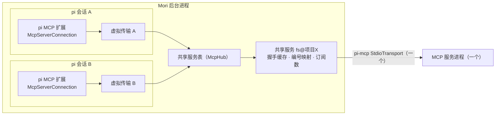
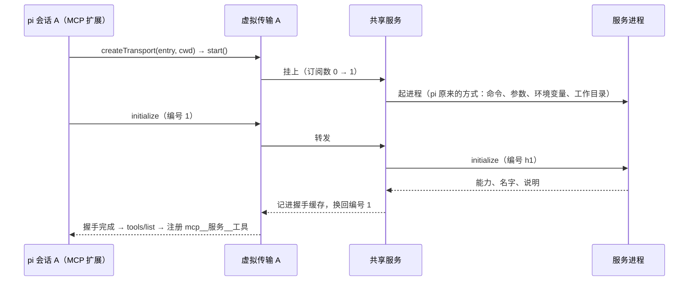
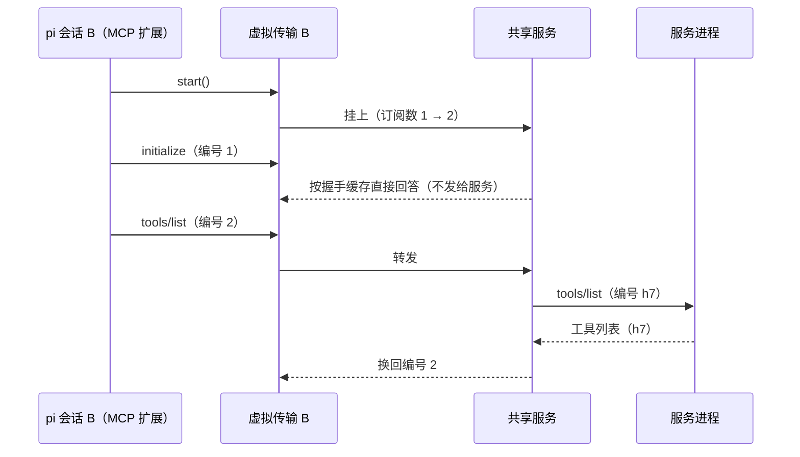

# MCP 共享连接方案（M6 追加，草案，等你确认后再动手）

## 问题

pi 的 MCP 扩展每个会话各连一次：每个启用的 stdio 服务，每个打开着的会话各起一个子进程。M3 起会话一直开着，所以进程和内存随会话数增长。
实测 1 个合成服务：1 个会话 2 个进程约 52 MB，10 个会话 20 个进程约 525 MB（[m6-checks.md](m6-checks.md)）。

你选的方向（2026-10-20）：照 Claude 桌面版，**每个服务一个进程，所有会话共用**；在 pi 下面加一层 Mori 的共享连接。

## 一句话

pi 给每个会话建 MCP 连接时会问"用什么传输"（`createMcpExtension({ createTransport })`）。Mori 在这里给它一个**虚拟传输**：
虚拟传输不起进程，而是挂到后台进程里的**共享服务**上；同一个服务只起一个真进程，多个会话的请求在共享服务里按编号分发。
pi 的 MCP 扩展本身一行不改：工具注册、调用方式、通知、批准、`/mcp` 都照旧。

## 架构

今天（没有共享）：会话 A、B 各自的 `McpServerConnection` → 各自的 `StdioTransport` → 各自的进程。

## 核心概念

| 概念 | 是什么 |
| --- | --- |
| 共享服务 | 后台进程里一个真连接：一个 `StdioTransport`、一个服务进程、一次 MCP 握手的结果 |
| 共享键 | 决定哪些会话能共用：同一份启动配置（命令、参数、环境变量、工作目录）**且**同一个项目文件夹（见"需要你决定"1） |
| 虚拟传输 | 交给 pi 的传输对象（实现 pi-mcp 的 `McpTransport` 接口：start / send / close / 监听）；每个会话每个服务一个，自己不起进程 |
| 订阅数 | 共享服务被几个虚拟传输挂着；第一个来时起进程，最后一个走时关进程 |
| 握手缓存 | 服务对 `initialize` 的回答（能力、名字、说明）；第一个会话握手时真的发给服务，之后的会话由共享服务直接按缓存回答 |
| 编号映射 | 各会话的请求编号会撞车：共享服务发给真服务前换成自己的编号，回复回来再换回去，交给发请求的那个会话 |
| 广播 / 定向 | 服务主动发的通知：工具列表变了、日志等广播给所有会话；进度通知、取消按编号只给相关的会话 |

## 主要流程

**第一个会话连上**

**第二个会话连上（不起新进程）**

**两个会话同时调用工具**：A 的 `tools/call`（编号 3）→ 共享服务换成 h8；B 的 `tools/call`（编号 3）→ h9；回复按 h8 / h9 各自送回。
批准仍在各自的会话里（pi 的工具管线没变）。

**服务进程退出或崩溃**：共享服务告诉所有挂着的虚拟传输"连接关了"→ pi 在每个会话里标成断开（今天就有的行为），下一次调用时 pi 自己重连
→ 再要一个虚拟传输 → 共享服务重新起进程、重新握手。

**最后一个会话关闭**（归档、删除、退出）：pi 在 `session_shutdown` 里关掉连接 → 虚拟传输关闭 → 订阅数归零 → 共享服务关进程
（照 pi 的做法结束整个进程树）。

## 接口

| 谁 | 接口 | 说明 |
| --- | --- | --- |
| Mori 交给 pi | `createMcpExtension({ createTransport: createSharedTransport })` | 注册 MCP 内置扩展时多传一个选项（方案第 6 节"MCP"一行） |
| 后台进程内部 | `createSharedTransport(entry, cwd, authProvider): McpTransport` | stdio 服务返回虚拟传输；HTTP 服务照 pi 原来的方式直连（见"需要你决定"2） |
| 后台进程内部 | 共享服务表：`acquire(键) / release(键)` | 按键找或建共享服务；订阅数归零时关掉 |
| 界面（可选） | 工具页 MCP 一行多一句"N 个会话共用这个服务进程" | 来源是共享服务表（真实数据）；不需要就不做 |

## 数据流

| 数据 | 谁写 | 存在哪 | 谁读、什么时候 |
| --- | --- | --- | --- |
| 服务配置 | 你（工具页 / 手改） | `mcp.json`（不变） | pi 在会话开始时读，决定连哪些服务（不变） |
| 共享服务表 | 后台进程 | 后台进程内存（不落盘） | 虚拟传输在 start 时查；工具页（可选）读订阅数 |
| 握手缓存 | 共享服务 | 内存，进程退出即清掉 | 之后挂上来的会话握手时 |
| 编号映射 | 共享服务 | 内存，请求结束即删 | 回复、进度、取消回来时 |
| 工具列表、错误、通知 | pi 的 MCP 扩展 | 各会话自己（不变） | 工具页、对话流（不变） |

## 几条关键规则

1. **只共享 stdio 服务**（有进程开销的那种）；HTTP 服务每个会话照旧直连，pi 的登录、凭据不受影响。
2. **共享的服务状态大家都看得到**：有状态的服务（例如开着一个浏览器、记着当前目录）被同一项目的几个会话共用，一个会话改了，另一个会话也看得到——
   Claude 桌面版的对话共用服务也是这样。
3. **pi 对每个会话说的"根目录"（roots）**：同一个共享键的会话都在同一个项目文件夹，共享服务直接用这个文件夹回答服务的 `roots/list`。
4. **错误原文不变**：起进程失败、握手失败，所有挂着的会话都收到同一个原文，pi 照旧发"MCP servers need attention"通知。
5. **不加新的界面状态**：没有"已连接"标记（pi 仍不提供），工具页照旧显示 pi 注册的工具名和错误原文。

## 需要你决定（括号里是推荐）

1. **共用的范围**：（推荐）**同一个项目文件夹里的会话共用**——pi 让 stdio 服务在会话的项目文件夹里运行（`mcp.json` 没写 `cwd` 时），
   共用范围不跨项目，服务看到的工作目录和根目录都和今天一样；10 个会话开在 2 个项目里就是 2 个进程。
   另一种：**全部会话共用一个进程**（最像 Claude 桌面版，它没有项目的概念）——服务改在一个固定目录（例如你的用户目录）运行，
   依赖相对路径的服务（例如参数写 `.` 的文件服务）会看到不同的目录，根目录也只能报一个。
2. **HTTP 服务**：（推荐）不共享，照旧每个会话直连（没有进程开销）。
3. **进程什么时候关**：（推荐）这个项目里最后一个用它的会话关闭时就关（不白占内存）；另一种照 Claude 桌面版开着直到退出 Mori。
4. **怎样起真进程**：pi 起 stdio 服务的那段代码（命令、`${变量}` 和 `!命令` 写法的环境变量、工作目录）没有导出。
   （推荐）**按文件路径载入 pi 1.3.0 自己的那一段**（版本锁定，启动时检查文件在不在，测试覆盖），行为与 pi 完全一致；
   另一种是照搬那几十行（又多一段要在 pi 升级时对照的代码）。

## 对方案的影响

- 这是方案第 8 节第 4 条说的"新后端"，你已经同意做（2026-10-20）。做完后改方案第 4 节 MCP 一行（"pi 的 MCP 扩展，stdio 服务由 Mori 按项目共用进程"）
  和第 6 节"后台进程只做四件事"（加第五件：MCP 共享连接），并在 `docs/v0/screens/tools.md` 记上共享的说明。
- 新代码只在后台进程：一个模块（共享服务表 + 虚拟传输，预计 300 行以内），`sessions.ts` 注册 MCP 时多传一个选项。主进程、界面不动（可选的"N 个会话共用"除外）。

## 怎样验收

| 检查 | 期望 |
| --- | --- |
| `m6-mcp-cost`：同一个项目开 1、5、10 个会话 | 每个服务始终 1 个进程（今天是 1、5、10 个） |
| 两个项目各开几个会话 | 每个项目 1 个进程，两个项目的服务各在自己的文件夹里运行 |
| 两个会话同时调用同一个服务的工具 | 各自拿到自己的结果，各自出批准卡 |
| 进度、取消 | 合成服务加一个慢工具：进度只到发起的会话；停止一个会话只取消它自己的调用 |
| 杀掉服务进程 | 所有会话标成断开；下一次调用时重新起一个进程，工具照常 |
| 归档、删除、退出 | 最后一个会话关闭后进程不在了；退出 Mori 不留下进程 |
| 工具页、通知、批准 | M6 的全部测试和 DeepSeek 走查照旧通过 |

## 步骤（你确认后）

1. 先做一个小验证：pi 的 MCP 扩展用 Mori 给的传输、两个会话共用一个合成服务进程（打包程序里也要能按文件路径载入 pi 那一段）。
2. 写共享服务表和虚拟传输，`sessions.ts` 接上；状态表（tools.md 增补）先写好。
3. 合成 MCP 服务加慢工具和进度通知，写 `m6-app-mcp-shared` 测试，改 `m6-mcp-cost` 的期望。
4. 开发构建和打包程序各跑一遍 M6 的测试、DeepSeek 走查 4、5 和 M0–M5 回归；更新方案第 4、6 节和 m6-checks.md。
