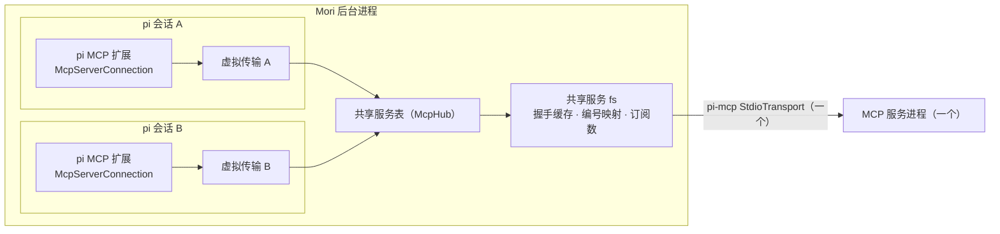
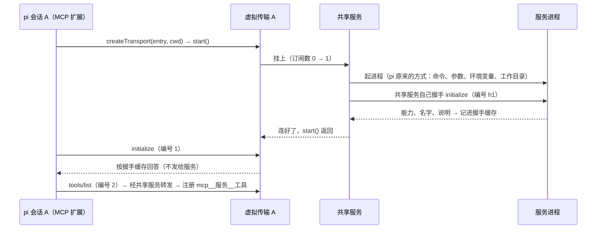
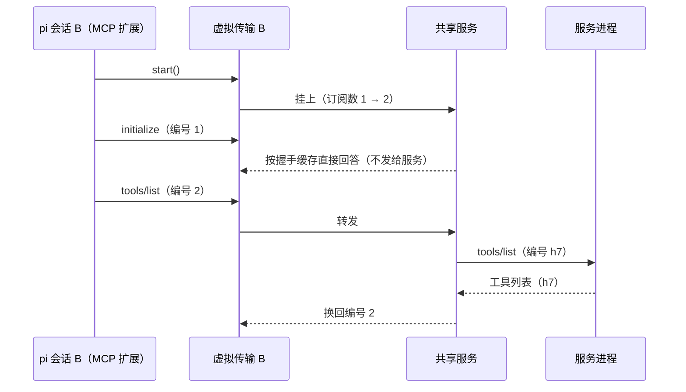

# MCP 共享连接方案（M6 追加）

状态：已按下面"你的决定"实现（2026-10-21），代码在 `app/src/kernel/mcpShare.ts`，实现时补定的做法登记在 [defaults.md](defaults.md) 的 MCP 几行，
测试结果和审查中发现的问题见 [m6-checks.md](m6-checks.md)。

## 问题

pi 的 MCP 扩展每个会话各连一次：每个启用的 stdio 服务，每个打开着的会话各起一个子进程。M3 起会话一直开着，所以进程和内存随会话数增长。
实测 1 个合成服务：1 个会话 2 个进程约 52 MB，10 个会话 20 个进程约 525 MB（[m6-checks.md](m6-checks.md)）。

你选的方向（2026-10-20）：照 Claude 桌面版，**每个服务一个进程，所有会话共用**；在 pi 下面加一层 Mori 的共享连接。

## 一句话

pi 给每个会话建 MCP 连接时会问"用什么传输"（`createMcpExtension({ createTransport })`）。Mori 在这里给它一个**虚拟传输**：
虚拟传输不起进程，而是挂到后台进程里的**共享服务**上；同一个服务只起一个真进程，多个会话的请求在共享服务里按编号分发。
pi 的 MCP 扩展本身一行不改：工具注册、调用方式、通知、批准、`/mcp` 都照旧。

## 架构

今天（没有共享）：会话 A、B 各自的 `McpServerConnection` → 各自的 `StdioTransport` → 各自的进程。

## 核心概念

| 概念 | 是什么 |
| --- | --- |
| 共享服务 | 后台进程里一个真连接：一个 `StdioTransport`、一个服务进程、一次 MCP 握手的结果 |
| 共享键 | 决定哪些会话能共用：同一个名字、同一份配置、同一个运行目录（用户级服务是你的用户目录，所以所有会话共用；项目级服务是那个项目文件夹） |
| 虚拟传输 | 交给 pi 的传输对象（实现 pi-mcp 的 `McpTransport` 接口：start / send / close / 监听）；每个会话每个服务一个，自己不起进程 |
| 订阅数 | 共享服务被几个虚拟传输挂着；用户级 stdio 服务在 Mori 启动时就起，订阅数归零也不关（照 Claude 桌面版，开到退出） |
| 握手缓存 | 服务对 `initialize` 的回答（能力、名字、说明）；共享服务自己和服务握手一次，之后每个会话的握手都按缓存回答 |
| 编号映射 | 各会话的请求编号会撞车：共享服务发给真服务前换成自己的编号，回复回来再换回去，交给发请求的那个会话 |
| 广播 / 定向 | 服务主动发的通知：工具 / 资源 / 提示词列表变了广播给所有会话，日志只给最早挂上的会话（pi 写进 `mcp.log`，不重复写）；进度通知、取消按编号只给相关的会话 |

## 主要流程

**Mori 启动、第一个会话连上**（用户级 stdio 服务在 Mori 启动时就由共享服务自己起好、握好手；下图是还没起时第一个会话来的情况，HTTP 服务和项目级服务就是这样）

**第二个会话连上（不起新进程）**

**两个会话同时调用工具**：A 的 `tools/call`（编号 3）→ 共享服务换成 h8；B 的 `tools/call`（编号 3）→ h9；回复按 h8 / h9 各自送回。
批准仍在各自的会话里（pi 的工具管线没变）。

**服务进程退出或崩溃**：共享服务告诉所有挂着的虚拟传输"连接关了"→ pi 在每个会话里标成断开（今天就有的行为），下一次调用时 pi 自己重连
→ 再要一个虚拟传输 → 共享服务重新起进程、重新握手。

**会话关闭**（归档、删除）：pi 在 `session_shutdown` 里关掉连接 → 虚拟传输关闭 → 订阅数减一；用户级服务的进程照旧开着，直到退出 Mori
（照 Claude 桌面版）。配置改了、删了或停用了的服务，没有会话用它之后才关。项目的服务在这个项目最后一个用它的会话关闭后关掉。**退出 Mori**：关掉全部共享服务（照 pi 的做法结束整个进程树）。

## 接口

| 谁 | 接口 | 说明 |
| --- | --- | --- |
| Mori 交给 pi | `createMcpExtension({ createTransport: createSharedTransport })` | 注册 MCP 内置扩展时多传一个选项（方案第 6 节"MCP"一行） |
| 后台进程内部 | `createSharedTransport(entry, cwd, authProvider): McpTransport` | 用户级、项目级的服务都返回虚拟传输（stdio 和 HTTP）；扩展注册的服务照 pi 原来的方式直连 |
| 后台进程内部 | 共享服务表：`acquire(键) / release(键)` | 按键找或建共享服务；订阅数归零时：用户级的照旧开着（配置已经不在的才关），项目的关掉 |
| 界面 | 工具页 MCP 每一行显示进程状态和在用的会话数 | 来源是共享服务表（真实数据），照 Claude 桌面版 |

## 数据流

| 数据 | 谁写 | 存在哪 | 谁读、什么时候 |
| --- | --- | --- | --- |
| 服务配置 | 你（工具页 / 手改） | `mcp.json`（不变） | pi 在会话开始时读，决定连哪些服务（不变） |
| 共享服务表 | 后台进程 | 后台进程内存（不落盘） | 虚拟传输在 start 时查；工具页（可选）读订阅数 |
| 握手缓存 | 共享服务 | 内存，进程退出即清掉 | 之后挂上来的会话握手时 |
| 编号映射 | 共享服务 | 内存，请求结束即删 | 回复、进度、取消回来时 |
| 工具列表、错误、通知 | pi 的 MCP 扩展 | 各会话自己（不变） | 工具页、对话流（不变） |

## 几条关键规则

1. **共用的范围和运行目录照 Claude 桌面版**：用户级服务整个 Mori 一份、在你的用户目录里运行；项目级服务按项目共用、在项目文件夹里运行。
2. **共享的服务状态大家都看得到**：有状态的服务被几个会话共用，一个会话改了，另一个会话也看得到（Claude 桌面版的对话共用服务也是这样）。
3. **根目录（roots）**：服务问的时候，共享服务回答所有挂着的会话的项目文件夹（去重）。
4. **错误原文不变**：起进程失败、握手失败，所有挂着的会话都收到同一个原文，pi 照旧发"MCP servers need attention"通知。
5. **pi 的 MCP 扩展不改**：工具注册、调用方式、通知、批准、`/mcp` 都照旧；工具页另外显示共享服务表里的进程状态。

## 你的决定（2026-10-20）

你说"claude 有 counterpart 的先完全按照 claude 的设计来，后续如果真的遇到体验问题再调整"。于是：

| 问题 | 定下的做法 | 依据 |
| --- | --- | --- |
| 共用的范围 | **所有会话共用**：用户级 `mcp.json` 里的每个服务整个 Mori 只起一份，跨项目共用 | 照 Claude 桌面版（它的本地服务是整个 App 一份） |
| 用户级服务在哪个目录运行 | **你的用户目录**（`mcp.json` 写了 `cwd` 时照写的，相对路径按用户目录算）；`roots` 报所有挂着的会话的项目文件夹 | 照 Claude 桌面版（它的服务不在任何项目里运行，官方说明要求配置里用绝对路径） |
| 项目的 `.pi/mcp.json` 里的服务 | 仍在那个项目文件夹里运行；同一个项目、同一份配置的会话共用；这个项目最后一个用它的会话关闭（归档、删除）后关掉（实现时定的推荐做法，见 [defaults.md](defaults.md)） | Claude 桌面版没有项目级服务（没有对应的做法），保持 pi 的语义：进程跟着这个项目的会话 |
| HTTP 服务 | **也共用**，整个 Mori 一个连接；第一次有会话要用时才连（登录凭据本来就是共用的 `mcp-auth.json`）；最后一个用它的会话关闭后关掉（实现时定的，见 [defaults.md](defaults.md)） | 照 Claude 桌面版（远程连接器也是整个 App 一份） |
| 进程什么时候起、什么时候关 | **Mori 启动时**就起用户级启用的 stdio 服务，**一直开到退出 Mori**；只有配置改了、删了或停用了的服务，在没有会话用它之后关掉 | 照 Claude 桌面版（启动 App 时连上、退出时关；它改配置要重启，Mori 改为新会话用新配置、旧进程没人用了就关） |
| 工具页显示进程状态 | 每个服务显示"运行中 · N 个会话在用"、"启动中…"、"失败：<原文第一行>"（完整原文可以展开；来源是共享服务表，真实状态） | 照 Claude 桌面版（设置 → 开发者里每个本地服务显示 running / failed） |
| 怎样起真进程 | 按文件路径载入 pi 1.3.0 自己的 `createDefaultTransport` 和 `loadMcpConfig`（版本锁定；启动时找不到就报错，不退回别的做法） | 没有对应的 Claude 做法，用推荐的做法 |
| 扩展用 `pi.registerMcpServer()` 注册的服务 | 不共用，照旧每个会话自己连 | 没有对应的 Claude 做法；它们跟着扩展、扩展跟着会话 |

几处随之而来的变化（都照 Claude 桌面版）：

- 同一个服务被所有会话共用，服务里的状态（例如开着的浏览器、记着的当前目录）跨会话、跨项目都看得到。
- pi 的 `/mcp reconnect` 只重连这个会话，不重启用户级服务的共享进程（Claude 桌面版要重启 App）；项目的服务、配置已经不在的服务
  只有这一个会话在用时，重连会等旧进程退出、再起新进程（同 pi 原来的做法）。
- M6 的反例"没有注册任何工具的 MCP 服务不显示'已连接'"：工具页仍不凭工具列表猜连接状态；现在有了共享服务表这个真实来源，
  显示的是进程状态"运行中"，不是"已连接"。

## 实现约定（给实现和测试）

- 新模块 `app/src/kernel/mcpShare.ts`，导出：
  - `createSharedTransport(entry, cwd, authProvider): McpTransport`：交给 `createMcpExtension({ createTransport })`；`entry.scope` 为 `extension` 时直接用 pi 的
    `createDefaultTransport`（不共用）。
  - `startSharedServers()`：后台进程启动时用 pi 的 `loadMcpConfig`（用户级，不读项目）起启用的 stdio 服务。
  - `closeSharedServers()`：退出前关掉全部（McpClient.close → 传输关闭 → pi 结束进程树）。
  - `sharedServerStates()`：给工具页；`forgetStaleServers()`：`mcp.json` 写入之后关掉没人用、配置已经不在（或停用）的共享服务。
- 共享键：`[entry.name, entry.config, 运行目录]` 的规范 JSON；运行目录 = 项目级为会话的项目文件夹，否则为用户目录。
  `entry.config` 里不算 `enabled`、`exposure`、`toolExposure`（pi 的 OVERRIDE_KEYS）：它们只决定 pi 在会话里怎样给出工具，
  不影响起进程；否则项目的覆盖、工具页的启停和"改为直接调用"会让同一个用户级服务多起一个进程（审查时发现，已改）。
- 每个共享服务一个 pi-mcp `McpClient`（`name: "pi"`、pi 的版本、超时同 pi：`timeout` 秒或 60 秒，`roots` 是挂着的会话的项目文件夹去重）和一个
  pi 的 `createDefaultTransport(entry, 运行目录, authProvider)`。连不上时原文照 pi 的写法：错误第一行，stdio 时接上 stderr 末尾。
- 虚拟传输：`start()` 挂上并等共享服务连好（失败时以原文抛错）；`initialize` 按握手缓存回答；`notifications/initialized` 不转发；`ping` 自己回答；
  其他请求用 `client.request(method, params, { signal, onProgress })` 转发（去掉 pi 的 `_meta.progressToken`，进度按原来的 token 送回这个会话）；
  `notifications/cancelled` 中止对应的请求；`close()` 中止这个会话挂着的请求、取消挂上。服务主动发的工具 / 资源 / 提示词列表变化通知广播给所有会话，
  `notifications/message`（日志）只给一个会话（不在 `mcp.log` 里重复写）。共享服务的连接断了：告诉所有虚拟传输"关了"，pi 下一次调用时重连。
- 协议：`McpServerEntry` 加 `shared`（进程状态、在用的会话数、错误原文；不共用或还没有共享服务时为 null）。

## 对方案的影响

- 这是方案第 8 节第 4 条说的"新后端"，你已经同意做（2026-10-20）。已改方案第 4 节 MCP 一行（Mori 共享连接：每个服务一个进程，所有会话共用）
  和第 6 节"后台进程只做五件事"（加第五件：MCP 共享连接），`docs/v0/screens/tools.md` 记了共享的说明和进程状态一行。
- 新代码只在后台进程：一个模块 `app/src/kernel/mcpShare.ts`（共享服务表 + 虚拟传输，约 700 行，比预计的 300 行多：注释、
  HTTP 会话过期、启动和退出的竞争、配置变了之后旧进程的去留都要处理），`sessions.ts` 注册 MCP 时多传一个选项，
  `index.ts` 启动时起服务、退出时关掉，`mcpConfig.ts` 带上进程状态、写入后关掉过时的服务。主进程不动；界面加了进程状态一行。

## 怎样验收

| 检查 | 期望 |
| --- | --- |
| `m6-mcp-cost`：开 1、5、10 个会话 | 每个用户级服务始终 1 个进程（今天是 1、5、10 个）；Mori 启动后、还没有会话时就有这 1 个 |
| 两个项目各开几个会话 | 用户级服务仍只有 1 个进程（在用户目录里运行，roots 报两个项目文件夹）；项目级服务每个项目 1 个、在项目文件夹里运行 |
| 两个会话同时调用同一个服务的工具 | 各自拿到自己的结果，各自出批准卡 |
| 进度、取消 | 合成服务加一个慢工具：进度只到发起的会话；停止一个会话只取消它自己的调用 |
| 杀掉服务进程 | 所有会话标成断开；下一次调用时重新起一个进程，工具照常 |
| 归档、删除、退出 | 会话都关了用户级服务的进程照旧开着；项目的服务在这个项目最后一个会话关闭后关掉；改了配置的服务没人用后关掉；退出 Mori 不留下进程 |
| 工具页、通知、批准 | M6 的全部测试和 DeepSeek 走查照旧通过 |

## 步骤

1. 小验证（已做，2026-10-20）：两个 pi 会话经 Mori 给的传输共用一个合成服务进程，服务只收到一次 `initialize`，两边各自拿到自己的调用结果。打包程序里按文件路径载入 pi 那一段在实现后由测试确认。
2. 写共享服务表和虚拟传输，`sessions.ts` 接上；状态表（tools.md 增补）先写好。
3. 合成 MCP 服务加慢工具和进度通知，写 `m6-app-mcp-shared` 测试，改 `m6-mcp-cost` 的期望。
4. 开发构建和打包程序各跑一遍 M6 的测试、DeepSeek 走查 4、5 和 M0–M5 回归；更新方案第 4、6 节和 m6-checks.md。
